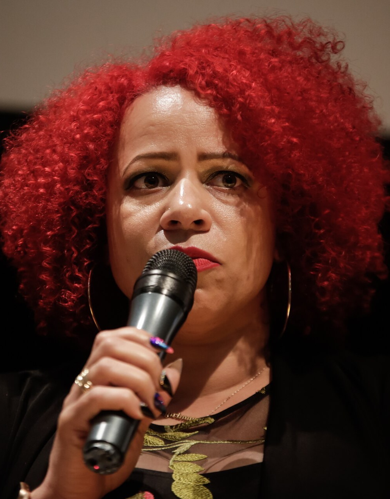
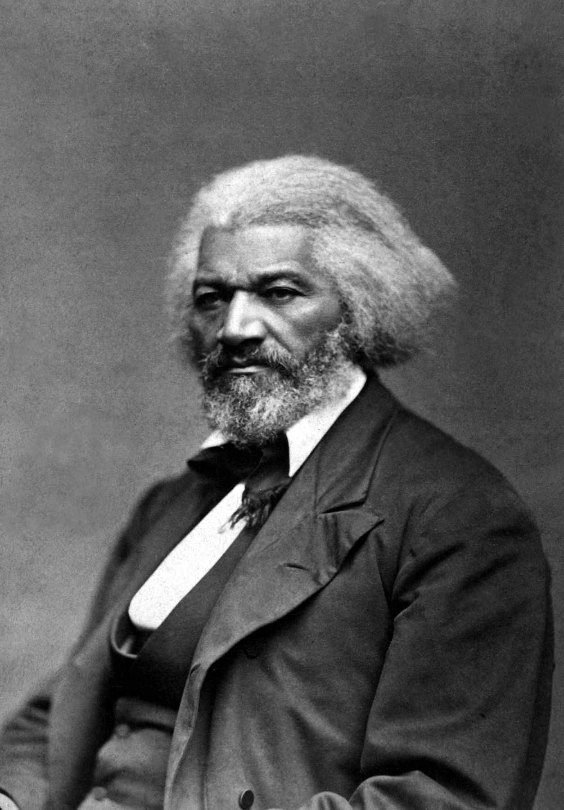
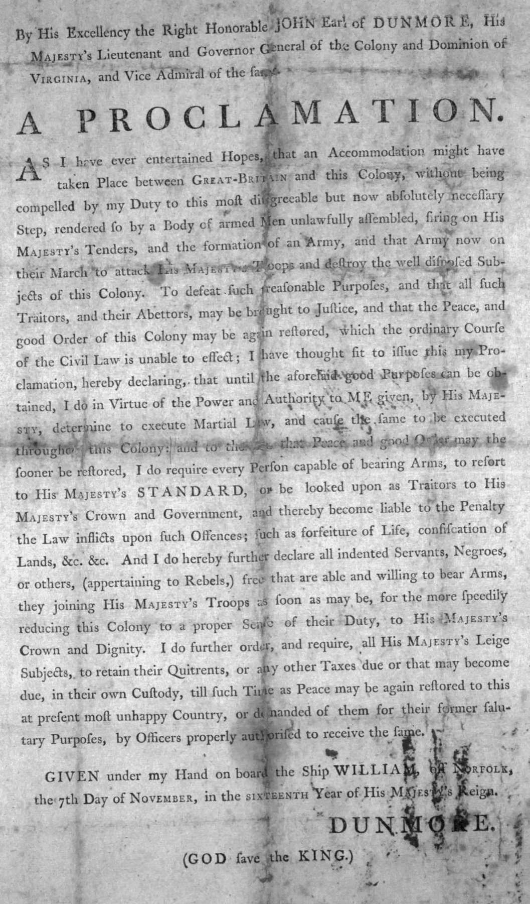
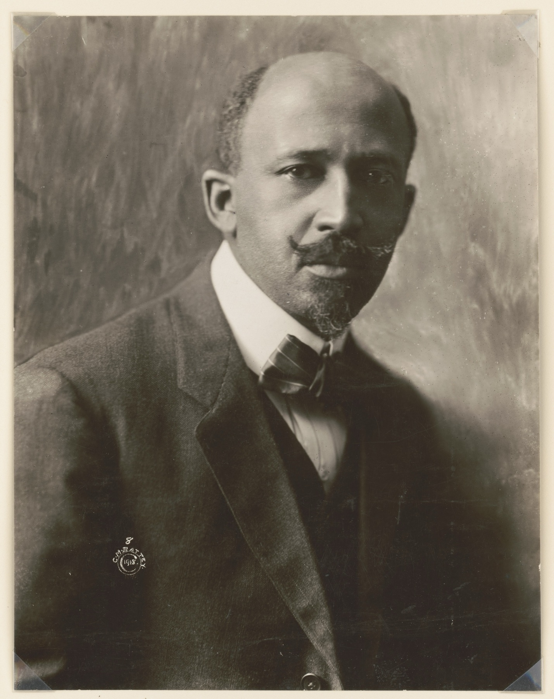

<!-- ========== TITLE ========== -->
<section data-transition="fade" markdown="1">
Making History • HIST 1105 • Week 12.2
{: .eyebrow}

# The fight over the 1619 Project
{: .main-point}

---

- Background: Adam Serwer, "The Fight Over the 1619 Project Is Not About the Facts," *The Atlantic* (December 23, 2019)
- Conor Friedersdorf, "1776 Honors America's Diversity in a Way 1619 Does Not," *The Atlantic* (January 6, 2020)
- Victoria Bynum, James M. McPherson, James Oakes, Sean Wilentz and Gordon S. Wood, letter to the editor, with Jake Silverstein's reply, "We Respond to the Historians Who Critiqued The 1619 Project," *The New York Times Magazine* (December 20, 2019)
{: .source-list}

None of the three has page numbers, so each is cited by article; Hannah-Jones's essay is cited by Magazine page. The letter is quoted as the Times published it, which differs in places from the version Serwer quotes.
{: .citation-note}
</section>

<!-- ========== THROUGHLINE ========== -->
<section markdown="1">
Today in context
{: .eyebrow}

## What makes history happen?
{: .main-point}

---

###### Week 11.1 · Loewen and Hayden
{: .num}

Commemoration and space. What gets put up, by whom, and who a place lets in.

###### Week 12.1 · Hannah-Jones
{: .num}

A founding retold from 1619: ideals false when written, made true by Black Americans' struggle.

###### Week 12.2 · The fight over it
{: .num}

Five historians call parts of it errors of fact; the Times calls them interpretation.

###### Week 13 · Science and nature
{: .num}

Who gets to say what counts as knowledge, and what follows from that authority.

</section>

<!-- ========== IMAGE: HANNAH-JONES ========== -->
<section class="image-slide" data-background="#0d1412" markdown="1">
<figure class="portrait">

<figcaption markdown="span">
Nikole Hannah-Jones · b. 1976
<em>A reporter at <i>The New York Times Magazine</i>. She conceived the 1619 Project and wrote its opening essay, "The Idea of America," published in August 2019.<strong>Why she matters:</strong> most of what the five historians call errors comes from her essay.(Alice Vergueiro/Abraji, 2018. Wikimedia Commons, CC BY 2.0; cropped.)</em>
</figcaption>
</figure>
</section>

<!-- ========== THE CLAIMS IN DISPUTE ========== -->
<section markdown="1">
The essay · the claims in dispute
{: .eyebrow}

## Four claims are at the center of the fight
{: .main-point}

---

#### The Revolution
"one of the primary reasons the colonists decided to declare their independence from Britain was because they wanted to protect the institution of slavery" (p. 18)

#### Lincoln
"he opposed slavery as a cruel system at odds with American ideals, but he also opposed black equality" (p. 20)

#### The struggle
"For the most part, black Americans fought back alone." (p. 24)

#### The founding
"the year 1619 is as important to the American story as 1776" (pp. 16–17). The project itself spoke of "understanding 1619 as our true founding."

Hannah-Jones, "The Idea of America," as printed in August 2019; the project's framing as quoted in Friedersdorf.
{: .cite}
</section>

<!-- ================================================================ -->
<!-- ====== PART ONE: THE LETTER AND THE REPLY, DECEMBER 2019 ======== -->
<!-- ================================================================ -->

<!-- ========== THE LETTER ========== -->
<section markdown="1">
Part one · the historians' letter · December 2019
{: .eyebrow}

## Five senior historians asked the Times to correct the project
{: .main-point}

---

"Raising profound, unsettling questions about slavery and the nation's past and present, as The 1619 Project does, is a praiseworthy and urgent public service. Nevertheless, we are dismayed at some of the factual errors in the project and the closed process behind it."

The historians' letter, <i>The New York Times Magazine</i>, December 20, 2019

###### The letter
{: .label}

Sean Wilentz, a Princeton historian, circulated it, and four other leading historians signed. They sent it on December 4. The Times published a version on December 20, beside the editor's reply, which declined to make the corrections.

</section>

<!-- ========== FACT, NOT FRAMING ========== -->
<section markdown="1">
Part one · the historians' letter · the charge
{: .eyebrow}

## The letter says the errors are matters of fact, not interpretation
{: .main-point}

---

"These errors, which concern major events, cannot be described as interpretation or 'framing.' They are matters of verifiable fact, which are the foundation of both honest scholarship and honest journalism. They suggest a displacement of historical understanding by ideology."

The historians' letter, December 20, 2019

###### What turns on it
{: .label}

A difference of interpretation is an argument historians have. An error of fact is something a newspaper corrects. Calling them errors of fact is what lets the letter ask for corrections.

</section>

<!-- ========== IMAGE: DOUGLASS ========== -->
<section class="image-slide" data-background="#0d1412" markdown="1">
<figure class="portrait">

<figcaption markdown="span">
Frederick Douglass · about 1879
<em>Born enslaved in Maryland, he became the country's best-known Black abolitionist. The letter sets his reading of the Constitution against the project's. (George K. Warren. U.S. National Archives, via Wikimedia Commons. Public domain.)</em>
</figcaption>
</figure>
</section>

<!-- ========== THE OBJECTIONS ========== -->
<section markdown="1">
Part one · the historians' letter · the objections
{: .eyebrow}

## It ranks the essay's claims: not true, distorted, misleading
{: .main-point}

---

#### Not true: the Revolution
The essay says the founders thought independence "required in order to ensure that slavery would continue" (p. 18). The letter: "This is not true," and "every statement offered by the project to validate it is false."

#### Distorted: "alone"
The letter calls "distorted" the claim that "for the most part," Black Americans fought their freedom struggles "alone."

#### Misleading: Lincoln
The project "ignores" Lincoln's agreement with Frederick Douglass that the Constitution was, in Douglass's words, "a GLORIOUS LIBERTY DOCUMENT."

The historians' letter, December 20, 2019; Hannah-Jones, "The Idea of America," p. 18.
{: .cite}
</section>

<!-- ========== AUTHORITY AND PROCESS ========== -->
<section markdown="1">
Part one · the historians' letter · the request
{: .eyebrow}

## It also objects to the Times's authority and its closed process
{: .main-point}

---

"The 1619 Project has not been presented as the views of individual writers … Instead, the project is offered as an authoritative account that bears the imprimatur and credibility of The New York Times."

The historians' letter, December 20, 2019

###### What it asked
{: .label}

The process, it says, "remains opaque." It asks for:

- "prominent corrections of all the errors and distortions"
- their removal "from any materials destined for use in schools"
- a full account of how the materials were "assembled, checked and authenticated"

</section>

<!-- ========== THE REPLY ========== -->
<section markdown="1">
Part one · the editor's reply · December 2019
{: .eyebrow}

## The editor replied that historians often dispute interpretation
{: .main-point}

---

"Within the world of academic history, differing views exist, if not over what precisely happened, then about why it happened, who made it happen, how to interpret the motivations of historical actors and what it all means."

Jake Silverstein, editor in chief, reply to the letter, December 20, 2019

###### No corrections
{: .label}

He rejected the claim "that our project contains significant factual errors and is driven by ideology." There was no formal panel; every article was checked "with subject-area experts," as for "any article." He granted: "We are not ourselves historians, it is true."

</section>

<!-- ========== DISCUSSION: PART ONE ========== -->
<section markdown="1">
Part one · discussion
{: .eyebrow}

## Fact or interpretation
{: .main-point}

---

Take the Revolution claim. Which part of it could a historian check in the documents, and which part is a judgment about why people acted?
{: .question .fragment data-fragment-index="1"}

What colonists wrote, and what Britain did about slavery, can be checked. How much slavery weighed among their reasons is a judgment about motive, where historians usually disagree.

</section>

<!-- ================================================================ -->
<!-- ====== PART TWO: THE DISPUTES =================================== -->
<!-- ================================================================ -->

<!-- ========== THE REVOLUTION ========== -->
<section markdown="1">
Part two · the disputes · the Revolution
{: .eyebrow}

## On the Revolution, critics find no evidence of motive; the reply cites British threats
{: .main-point}

---

##### Gordon Wood, a signer, quoted in Friedersdorf

"I don't know of any colonist who said that they wanted independence in order to preserve their slaves." And: "No colonist expressed alarm that the mother country was out to abolish slavery in 1776."

##### The Times's reply

Slaveholders' "uneasiness" about "growing antislavery sentiment in Britain and increasing imperial regulation helped motivate the Revolution." A 1772 English ruling against slavery "caused a sensation" in colonial papers; Dunmore's 1775 offer of freedom followed.

###### Serwer's verdict
{: .label}

Serwer finds the critics "on firm ground," though "some southern slave owners likely were fighting the British to preserve slavery." Historians in neither camp, he adds, "say both have a point."

</section>

<!-- ========== IMAGE: DUNMORE'S PROCLAMATION ========== -->
<section class="image-slide" data-background="#0d1412" markdown="1">
<figure class="portrait">

<figcaption markdown="span">
Lord Dunmore's proclamation · November 7, 1775
<em>Virginia's royal governor declared free the enslaved men of rebels "that are able and willing to bear Arms" for the King. The reply calls it the culmination of the slavery dispute. (Library of Congress, via Wikimedia Commons. Public domain.)</em>
</figcaption>
</figure>
</section>

<!-- ========== ALONE ========== -->
<section markdown="1">
Part two · the disputes · "alone"
{: .eyebrow}

## On "alone," Wilentz calls the fight universal; Hannah-Jones says allies were few
{: .main-point}

---

##### Sean Wilentz, to Serwer

"The fight for black freedom is a universal fight; it's a fight for everyone." To minimize that, he says, "is, I think, bad for understanding the radical tradition in America."

##### Nikole Hannah-Jones, to Serwer

"It is not saying that black people only fought alone. It is saying that most of the time we did." Most of the time, she says, "black people did not have a lot of allies in that movement."

###### Serwer's verdict
{: .label}

Serwer leans her way. The struggle "has been an interracial struggle," he grants, but across "the centuries of slavery and the century of Jim Crow that followed," "largely alone" "seems more than defensible."

</section>

<!-- ========== WHO WON FREEDOM ========== -->
<section markdown="1">
Part two · the disputes · who won freedom
{: .eyebrow}

## The letter defends Lincoln and the founding; the reply credits Black struggle
{: .main-point}

---

##### The historians' letter

Lincoln held "that the Declaration of Independence proclaimed universal equality, for blacks as well as whites." To call the country "founded on racial slavery" is "an argument rejected by a majority of abolitionists and proclaimed by champions of slavery like John C. Calhoun."

##### The Times's reply

Advances "have almost always come as a result of political and social struggles in which African-Americans have generally taken the lead, not as a working-out of the immanent logic of the Constitution." And Lincoln, "for much of his career," favored a plan to encourage freed people "to leave the country."

</section>

<!-- ========== CHANGE OVER TIME ========== -->
<section markdown="1">
Part two · the disputes · change over time
{: .eyebrow}

## Over the "DNA" line, they dispute how much racism has changed
{: .main-point}

---

##### James Oakes, a signer, to the World Socialist Web Site, in Serwer

Of her line that racism "runs in the very DNA of this country" (p. 21): "The function of those tropes is to deny change over time … If it's the DNA, there's nothing you can do." It "leads to political paralysis."

##### Adam Serwer, The Atlantic

"These are objections not to misstatements of historical fact, but to the argument that anti-black racism is a more intractable problem than most Americans are willing to admit." The project's theme, he writes, is that progress "has been fragile and reversible."

</section>

<!-- ========== IMAGE: DU BOIS ========== -->
<section class="image-slide" data-background="#0d1412" markdown="1">
<figure class="portrait">

<figcaption markdown="span">
W. E. B. Du Bois · about 1919
<em>His <i>Black Reconstruction</i> (1935) challenged the consensus, shaped by the Dunning School, that blamed Reconstruction's failures on "Negro ignorance and corruption." Both sides of the 1619 fight cite that episode. (C. M. Battey. Library of Congress. Public domain.)</em>
</figcaption>
</figure>
</section>

<!-- ========== "WHITE HISTORIANS" ========== -->
<section markdown="1">
Part two · the disputes · "white historians"
{: .eyebrow}

## The letter charges dismissal by race; the reply says it misreads a tweet
{: .main-point}

---

##### The historians' letter

"Dismissal of objections on racial grounds — that they are the objections of only 'white historians' — has affirmed that displacement," meaning the "displacement of historical understanding by ideology."

##### The Times's reply

The charge refers "not to anything published in The 1619 Project itself, but rather to a November Twitter post," where "context is important." Her point: "for the most part, the history of this country has been told by white historians."

</section>

<!-- ========== OBJECTIVITY ========== -->
<section markdown="1">
Part two · the disputes · objectivity
{: .eyebrow}

## The two sides disagree about whether history can be objective
{: .main-point}

---

##### Sean Wilentz, to Serwer

"Fact and objectivity are the foundation of both honest journalism and honest history." The Dunning School, he says, was "not a white point of view; it's a southern, racist point of view."

##### Nikole Hannah-Jones, to Serwer

"I would never discount the work of any historian because that person is white or any other race." Her point "was that history is not objective. And that people who write history are not simply objective arbiters of facts."

###### The Dunning School
{: .label}

Both sides use it. Wilentz credits Du Bois's "very, very courageous fight" against the "southern racists"; the Times's reply says it shows why "we need a greater variety of voices doing the telling."

</section>

<!-- ========== THE FOUNDING DATE ========== -->
<section markdown="1">
Part two · a third position · the founding date
{: .eyebrow}

## Friedersdorf, an Atlantic writer, makes an inclusive case for 1776
{: .main-point}

---

"Placing America's founding moment in 1776 honors the diversity of its people in a way that 1619 does not."

Friedersdorf, “1776 Honors America’s Diversity in a Way 1619 Does Not”

###### His reasons
{: .label}

No group, he argues, belongs at the center "more or less than any other," and 1619 overlooks Native Americans, Hispanics, Asian Americans, "and almost everyone whose ancestors got here after the Civil War."

###### Where he agrees with her
{: .label}

He concurs "that black abolitionists warrant status as Founding Fathers" and that "no people has a greater claim" to the flag, then adds that none has more claim than "the most recently naturalized American."

</section>

<!-- ========== DISCUSSION: PART TWO ========== -->
<section markdown="1">
Part two · discussion
{: .eyebrow}

## Where evidence stops
{: .main-point}

---

Serwer asks whether America was "founded as a slavocracy" or "conceived in liberty, a nation haltingly redeeming itself." What evidence could settle that?
{: .question .fragment data-fragment-index="1"}

Probably none on its own. The nation's pro-slavery and anti-slavery strands are, as Serwer puts it, "so closely intertwined" that each side can cite true facts.

</section>

<!-- ========== THE CASE FOR ========== -->
<section markdown="1">
Summing up · the case for the project
{: .eyebrow}

## Defenders say the disputes are interpretation, and the story needed widening
{: .main-point}

---

#### Interpretation, not error
Historians differ "about why it happened" (the reply). The objections are "not to misstatements of historical fact" (Serwer).

#### Slavery helped spur 1776
"The black-British alliance decisively pushed planters in these [Southern] states toward independence" (Waldstreicher, quoted in the reply).

#### Black Americans led
Advances "almost always" came from struggles they "generally" led (the reply). "Largely alone" is "more than defensible" (Serwer).

#### Schools need it
Few high-school students know slavery caused the Civil War (Southern Poverty Law Center). The materials are "supplementary," Silverstein says.

Silverstein's reply, December 20, 2019; Serwer, quoting the SPLC and Silverstein.
{: .cite}
</section>

<!-- ========== THE CASE AGAINST ========== -->
<section markdown="1">
Summing up · the case against the project
{: .eyebrow}

## Critics say it gets key facts wrong and narrows the story
{: .main-point}

---

#### Errors, not interpretation
"Matters of verifiable fact" (the letter). Wood knows of no colonist "who said that they wanted independence in order to preserve their slaves."

#### It discounts the ideals
It ignores Lincoln's "universal equality" and distorts "alone" (the letter). The "DNA" line denies "change over time" (Oakes).

#### Errors headed for schools
Children would get "a fundamental misunderstanding" of the Revolution (Wilentz), from a process that "remains opaque" (the letter).

#### 1776 includes more Americans
No group belongs at the center "more or less than any other" (Friedersdorf, who agrees with much of the essay).

The historians' letter; Friedersdorf, quoting Wood; Serwer, quoting Wilentz and Oakes.
{: .cite}
</section>

<!-- ========== TAKE HOME ========== -->
<section markdown="1">
Take home
{: .eyebrow}

## Checking the facts narrowed the fight without ending it
{: .main-point}

---

###### What moved
{: .label}

Hannah-Jones accepted that she put the Revolution claim too strongly, but said, "I do still back up that claim." In March 2020 the Times revised the sentence to cover some colonists, not all.

###### What did not
{: .label}

Both sides agree, Serwer finds, "that slavery's legacy still shapes American life," and Wilentz calls the project's idea "fantastic." They split over who drove what progress there has been: the founding's ideals, or Black Americans' struggle.

A correction settles a sentence, not a story: Hannah-Jones could accept one and keep her account of the country, and the critics kept theirs.

</section>

<!-- ========== THE POST ========== -->
<section data-transition="fade" markdown="1">
Discussion post · writing
{: .eyebrow}

## Write toward your discussion post
{: .main-point}

---

Weigh both sides before you pick one. Your post is due by midnight Sunday.
{: .detail}

- What is the strongest argument for the project, and the strongest against it?
- Where do you come down, and what would change your mind?
- What from your own life does this connect to? A history class, a family argument, a statue or a street name.
{: .questions .fragment data-fragment-index="1"}
</section>
