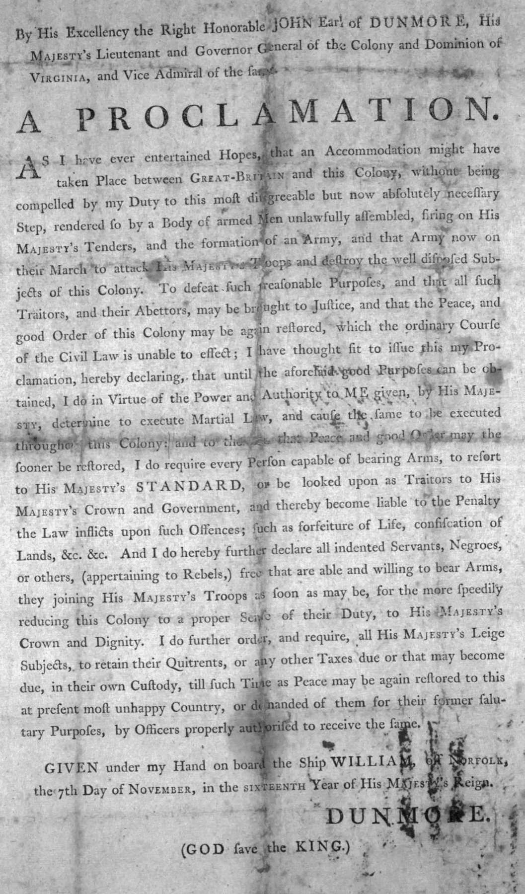
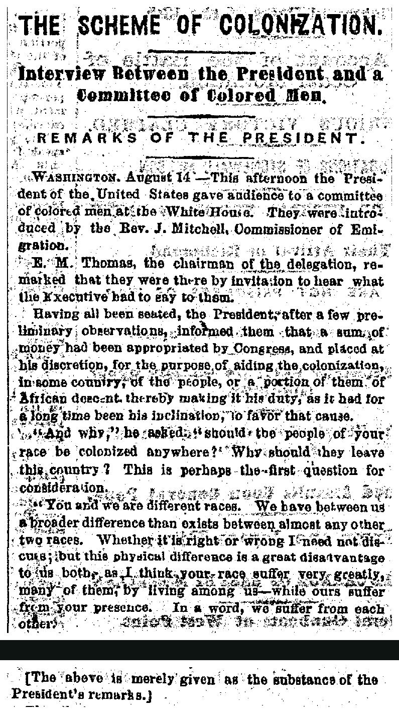
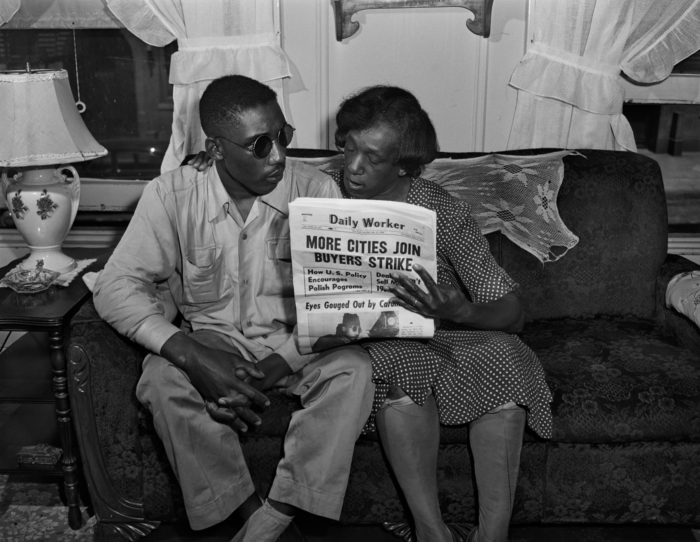
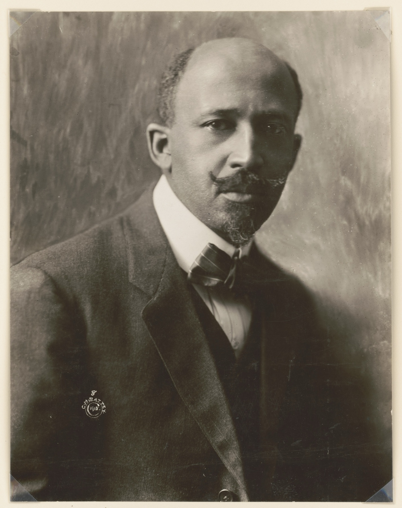
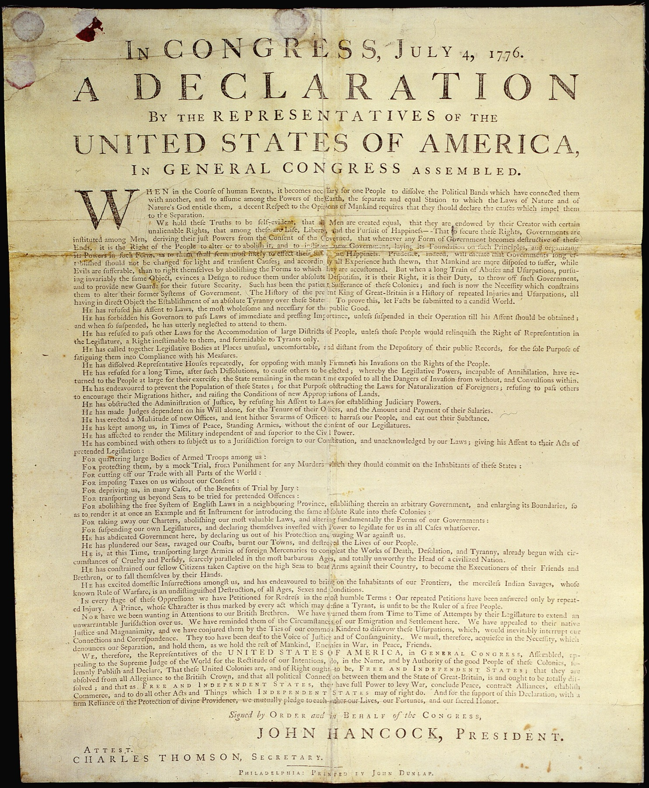

<!-- ========== TITLE ========== -->
<section data-transition="fade" markdown="1">
Making History • HIST 1105 • Week 12.2
{: .eyebrow}

# The 1619 quiz, argued both ways
{: .main-point}

---

- Background: Adam Serwer, "The Fight Over the 1619 Project Is Not About the Facts," *The Atlantic* (December 23, 2019)
- Nikole Hannah-Jones, "The Idea of America," *The New York Times Magazine* (August 18, 2019), 14–26
- Conor Friedersdorf, "1776 Honors America's Diversity in a Way 1619 Does Not," *The Atlantic* (January 6, 2020)
- The historians' letter and Jake Silverstein's reply, *The New York Times Magazine* (December 20, 2019)
- Earlier weeks: Carr, *What Is History?*, ch. 1; Trouillot, *Silencing the Past*, ch. 1; Jenkins, *Re-thinking History*, ch. 3
{: .source-list}
</section>

<!-- ================================================================ -->
<!-- ====== PART ONE: THE ESSAY'S CLAIMS, QUESTIONS 1–5 =============== -->
<!-- ================================================================ -->

<!-- ========== OPENER: THE STATUE OF FREEDOM ========== -->
<section class="image-slide bleed"
 data-background-image="images/statue-of-freedom-capitol.jpg"
 data-background-size="contain"
 data-background-color="#0d1412" markdown="1">

A dark bronze statue of a standing woman in a long robe and a feathered helmet, holding a sheathed sword and a wreath, on a round base lettered E PLURIBUS UNUM, against a pale sky
{: .bleed-alt}

Thomas Crawford, *Statue of Freedom*, raised to the top of the Capitol dome in 1863 · Architect of the Capitol photograph · public domain
{: .credit}

</section>

<!-- ========== Q1: THE REVOLUTION ========== -->
<section markdown="1">
Part one · the essay's claims · question 1
{: .eyebrow}

## Slavery and the Revolution
{: .main-point}

---

The colonists declared independence partly to protect slavery.
{: .question}

##### True · the Times's reply, and Serwer

Slaveholders' "uneasiness" about "growing antislavery sentiment in Britain and increasing imperial regulation helped motivate the Revolution." Serwer grants that "some southern slave owners likely were fighting the British to preserve slavery."

##### False · Gordon Wood, quoted in Friedersdorf

"I don't know of any colonist who said that they wanted independence in order to preserve their slaves." On the essay's version of the claim, Serwer finds the critics "on firm ground."

The word "partly" decides it. Some planters probably feared for slavery, Wood finds no colonist who said so, and the Times later narrowed the sentence to some colonists.

</section>

<!-- ========== IMAGE: DUNMORE'S PROCLAMATION ========== -->
<section class="image-slide" data-background="#0d1412" markdown="1">
<figure class="portrait">

<figcaption markdown="span">
Lord Dunmore's proclamation · November 7, 1775
<em>Virginia's royal governor declared free the enslaved men of rebels "that are able and willing to bear Arms" for the King. The reply calls it the culmination of the slavery dispute. (Library of Congress, via Wikimedia Commons. Public domain.)</em>
</figcaption>
</figure>
</section>

<!-- ========== Q2: THE FOUNDING IDEALS ========== -->
<section markdown="1">
Part one · the essay's claims · question 2
{: .eyebrow}

## The founding ideals
{: .main-point}

---

America's founding ideals of liberty and equality were false when they were written.
{: .question}

##### True · Hannah-Jones, "The Idea of America"

The statement is the display text on the essay's title page (p. 14). The men who drafted the Declaration "did not believe them to be true for the hundreds of thousands of black people in their midst" (p. 16).

##### False · Friedersdorf, in The Atlantic

The revolutionaries, Lincoln, Douglass and King "all placed the universalist ideals of the Declaration of Independence at the center of this country's founding." He honors its words "as distinct from its fallible, hypocritical author."

Both sides agree the men fell short of the words. They disagree about whether an ideal is false when the people who wrote it do not live by it.

</section>

<!-- ========== Q3: LINCOLN ========== -->
<section markdown="1">
Part one · the essay's claims · question 3
{: .eyebrow}

## Lincoln and equality
{: .main-point}

---

Lincoln was, at heart, a champion of Black equality.
{: .question}

##### True · the historians' letter, and the reply

Lincoln held "that the Declaration of Independence proclaimed universal equality, for blacks as well as whites, a view he upheld repeatedly against powerful white supremacists." The reply grants that "at the end of his life, Lincoln's racial outlook had evolved considerably in the direction of real equality."

##### False · Hannah-Jones, and the reply

Her Lincoln "opposed slavery as a cruel system at odds with American ideals, but he also opposed black equality" (p. 20). The reply adds that "for much of his career" he wanted freed people encouraged "to leave the country."

"At heart" asks which Lincoln counts: the one who backed colonization for much of his career, or the one whose outlook changed at the end.

</section>

<!-- ========== IMAGE: THE 1862 REPORT ========== -->
<section class="image-slide" data-background="#0d1412" markdown="1">
<figure class="portrait">

<figcaption markdown="span">
The report of Lincoln's meeting · August 15, 1862
<em>The Philadelphia <i>Press</i> ran it unsigned, the day after he asked five free Black men to support sending freed people abroad. The essay quotes this meeting (p. 20). (<i>The Press</i>, p. 2; two cuts, joined. Internet Archive. Public domain.)</em>
</figcaption>
</figure>
</section>

<!-- ========== Q4: ALONE ========== -->
<section markdown="1">
Part one · the essay's claims · question 4
{: .eyebrow}

## Allies in the freedom struggle
{: .main-point}

---

For the most part, Black Americans fought for their freedom alone.
{: .question}

##### True · Hannah-Jones, to Serwer

"It is not saying that black people only fought alone. It is saying that most of the time we did." Across slavery and Jim Crow, Serwer finds "largely alone" "more than defensible."

##### False · Sean Wilentz, to Serwer

"The fight for black freedom is a universal fight; it's a fight for everyone." The letter calls the claim distorted, and Serwer grants it "has been an interracial struggle."

Count the centuries and allies were few; count the turning points and they were there. "For the most part" depends on which you count.

</section>

<!-- ========== IMAGE: ISAAC WOODARD ========== -->
<section class="image-slide" data-background="#0d1412" markdown="1">
<figure class="landscape">

<figcaption markdown="span">
Isaac Woodard and his mother, Eliza, July 1946
<em>In February, police had beaten him blind hours after his Army discharge. The essay calls his maiming "nothing unusual" (p. 21). (<i>Sunday Worker</i>, 1946. Tamiment Library, NYU, via Wikimedia Commons. Public domain.)</em>
</figcaption>
</figure>
</section>

<!-- ========== Q5: DNA ========== -->
<section markdown="1">
Part one · the essay's claims · question 5
{: .eyebrow}

## Racism and change
{: .main-point}

---

Anti-black racism runs in the very DNA of this country.
{: .question}

##### True · Hannah-Jones, "The Idea of America"

The sentence is hers (p. 21). After Reconstruction, "Democracy would not return to the South for nearly a century," and in 1946 the blinding of a Black veteran was "nothing unusual" (p. 21).

##### False · James Oakes, to the World Socialist Web Site, in Serwer

"The function of those tropes is to deny change over time … If it's the DNA, there's nothing you can do."

The fight is over the metaphor. Oakes reads "DNA" as fixed; Serwer reads the project's theme as progress that is "fragile and reversible," which admits change.

</section>

<!-- ========== PART ONE DISCUSSION ========== -->
<section markdown="1">
Part one · discussion
{: .eyebrow}

## Claims and qualifiers
{: .main-point}

---

Which of these five statements could a document settle, and which turn on a single word?
{: .question .fragment data-fragment-index="1"}

Probably only the first, and only in part. The rest turn on "false," "at heart," "for the most part" and "DNA": judgments no document makes for you.

</section>

<!-- ================================================================ -->
<!-- ====== PART TWO: THE FIGHT, QUESTIONS 6–10 ======================= -->
<!-- ================================================================ -->

<!-- ========== OPENER: THE PLEDGE, 1899 ========== -->
<section class="image-slide bleed"
 data-background-image="images/pledge-whittier-1899.jpg"
 data-background-size="contain"
 data-background-color="#0d1412" markdown="1">

A black and white photograph: rows of Black schoolchildren on a bare field, right arms stretched out toward an American flag held by a small boy at the left, with leafless trees behind
{: .bleed-alt}

Frances Benjamin Johnston, saluting the flag at the Whittier Primary School, Hampton Institute, Virginia, 1899 or 1900 · Library of Congress · no known restrictions
{: .credit}

</section>

<!-- ========== Q6: FACT OR INTERPRETATION ========== -->
<section markdown="1">
Part two · the fight · question 6
{: .eyebrow}

## Fact or interpretation
{: .main-point}

---

The five historians' quarrel with the 1619 Project was about facts, not interpretation.
{: .question}

##### True · the historians' letter

"These errors, which concern major events, cannot be described as interpretation or 'framing.' They are matters of verifiable fact."

##### False · Silverstein's reply

Historians differ, "if not over what precisely happened, then about why it happened, who made it happen, how to interpret the motivations of historical actors and what it all means."

On the Revolution, the letter is right that what colonists wrote can be checked; the reply is right that how much slavery weighed with them is a judgment.

</section>

<!-- ========== Q7: CORRECTIONS ========== -->
<section markdown="1">
Part two · the fight · question 7
{: .eyebrow}

## Who corrects whom
{: .main-point}

---

Since its writers were journalists, not historians, the Times should have made the corrections the historians asked for.
{: .question .compact}

##### True · the historians' letter, and Silverstein

The project bears "the imprimatur and credibility of The New York Times," and the process behind it "remains opaque." Silverstein granted: "We are not ourselves historians, it is true."

##### False · Silverstein's reply

Every article was checked "with subject-area experts," and the reply names historians whose work supports the Revolution claim. He called the disputes interpretation, which is argued, not corrected.

The premise is Silverstein's own concession, not the letter's argument. Whether the Times owed corrections depends on whether the disputes were errors or interpretations.

</section>

<!-- ========== IMAGE: DU BOIS ========== -->
<section class="image-slide" data-background="#0d1412" markdown="1">
<figure class="portrait">

<figcaption markdown="span">
W. E. B. Du Bois · about 1919
<em>His <i>Black Reconstruction</i> (1935) challenged the consensus, shaped by the Dunning School, that blamed Reconstruction's failures on "Negro ignorance and corruption." Both sides of the 1619 fight cite that episode. (C. M. Battey. Library of Congress. Public domain.)</em>
</figcaption>
</figure>
</section>

<!-- ========== Q8: WHO WRITES HISTORY ========== -->
<section markdown="1">
Part two · the fight · question 8
{: .eyebrow}

## Who writes history
{: .main-point}

---

Who writes history matters as much as the evidence they use.
{: .question}

##### True · Hannah-Jones, to Serwer, and Serwer

Her point "was that history is not objective," and that white scholars "are no more objective than any other scholars." For decades, Serwer writes, the white historians of the Dunning School portrayed Reconstruction as a tragedy.

##### False · Sean Wilentz, to Serwer

"Fact and objectivity are the foundation of both honest journalism and honest history." The Dunning School was "not a white point of view; it's a southern, racist point of view," and Du Bois fought "a very, very courageous fight" against it.

Serwer reads the Dunning School both ways: as "the danger of a monochromatic group of historians," or, for Wilentz, "the risk that ideologues can hijack the narrative."

</section>

<!-- ========== IMAGE: THE DECLARATION ========== -->
<section class="image-slide" data-background="#0d1412" markdown="1">
<figure class="portrait">

<figcaption markdown="span">
The Declaration as first printed · Philadelphia, July 1776
<em>Friedersdorf wants children taught that the country was founded on this day, "with the declaration of those revolutionary ideals." (John Dunlap, printer. U.S. National Archives, via Wikimedia Commons. Public domain.)</em>
</figcaption>
</figure>
</section>

<!-- ========== Q9: 1776 OR 1619 ========== -->
<section markdown="1">
Part two · the fight · question 9
{: .eyebrow}

## Choosing a founding date
{: .main-point}

---

1776 is a more inclusive founding date than 1619.
{: .question}

##### True · Friedersdorf, in The Atlantic

"Placing America's founding moment in 1776 honors the diversity of its people in a way that 1619 does not." A 1619 founding, he argues, overlooks "indigenous Americans, Hispanics, Asian Americans, and almost everyone whose ancestors got here after the Civil War."

##### False · Hannah-Jones, "The Idea of America"

Black Americans' struggles "paved the way for every other rights struggle, including women's and gay rights, immigrant and disability rights" (p. 16). On her account, the ideals of 1776 reached everyone through the descendants of 1619.

Friedersdorf finds inclusion in the ideals, Hannah-Jones in the struggle that extended them. He grants "that black abolitionists warrant status as Founding Fathers."

</section>

<!-- ========== Q10: WHAT SCHOOLS TAUGHT ========== -->
<section markdown="1">
Part two · the fight · question 10
{: .eyebrow}

## New to whom
{: .main-point}

---

The story the 1619 Project told was new.
{: .question}

##### True · Hannah-Jones, and Serwer

She "had been taught, in school, through cultural osmosis," that "our history as a people began with enslavement and that we had contributed little to this great nation" (p. 16). The Southern Poverty Law Center, Serwer reports, found few high-school students knew slavery caused the Civil War.

##### False · McClay, in Friedersdorf, and the essay

"The shelves of American libraries groan with books on the subject." The essay itself counts the Constitution's slavery clauses "as the historian David Waldstreicher has written" (p. 18).

Historians had written the story, and the essay leans on them; many classrooms had not taught it. "New" depends on who the reader is.

</section>

<!-- ========== PART TWO DISCUSSION ========== -->
<section markdown="1">
Part two · discussion
{: .eyebrow}

## Agreement without an ending
{: .main-point}

---

Where do the five historians and the project agree, and why didn't that agreement end the fight?
{: .question .fragment data-fragment-index="1"}

Both agree, Serwer finds, "that slavery's legacy still shapes American life." They split over who drove the progress since: the founding's ideals, or Black Americans' struggle.

</section>

<!-- ================================================================ -->
<!-- ====== PART THREE: THE COURSE, QUESTIONS 11–13 =================== -->
<!-- ================================================================ -->

<!-- ========== OPENER: GETTYSBURG, 1913 ========== -->
<section class="image-slide bleed"
 data-background-image="images/gettysburg-reunion-1913.jpg"
 data-background-size="contain"
 data-background-color="#0d1412" markdown="1">

A sepia photograph: two lines of elderly bearded men in hats and suits reach across a bank of shrubs under a tree to shake hands, with an open field behind them
{: .bleed-alt}

Union and Confederate veterans shake hands at the Angle, Gettysburg reunion, July 1913 · International News Service · Library of Congress · no known restrictions
{: .credit}

</section>

<!-- ========== Q11: CARR ========== -->
<section markdown="1">
Part three · Week 1 · question 11
{: .eyebrow}

## The historian and the facts
{: .main-point}

---

E. H. Carr would side with the Times against the five historians.
{: .question}

##### True · Carr, What Is History?, p. 11

"The facts speak only when the historian calls on them: it is he who decides to which facts to give the floor, and in what order or context." Interpretation, he writes, is "the life-blood of history" (p. 28).

##### False · Carr, p. 28, and the letter

The historian's duty "is not exhausted by the obligation to see that his facts are accurate. He must seek to bring into the picture all known or knowable facts relevant, in one sense or another, to the theme on which he is engaged and to the interpretation proposed." The letter says the essay "ignores" Lincoln's agreement with Douglass.

Carr would grant the Times its selection and still ask what it left out. For him a history can fail by omission as well as by error.

</section>

<!-- ========== Q12: TROUILLOT ========== -->
<section markdown="1">
Part three · Week 9 · question 12
{: .eyebrow}

## What every story leaves out
{: .main-point}

---

The 1619 Project leaves out as much as the story it replaced.
{: .question}

##### True · Friedersdorf

A 1619 founding "centers one original sin, chattel slavery, over an earlier sin that was also abhorrent and consequential: the genocide and subjugation of indigenous North Americans."

##### False · Hannah-Jones

The story she was taught said "we had contributed little to this great nation." The essay puts them back: "They built the plantations of George Washington, Thomas Jefferson and James Madison" (p. 16).

Trouillot would say every story leaves something out: "any historical narrative is a particular bundle of silences" (p. 27). The question is whose silences are larger.

</section>

<!-- ========== Q13: JENKINS ========== -->
<section markdown="1">
Part three · Week 10 · question 13
{: .eyebrow}

## Position and evidence
{: .main-point}

---

The five historians' account of the founding is as ideological as the 1619 Project's.
{: .question}

##### True · Jenkins, p. 82, and the letter

"There is no such thing as an 'unpositioned centre.'" "The only choice is between a history that is aware of what it is doing and a history that is not." The letter charges the project with "ideology"; on Jenkins's terms, the letter has a position too.

##### False · Carr, What Is History?, p. 27

"It does not follow that, because interpretation plays a necessary part in establishing the facts of history, and because no existing interpretation is wholly objective, one interpretation is as good as another."

It turns on "as." Jenkins holds that every account has a position; Carr, that positions can still be weighed against the evidence.

</section>

<!-- ========== PART THREE DISCUSSION ========== -->
<section markdown="1">
Part three · discussion
{: .eyebrow}

## Both true and false
{: .main-point}

---

Every statement on the quiz could be argued both ways. Does that make historical truth a matter of opinion?
{: .question .fragment data-fragment-index="1"}

Probably not. Both sides argued from the same documents, and the Revolution sentence was narrowed to some colonists once its scope was challenged. Interpretation is unavoidable, not unlimited.

</section>

