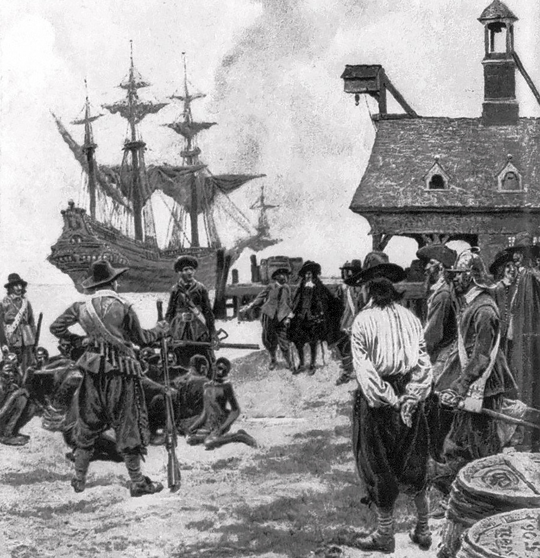
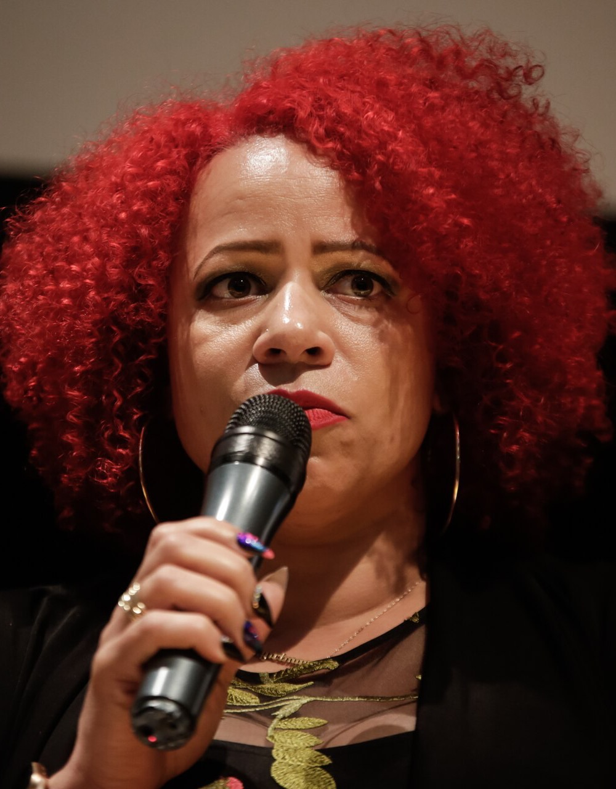
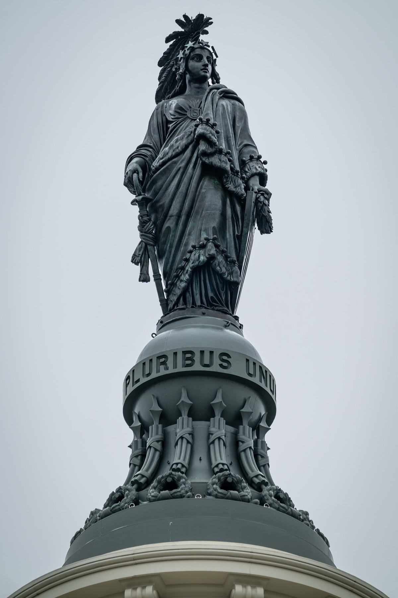
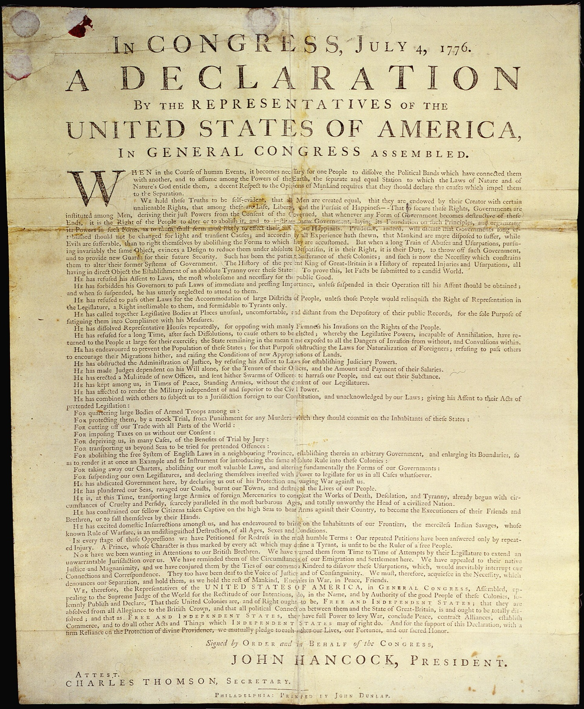
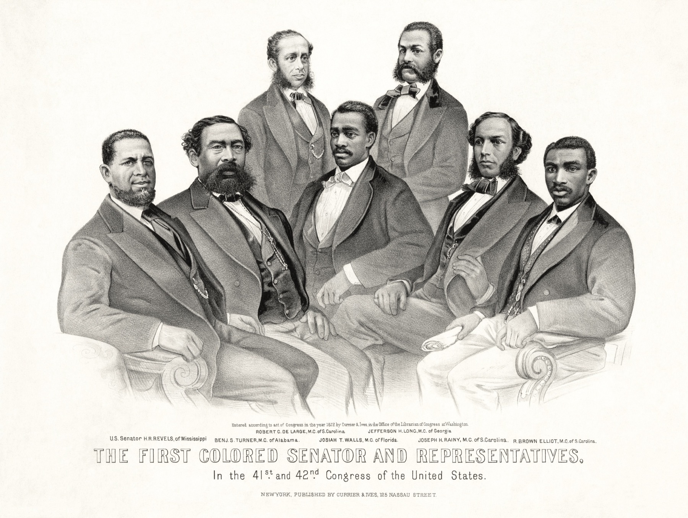
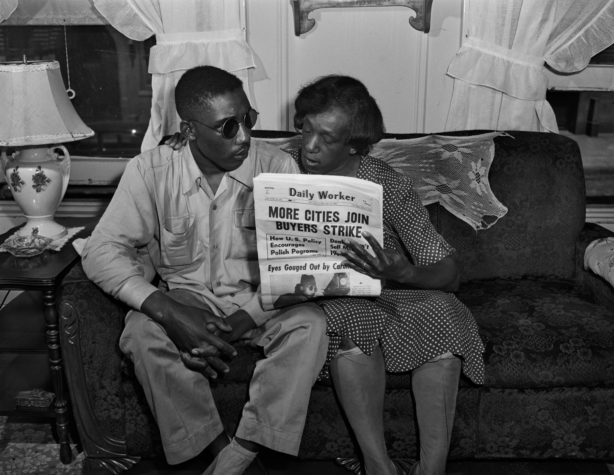

<!-- ========== TITLE ========== -->
<section data-transition="fade" markdown="1">
Making History • HIST 1105 • Week 12.1
{: .eyebrow}

# The 1619 Project and "The Idea of America"
{: .main-point}

---

- Nikole Hannah-Jones, "The Idea of America," *The New York Times Magazine* (August 18, 2019), 14–26
{: .source-list}

Cited by Magazine page, which the Pulitzer Center PDF keeps. Quotations give the essay as printed in August 2019.
{: .citation-note}
</section>

<!-- ========== IMAGE: PYLE, 1901 ========== -->
<section class="image-slide" data-background="#0d1412" markdown="1">
<figure class="landscape">

<figcaption markdown="span">
"Landing Negroes at Jamestown from Dutch Man-of-War, 1619"
<em>Howard Pyle drew the 1619 arrival in 1901, 282 years after it. Armed colonists fill the foreground; the captives sit on the ground at left. (Howard Pyle, 1901. Wikimedia Commons. Public domain.)</em>
</figcaption>
</figure>
</section>

<!-- ========== THROUGHLINE ========== -->
<section markdown="1">
Today in context
{: .eyebrow}

## What makes history happen?
{: .main-point}

---

###### Week 11.1 · Loewen and Hayden
{: .num}

Commemoration and space. What gets put up, by whom, and who a place lets in.

###### Week 11.2 · AI and history
{: .num}

Probability. A chatbot's history follows what was written down most often.

###### Week 12.1 · Hannah-Jones
{: .num}

A journalist sets 1619 beside 1776 and credits Black Americans with making the democracy.

###### Week 12.2 · The fight over it
{: .num}

Five historians call parts of it errors of fact; the Times calls them interpretation.

</section>

<!-- ========== IMAGE: HANNAH-JONES ========== -->
<section class="image-slide" data-background="#0d1412" markdown="1">
<figure class="portrait">

<figcaption markdown="span">
Nikole Hannah-Jones · b. 1976
<em>A reporter at <i>The New York Times Magazine</i>, raised in Iowa, whose reporting had centered on school segregation. She conceived the 1619 Project and wrote its opening essay, which won the 2020 Pulitzer Prize for Commentary.<strong>Why she matters:</strong> her essay states the project's central argument, that 1619 matters as much to the country as 1776.(Alice Vergueiro/Abraji, 2018. Wikimedia Commons, CC BY 2.0; cropped.)</em>
</figcaption>
</figure>
</section>

<!-- ========== THE ESSAY AS A THING ========== -->
<section markdown="1">
The essay · August 18, 2019
{: .eyebrow}

## The essay opened a Magazine issue marking 400 years since 1619
{: .main-point}

---

"Our founding ideals of liberty and equality were false when they were written. Black Americans fought to make them true. Without this struggle, America would have no democracy at all."

Hannah-Jones, “The Idea of America,” p. 14, the title page

###### The issue
{: .label}

*The New York Times Magazine* gave the whole issue to the anniversary: ten essays, with poems and fiction. Her essay leads it, pp. 14–26, with photographs between the pages. The Pulitzer Center later turned the project into school materials.

</section>

<!-- ================================================================ -->
<!-- ====== PART ONE: THE FOUNDING, PP. 16–18 ======================== -->
<!-- ================================================================ -->

<!-- ========== THE FLAG ========== -->
<section markdown="1">
Part one · the founding · the opening
{: .eyebrow}

## Hannah-Jones opens with her father's flag and what school taught her
{: .main-point}

---

"I had been taught, in school, through cultural osmosis, that the flag wasn't really ours, that our history as a people began with enslavement and that we had contributed little to this great nation."

Hannah-Jones, “The Idea of America,” p. 16

###### Her father
{: .label}

He flew the flag anyway. He knew, she writes, "that our people's contributions to building the richest and most powerful nation in the world were indelible, that the United States simply would not exist without us" (p. 16).

</section>

<!-- ========== WHAT THEY BUILT ========== -->
<section markdown="1">
Part one · the founding · the labor
{: .eyebrow}

## Her first evidence is what enslaved people built
{: .main-point}

---

"They built the plantations of George Washington, Thomas Jefferson and James Madison, sprawling properties that today attract thousands of visitors from across the globe captivated by the history of the world's greatest democracy. They laid the foundations of the White House and the Capitol, even placing with their unfree hands the Statue of Freedom atop the Capitol dome."

Hannah-Jones, “The Idea of America,” p. 16

###### And the money
{: .label}

Profits from their "stolen labor," she writes, "helped the young nation pay off its war debts and financed some of our most prestigious universities" (p. 16).

</section>

<!-- ========== IMAGE: STATUE OF FREEDOM ========== -->
<section class="image-slide" data-background="#0d1412" markdown="1">
<figure class="portrait">

<figcaption markdown="span">
The Statue of Freedom, U.S. Capitol dome
<em>Thomas Crawford's bronze, raised to the top of the dome in 1863. The essay says enslaved people placed it there "with their unfree hands" (p. 16). (Architect of the Capitol photograph. Wikimedia Commons. Public domain.)</em>
</figcaption>
</figure>
</section>

<!-- ========== 1619 AND 1776 ========== -->
<section markdown="1">
Part one · the founding · the claim
{: .eyebrow}

## The essay argues that 1619 is as important as 1776
{: .main-point}

---

"…that the year 1619 is as important to the American story as 1776. That black Americans, as much as those men cast in alabaster in the nation's capital, are this nation's true 'founding fathers.'"

Hannah-Jones, “The Idea of America,” pp. 16–17

###### The flag again
{: .label}

The passage ends with her father's flag: "And that no people has a greater claim to that flag than us" (p. 17).

</section>

<!-- ========== IDEAL AND A LIE ========== -->
<section markdown="1">
Part one · the founding · the contradiction
{: .eyebrow}

## She calls the founding both an ideal and a lie
{: .main-point}

---

"The United States is a nation founded on both an ideal and a lie. Our Declaration of Independence, signed on July 4, 1776, proclaims that 'all men are created equal' and 'endowed by their Creator with certain unalienable rights.' But the white men who drafted those words did not believe them to be true for the hundreds of thousands of black people in their midst."

Hannah-Jones, “The Idea of America,” p. 16

###### The other half
{: .label}

Black Americans, she writes, "believed fervently in the American creed" and "helped the country live up to its founding ideals" (p. 16).

</section>

<!-- ========== ROBERT HEMINGS ========== -->
<section markdown="1">
Part one · the founding · the Declaration
{: .eyebrow}

## She puts an enslaved teenager beside Jefferson as he drafted the Declaration
{: .main-point}

---

"As Jefferson composed his inspiring words, however, a teenage boy who would enjoy none of those rights and liberties waited nearby to serve at his master's beck and call. His name was Robert Hemings, and he was the half brother of Jefferson's wife, born to Martha Jefferson's father and a woman he owned."

Hannah-Jones, “The Idea of America,” p. 17

###### Her method
{: .label}

The contradiction arrives as one named person rather than a number. Jefferson had chosen him, she writes, "from among about 130 enslaved people" at Monticello (p. 17).

</section>

<!-- ========== IMAGE: DUNLAP BROADSIDE ========== -->
<section class="image-slide" data-background="#0d1412" markdown="1">
<figure class="portrait">

<figcaption markdown="span">
The Declaration as first printed · Philadelphia, July 1776
<em>Jefferson's draft blamed the king for slavery and called the trade a crime, the essay says; the passage was struck, and the printed text never mentions slavery (p. 18). (John Dunlap, printer. U.S. National Archives, via Wikimedia Commons. Public domain.)</em>
</figcaption>
</figure>
</section>

<!-- ========== THE REVOLUTION ========== -->
<section markdown="1">
Part one · the founding · the Revolution
{: .eyebrow}

## The essay makes slavery a primary reason for the Revolution
{: .main-point}

---

"Conveniently left out of our founding mythology is the fact that one of the primary reasons the colonists decided to declare their independence from Britain was because they wanted to protect the institution of slavery."

Hannah-Jones, “The Idea of America,” p. 18, as printed in August 2019

###### Her evidence
{: .label}

In London, she writes, "there were growing calls to abolish the slave trade," which "would have upended the economy of the colonies, in both the North and the South" (p. 18).

</section>

<!-- ========== THE CONSTITUTION ========== -->
<section markdown="1">
Part one · the founding · the Constitution
{: .eyebrow}

## She says the Constitution protected slavery without naming it
{: .main-point}

---

"Similarly, 11 years later, when it came time to draft the Constitution, the framers carefully constructed a document that preserved and protected slavery without ever using the word. In the texts in which they were making the case for freedom to the world, they did not want to explicitly enshrine their hypocrisy, so they sought to hide it."

Hannah-Jones, “The Idea of America,” p. 18

###### Her count
{: .label}

Of the Constitution's 84 clauses, "Six deal directly with the enslaved and their enslavement, as the historian David Waldstreicher has written, and five more hold implications for slavery" (p. 18).

</section>

<!-- ========== DISCUSSION: PART ONE ========== -->
<section markdown="1">
Part one · discussion
{: .eyebrow}

## Evidence for a founding
{: .main-point}

---

Her evidence runs from what enslaved people built to Hemings, the calls in London, and the clauses. Which shows slavery was central to the founding, not just present at it?
{: .question .fragment data-fragment-index="1"}

Probably the clauses, which were a founding choice. The labor and Hemings show slavery was present; the Revolution claim needs the colonists' motives, which are harder to show.

</section>

<!-- ================================================================ -->
<!-- ====== PART TWO: THE PERFECTERS, PP. 16–26 ====================== -->
<!-- ================================================================ -->

<!-- ========== PERFECTERS ========== -->
<section markdown="1">
Part two · the perfecters · the claim
{: .eyebrow}

## She says Black Americans have been democracy's perfecters
{: .main-point}

---

"Black Americans have also been, and continue to be, foundational to the idea of American freedom. More than any other group in this country's history, we have served, generation after generation, in an overlooked but vital role: It is we who have been the perfecters of this democracy."

Hannah-Jones, “The Idea of America,” p. 16

###### Not only for themselves
{: .label}

Their struggles, she writes, "paved the way for every other rights struggle, including women's and gay rights, immigrant and disability rights" (p. 16).

</section>

<!-- ========== LINCOLN, 1862 ========== -->
<section markdown="1">
Part two · the perfecters · August 1862
{: .eyebrow}

## Her Lincoln asks five free Black men to support sending freed people abroad
{: .main-point}

---

"You and we are different races. . . . Your race suffer very greatly, many of them, by living among us, while ours suffer from your presence. In a word, we suffer on each side."

Abraham Lincoln, August 14, 1862, quoted in Hannah-Jones, “The Idea of America,” p. 20

###### The answer she gives
{: .label}

Most freed people stayed, agreeing with an earlier convention of Black leaders: "This is our home, and this our country" (p. 20). She calls that "an astounding testament to their belief in this nation's founding ideals."

</section>

<!-- ========== RECONSTRUCTION ========== -->
<section markdown="1">
Part two · the perfecters · Reconstruction
{: .eyebrow}

## Reconstruction is her main evidence that Black Americans perfected the democracy
{: .main-point}

---

"The South, for the first time in the history of this country, began to resemble a democracy, with black Americans elected to local, state and federal offices."

Hannah-Jones, “The Idea of America,” p. 20

###### What they built
{: .label}

Black legislators' "biggest achievement," she writes, was "that most democratic of American institutions: the public school," for white children as well as Black (p. 21).

</section>

<!-- ========== IMAGE: FIRST COLORED SENATOR AND REPRESENTATIVES ========== -->
<section class="image-slide" data-background="#0d1412" markdown="1">
<figure class="landscape">

<figcaption markdown="span">
"The First Colored Senator and Representatives," 1872
<em>Printed in the essay (p. 17) above its claim that Black Americans are the nation's true "founding fathers." At left, the first Black man elected to the Senate. (Currier &amp; Ives, 1872. Library of Congress, via Wikimedia Commons. Public domain.)</em>
</figcaption>
</figure>
</section>

<!-- ========== THE NADIR ========== -->
<section markdown="1">
Part two · the perfecters · after 1877
{: .eyebrow}

## Reconstruction's collapse is her evidence that racism runs in the country's "DNA"
{: .main-point}

---

"But it would not last. Anti-black racism runs in the very DNA of this country, as does the belief, so well articulated by Lincoln, that black people are the obstacle to national unity."

Hannah-Jones, “The Idea of America,” p. 21

###### What followed
{: .label}

In 1877 federal troops left the South, and white Southerners undid Reconstruction's gains. "Democracy would not return to the South for nearly a century," she writes (p. 21).

</section>

<!-- ========== IMAGE: ISAAC WOODARD ========== -->
<section class="image-slide" data-background="#0d1412" markdown="1">
<figure class="landscape">

<figcaption markdown="span">
Isaac Woodard and his mother, Eliza, July 1946
<em>In February, police had beaten him blind hours after his Army discharge. The essay calls his maiming "nothing unusual" (p. 21). (<i>Sunday Worker</i>, 1946. Tamiment Library, NYU, via Wikimedia Commons. Public domain.)</em>
</figcaption>
</figure>
</section>

<!-- ========== ALONE ========== -->
<section markdown="1">
Part two · the perfecters · the civil rights movement
{: .eyebrow}

## She argues Black Americans fought mostly alone, and won rights for everyone
{: .main-point}

---

"For the most part, black Americans fought back alone. Yet we never fought only for ourselves. The bloody freedom struggles of the civil rights movement laid the foundation for every other modern rights struggle."

Hannah-Jones, “The Idea of America,” p. 24

###### Her example
{: .label}

The civil rights movement, she writes, "led to the passage of the Immigration and Nationality Act of 1965, which upended the racist immigration quota system intended to keep this country white" (p. 26).

</section>

<!-- ========== THE ENDING ========== -->
<section markdown="1">
Part two · the perfecters · the ending
{: .eyebrow}

## The essay ends where it began, with a flag
{: .main-point}

---

"We were told once, by virtue of our bondage, that we could never be American. But it was by virtue of our bondage that we became the most American of all."

Hannah-Jones, “The Idea of America,” p. 26

###### Her own flag
{: .label}

Asked in school to draw the flag of her ancestral land, she picked "a random African country." Now she would tell her younger self "to boldly, proudly, draw the stars and those stripes of the American flag" (p. 26).

</section>

<!-- ========== DISCUSSION: PART TWO ========== -->
<section markdown="1">
Part two · discussion
{: .eyebrow}

## History in the first person
{: .main-point}

---

She opens and closes with her family and writes "we." What does that let a magazine essay do that a journal article could not, and what does it cost?
{: .question .fragment data-fragment-index="1"}

It makes the past a claim on the present, which is the project's aim. It also makes it harder to separate what she shows from what she concludes.

</section>

<!-- ========== THE ARC ========== -->
<section markdown="1">
The lecture · looking back
{: .eyebrow}

## A founding retold, a democracy credited, and the flag her father flew
{: .main-point}

---

###### 01 · The founding, pp. 16–18
{: .num}

#### An ideal and a lie

Slavery beside Jefferson as he wrote, one of the primary reasons for independence, and in the Constitution's clauses.

###### 02 · The perfecters, pp. 16, 20–26
{: .num}

#### Democracy pushed wider

Reconstruction, the collapse after 1877, and a civil rights movement whose laws reached everyone.

###### 03 · The frame, pp. 16 and 26
{: .num}

#### Her father's flag

From her embarrassment at it to "the most American of all."

</section>

<!-- ========== TAKE HOME ========== -->
<section markdown="1">
Take home
{: .eyebrow}

## The essay retells the founding to make a claim on the present
{: .main-point}

---

###### What it argues
{: .label}

Read from 1619, American history is the story of enslaved people and their descendants making real the democracy the founders proclaimed and did not practice.

###### How it argues
{: .label}

With a journalist's evidence: a family, a named person beside Jefferson, a count of clauses, Reconstruction's laws. And in the first person plural.

Its strength is also its exposure: reading every period through 1619 shows slavery's reach, and lets critics test each period's claim on its own.

</section>

<!-- ========== NEXT TIME ========== -->
<section data-transition="fade" markdown="1">
Next time · Week 12.2
{: .eyebrow}

## Five historians call parts of the essay wrong on the facts
{: .main-point}

---

Read Serwer and Friedersdorf. The discussion post is due Sunday.
{: .detail}

- Which claim in the essay do you find strongest, and which weakest?
- What did your own schooling teach you about 1619, or leave out?
{: .questions .fragment data-fragment-index="1"}
</section>
