<!-- ========== COLD OPEN: THE TURK, AS SHOWN ========== -->
<section class="image-slide bleed" data-background-image="images/racknitz-turk-plate1.jpg" data-background-size="contain" data-background-color="#07080d" markdown="1">

A hand-colored engraving of a life-size figure in Turkish robes and a turban seated behind a wooden cabinet with a chessboard on top. The cabinet's doors and a drawer stand open to show wheels, cylinders and gears.
{: .bleed-alt}

Joseph Friedrich von Racknitz, *Ueber den Schachspieler des Herrn von Kempelen* (On Herr von Kempelen's Chess Player), 1789, plate I · Humboldt University Library · Public domain
{: .credit}

</section>

<!-- ========== COLD OPEN: THE TURK, AS RACKNITZ IMAGINED IT ========== -->
<section class="image-slide bleed" data-background-image="images/racknitz-turk-plate3.jpg" data-background-size="contain" data-background-color="#07080d" markdown="1">

The same cabinet drawn as if transparent. Behind the gears a man in a red coat sits inside, working the pieces of a small chessboard by the light of two candles, with rods running up to the Turkish figure's arm above him.
{: .bleed-alt}

Racknitz, 1789, plate III · Humboldt University Library · Public domain
{: .credit}

</section>

<!-- ========== COLD OPEN: THE QUESTION ========== -->
<section markdown="1">
Racknitz, 1789 · plates I and III
{: .eyebrow}

## Where is the person in a machine that writes?
{: .main-point}

---

- From 1770 to 1854 the Turk played chess before courts and paying crowds. The player was a person hidden in the cabinet.
- A chatbot writes a history of your campus in seconds. Whose knowledge is in it, and is what it writes history?
{: .questions.compact}
</section>

<!-- ========== COLD OPEN: WORKING THE PAIR ========== -->
<section markdown="1">

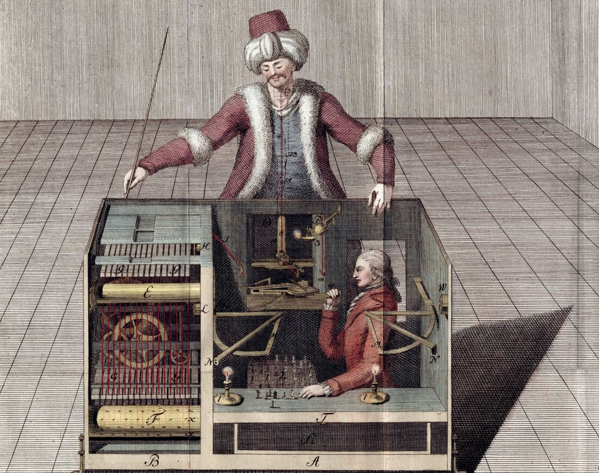

- **The doors open.** Kempelen built the Turk in 1770 for Maria Theresa's court. Before a game the showman opened the cabinet on its gears. <em class="ask">What does a show of machinery ask an audience to stop looking for?</em>
- **Racknitz's guess.** He drew an operator inside, and placed him wrongly. The full method was printed only in 1857, three years after a fire destroyed the Turk. <em class="ask">How do you check a machine whose inside you cannot see?</em>
- **The name survives.** In 2005 Amazon named its crowd-work site Mechanical Turk. Researchers hired people there to label the data AI is trained on. <em class="ask">Who is hidden inside a chatbot's answer?</em>

</section>

<!-- ========== TITLE ========== -->
<section data-transition="fade" markdown="1">
Making History • HIST 1105 • Week 11.2
{: .eyebrow}

# AI and the Future of History
{: .main-point}

---

- Emily M. Bender, Timnit Gebru, Angelina McMillan-Major and Margaret Mitchell, "On the Dangers of Stochastic Parrots" (2021), 610–623
- Ouyang et al. on how chatbots are tuned (2022), Chen et al. on their reasoning (2025), Kalai et al. on why they invent (2025)
- From earlier weeks: Carr (1961), Trouillot (1995), Maza (2017)
{: .source-list}

No reading for today. Carr is cited by the page of the Penguin edition, Trouillot of the Beacon Press edition (1995), and Maza of the Chicago edition, as in the course PDFs. Bender et al. are cited by the page of the FAccT '21 proceedings, where Mitchell signed as "Shmargaret Shmitchell." Ouyang et al. (2022), Chen et al. (2025), Kalai et al. (2025) and Gurnee and Tegmark (2024) are cited by the page of their arXiv versions. The probabilities on screen come from two small open models, GPT-2 (2019) and OLMo 2 (2025), and the reasoning from a third, Qwen3 (2025), all run for this deck.
{: .citation-note}
</section>

<!-- ========== THROUGHLINE ========== -->
<section markdown="1">
Today in context
{: .eyebrow}

## What makes history happen?
{: .main-point}

---

###### Week 10.2 · Campus history with AI
{: .num}

A machine that puts words together the way readers expect. Whether it can write history.

###### Week 11.1 · Loewen and Hayden
{: .num}

Commemoration and space. What gets put up, by whom, and who a place lets in.

###### Week 11.2 · AI and history
{: .num}

Probability. A chatbot's history follows what was written down most often.

###### Week 12.1 · Hannah-Jones
{: .num}

The 1619 Project: a magazine's history of slavery, and the fight it started.

</section>

<!-- ================================================================ -->
<!-- ====== PART ONE: HOW A CHATBOT WORKS ============================ -->
<!-- ================================================================ -->

<!-- ========== FOUR STAGES ========== -->
<section markdown="1">
Part one · how a chatbot works
{: .eyebrow}

## A language model is trained to predict the next piece of text
{: .main-point}

---

###### 01
{: .num}

#### Collect

Trillions of words: web pages, books, Wikipedia, code.

###### 02
{: .num}

#### Split

The text is cut into tokens, words and pieces of words, each one a number.

###### 03
{: .num}

#### Predict

Guess the next token, compare it with the real one, adjust billions of numbers. Repeat, trillions of times.

###### 04
{: .num}

#### Tune

People rank its answers, and it is adjusted toward the ones they prefer.

</section>

<!-- ========== IMAGE: TOKENS ========== -->
<section class="image-slide" markdown="1">
<figure class="landscape">
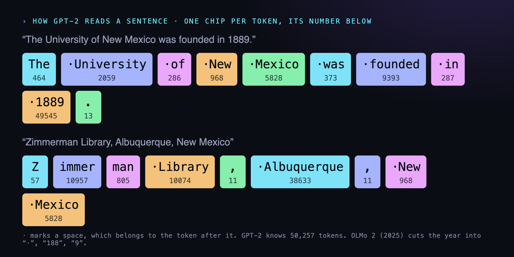
<figcaption markdown="span">
Two sentences as a language model receives them
<em>In GPT-2, common words and many years are a single token. A rarer name is cut into fragments. The model never sees letters, only these numbers. (Diagram for this deck, from GPT-2's tokenizer, OpenAI 2019.)</em>
</figcaption>
</figure>
</section>

<!-- ========== IMAGE: NEXT-TOKEN PROBABILITIES ========== -->
<section class="image-slide" markdown="1">
<figure class="landscape">
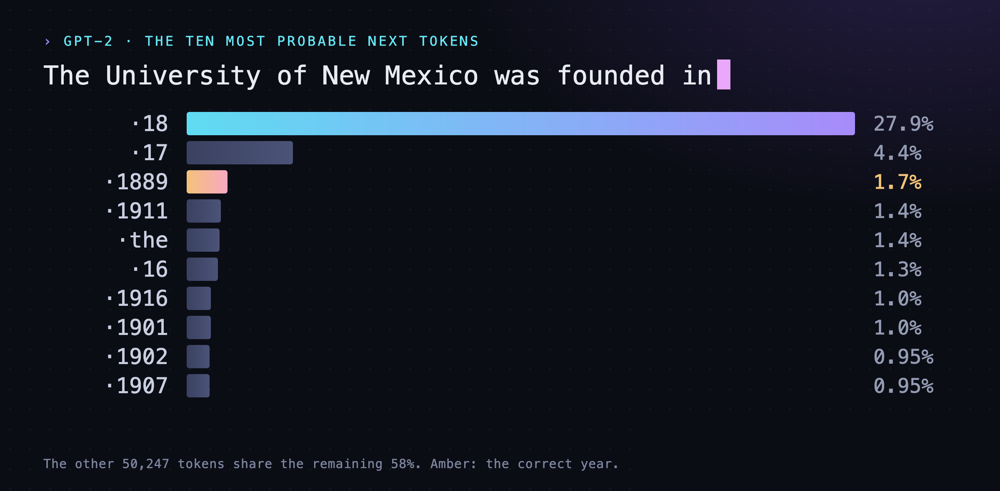
<figcaption markdown="span">
What a model actually puts out: a probability for every token it knows
<em>It picks one, adds it, and runs again: "18" becomes a year on the next step. As a whole year, 1889 is GPT-2's top choice; a 2025 model twelve times larger ranks it 23rd. (Diagram for this deck: GPT-2, OpenAI 2019.)</em>
</figcaption>
</figure>
</section>

<!-- ========== IMAGE: THREE RUNS ========== -->
<section class="image-slide" markdown="1">
<figure class="landscape">
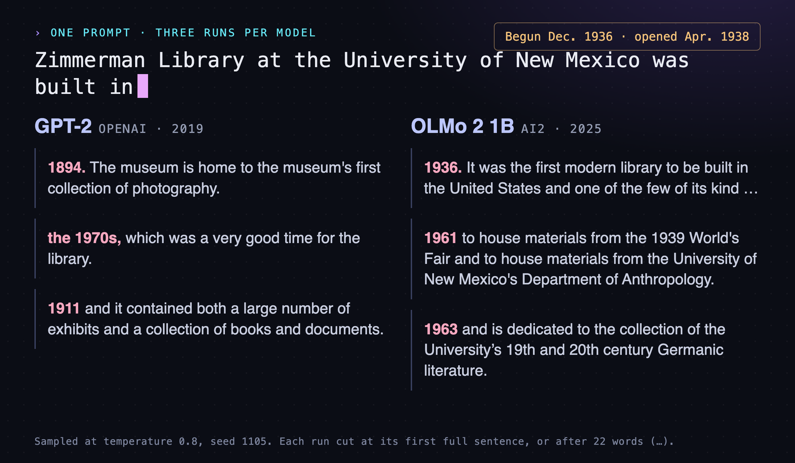
<figcaption markdown="span">
One prompt, three runs from each model, six dates
<em>Sampling gives each run a different answer. The library was begun in 1936; it was not, as one run says, "the first modern library" in the United States. (Diagram for this deck: GPT-2, OpenAI 2019; OLMo 2 1B, Ai2 2025.)</em>
</figcaption>
</figure>
</section>

<!-- ========== SEARCH OR MEMORY ========== -->
<section markdown="1">
Part one · with and without search
{: .eyebrow}

## A chatbot that searches summarizes real pages; one that doesn't works from memory
{: .main-point}

---

##### From memory

Every sentence is predicted from patterns in the training text. No source is stored as such, so the model cannot say where a sentence came from.

##### With search

It runs a web search, reads the top results, and writes a summary of them, predicted the same way. Its citations are real pages; what it says they say still needs checking.

</section>

<!-- ========== TUNING: THE RATERS ========== -->
<section markdown="1">
OpenAI · 2022 · stage four
{: .eyebrow}

## OpenAI tuned GPT-3 to what about forty hired raters preferred
{: .main-point}

---

"This procedure aligns the behavior of GPT-3 to the stated preferences of a specific group of people (mostly our labelers and researchers), rather than any broader notion of 'human values'"

Ouyang et al., "Training Language Models to Follow Instructions with Human Feedback" (OpenAI, 2022), p. 2

###### Then, ChatGPT
{: .label}

The raters were contractors hired through Upwork and Scale AI (p. 7). ChatGPT, released that November, was trained the same way, by OpenAI's own account. Its helpful, even voice comes mostly from this stage.

</section>

<!-- ========== IMAGE: A REASONING TRACE ========== -->
<section class="image-slide" markdown="1">
<figure class="landscape">
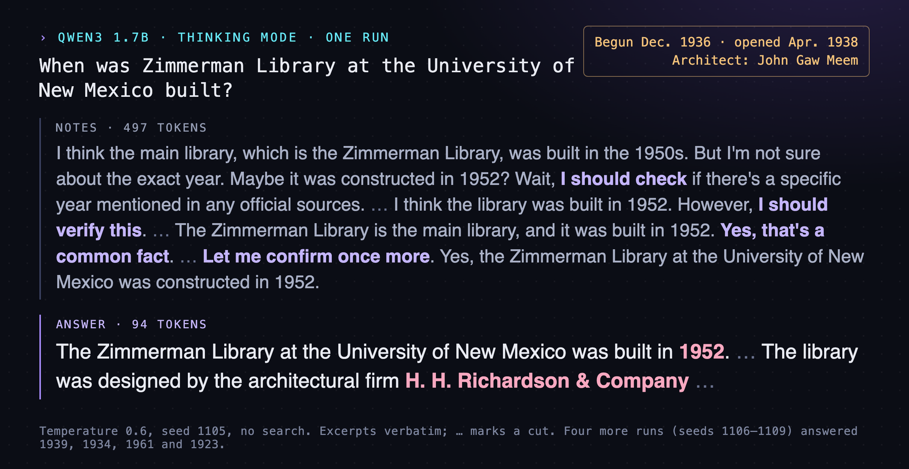
<figcaption markdown="span">
A reasoning model's notes, then its answer
<em>The notes speak of checking, yet nothing was looked up: notes and answer are both predicted. Reasoning is trained on questions with a checkable answer: math, not history. (Diagram for this deck: Qwen3 1.7B, Alibaba 2025.)</em>
</figcaption>
</figure>
</section>

<!-- ========== REASONING: THE NOTES ARE NOT A RECORD ========== -->
<section markdown="1">
Chen et al. · Anthropic · 2025
{: .eyebrow}

## A reasoning model's notes don't always say how it reached its answer
{: .main-point}

---

"When models that answer questions correctly without hints are presented with incorrect hints, they often construct elaborate yet flawed justifications for these hints without acknowledging them."

Chen et al., "Reasoning Models Don't Always Say What They Think," p. 7

###### The test
{: .label}

They slipped a hint toward one answer into multiple-choice questions. When the hint changed a model's answer, its notes admitted using it 25 percent of the time for Claude 3.7 Sonnet and 39 percent for DeepSeek R1 (p. 6).

###### For a historian
{: .label}

Notes that sound like checking are not a record of checking. They are more predicted text, to be criticized like the answer itself.

</section>

<!-- ================================================================ -->
<!-- ====== PART TWO: WHOSE TEXT ===================================== -->
<!-- ================================================================ -->

<!-- ========== CARR: WHO GIVES THE FLOOR ========== -->
<section markdown="1">
Part two · whose text · Carr, 1961
{: .eyebrow}

## In a language model, frequency decides which facts get the floor
{: .main-point}

---

"The facts speak only when the historian calls on them: it is he who decides to which facts to give the floor, and in what order or context."

Carr, <i>What Is History?</i>, p. 11

###### In a model
{: .label}

No historian decides. Each next word is picked by probability, so the facts written down most often speak first, and the rarely recorded hardly speak at all.

</section>

<!-- ========== IMAGE: PRONOUNS ========== -->
<section class="image-slide" markdown="1">
<figure class="landscape">
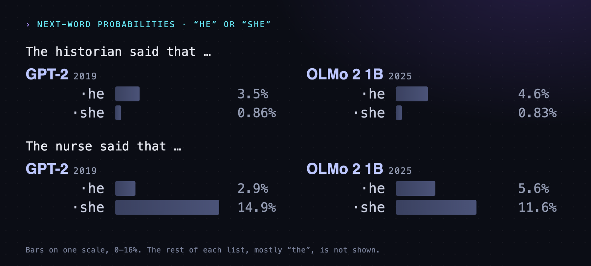
<figcaption markdown="span">
"The historian said that …" and "The nurse said that …"
<em>Nothing in the prompt says who the historian or the nurse is. The model supplies the usual answer from its training text. (Diagram for this deck: GPT-2, OpenAI 2019; OLMo 2 1B, Ai2 2025.)</em>
</figcaption>
</figure>
</section>

<!-- ========== IMAGE: THE PAPER ========== -->
<section class="image-slide" markdown="1">
<figure class="portrait">
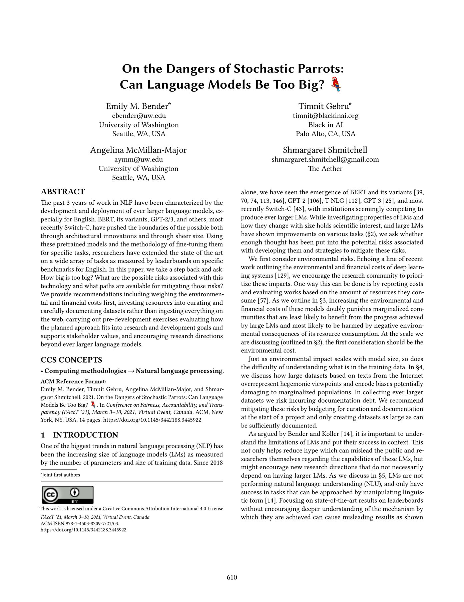
<figcaption markdown="span">
"On the Dangers of Stochastic Parrots," March 2021
<em>Two linguists and two computer scientists on what language models are and what they are trained on. Google asked its employees to withdraw the paper or their names; Mitchell signed as "Shmargaret Shmitchell." (ACM FAccT '21, p. 610. CC BY 4.0.)</em>
</figcaption>
</figure>
</section>

<!-- ========== IMAGE: BENDER ========== -->
<section class="image-slide" markdown="1">
<figure class="portrait">
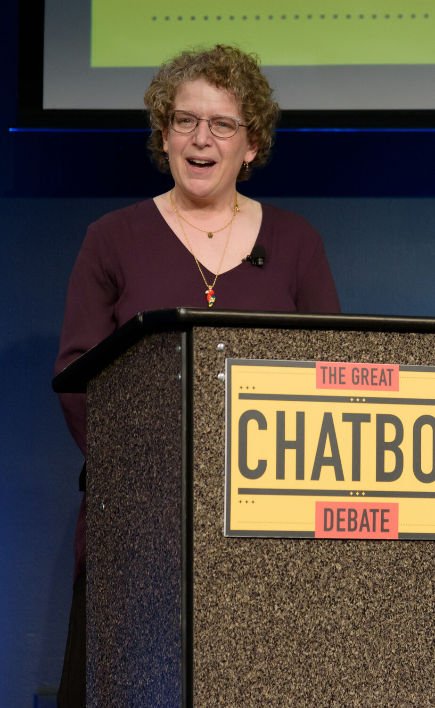
<figcaption markdown="span">
Emily M. Bender · b. 1973
<em>A linguist at the University of Washington since 2003, working on grammar and computational linguistics. Here at the Computer History Museum's "Great Chatbot Debate," March 2025.<strong>Why she matters:</strong> she argues that a model trained only on the form of language cannot reach its meaning.(Photo: King of Hearts, Wikimedia Commons, CC BY-SA 4.0.)</em>
</figcaption>
</figure>
</section>

<!-- ========== IMAGE: GEBRU ========== -->
<section class="image-slide" markdown="1">
<figure class="portrait">
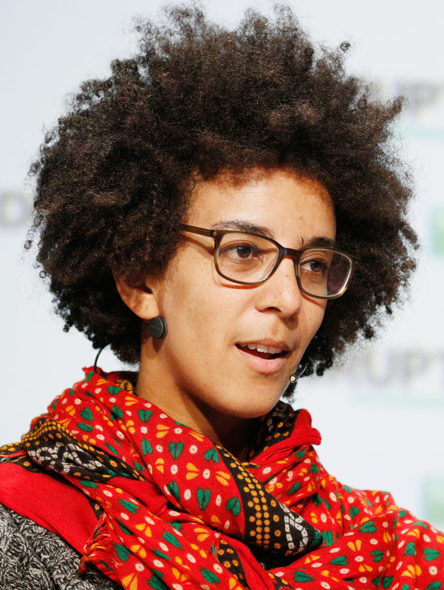
<figcaption markdown="span">
Timnit Gebru · b. 1983
<em>Born in Addis Ababa, she studied bias in facial recognition and co-led Google's Ethical AI team. Google said she resigned in December 2020; she says she was fired over this paper.<strong>Why she matters:</strong> she pushed the field to ask what is in the training data, and who it leaves out.(TechCrunch Disrupt, 2018. Photo: TechCrunch, CC BY 2.0.)</em>
</figcaption>
</figure>
</section>

<!-- ========== BENDER AND GEBRU: EVERY STEP ========== -->
<section markdown="1">
Bender et al. · 2021 · the training data
{: .eyebrow}

## From posting to filtering, every step favors the dominant view
{: .main-point}

---

"Thus at each step, from initial participation in Internet fora, to continued presence there, to the collection and finally the filtering of training data, current practice privileges the hegemonic viewpoint."

Bender et al., "Stochastic Parrots," p. 614

###### Who was writing
{: .label}

GPT-2 learned from pages linked on Reddit, and in a 2016 survey 67 percent of US Reddit users were men. Surveys found 8.8 to 15 percent of Wikipedia's editors were women (p. 613).

</section>

<!-- ========== TROUILLOT: FOUR MOMENTS (EXPLAINER) ========== -->
<section markdown="1">
Trouillot · 1995 · Week 9.2
{: .eyebrow}

## Silences enter history at four moments
{: .main-point}

---

<figure>
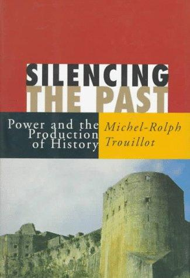
<figcaption>Beacon Press, 1995. Used for teaching.</figcaption>
</figure>

"Silences enter the process of historical production at four crucial moments: the moment of fact creation (the making of *sources*); the moment of fact assembly (the making of *archives*); the moment of fact retrieval (the making of *narratives*); and the moment of retrospective significance (the making of *history* in the final instance)."

Trouillot, <i>Silencing the Past</i>, p. 26

</section>

<!-- ========== IMAGE: 1791 ========== -->
<section class="image-slide" markdown="1">
<figure class="landscape">
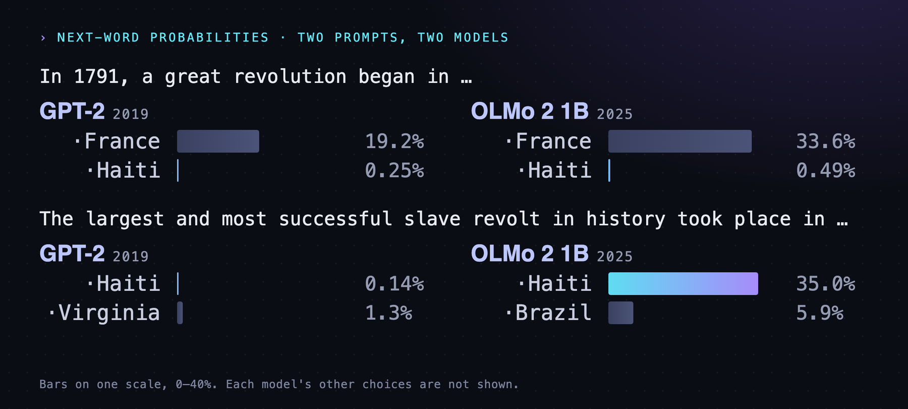
<figcaption markdown="span">
"In 1791, a great revolution began in …"
<em>Trouillot's "unthinkable" revolution (p. 27) began in Saint-Domingue, now Haiti, in August 1791. Both models answer France; asked about a slave revolt, the 2025 model answers Haiti. (Diagram for this deck: GPT-2, OpenAI 2019; OLMo 2 1B, Ai2 2025.)</em>
</figcaption>
</figure>
</section>

<!-- ========== THE PIPELINE AS TROUILLOT'S MOMENTS ========== -->
<section markdown="1">
Trouillot's moments · in a training pipeline
{: .eyebrow}

## A chatbot inherits the archive's silences and adds its own
{: .main-point}

---

###### 01 · sources
{: .num}

#### Who wrote online

Who posted, in which languages. Most of the past was never digitized at all.

###### 02 · archives
{: .num}

#### What was kept

What crawlers collected and what filters threw out, largely unchecked (Bender et al., p. 614).

###### 03 · narratives
{: .num}

#### What is likely

The most probable continuation: usually the version written down most often.

###### 04 · history
{: .num}

#### What sticks

Readers repeat the answer as the history, and it returns to the web to train the next model.

</section>

<!-- ================================================================ -->
<!-- ====== PART THREE: FLUENT WITHOUT MEANING ======================= -->
<!-- ================================================================ -->

<!-- ========== THE PARROT ========== -->
<section markdown="1">
Part three · fluency · Bender et al., 2021
{: .eyebrow}

## Bender, Gebru and their coauthors call a language model a stochastic parrot
{: .main-point}

---

"Contrary to how it may seem when we observe its output, an LM is a system for haphazardly stitching together sequences of linguistic forms it has observed in its vast training data, according to probabilistic information about how they combine, but without any reference to meaning: a stochastic parrot."

Bender et al., "Stochastic Parrots," pp. 616–17

</section>

<!-- ========== THE READER SUPPLIES THE COHERENCE ========== -->
<section markdown="1">
Bender et al. · 2021 · the reader
{: .eyebrow}

## The coherence, they argue, is supplied by the reader
{: .main-point}

---

"Text generated by an LM is not grounded in communicative intent, any model of the world, or any model of the reader's state of mind."

Bender et al., "Stochastic Parrots," p. 616

###### Why it reads as meant
{: .label}

Readers assume fluent text was meant by someone. The sense of meaning that results is, in their words, "an illusion arising from our singular human understanding of language" (p. 616).

###### Compare · Week 10.1
{: .label}

Davis read sixteenth-century pardon tales as stories shaped by tellers who wanted something.

</section>

<!-- ========== GURNEE AND TEGMARK (EXPLAINER) ========== -->
<section markdown="1">
Gurnee and Tegmark · MIT · 2024
{: .eyebrow}

## Others find more than a parrot: a rough map of the world inside a model
{: .main-point}

---

<figure>

<figcaption>Places read from Llama-2's internal activity by a simple trained probe. Gurnee and Tegmark, fig. 1. Used for teaching.</figcaption>
</figure>

"…an enormous collection of superficial statistics or a set of more coherent and grounded representations that reflect the real world."

Gurnee and Tegmark, "Language Models Represent Space and Time" (ICLR 2024), p. 1

The map is of the well-known: only places with 5,000 Wikipedia page views, which they expected a model to know (p. 13).
{: .detail}

</section>

<!-- ========== THREE INVENTED DISSERTATIONS ========== -->
<section markdown="1">
Kalai et al. · 2025
{: .eyebrow}

## Chatbots asked for a scholar's dissertation each invented a different one
{: .main-point}

---

###### ChatGPT · GPT-4o
{: .num}

#### CMU, 2002

"Boosting, Online Algorithms, and Other Topics in Machine Learning"

###### DeepSeek
{: .num}

#### Harvard, 2005

"Algebraic Methods in Interactive Machine Learning"

###### Llama
{: .num}

#### MIT, 2007

"Efficient Algorithms for Learning and Playing Games"

Kalai et al., "Why Language Models Hallucinate" (2025), p. 2, table 1
{: .cite}

###### The right answer
{: .label}

The scholar was the paper's first author, Adam Tauman Kalai. None of the three got the title or the year of his 2001 dissertation.

</section>

<!-- ========== WHY THEY BLUFF ========== -->
<section markdown="1">
Kalai et al. · 2025 · why
{: .eyebrow}

## Training rewards a confident guess over an admission of doubt
{: .main-point}

---

"Bluffs are often overconfident and specific, such as 'September 30' rather than 'Sometime in autumn' for a question about a date."

Kalai et al., "Why Language Models Hallucinate," p. 4

###### How models are graded
{: .label}

Most tests score like exams: a guess can earn a point, "I don't know" earns none. So models are, the authors write, "always in 'test-taking' mode" (p. 4).

###### Compare · the AI essay guide
{: .label}

A confident-sounding account with no admission of gaps or uncertainty is a serious red flag.

</section>

<!-- ========== MAZA: THE EMBARGO ========== -->
<section markdown="1">
Maza · Week 10.1
{: .eyebrow}

## A model has the historian's prose without the embargo on invention
{: .main-point}

---

"Agreement reigns in principle that historians are bound by the facts and obey a strict embargo on invention. But the historian's task also consists in assembling scattered sources and connecting the dots between them, and superior historical work involves the ability to imagine the past and recreate it in vivid prose."

Maza, <i>Thinking About History</i>, p. 225

###### Half of the task
{: .label}

A language model connects dots and writes vivid prose with ease. It cannot keep the embargo: nothing in it separates a sentence drawn from a source from one it filled in.

</section>

<!-- ================================================================ -->
<!-- ====== PART FOUR: THE RECORD ==================================== -->
<!-- ================================================================ -->

<!-- ========== PART FOUR OPENS ========== -->
<section markdown="1">
Part four · the record
{: .eyebrow}

## Machine learning now reads some archives no one could, and pollutes others
{: .main-point}

---

So far the record has been what models learn from. They are also changing the record itself.
{: .detail}
</section>

<!-- ========== IMAGE: HERCULANEUM ========== -->
<section class="image-slide" markdown="1">
<figure class="landscape">
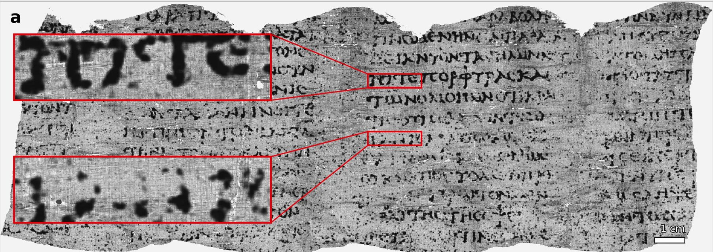
<figcaption markdown="span">
PHerc. Paris 4, read in 2023
<em>A scroll carbonized by Vesuvius in 79 CE, too fragile to unroll. A team of three trained models on CT scans to find the ink, making over 2,000 characters of Greek legible. (Vesuvius Challenge, 2024. CC BY-NC 4.0.)</em>
</figcaption>
</figure>
</section>

<!-- ========== HERCULANEUM: WHAT IT SAYS ========== -->
<section markdown="1">
PHerc. Paris 4 · what it says
{: .eyebrow}

## The scroll holds a text unseen for 2,000 years, an argument about pleasure
{: .main-point}

---

"…as too in the case of food, we do not right away believe things that are scarce to be absolutely more pleasant than those which are abundant."

PHerc. Paris 4, tr. Vesuvius Challenge papyrologists (2024)

###### What it says
{: .label}

An Epicurean, very likely Philodemus, the villa's resident philosopher, weighs scarce pleasures against plentiful ones. He names a Xenophantus, perhaps a musician, and ends by mocking rivals with "nothing to say about pleasure."

###### What a historian gains
{: .label}

A work unread since antiquity, from a library that survived while almost every other ancient text decayed. The models find the ink; papyrologists read the Greek. By 2024, about 5 percent of the scroll.

</section>

<!-- ========== WORDFREQ ========== -->
<section markdown="1">
wordfreq · 2024
{: .eyebrow}

## A word-frequency project stopped updating, saying generated text had polluted its data
{: .main-point}

---

"I don't think anyone has reliable information about post-2021 language usage by humans."

Robyn Speer, "Why wordfreq will not be updated" (GitHub, September 2024)

###### For the archive
{: .label}

A historian of the 2020s will meet web sources that cannot be sorted by eye into human and machine. Provenance, the first question about any document, gets harder to answer.

</section>

<!-- ========== CARR: STUDY THE HISTORIAN ========== -->
<section markdown="1">
Carr · 1961
{: .eyebrow}

## Carr's first rule still holds, but a chatbot has no one historian to study
{: .main-point}

---

"Study the historian before you begin to study the facts."

Carr, <i>What Is History?</i>, p. 23

###### Who to study instead
{: .label}

Behind each answer: millions of writers, a company's crawlers and filters, the raters who tuned it, and, if it searched, the pages it found. Studying those is source criticism now.

</section>

<!-- ========== WHAT CHANGES ========== -->
<section markdown="1">
Part four · historical practice
{: .eyebrow}

## Language models change what historians read and how they must check it
{: .main-point}

---

#### Archives read faster

Transcribing handwriting, translating, and searching collections too large for anyone to read.

#### Provenance gets harder

Since about 2021 a web source may be machine-written, and the record of our own time is harder to trust.

#### Narratives drift to the probable

A chatbot's history leans toward what was written most: the famous, the digitized, the English.

#### Checking becomes the job

Finding sources, weighing them, and asking what is missing: the work a model does worst.

</section>

<!-- ================================================================ -->
<!-- ====== CLOSE ==================================================== -->
<!-- ================================================================ -->

<!-- ========== THE ARC ========== -->
<section markdown="1">
AI and history · looking back
{: .eyebrow}

## Prediction, its sources, its fluency, and the record
{: .main-point}

---

###### 01 · how it works
{: .num}

#### Trained to predict

A chatbot predicts text from patterns in what it read, tuned to what raters preferred.

###### 02 · Bender et al., Trouillot
{: .num}

#### Inheriting silences

Its training data favors the dominant view and adds new silences to the archive's.

###### 03 · Bender et al., Kalai et al.
{: .num}

#### Fluent without meaning

Readers supply the coherence, and training rewards a confident guess.

###### 04 · Carr
{: .num}

#### A changed record

Image models read lost texts; language models fill the web with text whose maker is hard to name.

</section>

<!-- ========== THE TAKE HOME ========== -->
<section data-transition="fade" markdown="1">
The take home
{: .eyebrow}

## A language model writes the most probable history, not the best-sourced one
{: .main-point}

---

###### What it does well
{: .label}

Fluent summaries, transcription, translation and drafts, in seconds. Read as a source to be criticized, it can help.

###### What it cannot do
{: .label}

Tell its sourced sentences from its invented ones, or keep the embargo on invention. Its silences are the archive's and the web's together.

The cost: the more history machines write, the more of a historian's work becomes checking it.

</section>

<!-- ========== CLOSE: WHAT IS ZIMMERMAN LIBRARY? ========== -->
<section markdown="1">
Close · one question
{: .eyebrow}

## What is Zimmerman Library?
{: .main-point}

</section>

<!-- ========== IMAGE: ZIMMERMAN, 2010 ========== -->
<section class="image-slide" markdown="1">
<figure class="landscape">

<figcaption markdown="span">
Zimmerman Library, UNM, Albuquerque NM
<em>Photograph, 11 May 2010. John Phelan, Wikimedia Commons, CC BY-SA 3.0.</em>
</figcaption>
</figure>
</section>

<!-- ========== IMAGE: ZIMMERMAN, 1938 ========== -->
<section class="image-slide" markdown="1">
<figure class="landscape">
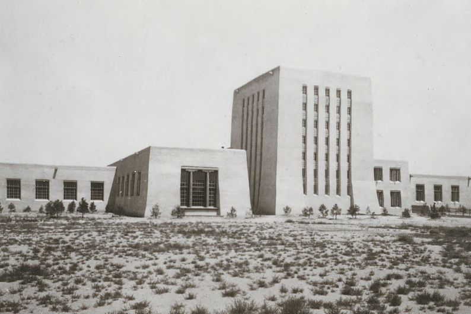
<figcaption markdown="span">
Library - Zimmerman - exterior - east side prior to additions
<em>Color slide, 1938? UNM Archives, UNMA 028, box 66. Center for Southwest Research.</em>
</figcaption>
</figure>
</section>

<!-- ========== WHAT COMES NEXT ========== -->
<section markdown="1">
Next · Campus History, part two
{: .eyebrow}

## Next: the archive, where the sources the chatbot never read are kept
{: .main-point}

</section>
