<!-- ========== TITLE ========== -->
<section data-transition="fade" markdown="1">
Making History • HIST 1105 • Week 14.2
{: .eyebrow}

# Environmental History
{: .main-point}

---

- Background: Sarah Maza, *Thinking About History* (2017), ch. 3: "The History of What?", 108–117
- William Cronon, "The Uses of Environmental History," *Environmental History Review* 17, no. 3 (1993), 1–22
- Optional: Dipesh Chakrabarty, "The Climate of History: Four Theses," *Critical Inquiry* 35, no. 2 (2009), 197–211
{: .source-list}
</section>

<!-- ================================================================ -->
<!-- ================= PART ONE: THE FIELD EMERGES ================== -->
<!-- ================================================================ -->

<!-- ========== BACON: NATURE VEXED ========== -->
<section markdown="1">

<figure>
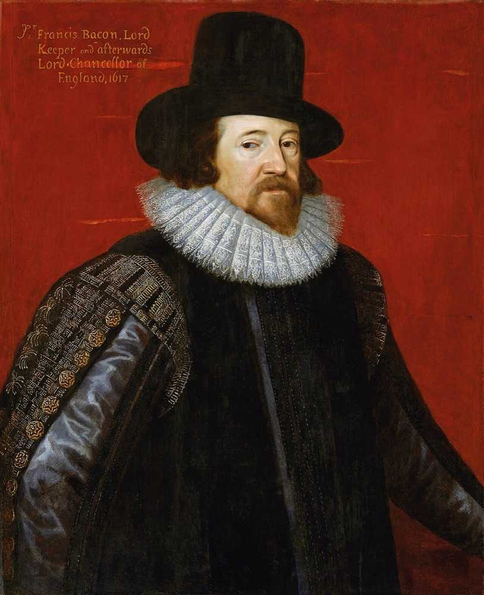
<figcaption>Paul van Somer, <i>Francis Bacon</i>, 1617 · public domain</figcaption>
</figure>

1620 · Francis Bacon
{: .eyebrow}

## Bacon wanted nature forced to give up her secrets
{: .main-point}

"nature under constraint and vexed; that is to say, when by art and the hand of man she is forced out of her natural state, and squeezed and moulded." Bacon, <i>The Great Instauration</i> (1620), "Plan of the Work," trans. James Spedding
{: .quote.compact}

Bacon, later Lord Chancellor of England, gave an old claim a method. In Genesis, God grants man "dominion … over all the earth" (Maza, p. 109).
{: .detail}

</section>

<!-- ========== IMAGE: PIONEER RUN ========== -->
<section class="image-slide" data-background="#0d1412" markdown="1">
<figure class="landscape">
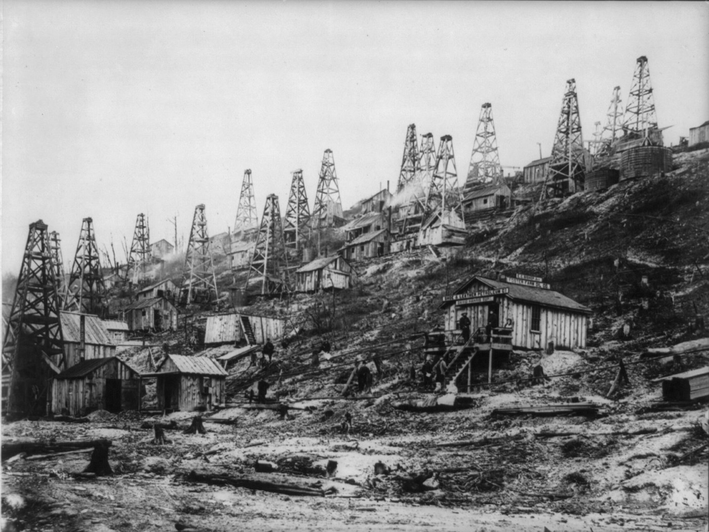
<figcaption markdown="span">
Oil derricks on Pioneer Run, Pennsylvania, late nineteenth century
<em>Industrial economies treated forests, coal and oil as stores to be drawn down. The stumps in front were the hillside's forest. (Library of Congress. Public domain.)</em>
</figcaption>
</figure>
</section>

<!-- ========== ROMANTIC NATURE ========== -->
<section markdown="1">

<figure>
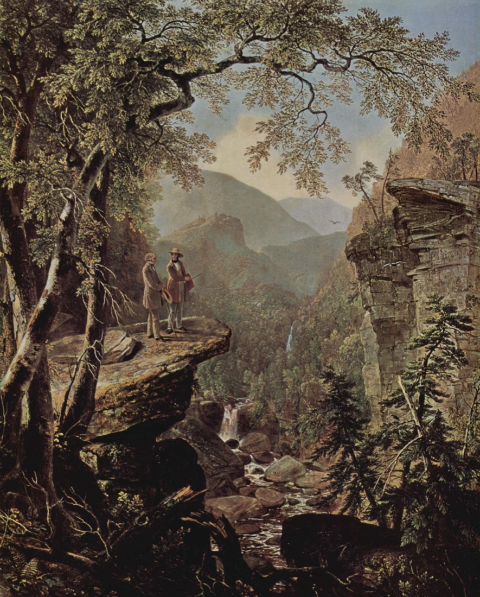
<figcaption>Asher B. Durand, <i>Kindred Spirits</i>, 1849: the painter Thomas Cole and the poet William Cullen Bryant in the Catskills · public domain</figcaption>
</figure>

1760s–1850s · romantic nature
{: .eyebrow}

## Romantic writers made nature a refuge from society
{: .main-point}

"a romantic tradition, articulated by writers from Jean-Jacques Rousseau to Henry David Thoreau, that enshrined the natural world as the virtuous alternative to human decadence." Maza, <i>Thinking About History</i>, p. 109
{: .quote.compact}

All three pictured nature as passive and unchanging. That picture "lay behind the earliest writings on environmental history in the late nineteenth and early twentieth century" (p. 109).
{: .detail}

</section>

<!-- ========== BACKDROP, THEN VICTIM ========== -->
<section markdown="1">
1870s–1960s · backdrop, then victim
{: .eyebrow}

## Nature was history's backdrop, then entered it as a victim
{: .main-point}

<figure>
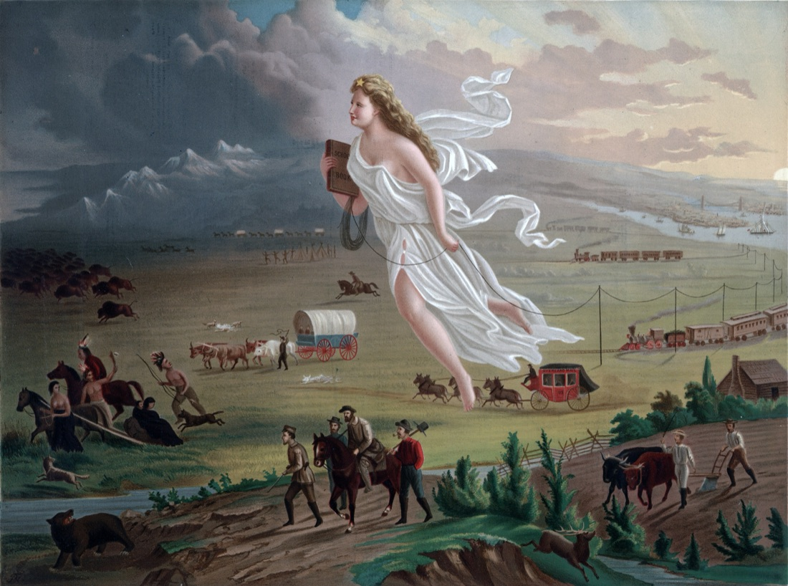
<figcaption>John Gast, <i>American Progress</i>, 1872 · public domain</figcaption>
</figure>

"Long the barely noticed backdrop to human activity, the natural world initially entered history as the vulnerable object of human hubris and greed." Maza, <i>Thinking About History</i>, p. 109
{: .quote.compact}

Nineteenth-century Americans told the settling of the wilderness as a triumph. Rival accounts told it as the destruction of nature (p. 109).
{: .detail}

</section>

<!-- ========== THE 1970S ========== -->
<section markdown="1">

<figure>
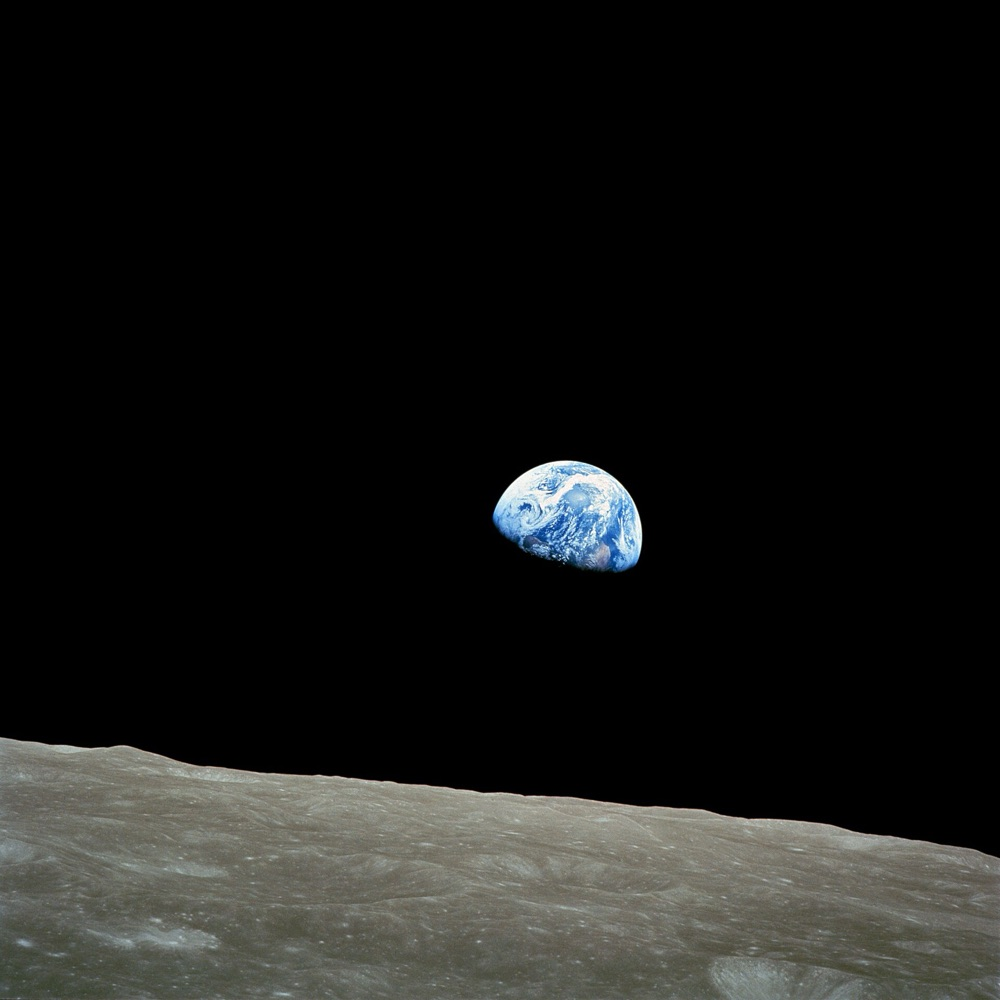
<figcaption><i>Earthrise</i>, from Apollo 8, 1968 · NASA · public domain</figcaption>
</figure>

1970s · a field with a cause
{: .eyebrow}

## The field took shape alongside the environmental movement
{: .main-point}

"this field has, since taking shape in its modern form starting in the 1970s, been closely connected with a specific political project, that of environmental conservation." Maza, <i>Thinking About History</i>, p. 109
{: .quote.compact}

Its early books mostly showed people damaging nature (p. 111).
{: .detail}

</section>

<!-- ========== WILDERNESS ========== -->
<section markdown="1">

<figure>
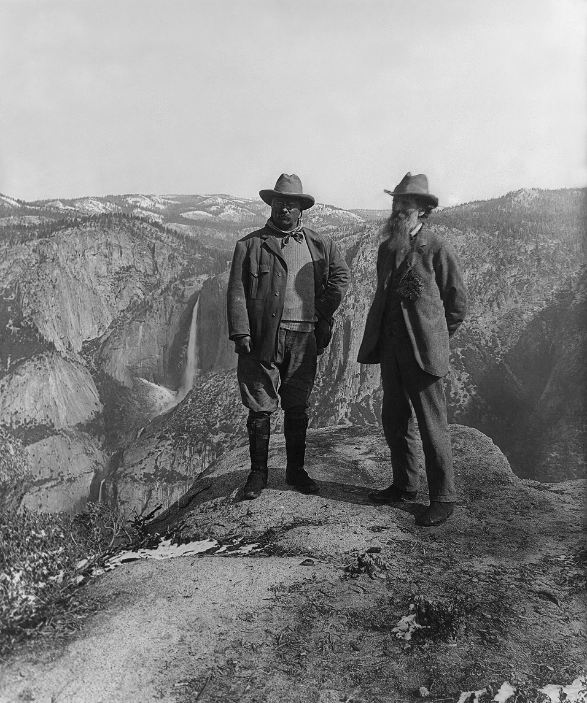
<figcaption>Theodore Roosevelt and John Muir at Glacier Point, Yosemite, 1903 · public domain</figcaption>
</figure>

1967 · wilderness
{: .eyebrow}

## A history of the wilderness idea shaped the fight to protect it
{: .main-point}

"Roderick Nash's <i>Wilderness and the American Mind</i> has played a significant role in helping frame debates about wilderness protection in the three decades since its publication." Cronon, "The Uses of Environmental History," pp. 2–3
{: .quote.compact}

Cronon also calls it a "whig history of wilderness consciousness" (p. 22 n. 27).
{: .detail}

</section>

<!-- ========== CONSERVATION AND PRESERVATION ========== -->
<section markdown="1">
1890s–1910s · two movements
{: .eyebrow}

## Conservationists managed nature for use; preservationists set places aside
{: .main-point}

---

##### Conservation · Gifford Pinchot

Forests, rivers and grasslands were resources, to be run by trained experts for a steady yield. Pinchot, Theodore Roosevelt's forester, became the first chief of the U.S. Forest Service in 1905.

##### Preservation · John Muir

Some places were worth more untouched, for their beauty and for the spirit. Muir, a Scottish-born naturalist, helped found the Sierra Club in 1892 and was its first president.

</section>

<!-- ========== HETCH HETCHY ========== -->
<section markdown="1">
Hetch Hetchy · 1908–1913
{: .eyebrow}

## A dam in Yosemite set the two movements against each other
{: .main-point}

<figure>

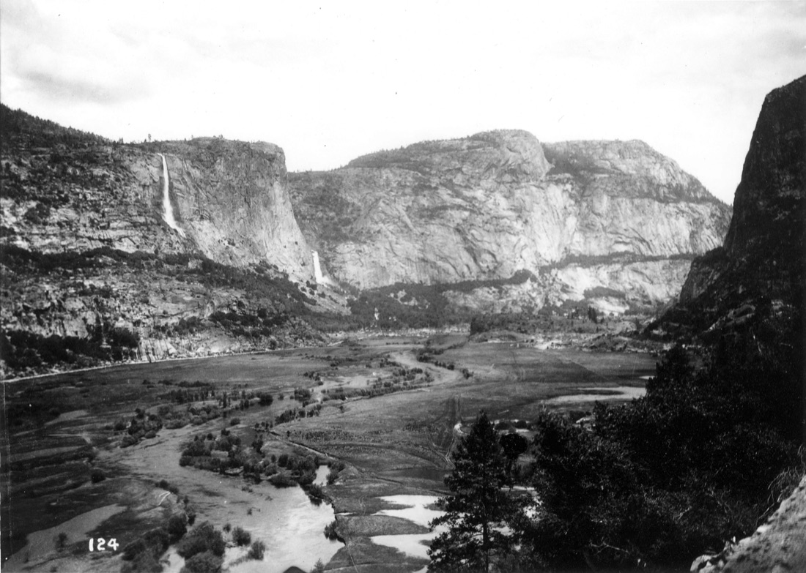
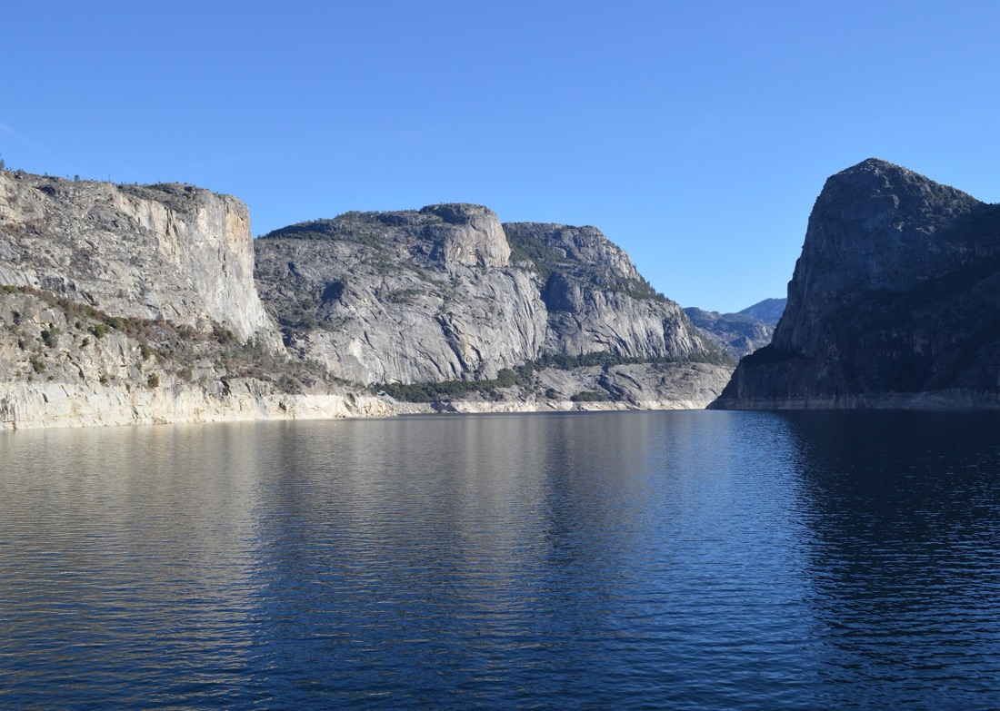

<figcaption>Isaiah West Taber, Hetch Hetchy Valley before the dam, published 1908 · public domainThe same view as Hetch Hetchy Reservoir, 2014 · Blake Carroll · CC0</figcaption>
</figure>

"Dam Hetch Hetchy! As well dam for water-tanks the people's cathedrals and churches, for no holier temple has ever been consecrated by the heart of man." Muir, <i>The Yosemite</i> (1912), p. 262
{: .quote.compact}

San Francisco wanted a reservoir, and Pinchot backed it. Congress approved the dam in 1913.
{: .detail}

</section>

<!-- ========== ALIGNED ========== -->
<section markdown="1">
1890s–1910s · common ground
{: .eyebrow}

## Away from Hetch Hetchy, the two camps usually wanted the same things
{: .main-point}

---

#### Public land, public rules

Both opposed timber, grazing and hunting interests stripping the public domain, and both wanted the federal government to keep the land and set its rules.

#### Muir and Pinchot started as allies

They toured the western forests together with the 1896 Forest Commission. They split in 1897 over letting sheep graze the forest reserves.

#### One president did both

Roosevelt, advised by Pinchot, created about 150 national forests. He also created five national parks and eighteen national monuments, the Grand Canyon among them.

</section>

<!-- ========== BOTH MOVEMENTS ========== -->
<section markdown="1">
Aldo Leopold · 1887–1948
{: .eyebrow}

## Both movements joined an older story of nature's decline
{: .main-point}

<figure>
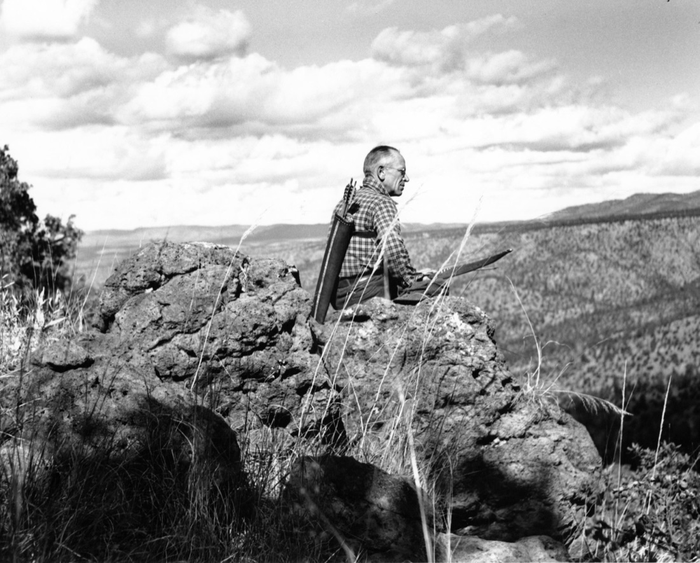
<figcaption>Aldo Leopold above the Rio Gavilan, northern Mexico, 1938 · U.S. Forest Service · public domain</figcaption>
</figure>

"declensionist chronicles of man's destructive impact on nature, which converged with the efforts of early conservationists like John Muir and Aldo Leopold." Maza, <i>Thinking About History</i>, p. 109
{: .quote.compact}

In 1924 the forester Leopold got New Mexico's Gila made the first wilderness area.
{: .detail}

###### Each movement got its history
{: .label}

Samuel Hays's <i>Conservation and the Gospel of Efficiency</i> (1959) told the conservationists' story, Nash's book the preservationists'. Cronon says Nash helped frame later fights over wilderness, and Hays spoke as strongly to conservation politics (pp. 2–3).

</section>

<!-- ========== DUST BOWL ========== -->
<section markdown="1">

<figure>
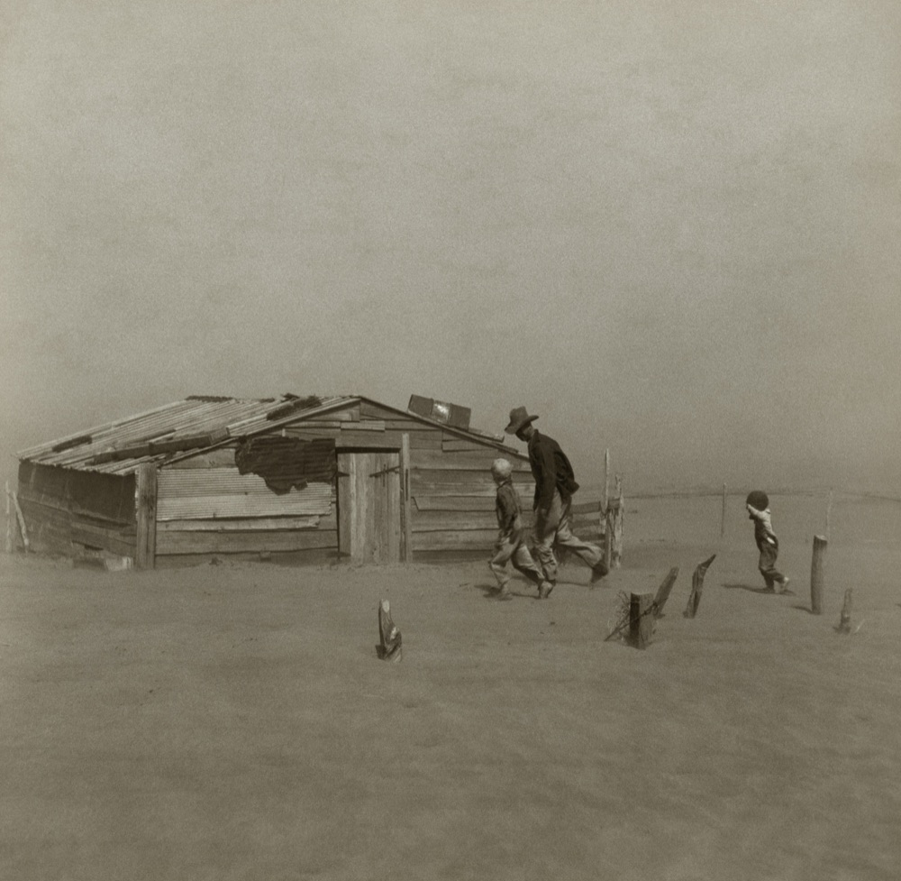
<figcaption>Arthur Rothstein, a dust storm in Cimarron County, Oklahoma, 1936 · public domain</figcaption>
</figure>

1979 · decline
{: .eyebrow}

## A history of the Dust Bowl traced the disaster to capitalism
{: .main-point}

"<i>Dust Bowl</i> and <i>Rivers of Empire</i> located the origins of environmental degradation in capitalist world-views and modes of production that are as alive in the present as they have been in the past." Cronon, "The Uses of Environmental History," p. 3
{: .quote.compact}

Maza calls Donald Worster's <i>Dust Bowl</i> (1979) a "classic, still popular account" (p. 110 n. 62).
{: .detail}

</section>

<!-- ========== CHANGES IN THE LAND ========== -->
<section markdown="1">
1983 · <i>Changes in the Land</i>
{: .eyebrow}

## Cronon's first book set two ways of using New England's land side by side
{: .main-point}

<figure>
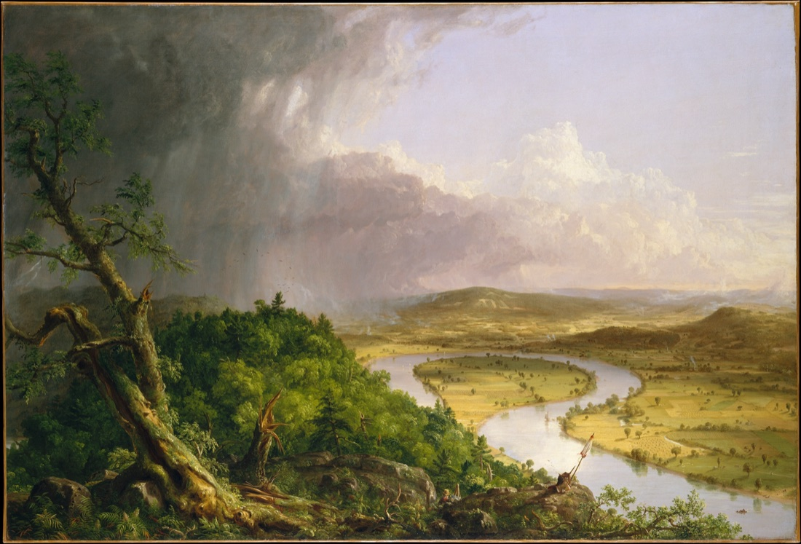
<figcaption>Thomas Cole, <i>The Oxbow</i>, 1836: the Connecticut River in Massachusetts · public domain</figcaption>
</figure>

"The pig was not merely a pig … but a creature bound among other things to the fence, the dandelion, and a very special definition of property." Cronon, <i>Changes in the Land</i> (1983), quoted in Maza, p. 112
{: .quote.compact}

Native people moved with the seasons. Colonists fenced, cleared and sold. Cronon avoids "villains and victims" (pp. 111–12).
{: .detail}

</section>

<!-- ========== ECOLOGICAL IMPERIALISM ========== -->
<section markdown="1">
1986 · <i>Ecological Imperialism</i>
{: .eyebrow}

## Europeans conquered with weeds, livestock and germs
{: .main-point}

<figure>
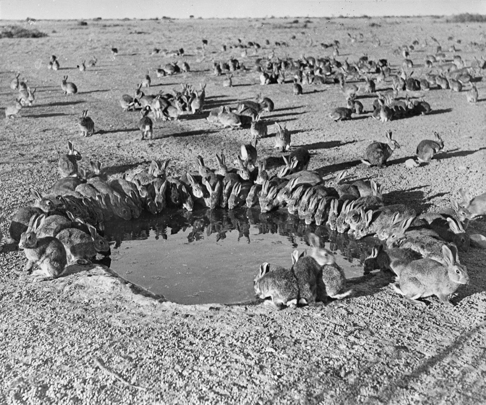
<figcaption>Rabbits at a waterhole, Wardang Island, South Australia, 1938 · public domain</figcaption>
</figure>

"they came with invisible and ultimately irresistible biological allies: weeds, proliferating livestock such as rabbits and pigs, and above all pathogens." Maza, <i>Thinking About History</i>, p. 114
{: .quote.compact}

Alfred Crosby's book asks why Europeans settled so successfully in North America, Australia and New Zealand (pp. 113–14).
{: .detail}

</section>

<!-- ========== TOPICS ========== -->
<section markdown="1">
By the 1990s · subjects
{: .eyebrow}

## The field took on many more subjects than wilderness
{: .main-point}

---

#### Science and gender

Carolyn Merchant, <i>The Death of Nature</i> (1980): "western science has harmed nature and women in parallel ways" (Cronon, p. 3).

#### Fire

Stephen Pyne's histories of fire, written to show managers "the complexity of their task" (Cronon, p. 3).

#### Cities

Joel Tarr's studies of "pollution and waste streams," aimed at policymakers (Cronon, p. 3).

#### Fisheries

"People mismanage fish" when they misunderstand ecosystems (Cronon, p. 9).

#### Unequal environments

"the socially unequal impact of urban physical environments" (Maza, p. 111).

#### Animals

The "shifting status of animals in human societies" (Maza, p. 115).

</section>

<!-- ================================================================ -->
<!-- ====================== PART TWO: CRONON ======================== -->
<!-- ================================================================ -->

<!-- ========== CRONON: THE QUESTION ========== -->
<section markdown="1">
Cronon · 1993 · the question
{: .eyebrow}

## Cronon's students finished his environmental history course in despair
{: .main-point}

---

"What my students had apparently concluded from their encounter with my subject was that the American environment had gone from good to bad in an unrelentingly depressing story that left little or no hope for the future."

Cronon, "The Uses of Environmental History," p. 1

The essay asks what the field is good for, and for whom (pp. 2–7).
{: .detail}
</section>

<!-- ========== HYBRID ========== -->
<section markdown="1">
A second generation · hybrid
{: .eyebrow}

## Later historians stopped treating nature and culture as opposites
{: .main-point}

<figure>

<figcaption>Grand Coulee Dam, Columbia River, 1986 · U.S. Bureau of Reclamation · public domain</figcaption>
</figure>

"current scholarship mostly rejects the myth of a pure, unsullied nature in favor of the view that 'all environments are hybrid.'" Maza, <i>Thinking About History</i>, p. 110, quoting Paul Sutter
{: .quote.compact}

The first generation saw a western dam as "destructive domination." The second saw a "second nature" (p. 110).
{: .detail}

###### Discuss
{: .label}

**Is a dammed river still nature?**

</section>

<!-- ========== CRONON: PRACTICAL LESSONS ========== -->
<section markdown="1">
Cronon · 1993 · findings
{: .eyebrow}

## Cronon lists practical lessons the field has already taught
{: .main-point}

---

#### Markets hide their effects

Buyers and sellers "link together ecosystems and encourage change, rarely understanding the full ecological implications" (p. 8).

#### Migrants bring company

People who move "carry with them other organisms—plants, animals, microbes" (p. 8).

#### Tools depend on culture

Technology's effects "are powerfully mediated by the cultures in which they are embedded" (p. 8).

#### Trash shows values

"If you want to understand people's environmental values, watch what they throw away" (p. 9).

Cronon, "The Uses of Environmental History," pp. 8–9
{: .cite}
</section>

<!-- ========== CRONON: FOUR HABITS ========== -->
<section markdown="1">
Cronon · 1993 · thinking like a historian
{: .eyebrow}

## Cronon finds the field's best use in four habits of thought
{: .main-point}

---

#### Nature is always there

"All human history has a natural context." People "are not the only actors who make history" (p. 13).

#### Nothing stands still

"Neither nature nor culture is static." Eras of balance are "almost surely golden-age myths" (p. 13).

#### Knowledge has a history

"All environmental knowledge is culturally constructed and historically contingent—including our own" (p. 14).

#### Parables, not predictions

"Historical wisdom usually comes in the form of parables, not policy recommendations or certainties" (p. 16).

###### Compare · Week 13.1
{: .label}

Constructivists treated scientific knowledge as made, not found. Cronon agrees, but nature still "exists quite apart from what we believe about it" (p. 15).

</section>

<!-- ================================================================ -->
<!-- ============== PART THREE: CHAKRABARTY AND BRAUDEL ============= -->
<!-- ================================================================ -->

<!-- ========== IMAGE: COALBROOKDALE ========== -->
<section class="image-slide" data-background="#0d1412" markdown="1">
<figure class="landscape">
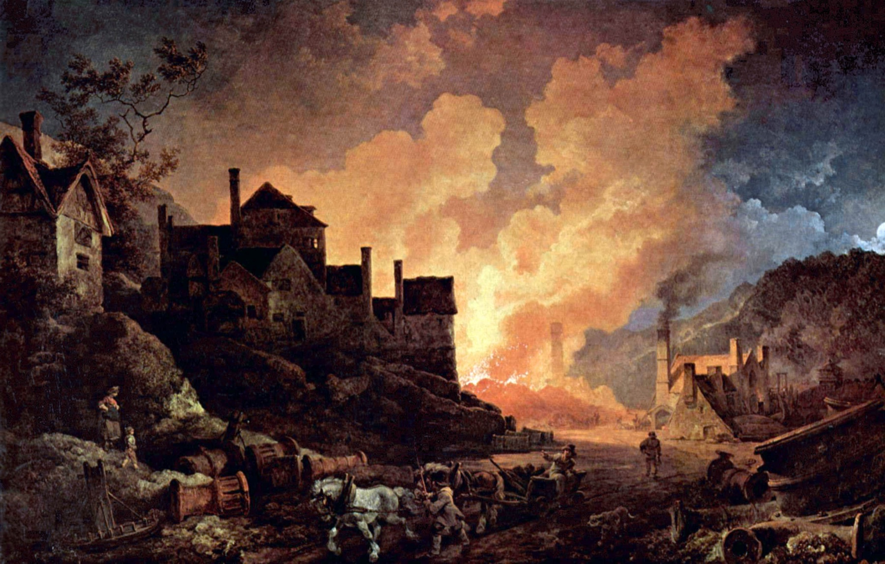
<figcaption markdown="span">
Philip James de Loutherbourg, <i>Coalbrookdale by Night</i>, 1801
<em>English iron furnaces burning coal. Some scientists date a new geological epoch, the Anthropocene, to the late eighteenth century, when carbon dioxide in the air began to climb (Chakrabarty, p. 209). (Science Museum, London, via Wikimedia Commons. Public domain.)</em>
</figcaption>
</figure>
</section>

<!-- ========== CHAKRABARTY: GEOLOGICAL FORCE ========== -->
<section markdown="1">
Chakrabarty · 2009 · climate
{: .eyebrow}

## Chakrabarty: humans have become a geological force
{: .main-point}

---

"To call human beings geological agents is to scale up our imagination of the human. … we can become geological agents only historically and collectively, that is, when we have reached numbers and invented technologies that are on a scale large enough to have an impact on the planet itself."

Chakrabarty, "The Climate of History," pp. 206–7

###### Biological, then geological
{: .label}

Environmental historians had shown people as biological agents, carrying germs, crops and animals. Changing the climate is a different scale of power, acquired only since the Industrial Revolution (pp. 205–7).

</section>

<!-- ========== BRAUDEL AND CHAKRABARTY ========== -->
<section markdown="1">
Braudel and Chakrabarty
{: .eyebrow}

## Braudel's slowest layer of history can now move fast
{: .main-point}

---

##### Braudel, preface to *The Mediterranean* (1949)

"a history that is almost changeless, the history of man in relation to his surroundings" (<i>On History</i>, p. 3)

##### Chakrabarty, "The Climate of History" (2009)

"this slow and apparently timeless backdrop for human actions transforms itself with a speed that can only spell disaster for human beings" (p. 205)

###### Prisoner, or maker
{: .label}

Braudel made the environment active when most historians left it as scenery (p. 205). Even environmental history, Chakrabarty says, was "still a vision of man 'as a prisoner of climate,'" in Braudel's phrase, "and not of man as the maker of it" (p. 206).

</section>

<!-- ========== CHAKRABARTY: FREEDOM ========== -->
<section markdown="1">
Chakrabarty · 2009 · freedom
{: .eyebrow}

## Chakrabarty ties modern freedoms to fossil fuels
{: .main-point}

---

"The mansion of modern freedoms stands on an ever-expanding base of fossil-fuel use. Most of our freedoms so far have been energy-intensive."

Chakrabarty, "The Climate of History," p. 208

###### Discuss
{: .label}

**Historians since the Enlightenment have told modern history as a story of growing freedom. Does coal belong in that story?**

</section>

<!-- ========== THE TAKE HOME ========== -->
<section data-transition="fade" markdown="1">
The take home
{: .eyebrow}

## Environmental history puts people back inside nature
{: .main-point}

---

"There cannot be people outside of nature; there can only be people <i>thinking</i> they are outside of nature."

Cronon, "The Uses of Environmental History," p. 19

</section>

<!-- ========== CLOSING ========== -->
<section markdown="1">
Next · 15.1 · food history
{: .eyebrow}

## What food tells us about us
{: .main-point}
</section>
