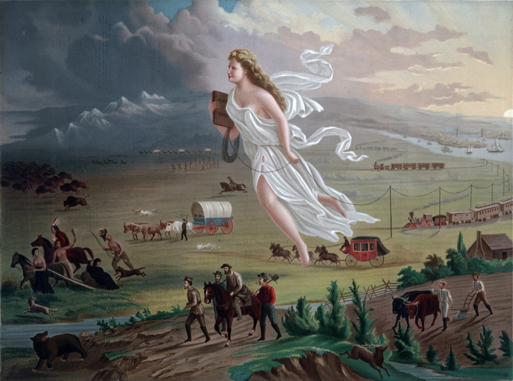
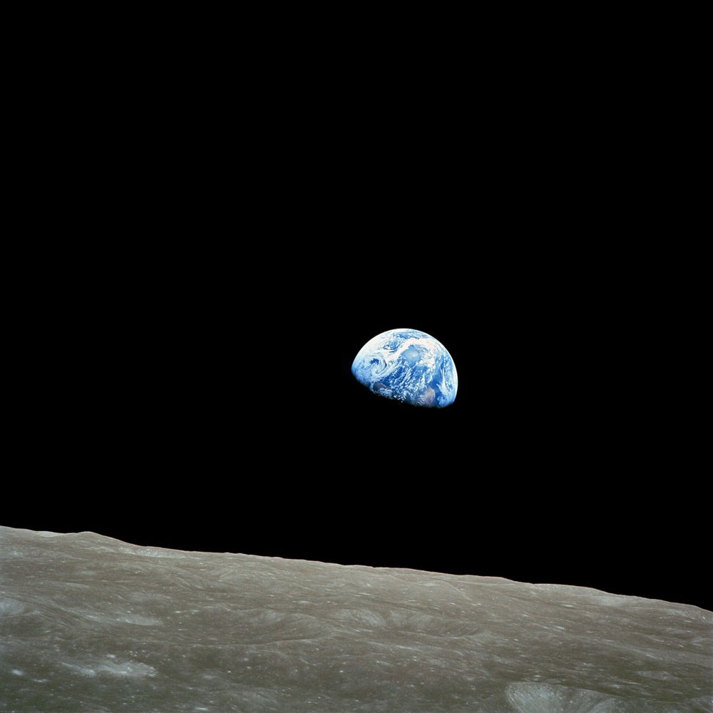
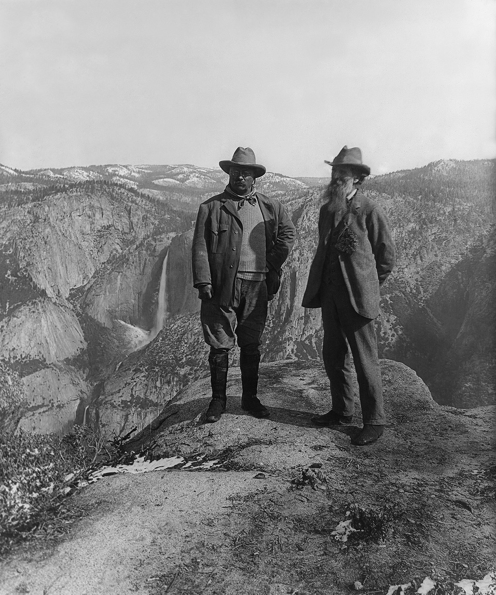
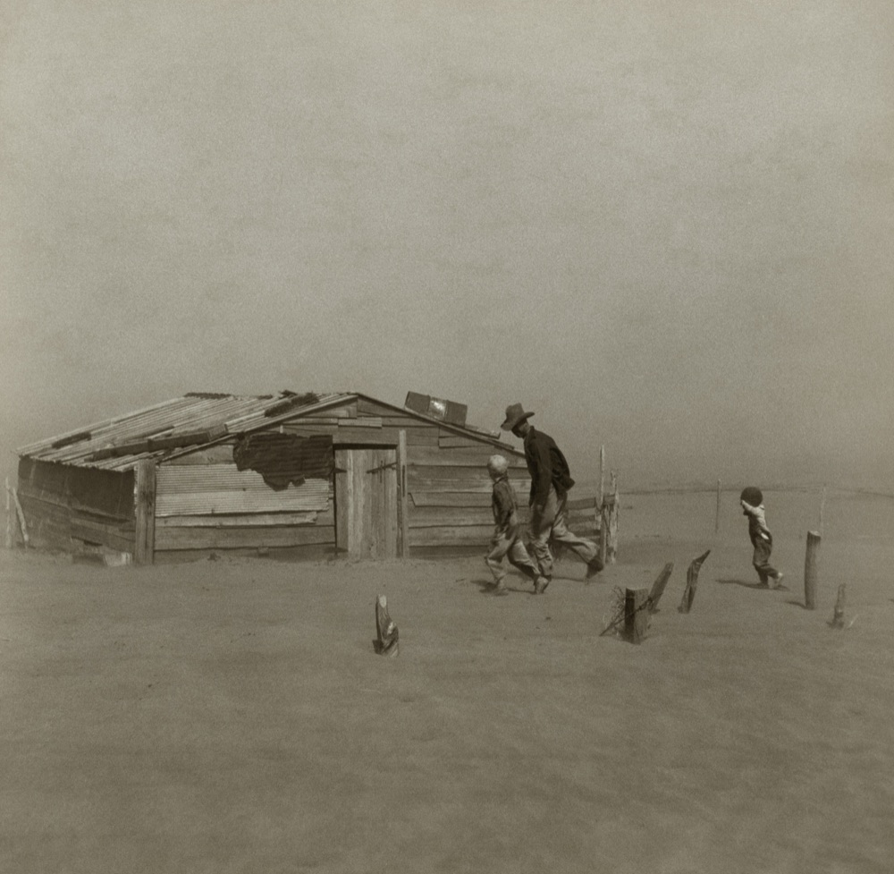
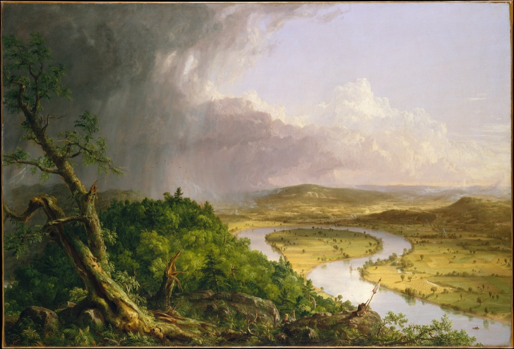
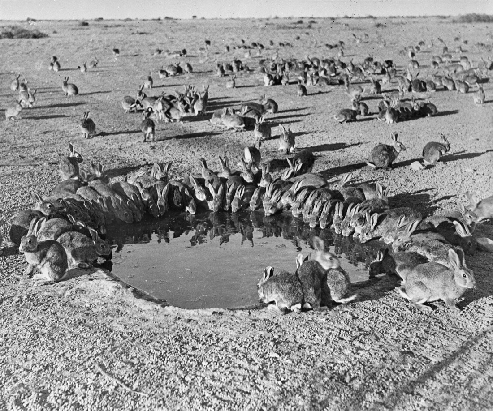
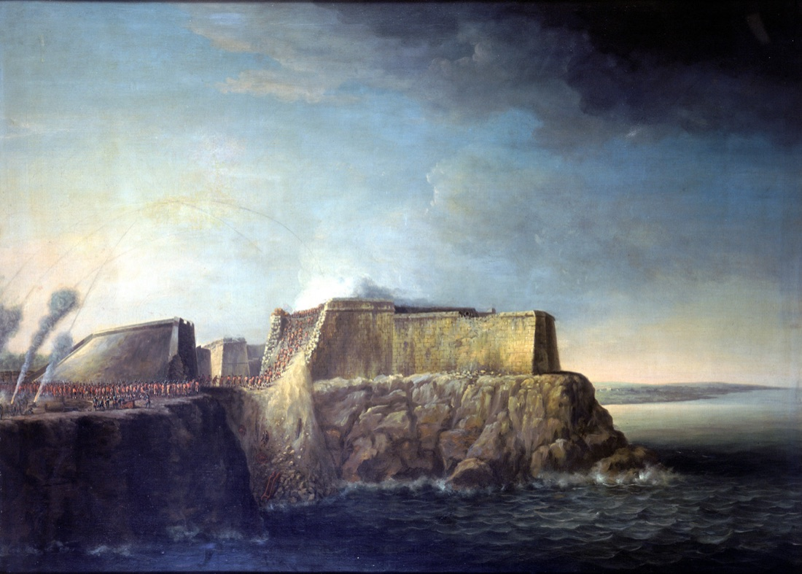
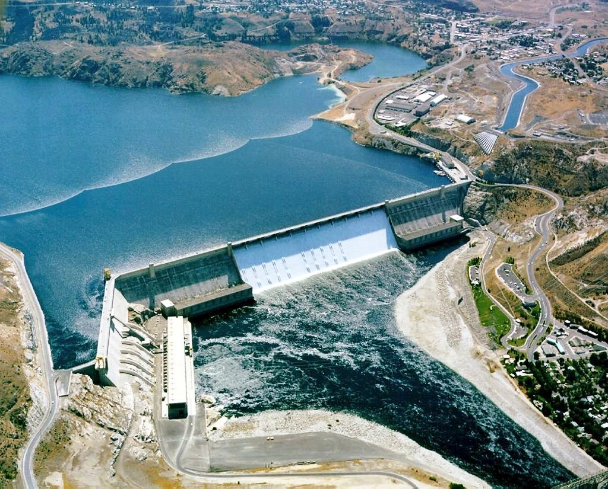
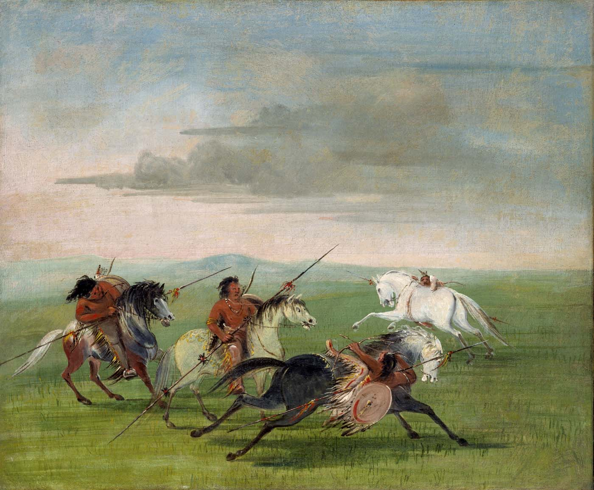
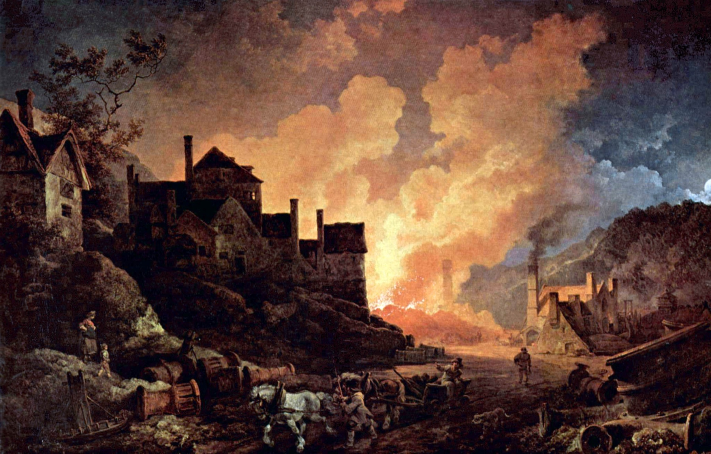

<!-- ========== TITLE ========== -->
<section data-transition="fade" markdown="1">
Making History • HIST 1105 • Week 14.2
{: .eyebrow}

# Environmental History
{: .main-point}

---

- Background: Sarah Maza, *Thinking About History* (2017), ch. 3: "The History of What?", 108–117
- William Cronon, "The Uses of Environmental History," *Environmental History Review* 17, no. 3 (1993), 1–22
- Optional: Dipesh Chakrabarty, "The Climate of History: Four Theses," *Critical Inquiry* 35, no. 2 (2009), 197–211
{: .source-list}

Cronon and Chakrabarty are cited by the journal's page numbers. Braudel is quoted from <i>On History</i>, trans. Sarah Matthews (1980), as in Week 5.2.
{: .citation-note}
</section>

<!-- ================================================================ -->
<!-- ================= PART ONE: THE FIELD EMERGES ================== -->
<!-- ================================================================ -->

<!-- ========== BACKDROP, THEN VICTIM ========== -->
<section markdown="1">
Before 1970 · backdrop
{: .eyebrow}

## Nature was history's backdrop, then entered it as a victim
{: .main-point}

<figure>

<figcaption>John Gast, <i>American Progress</i>, 1872 · public domain</figcaption>
</figure>

"Long the barely noticed backdrop to human activity, the natural world initially entered history as the vulnerable object of human hubris and greed." Maza, <i>Thinking About History</i>, p. 109
{: .quote.compact}

Nineteenth-century Americans told the settling of the wilderness as a triumph. Rival accounts told it as the destruction of nature (p. 109).
{: .detail}

</section>

<!-- ========== THE 1970S ========== -->
<section markdown="1">
1970s · a field with a cause
{: .eyebrow}

## The field took shape alongside the environmental movement
{: .main-point}

<figure>

<figcaption><i>Earthrise</i>, from Apollo 8, 1968 · NASA · public domain</figcaption>
</figure>

"this field has, since taking shape in its modern form starting in the 1970s, been closely connected with a specific political project, that of environmental conservation." Maza, <i>Thinking About History</i>, p. 109
{: .quote.compact}

Its early books mostly showed people damaging nature (p. 111).
{: .detail}

</section>

<!-- ========== WILDERNESS ========== -->
<section markdown="1">
1967 · wilderness
{: .eyebrow}

## A history of the wilderness idea shaped the fight to protect it
{: .main-point}

<figure>

<figcaption>Theodore Roosevelt and John Muir at Glacier Point, Yosemite, 1903 · public domain</figcaption>
</figure>

"Roderick Nash's <i>Wilderness and the American Mind</i> has played a significant role in helping frame debates about wilderness protection in the three decades since its publication." Cronon, "The Uses of Environmental History," pp. 2–3
{: .quote.compact}

Cronon also calls it a "whig history of wilderness consciousness" (p. 22 n. 27).
{: .detail}

</section>

<!-- ========== DUST BOWL ========== -->
<section markdown="1">
1979 · decline
{: .eyebrow}

## A history of the Dust Bowl traced the disaster to capitalism
{: .main-point}

<figure>

<figcaption>Arthur Rothstein, a dust storm in Cimarron County, Oklahoma, 1936 · public domain</figcaption>
</figure>

"<i>Dust Bowl</i> and <i>Rivers of Empire</i> located the origins of environmental degradation in capitalist world-views and modes of production that are as alive in the present as they have been in the past." Cronon, "The Uses of Environmental History," p. 3
{: .quote.compact}

Maza calls Donald Worster's <i>Dust Bowl</i> (1979) a "classic, still popular account" (p. 110 n. 62).
{: .detail}

</section>

<!-- ========== CHANGES IN THE LAND ========== -->
<section markdown="1">
1983 · <i>Changes in the Land</i>
{: .eyebrow}

## Cronon's first book set two ways of using New England's land side by side
{: .main-point}

<figure>

<figcaption>Thomas Cole, <i>The Oxbow</i>, 1836: the Connecticut River in Massachusetts · public domain</figcaption>
</figure>

"The pig was not merely a pig … but a creature bound among other things to the fence, the dandelion, and a very special definition of property." Cronon, <i>Changes in the Land</i> (1983), quoted in Maza, p. 112
{: .quote.compact}

Native people moved with the seasons. Colonists fenced, cleared and sold. Cronon avoids "villains and victims" (pp. 111–12).
{: .detail}

</section>

<!-- ========== ECOLOGICAL IMPERIALISM ========== -->
<section markdown="1">
1986 · <i>Ecological Imperialism</i>
{: .eyebrow}

## Europeans conquered with weeds, livestock and germs
{: .main-point}

<figure>

<figcaption>Rabbits at a waterhole, Wardang Island, South Australia, 1938 · public domain</figcaption>
</figure>

"they came with invisible and ultimately irresistible biological allies: weeds, proliferating livestock such as rabbits and pigs, and above all pathogens." Maza, <i>Thinking About History</i>, p. 114
{: .quote.compact}

Alfred Crosby's book asks why Europeans settled so successfully in North America, Australia and New Zealand (pp. 113–14).
{: .detail}

</section>

<!-- ========== GUNS, GERMS, AND STEEL ========== -->
<section markdown="1">
1997 · <i>Guns, Germs, and Steel</i>
{: .eyebrow}

## A bestseller explained Eurasia's dominance by geography alone
{: .main-point}

---

"In short, you don't need Christianity, capitalism, or the Chinese work ethic, let alone the putative superiority of Caucasian or Asian genes, to account for the Eurasian advantage."

Maza, <i>Thinking About History</i>, p. 113

Many historians dispute Jared Diamond's "stark environmental determinism" (p. 113).
{: .detail}

###### Discuss
{: .label}

**If geography explains who conquered whom, what is left for people to have decided?**

</section>

<!-- ========== NONHUMAN ACTORS ========== -->
<section markdown="1">
2010 · <i>Mosquito Empires</i>
{: .eyebrow}

## Mosquitoes became actors in the history of empire
{: .main-point}

<figure>

<figcaption>Dominic Serres, <i>The Capture of Havana, 1762: Storming of Morro Castle</i>, 1770s · public domain</figcaption>
</figure>

"Thanks to their insect allies and despite the weakness of their home country, the Spanish held on to their empire." Maza, <i>Thinking About History</i>, p. 115
{: .quote.compact}

J. R. McNeill's example: the British took Havana in 1762, but yellow fever killed more of their troops there than died in all of North America during the Seven Years' War (p. 115).
{: .detail}

</section>

<!-- ========== TOPICS ========== -->
<section markdown="1">
By the 1990s · subjects
{: .eyebrow}

## The field took on many more subjects than wilderness
{: .main-point}

---

#### Science and gender

Carolyn Merchant, <i>The Death of Nature</i> (1980): "western science has harmed nature and women in parallel ways" (Cronon, p. 3).

#### Fire

Stephen Pyne's histories of fire, written to show managers "the complexity of their task" (Cronon, p. 3).

#### Cities

Joel Tarr's studies of "pollution and waste streams," aimed at policymakers (Cronon, p. 3).

#### Fisheries

"People mismanage fish" when they misunderstand ecosystems (Cronon, p. 9).

#### Unequal environments

"the socially unequal impact of urban physical environments" (Maza, p. 111).

#### Animals

The "shifting status of animals in human societies" (Maza, p. 115).

</section>

<!-- ========== HYBRID ========== -->
<section markdown="1">
A second generation · hybrid
{: .eyebrow}

## Later historians stopped treating nature and culture as opposites
{: .main-point}

<figure>

<figcaption>Grand Coulee Dam, Columbia River, 1986 · U.S. Bureau of Reclamation · public domain</figcaption>
</figure>

"current scholarship mostly rejects the myth of a pure, unsullied nature in favor of the view that 'all environments are hybrid.'" Maza, <i>Thinking About History</i>, p. 110, quoting Paul Sutter
{: .quote.compact}

Earlier historians described a dam as nature destroyed. Later ones called the dammed river a "second nature" (p. 110).
{: .detail}

###### Discuss
{: .label}

**Is a dammed river still nature?**

</section>

<!-- ================================================================ -->
<!-- ====================== PART TWO: CRONON ======================== -->
<!-- ================================================================ -->

<!-- ========== CRONON: THE QUESTION ========== -->
<section markdown="1">
Cronon · 1993 · the question
{: .eyebrow}

## Cronon's students finished his environmental history course in despair
{: .main-point}

---

"What my students had apparently concluded from their encounter with my subject was that the American environment had gone from good to bad in an unrelentingly depressing story that left little or no hope for the future."

Cronon, "The Uses of Environmental History," p. 1

The essay asks what the field is good for, and for whom (pp. 2–7).
{: .detail}
</section>

<!-- ========== CRONON: PRACTICAL LESSONS ========== -->
<section markdown="1">
Cronon · 1993 · findings
{: .eyebrow}

## Cronon lists practical lessons the field has already taught
{: .main-point}

---

#### Markets hide their effects

Buyers and sellers "link together ecosystems and encourage change, rarely understanding the full ecological implications" (p. 8).

#### Migrants bring company

People who move "carry with them other organisms—plants, animals, microbes" (p. 8).

#### Tools depend on culture

Technology's effects "are powerfully mediated by the cultures in which they are embedded" (p. 8).

#### Trash shows values

"If you want to understand people's environmental values, watch what they throw away" (p. 9).

Cronon, "The Uses of Environmental History," pp. 8–9
{: .cite}
</section>

<!-- ========== IMAGE: CATLIN ========== -->
<section class="image-slide" data-background="#0d1412" markdown="1">
<figure class="landscape">

<figcaption markdown="span">
George Catlin, <i>Comanche Feats of Horsemanship</i>, 1834–35
<em>Another of Cronon's lessons: the horse "was not simply a European invader, but a complex cultural entity." A conquistador's horse was not a Comanche trading horse (p. 9). (Smithsonian American Art Museum. Public domain.)</em>
</figcaption>
</figure>
</section>

<!-- ========== CRONON: FOUR HABITS ========== -->
<section markdown="1">
Cronon · 1993 · thinking like a historian
{: .eyebrow}

## Cronon finds the field's best use in four habits of thought
{: .main-point}

---

#### Nature is always there

"All human history has a natural context." People "are not the only actors who make history" (p. 13).

#### Nothing stands still

"Neither nature nor culture is static." Eras of balance are "almost surely golden-age myths" (p. 13).

#### Knowledge has a history

"All environmental knowledge is culturally constructed and historically contingent—including our own" (p. 14).

#### Parables, not predictions

"Historical wisdom usually comes in the form of parables, not policy recommendations or certainties" (p. 16).

###### Compare · Week 13.1
{: .label}

Constructivists treated scientific knowledge as made, not found. Cronon agrees, but nature still "exists quite apart from what we believe about it" (p. 15).

</section>

<!-- ========== CRONON: PARABLES ========== -->
<section markdown="1">
Cronon · 1993 · parables
{: .eyebrow}

## Cronon offers stories about the past, not forecasts
{: .main-point}

---

"Rather than make <i>predictions</i> about what <i>will</i> happen, we offer <i>parables</i> about how to interpret what <i>may</i> happen."

Cronon, "The Uses of Environmental History," p. 17

###### Discuss
{: .label}

**A city council deciding whether to build on a floodplain asks a historian what will happen. What can the historian usefully say?**

</section>

<!-- ================================================================ -->
<!-- ============== PART THREE: CHAKRABARTY AND BRAUDEL ============= -->
<!-- ================================================================ -->

<!-- ========== IMAGE: COALBROOKDALE ========== -->
<section class="image-slide" data-background="#0d1412" markdown="1">
<figure class="landscape">

<figcaption markdown="span">
Philip James de Loutherbourg, <i>Coalbrookdale by Night</i>, 1801
<em>English iron furnaces burning coal. Some scientists date a new geological epoch, the Anthropocene, to the late eighteenth century, when carbon dioxide in the air began to climb (Chakrabarty, p. 209). (Science Museum, London, via Wikimedia Commons. Public domain.)</em>
</figcaption>
</figure>
</section>

<!-- ========== CHAKRABARTY: GEOLOGICAL FORCE ========== -->
<section markdown="1">
Chakrabarty · 2009 · climate
{: .eyebrow}

## Chakrabarty: humans have become a geological force
{: .main-point}

---

"To call human beings geological agents is to scale up our imagination of the human. … we can become geological agents only historically and collectively, that is, when we have reached numbers and invented technologies that are on a scale large enough to have an impact on the planet itself."

Chakrabarty, "The Climate of History," pp. 206–7

###### Biological, then geological
{: .label}

Environmental historians had shown people as biological agents, carrying germs, crops and animals. Changing the climate is a different scale of power, acquired only since the Industrial Revolution (pp. 205–7).

</section>

<!-- ========== BRAUDEL AND CHAKRABARTY ========== -->
<section markdown="1">
Braudel and Chakrabarty
{: .eyebrow}

## Braudel's slowest layer of history can now move fast
{: .main-point}

---

##### Braudel, preface to *The Mediterranean* (1949)

"a history that is almost changeless, the history of man in relation to his surroundings" (<i>On History</i>, p. 3)

##### Chakrabarty, "The Climate of History" (2009)

"this slow and apparently timeless backdrop for human actions transforms itself with a speed that can only spell disaster for human beings" (p. 205)

###### Prisoner, or maker
{: .label}

Braudel made the environment active when most historians left it as scenery (p. 205). Even environmental history, Chakrabarty says, was "still a vision of man 'as a prisoner of climate,'" in Braudel's phrase, "and not of man as the maker of it" (p. 206).

</section>

<!-- ========== CHAKRABARTY: FREEDOM ========== -->
<section markdown="1">
Chakrabarty · 2009 · freedom
{: .eyebrow}

## Chakrabarty ties modern freedoms to fossil fuels
{: .main-point}

---

"The mansion of modern freedoms stands on an ever-expanding base of fossil-fuel use. Most of our freedoms so far have been energy-intensive."

Chakrabarty, "The Climate of History," p. 208

###### Discuss
{: .label}

**Historians since the Enlightenment have told modern history as a story of growing freedom. Does coal belong in that story?**

</section>

<!-- ========== THE TAKE HOME ========== -->
<section data-transition="fade" markdown="1">
The take home
{: .eyebrow}

## Environmental history puts people back inside nature
{: .main-point}

---

"There cannot be people outside of nature; there can only be people <i>thinking</i> they are outside of nature."

Cronon, "The Uses of Environmental History," p. 19

Historians first made nature an actor in human history. Climate change now makes humans an actor in the planet's history.

</section>

<!-- ========== CLOSING ========== -->
<section markdown="1">
Next · 15.1 · food history
{: .eyebrow}

## Next week, historians follow food
{: .main-point}
</section>
