<!-- ========== COLD OPEN: FERRIS ========== -->
<section class="image-slide bleed"
 data-background-image="images/ferris-first-thanksgiving.jpg"
 data-background-size="contain"
 data-background-color="#0d1412" markdown="1">

An oil painting of an outdoor feast beside a log cabin: Pilgrim women in white caps and men in black hats carry dishes to a table, while Native men in feathered war bonnets sit on the ground in the foreground, a dog at their feet
{: .bleed-alt}

J. L. G. Ferris, *The First Thanksgiving 1621*, painted about 1915 · Library of Congress · public domain
{: .credit}

</section>

<!-- ========== COLD OPEN: THE NOTES ========== -->
<section markdown="1">

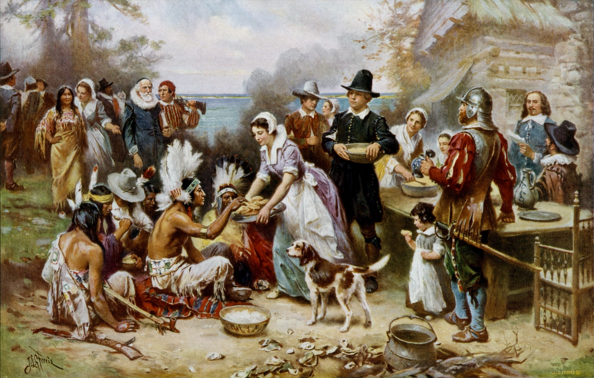

- **Feathered war bonnets.** Headdresses like these belonged to the Plains nations, two thousand miles west, and Wampanoag men did not wear them. <em class="ask">Where did a painter in 1915 get his picture of an Indian?</em>
- **The English serve; the Wampanoag sit on the ground.** One group has the table and the other receives. Edward Winslow's letter of December 1621 has the Wampanoag bringing five deer. <em class="ask">Who was feeding whom?</em>
- **A log cabin.** Plymouth's houses were timber-framed; log building came to America later, with Swedish and Finnish settlers. <em class="ask">If the picture is wrong about 1621, what is it right about?</em>

</section>

<!-- ========== TITLE ========== -->
<section data-transition="fade" markdown="1">
Making History • HIST 1105 • Week 15.1
{: .eyebrow}

# The History of Food
{: .main-point}

---

- Background: Warren Belasco, "Why Study Food?", in *Food: The Key Concepts* (2008), 1–13
- Janet Siskind, "The Invention of Thanksgiving: A Ritual of American Nationality," *Critique of Anthropology* 12, no. 2 (1992), 167–91
- "What Was on the Menu at the First Thanksgiving?", *Smithsonian* (2011)
{: .source-list}

</section>

<!-- ================================================================ -->
<!-- ====== PART ONE: FOOD AS MATERIAL, 1960s–1990s ================= -->
<!-- ================================================================ -->

<!-- ========== FABRE ========== -->
<section markdown="1">

<figure>
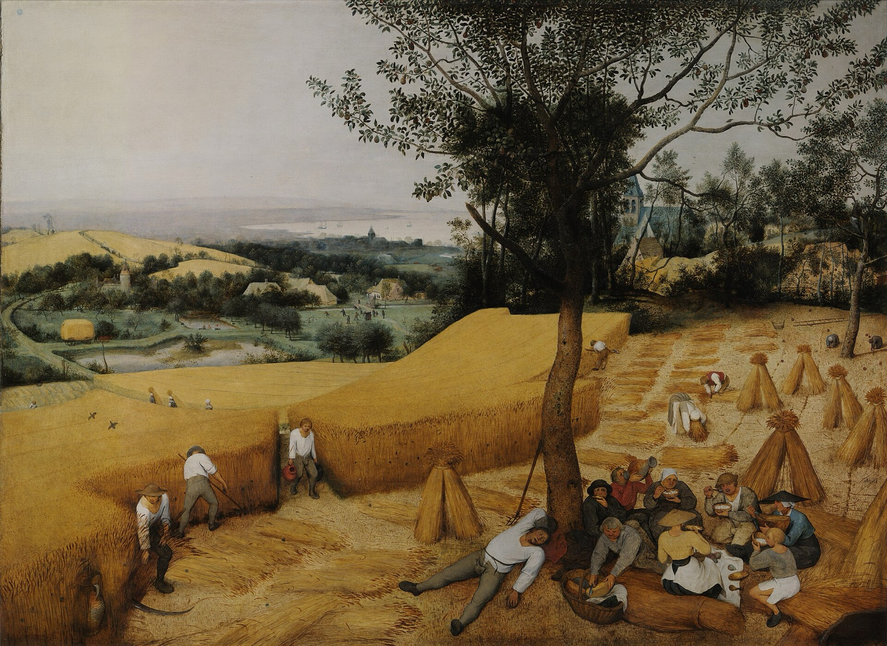
<figcaption>Pieter Bruegel the Elder, <i>The Harvesters</i>, 1565 · Metropolitan Museum of Art · public domain</figcaption>
</figure>

Part one · food as material
{: .eyebrow}

## History long passed over the fields that fed it
{: .main-point}

"History celebrates the battlefields whereon we meet our death, but scorns to speak of the plowed fields whereby we thrive; it knows the names of the King's bastards, but cannot tell us the origin of wheat." Jean-Henri Fabre, an epigraph in Belasco, "Why Study Food?", p. 1
{: .quote.compact}

Economists, chemists and agronomists had long studied food production, Belasco notes (p. 2). From the 1960s, historians took it up too.
{: .detail}

</section>

<!-- ========== THE ANNALES ========== -->
<section markdown="1">

<figure>
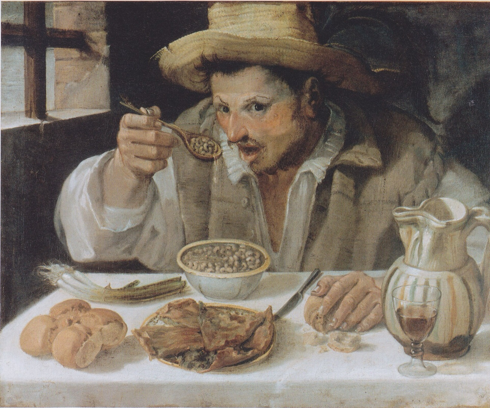
<figcaption>Annibale Carracci, <i>The Bean Eater</i>, about 1583–85 · Galleria Colonna, Rome · public domain</figcaption>
</figure>

Braudel · 1967
{: .eyebrow}

## Daily bread became a foundation of history
{: .main-point}

"civilization itself is impossible without food: with the invention of agriculture some ten thousand years ago came city states and empires, art, music, and organized warfare." Belasco, "Why Study Food?", p. 1
{: .quote.compact}

Fernand Braudel, a French historian, began *Capitalism and Material Life* (1967), his history of capitalism, with population, then wheat, rice and maize, and what ordinary people ate and drank.
{: .detail}

</section>

<!-- ========== MINTZ ========== -->
<section markdown="1">

<figure>
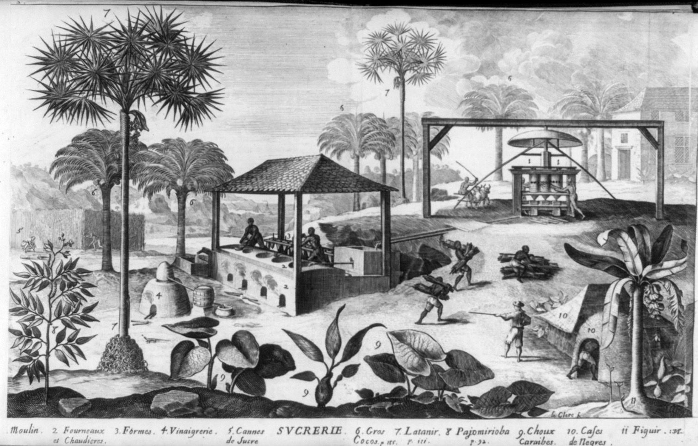
<figcaption>A sugar works in the French Antilles, from Jean-Baptiste Du Tertre, <i>Histoire générale des Antilles</i>, 1667 · Library of Congress · public domain</figcaption>
</figure>

Mintz · 1985
{: .eyebrow}

## Sugar tied slave plantations to English tea
{: .main-point}

"For much of history the search for sufficient food drove the conquest and colonization of continents – and the enslavement or eradication of entire populations." Belasco, "Why Study Food?", p. 2
{: .quote.compact}

Sidney Mintz's *Sweetness and Power* (1985) showed sugar grown by enslaved Africans in the Caribbean becoming cheap calories for English factory workers.
{: .detail}

</section>

<!-- ========== CRONON ========== -->
<section markdown="1">

<figure>
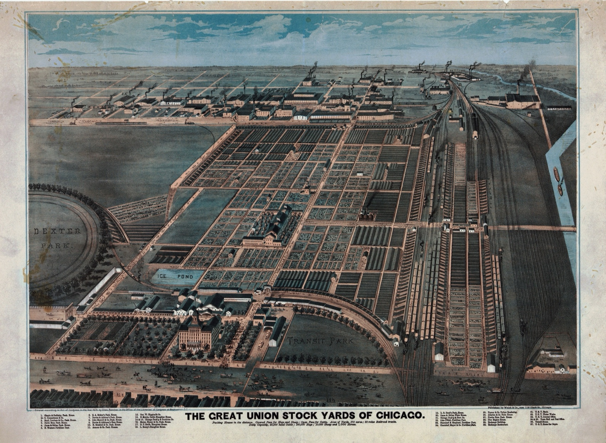
<figcaption><i>The Great Union Stock Yards of Chicago</i>, lithograph, 1878 · Library of Congress · public domain</figcaption>
</figure>

Cronon · 1991
{: .eyebrow}

## Meatpackers made it easy to forget the killing
{: .main-point}

"In the packers' world it was easy not to remember that eating was a moral act inexorably bound to killing" Cronon, <i>Nature's Metropolis</i> (1991), quoted in Belasco, p. 4
{: .quote.compact}

William Cronon's *Nature's Metropolis*, an environmental history of Chicago, traced the packers. Belasco finds the habit as early as the East India Company's report of 1701 (p. 4).
{: .detail}

</section>

<!-- ================================================================ -->
<!-- ====== PART TWO: WHAT FOOD MEANT, BELASCO PP. 2–4 =============== -->
<!-- ================================================================ -->

<!-- ========== THE REASONS ========== -->
<section markdown="1">
Part two · meaning
{: .eyebrow}

## Belasco: scholars studied food but avoided what it meant
{: .main-point}

---

"Why this reluctance to address the wider meaning of our food behaviors?" Belasco, "Why Study Food?", p. 2
{: .quote.compact}

#### Mind over body

Philosophers ranked reason above appetite, and eating looked like an animal function (pp. 2–3).

#### Women's work

The Victorian "separate spheres" put cooking in the home and its study in home economics, a low-ranked field (p. 3).

#### Escape from drudgery

Reformers wanted food out of sight: the meal in a pill, the central kitchen, the automated farm (pp. 3–4).

###### Compare · Week 6.2
{: .label}

Scott: gender as the system that makes arrangements of power look natural, including who does the cooking.

</section>

<!-- ========== WOMEN'S WORK ========== -->
<section markdown="1">

<figure>
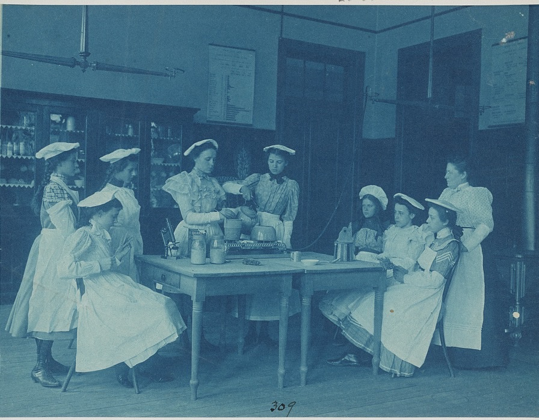
<figcaption>A cooking class in a Washington, D.C., high school, about 1899 · Frances Benjamin Johnston · Library of Congress · public domain</figcaption>
</figure>

Shapiro · 1986
{: .eyebrow}

## Historians took women's food work seriously, and found science and citizenship in it
{: .main-point}

"In recent years there have been significant and largely sympathetic reappraisals of women's food work" Belasco, "Why Study Food?", p. 3
{: .quote.compact}

Laura Shapiro's *Perfection Salad* (1986) followed the domestic scientists of about 1900, who taught cooking as chemistry and as good citizenship.
{: .detail}

</section>

<!-- ========== AMERICAN FOOD: CONTACT ========== -->
<section markdown="1">

<figure>
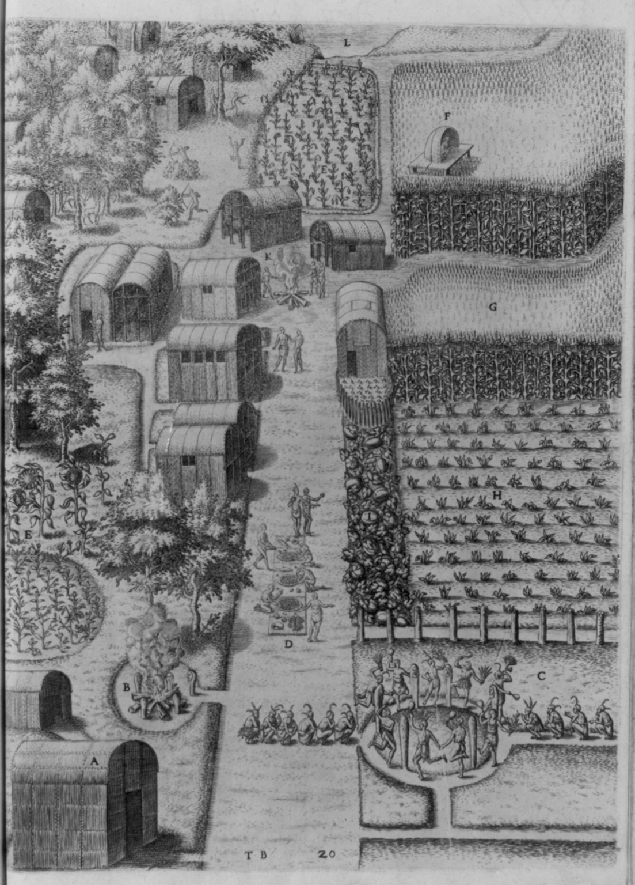
<figcaption>Theodor de Bry after John White, the Algonquian town of Secotan and its cornfields, engraving first published 1590 · Library of Congress · public domain</figcaption>
</figure>

[American food](/courses/american-food/) · 1600s · contact
{: .eyebrow}

## Native corn became Boston brown bread
{: .main-point}

"Squanto stood them in great stead, showing them both the maner how to set it, and after how to dress and tend it." Bradford, <i>Of Plymouth Plantation</i>, on spring 1621 (1908 ed.), pp. 115–16
{: .quote.compact}

William Bradford, Plymouth's governor, wrote that the English wheat and peas "came not to good." Cornmeal baked with rye became "rye 'n' Injun," later Boston brown bread.
{: .detail}

</section>

<!-- ========== AMERICAN FOOD: COOKBOOKS ========== -->
<section markdown="1">

<figure>
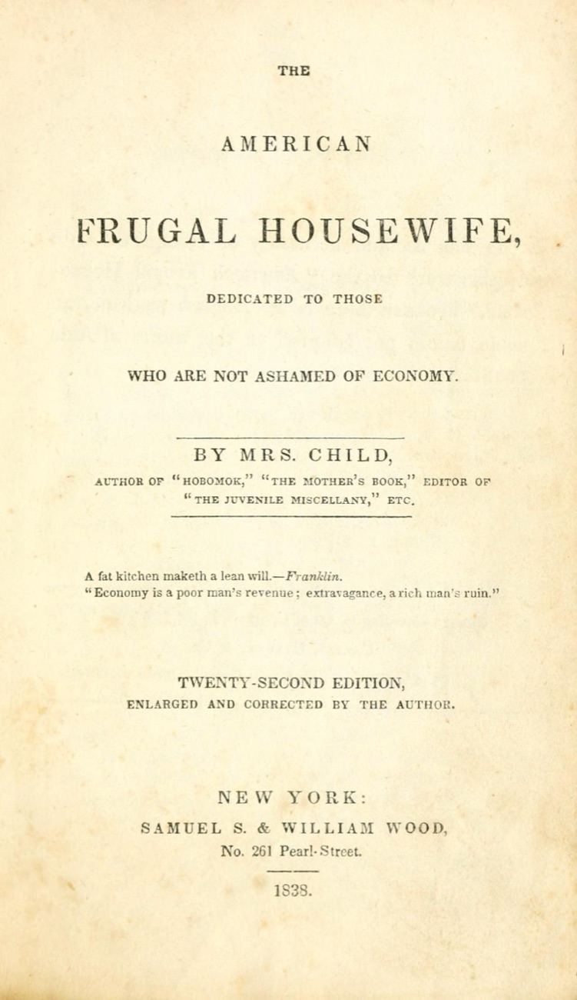
<figcaption>Lydia Maria Child, <i>The American Frugal Housewife</i>, twenty-second edition, New York, 1838, title page · Internet Archive · public domain</figcaption>
</figure>

American food · 1790s–1850s · cookbooks
{: .eyebrow}

## Cookbooks taught thrift as an American virtue
{: .main-point}

"The true economy of housekeeping is simply the art of gathering up all the fragments, so that nothing be lost." Child, <i>The American Frugal Housewife</i> (1832 ed.), introductory chapter
{: .quote.compact}

Lydia Maria Child's book (1829) reached a twenty-second edition by 1838. Amelia Simmons's *American Cookery* (1796), the first cookbook by an American printed here, promised recipes “adapted to this country.”
{: .detail}

</section>

<!-- ========== AMERICAN FOOD: MEAT ========== -->
<section markdown="1">

<figure>
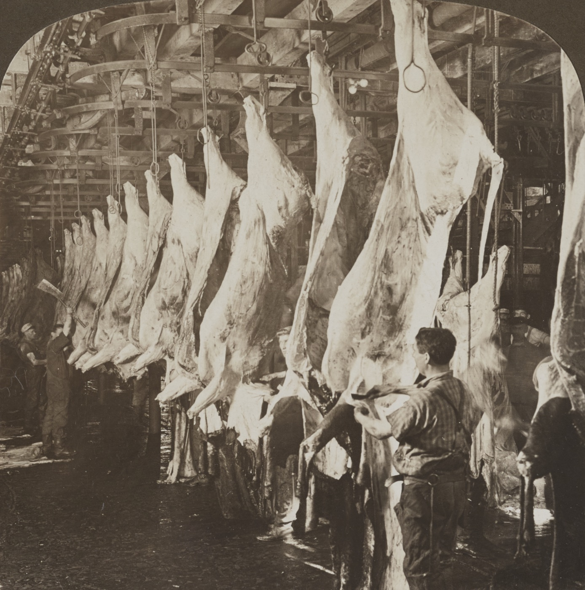
<figcaption>“Dropping hides” and “splitting chucks,” beef department, Swift &amp; Co.'s packing house, Chicago, stereograph, 1906 · H. C. White Co. · Library of Congress · public domain</figcaption>
</figure>

American food · 1870s–1970s · meat
{: .eyebrow}

## Railroads and factory farms made meat cheap
{: .main-point}

"Meat production has long been the focus of many laborsaving innovations – hence the early rise of the slaughterhouse 'disassembly' line, which in turn became the model for so many other mass production industries." Belasco, "Why Study Food?", p. 12
{: .quote.compact}

Swift's refrigerated rail cars carried Chicago beef east from the late 1870s. A 1976 livestock journal told farmers to treat the pig "just like a machine in a factory" (p. 4).
{: .detail}

</section>

<!-- ========== AMERICAN FOOD: MIGRATION ========== -->
<section markdown="1">

<figure>
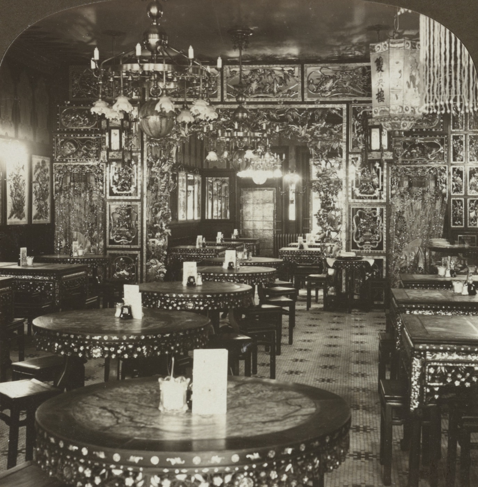
<figcaption>Song Ying Lo, “the finest Chop Suey house in Chicago,” stereograph, 1907 · H. C. White Co. · Library of Congress · public domain</figcaption>
</figure>

American food · 1880s–1920s · migration
{: .eyebrow}

## Chop suey was welcome before the Chinese were
{: .main-point}

"the coming of Chinese laborers to this country endangers the good order of certain localities within the territory thereof" Chinese Exclusion Act, 1882, preamble
{: .quote.compact}

The act barred Chinese laborers and was renewed until 1943. After 1900, chop suey houses like this one fed a craze among non-Chinese diners across the country.
{: .detail}

</section>

<!-- ========== AMERICAN FOOD: NUTRITION ========== -->
<section markdown="1">

<figure>
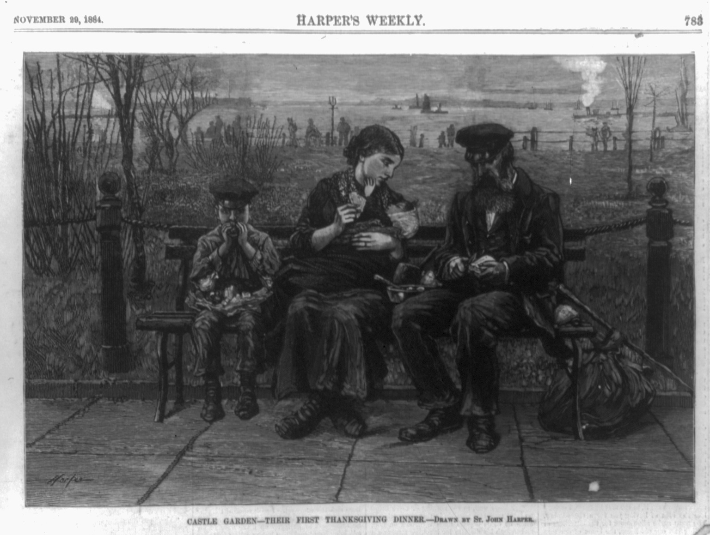
<figcaption>W. St. John Harper, “Castle Garden—their first Thanksgiving dinner,” <i>Harper’s Weekly</i>, 29 November 1884 · Library of Congress · public domain</figcaption>
</figure>

American food · 1880s–1920s · nutrition
{: .eyebrow}

## Reformers made food the first lesson in Americanization
{: .main-point}

"Almost their first thought on landing is of something to eat, and this fact places food in the first rank of importance in our plans for Americanization." Bertha M. Wood, <i>Foods of the Foreign-Born</i> (1922), p. 1
{: .quote.compact}

Wood, a Boston dietitian heir to Shapiro's domestic scientists, saw "Gallons of American soups and broths" go untouched in the 1918 flu, and told dietitians to learn immigrants' foods (pp. 2–3).
{: .detail}

</section>

<!-- ========== IMAGE: FOOD WILL WIN THE WAR ========== -->
<section class="image-slide" data-background="#0d1412" markdown="1">
<figure class="portrait">
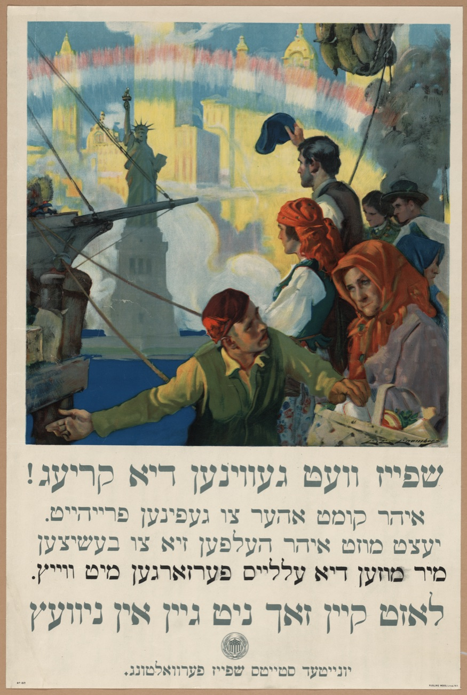
<figcaption markdown="span">
U.S. Food Administration poster in Yiddish, 1917: "Food will win the war! You came here seeking freedom, now you must help to preserve it."
<em>The same poster ran in English. Saving wheat became a test of immigrant loyalty, and reformers' food lessons became a war effort. (Charles Edward Chambers. Library of Congress. No known restrictions.)</em>
</figcaption>
</figure>
</section>

<!-- ========== AMERICAN FOOD: FAST FOOD ========== -->
<section markdown="1">

<figure>
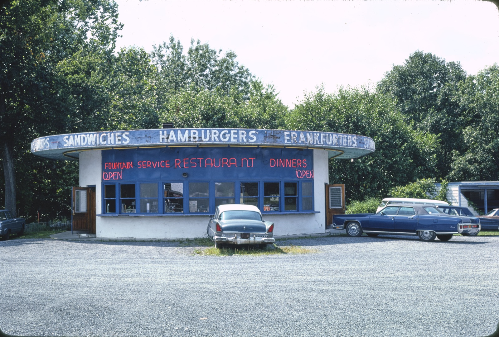
<figcaption>John Margolies, drive-in restaurant, Routes 9 and 96, Rhinebeck, New York, 1976 · Library of Congress · no known restrictions</figcaption>
</figure>

American food · 1950s–1970s · fast food
{: .eyebrow}

## Drive-ins and communes grew up together
{: .main-point}

"in providing over 50 million meals a day, McDonald's comes very close to Cridge's 'one big kitchen' vision." Belasco, "Why Study Food?", p. 4
{: .quote.compact}

Annie Denton Cridge, a novelist, had dreamed in 1870 of one kitchen feeding an eighth of Philadelphia (p. 4). The counterculture answered with brown rice and co-ops, Belasco's “countercuisine.”
{: .detail}

</section>

<!-- ================================================================ -->
<!-- ====== PART THREE: BELASCO'S TRIANGLE, PP. 7–11 ================== -->
<!-- ================================================================ -->

<!-- ========== THE TRIANGLE ========== -->
<section markdown="1">
Part three · the triangle
{: .eyebrow}

## Belasco: what we eat is a negotiation among identity, convenience and responsibility
{: .main-point}

---

"people decide what to eat based on a rough negotiation – a pushing and tugging – between the dictates of identity and convenience, with somewhat lesser guidance from the considerations of responsibility."

Belasco, "Why Study Food?", p. 8

#### Identity

Taste, family, ethnicity, memory and status: "Is this what people like me eat?" (p. 8)

#### Convenience

Price, availability, time and skill: "Can I get it?," "Can I afford it?," "Can I make it?" (p. 9)

#### Responsibility

The consequences for bodies, animals, land and other people, now and later (p. 9).

</section>

<!-- ========== DISCUSSION: PART THREE ========== -->
<section markdown="1">
Part three · discussion
{: .eyebrow}

## The weakest corner
{: .main-point}

---

Belasco puts responsibility at the top of the triangle "not because it is the strongest factor but because maybe it *should* be" (p. 9). Is that the historian talking, or the moralist?
{: .question .fragment data-fragment-index="1"}

Both. He ranks responsibility as a moralist would, then grants the triangle is "not quite equilateral" (p. 8). A historian of eating mostly finds identity and convenience doing the deciding.

</section>

<!-- ================================================================ -->
<!-- ====== PART FOUR: SISKIND, THE INVENTION OF THANKSGIVING ======== -->
<!-- ================================================================ -->

<!-- ========== SISKIND ========== -->
<section markdown="1">

<figure>
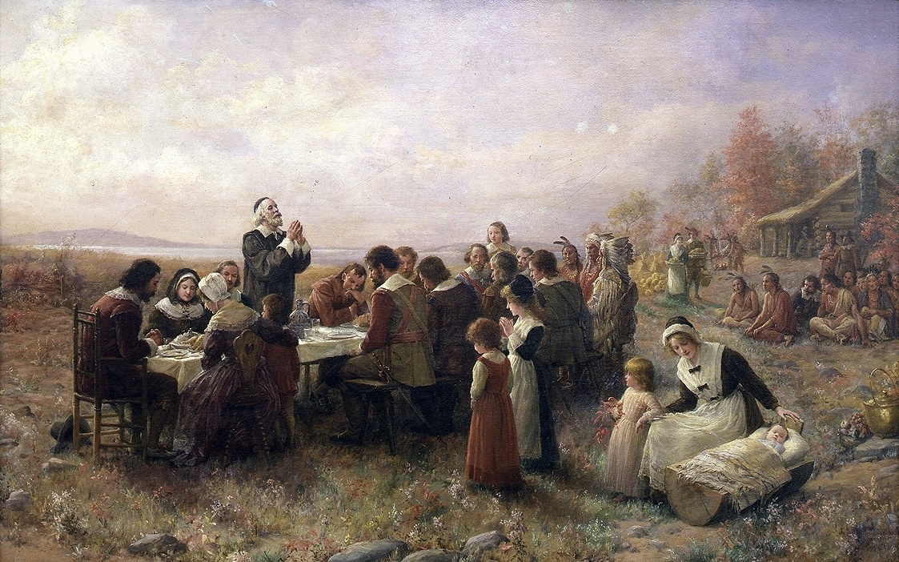
<figcaption>Jennie Augusta Brownscombe, <i>The First Thanksgiving at Plymouth</i>, 1914 · Pilgrim Hall Museum · public domain</figcaption>
</figure>

Part four · invention
{: .eyebrow}

## When was Thanksgiving?
{: .main-point}

"Thanksgiving was 'invented' in its present form at the end of the 19th century." Siskind, "The Invention of Thanksgiving," p. 167
{: .quote.compact}

Janet Siskind, a Rutgers anthropologist, wrote on the eve of the 1992 Columbus quincentenary (p. 186), drawing on Hobsbawm's "invented traditions" (p. 169).
{: .detail}

</section>

<!-- ========== NO FIRST THANKSGIVING ========== -->
<section markdown="1">
1621 · Plymouth
{: .eyebrow}

## Siskind: the 1621 harvest feast was not a Puritan thanksgiving
{: .main-point}

---

"The connection between these three days of feasting in Plymouth in the fall of 1621 and our celebration of Thanksgiving is purely, but significantly, mythological."

Siskind, "The Invention of Thanksgiving," p. 170

###### Days of thanksgiving
{: .label}

Puritans kept them with long sermons and prayer, without work or play, and the meal hardly mattered. The 1621 feast has been read as an English harvest festival or a meal to keep the Wampanoag alliance, but it closely resembles Algonquian feasts for the ripening corn (p. 170).

</section>

<!-- ========== VICTORIES ========== -->
<section markdown="1">

<figure>
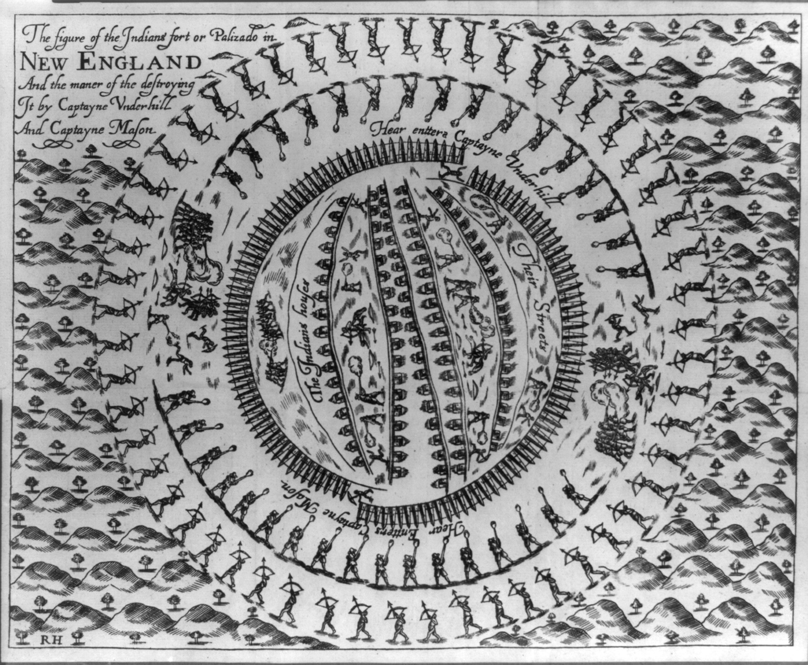
<figcaption>The English attack on the Pequot fort at Mystic, 1637, from John Underhill, <i>Newes from America</i>, 1638 · Library of Congress · public domain</figcaption>
</figure>

1637 and 1676 · victories
{: .eyebrow}

## Some early thanksgivings celebrated victories over Native peoples
{: .main-point}

"did God break the head of that Leviathan, and gave it to be meat to the people inhabiting the wilderness" Increase Mather (1676), quoted in Siskind, p. 178
{: .quote.compact}

New England's first shared thanksgiving, in 1637, marked the defeat of the Pequots. In 1676 King Philip's head reached Plymouth as the congregation finished its thanksgiving (pp. 172, 178).
{: .detail}

</section>

<!-- ========== HOMECOMING ========== -->
<section markdown="1">

<figure>
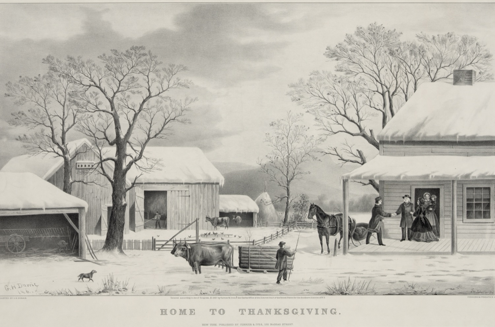
<figcaption>Currier &amp; Ives, <i>Home to Thanksgiving</i>, 1867, after George Henry Durrie · Library of Congress · public domain</figcaption>
</figure>

1800s · homecoming
{: .eyebrow}

## The feast moved from the congregation to the family home
{: .main-point}

"Thanksgiving celebrates and obfuscates the destruction of community, constructing the family and nation as the only bastions against a Hobbesian world" Siskind, "The Invention of Thanksgiving," p. 175
{: .quote.compact}

Each household feasted alone, at the same hour as every other. In 1858 over ten thousand people left New York City to spend it in New England (pp. 175–76).
{: .detail}

</section>

<!-- ========== HALE ========== -->
<section markdown="1">

<figure>
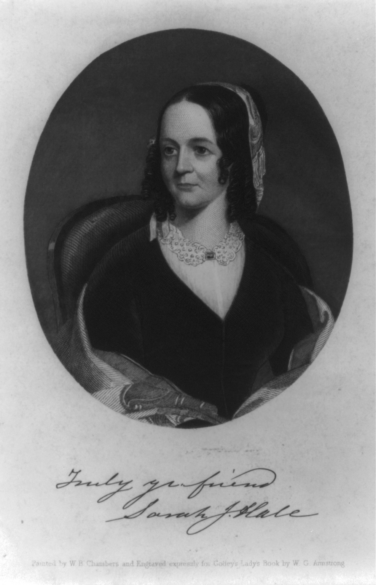
<figcaption>Sarah Josepha Hale, engraved for <i>Godey’s Lady’s Book</i> by W. G. Armstrong after W. B. Chambers, about 1850 · Library of Congress · public domain</figcaption>
</figure>

1863 · the campaign
{: .eyebrow}

## Sarah Josepha Hale lobbied for one national Thanksgiving Day
{: .main-point}

"This subject is to have the day of our annual Thanksgiving made a National and fixed Union Festival." Hale to Lincoln, 28 September 1863, Library of Congress
{: .quote.compact}

Hale edited *Godey's Lady's Book* and had pressed governors for fifteen years. Lincoln proclaimed the last Thursday in November (p. 174); Siskind finds that date "clearly already present" (n. 7).
{: .detail}

</section>

<!-- ========== IMAGE: NAST ========== -->
<section class="image-slide" data-background="#0d1412" markdown="1">
<figure class="landscape">
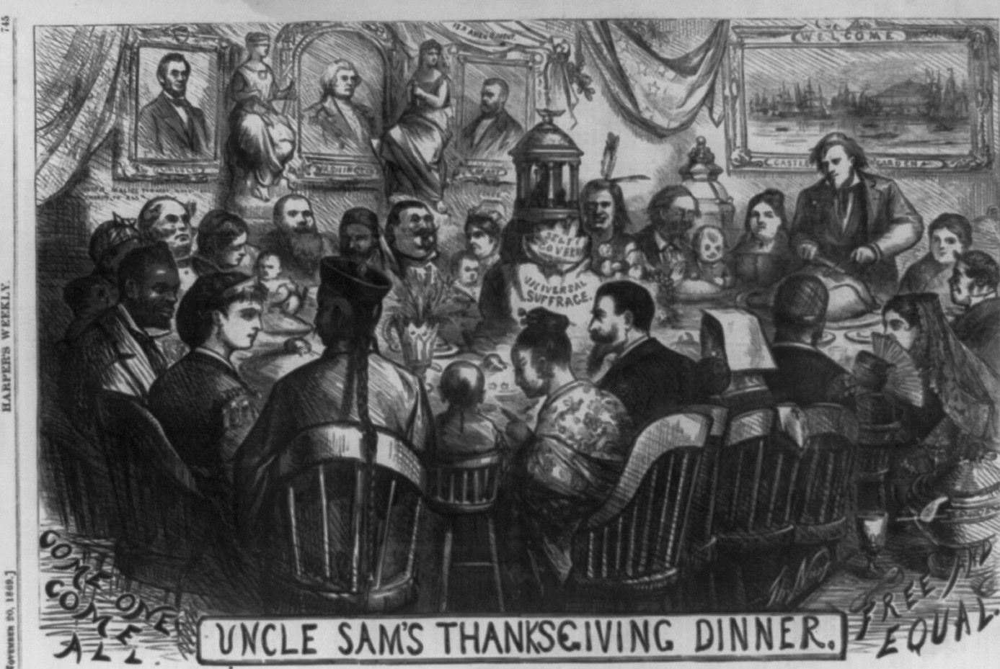
<figcaption markdown="span">
Thomas Nast, "Uncle Sam's Thanksgiving Dinner," <i>Harper's Weekly</i>, 20 November 1869
<em>Nast drew Reconstruction's promise as a Thanksgiving table: Uncle Sam carves for Chinese, Black, Native and European guests under "Come One Come All" and "Free and Equal." Six years later, Alabama gave thanks for the opposite. (Library of Congress. Public domain.)</em>
</figcaption>
</figure>
</section>

<!-- ========== THE SOUTH ========== -->
<section markdown="1">
1875 · the South
{: .eyebrow}

## The South joined the national feast as Reconstruction ended
{: .main-point}

---

"to honor the replacement of a reconstruction constitution by a new document that restricted black participation in state government"

Appelbaum (1984), on Alabama's Thanksgiving of 23 December 1875, quoted in Siskind, p. 181

###### Refusal
{: .label}

Southern states would not keep a northern holiday for a nation that, under Reconstruction, had made the freed slaves citizens (p. 181).

</section>

<!-- ========== THE PILGRIMS ========== -->
<section markdown="1">
1880s–1900s · the Pilgrims
{: .eyebrow}

## The Pilgrims entered the holiday when immigrants had to be made into Americans
{: .main-point}

---

"The basic political problem of the U.S.A. . . . was how to assimilate a heterogeneous mass . . . of people who were Americans not by birth but by immigration. Americans had to be made."

Hobsbawm (1983), quoted in Siskind, p. 182

###### The model immigrant
{: .label}

The Pilgrims gave newcomers a model: devout, chosen, starting over. An 1887 spread in *Life* laid a picture of Pilgrims over one of immigrants arriving (p. 183).

###### Compare · Week 9.1
{: .label}

The Pledge, written for Columbus Day 1892, was "invented in this period" too (p. 183).

</section>

<!-- ========== YEZIERSKA ========== -->
<section markdown="1">

<figure>
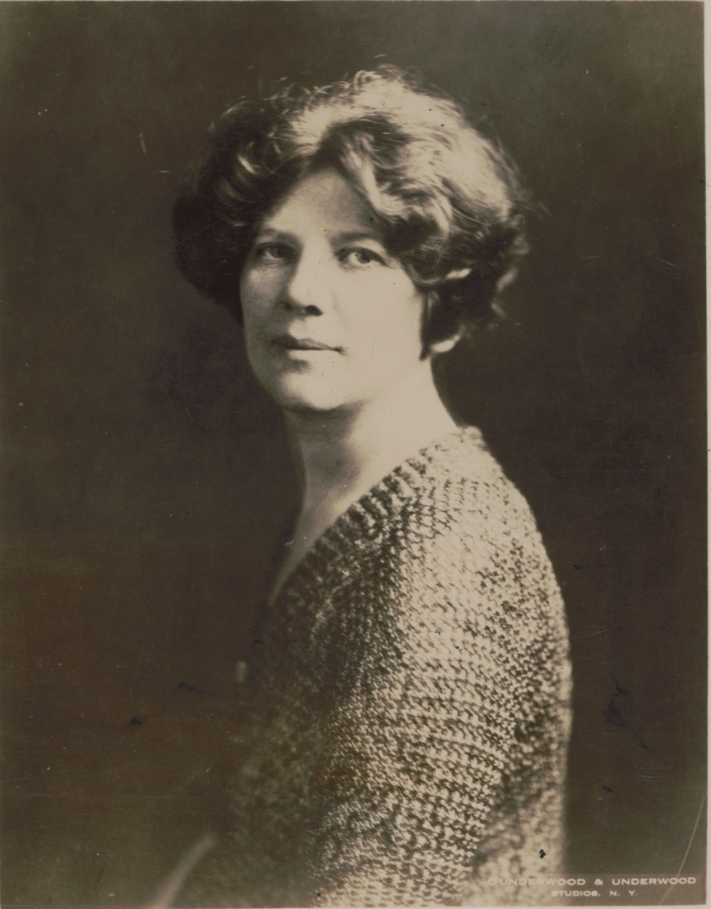
<figcaption>Anzia Yezierska, 1925 · Underwood &amp; Underwood · Library of Congress · no known restrictions</figcaption>
</figure>

1923 · Yezierska
{: .eyebrow}

## A Jewish immigrant writer cast her own crossing as the Pilgrims'
{: .main-point}

"I saw America – a big idea – a deathless hope – a world still in the making." Yezierska, "America and I" (1923), quoted in Siskind, p. 183
{: .quote.compact}

Yezierska came from Russian Poland to New York's Lower East Side as a girl and wrote about its sweatshops. Siskind reads her story as proof the myth worked.
{: .detail}

</section>

<!-- ========== DISCUSSION: PART FOUR ========== -->
<section markdown="1">
Part four · discussion
{: .eyebrow}

## A menu for 1621
{: .main-point}

---

The *Smithsonian* article reconstructs what was eaten in 1621: venison, wildfowl, corn. Which of Siskind's questions can a menu answer, and which can it not reach?
{: .question .fragment data-fragment-index="1"}

Winslow's letter gives a menu. Siskind asks why the late 1800s made that meal the nation's origin, the question to put to Ferris's painting.

</section>

<!-- ================================================================ -->
<!-- ====== PART FIVE: THE TABLE ===================================== -->
<!-- ================================================================ -->

<!-- ========== THE TABLE ========== -->
<section markdown="1">
Part five · the table
{: .eyebrow}

## Siskind's four dishes are older than the holiday's late-1800s form
{: .main-point}

---

"everyone knows that across the nation members of every other household are simultaneously feasting on stuffed turkey, sweet potatoes, pumpkin pie and cranberry sauce."

Siskind, "The Invention of Thanksgiving," p. 169

Belasco asks of a slice of toast who grew the wheat, who baked the bread and how it got so cheap (p. 10). The same questions open each dish.
{: .detail .fragment data-fragment-index="1"}
</section>

<!-- ========== TURKEY: HISTORY ========== -->
<section markdown="1">

<figure>
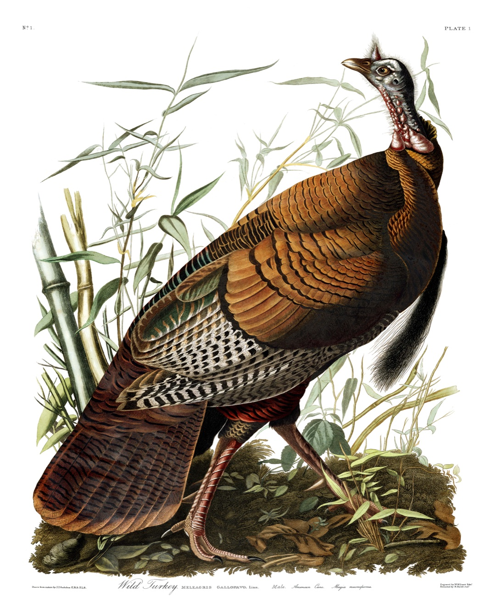
<figcaption>John James Audubon, <i>Wild Turkey</i>, <i>The Birds of America</i>, plate 1, 1827 · National Audubon Society · public domain</figcaption>
</figure>

The table · turkey
{: .eyebrow}

## Before the turkey, a chicken pie marked Thanksgiving dinner
{: .main-point}

"the presence of three or four kinds of meat emphasized the status of this meal as a major feast, but a chicken pie signified that the feast was Thanksgiving dinner" Appelbaum (1984), quoted in Siskind, p. 177
{: .quote.compact}

Domesticated in Mexico and again in the Southwest, turkeys reached Europe in the 1500s (p. 179) and the feast's center by the early 1800s (p. 177). The Broad Breasted White cannot mate naturally.
{: .detail}

</section>

<!-- ========== TURKEY: SYMBOL ========== -->
<section markdown="1">
The table · turkey
{: .eyebrow}

## Siskind read the stuffed turkey as a stand-in for Native Americans
{: .main-point}

---

"the Thanksgiving turkey powerfully symbolizes the Indians. It is a symbol of a symbol"

Siskind, "The Invention of Thanksgiving," p. 177

###### Wild and tame
{: .label}

Settlers pictured Indians as wild enemies or as converts to be civilized, like wild and farmyard turkeys (p. 179). Siskind says she found no other author who reads the bird this way (n. 1).

</section>

<!-- ========== PUMPKIN PIE ========== -->
<section markdown="1">

<figure>
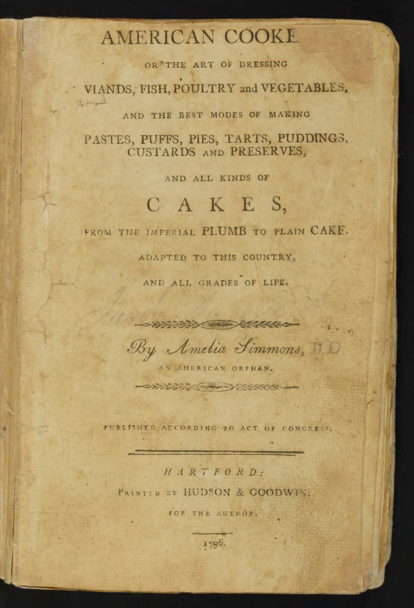
<figcaption>Amelia Simmons, <i>American Cookery</i>, Hartford, 1796, title page · Internet Archive · public domain</figcaption>
</figure>

The table · pumpkin pie
{: .eyebrow}

## Pumpkin pie was a New England dish before it was a national one
{: .main-point}

"One quart stewed and strained, 3 pints cream, 9 beaten eggs, sugar, mace, nutmeg and ginger, laid into paste No. 7 or 3 . . ." Simmons, "Pompkin," <i>American Cookery</i> (1796)
{: .quote.compact}

Simmons printed hers in Hartford. The South took up the northern holiday only in the 1870s (Siskind, p. 181). Libby's put its recipe on the can in 1950.
{: .detail}

</section>

<!-- ========== SWEET POTATOES ========== -->
<section markdown="1">

<figure>
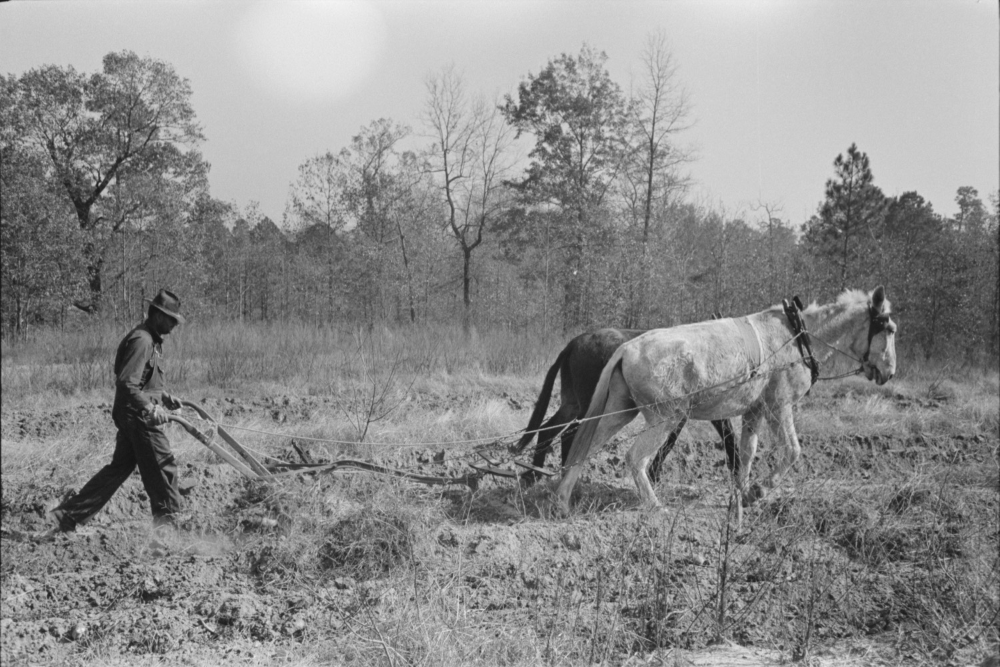
<figcaption>Russell Lee, sharecropper plowing up sweet potatoes near Laurel, Mississippi, November 1938 · Library of Congress · public domain</figcaption>
</figure>

The table · sweet potatoes
{: .eyebrow}

## Sweet potatoes came from Southern fields, marshmallows from a candy company
{: .main-point}

"The above is a good receipt for Pompkins, Potatoes or Yams" Simmons, "A Crookneck, or Winter Squash Pudding," <i>American Cookery</i> (1796)
{: .quote.compact}

Sweet potatoes, native to tropical America, became a staple of the slave South, named for West African yams. A 1917 Angelus Marshmallows booklet usually gets the credit for the topping.
{: .detail}

</section>

<!-- ========== CRANBERRIES ========== -->
<section markdown="1">

<figure>
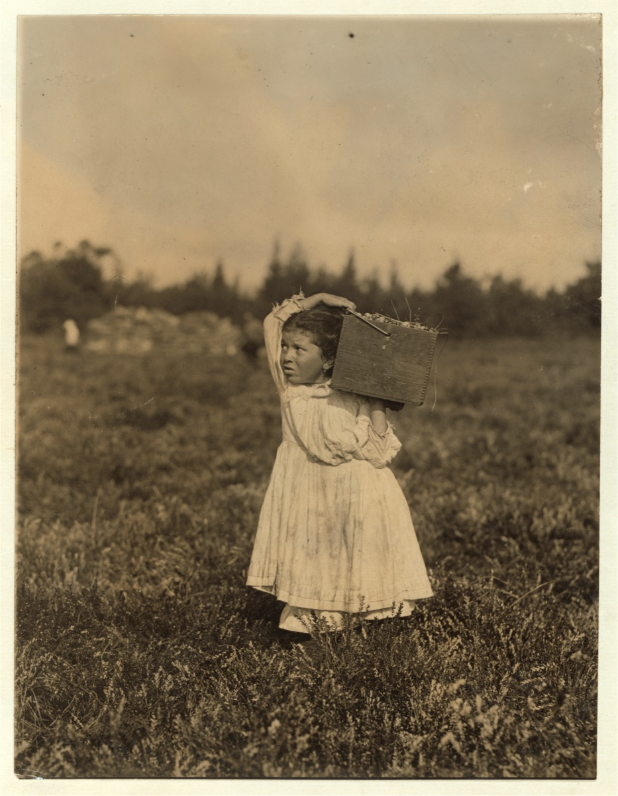
<figcaption>Lewis Hine, Jennie Camillo, 8, cranberry picker, Pemberton, New Jersey, 1910 · Library of Congress · public domain</figcaption>
</figure>

The table · cranberry sauce
{: .eyebrow}

## Cranberry sauce came by way of child pickers, a can and a cancer scare
{: .main-point}

"serve up with boiled onions and cramberry-sauce, mangoes, pickles or celery." Simmons, "To stuff and roast a Turkey, or Fowl," <i>American Cookery</i> (1796)
{: .quote.compact}

Families, children included, picked the bogs. Canned sauce arrived in 1912. In November 1959 a federal warning about weed killer on some berries wrecked that Thanksgiving's sales.
{: .detail}

</section>

<!-- ========== THE ARC ========== -->
<section markdown="1">
Belasco and Siskind · looking back
{: .eyebrow}

## From what people ate to what a holiday meal means
{: .main-point}

---

###### 01 · 1960s–1990s
{: .num}

#### Material

Braudel's bread, Mintz's sugar and Cronon's packers made food evidence of economies and empires.

###### 02 · 1980s–2000s
{: .num}

#### Meaning

Scholars shied from meaning until Shapiro and others read meals for citizenship and belonging.

###### 03 · Belasco, pp. 7–11
{: .num}

#### Negotiated

Every meal trades identity against convenience, and responsibility pulls weakest.

###### 04 · Siskind, 1992
{: .num}

#### Invented

Victory days became a family feast, a national day, then a rite for making Americans.

###### 05 · The table
{: .num}

#### Older than the holiday

Each dish carries its own history of land, labor and industry.

</section>

<!-- ========== THE TAKE HOME ========== -->
<section data-transition="fade" markdown="1">
The take home
{: .eyebrow}

## A tradition with a history can be changed, and someone decides how
{: .main-point}

---

"if the present is transformed, there will be changes in the past, and a new form of the 'First Thanksgiving' will emerge."

Siskind, "The Invention of Thanksgiving," p. 187

The foods on Thursday's table are older than the holiday, and many of its dishes are younger. Its story was chosen in the late 1800s and can be chosen again.

</section>
