<!-- ========== TITLE ========== -->
<section data-transition="fade" markdown="1">
Making History • HIST 1105 • Week 11.1
{: .eyebrow}

# History, Memory, and Public Space
{: .main-point}

---

- James W. Loewen, *Lies Across America: What Our Historic Sites Get Wrong* (1999), "Some Functions of Public History" and "The Sociology of Historic Sites", 13–24
- Dolores Hayden, *The Power of Place: Urban Landscapes as Public History* (1995), ch. 2, "Urban Landscape History: The Sense of Place and the Politics of Space", 14–43
{: .source-list}

Loewen is cited by the page of the revised edition (The New Press, 2019), which the course PDF reproduces. Hayden is cited by the page of the MIT Press edition.
{: .citation-note}
</section>

<!-- ========== THROUGHLINE ========== -->
<section markdown="1">
Today in context
{: .eyebrow}

## What makes history happen?
{: .main-point}

---

###### Week 10.1 · Maza, with Jenkins
{: .num}

Language. Sources read as texts, and histories as made things.

###### Week 10.2 · Campus history with AI
{: .num}

A machine that puts words together the way readers expect. Whether it can write history.

###### Week 11.1 · Loewen and Hayden
{: .num}

Commemoration and space. What gets put up, by whom, and who a place lets in.

###### Week 11.2 · AI and campus history
{: .num}

The campus as a landscape with a past, and the archive behind it.

</section>

<!-- ================================================================ -->
<!-- ====== LOEWEN, PP. 13–24 ========================================= -->
<!-- ================================================================ -->

<!-- ========== IMAGE: LOEWEN ========== -->
<section class="image-slide" data-background="#0d1412" markdown="1">
<figure class="portrait">

<figcaption markdown="span">
James W. Loewen · 1942–2021
<em>A sociologist from Decatur, Illinois, who taught at Tougaloo College in Mississippi, then for twenty years at the University of Vermont. <i>Lies My Teacher Told Me</i> (1995) took on high-school textbooks; <i>Lies Across America</i> (1999) took the same questions to historic sites across the country.<strong>Why he matters:</strong> he reads markers and monuments as documents with authors and sponsors, so a visitor can ask who put them up and why.(Skyline College, 2015. Flickr, CC BY-NC-SA 2.0; non-commercial use.)</em>
</figcaption>
</figure>
</section>

<!-- ========== WHAT MONUMENTS ARE FOR ========== -->
<section markdown="1">
Loewen · "Some Functions of Public History"
{: .eyebrow}

## For Loewen, teaching the past is not the main reason for a monument
{: .main-point}

---

#### Heroes to share

People "live by stories." Those with no heroic story of their own can borrow the nation's (p. 13).

#### History is power

The upper class commemorates its past to feel good about itself, and to "stay upper" (p. 13).

#### A civil religion

Sacred sites for what Robert Bellah called America's "civil religion." Memorials make the state, mostly, the thing worth dying for (p. 14).

#### Tourism

Colonial Williamsburg has become "a powerful moneymaking machine," and a marker can "put a town on the map" (pp. 13, 16).

</section>

<!-- ========== IMAGE: WILLIAMSBURG ========== -->
<section class="image-slide" data-background="#0d1412" markdown="1">
<figure class="landscape">
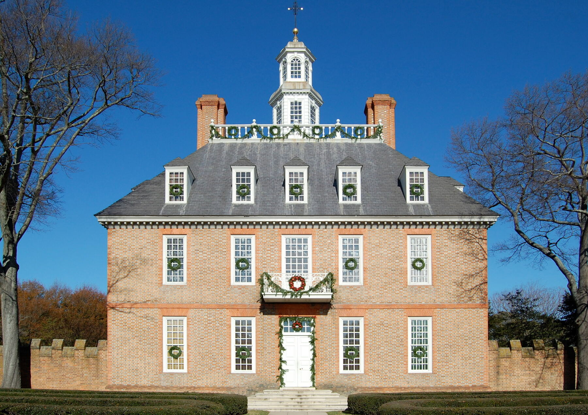
<figcaption markdown="span">
The Governor's Palace, Colonial Williamsburg, Virginia
<em>Rebuilt with Rockefeller money in the early 1930s where the palace burned in 1781. "Popular education in history is a market commodity," says its Vice President for Research (Loewen, p. 13). (Fletcher6, 2008. Wikimedia Commons, CC BY-SA 3.0.)</em>
</figcaption>
</figure>
</section>

<!-- ========== WHATEVER HAPPENED WAS GOOD ========== -->
<section markdown="1">
Loewen · what monuments do to thinking
{: .eyebrow}

## Most monuments, Loewen argues, tell visitors that whatever happened was good
{: .main-point}

---

#### The state is rarely criticized

Most war memorials turn their conflicts into "noble causes." Markers rarely criticize the government (p. 14).

#### Thinking is discouraged

A modest plaque "speaks with authority," as if its message were "incontestable" (p. 14).

#### The future inherits it

One generation's monuments become "a force imprisoning the minds" of the next. Local ones can "empower people" too (p. 17).

</section>

<!-- ========== IMAGE: OÑATE · THE HAPPY VERSION ========== -->
<section class="image-slide" data-background="#0d1412" markdown="1">
<figure class="landscape">

<figcaption markdown="span">
Reynaldo Rivera, <i>Juan de Oñate</i>, at the Oñate Monument Center, Alcalde, New Mexico
<em>The happy version: the colony's founder on horseback. Loewen: it lets "some Hispanic visitors" identify with "a heroic forebear," while some Native visitors see "the heroification of a bloody conquistador" (p. 15). (Advanced Source Productions, 2006. Wikimedia Commons, CC BY 2.0.)</em>
</figcaption>
</figure>
</section>

<!-- ========== IMAGE: ACOMA ========== -->
<section class="image-slide" data-background="#0d1412" markdown="1">
<figure class="landscape">
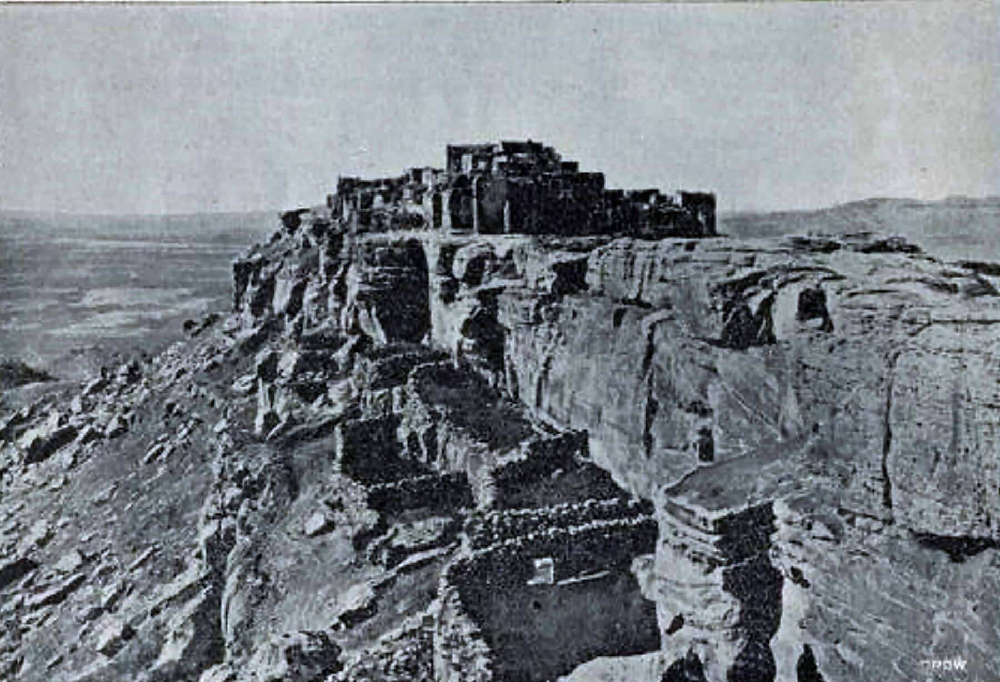
<figcaption markdown="span">
Acoma Pueblo on its mesa, about 1899
<em>In December 1598 Acoma's fighters killed eleven Spaniards. In January 1599 Oñate's soldiers stormed the mesa and burned the pueblo; Spanish witnesses counted 600 to 800 dead (George P. Hammond, 1927, pp. 120–22). (Photographer unknown; <i>The Pacific Monthly</i>, about 1900. Wikimedia Commons, public domain.)</em>
</figcaption>
</figure>
</section>

<!-- ========== ACOMA · WHAT THE STATUE LEAVES OUT ========== -->
<section markdown="1">
Oñate · what the statue leaves out
{: .eyebrow}

## Spain convicted Oñate of crimes at Acoma; the statue omits it
{: .main-point}

---

#### The sentence, 1599

Acoma's men over twenty-five: a foot cut off and twenty years' servitude. Younger men and women: twenty years (pp. 122–23).

#### Twenty-four men

A Spanish captain counted twenty-four maimed (p. 123). Some of Oñate's defenders now say toes, not feet.

#### Convicted, 1614

A royal judge found him guilty of crimes including killing innocent and guilty alike at Acoma, and banished him (p. 184).

#### The statue's foot, 1997

Before the 400th anniversary, someone cut off its right foot, claiming to act for Acoma. It came down in 2020.

George P. Hammond, <i>Don Juan de Oñate and the Founding of New Mexico</i> (1927).
{: .cite}
</section>

<!-- ========== IMAGE: GODDESS OF DEMOCRACY ========== -->
<section class="image-slide" data-background="#0d1412" markdown="1">
<figure class="portrait">
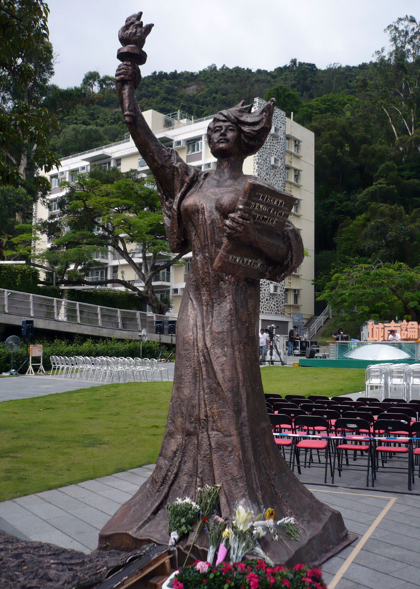
<figcaption markdown="span">
A copy of the 1989 "Goddess of Democracy" at the Chinese University of Hong Kong, 2010
<em>The original stood in Tiananmen Square in 1989. "Even in the United States," blared the government's loudspeakers, "statues need permission before they can be put up" (Loewen, p. 18). This copy was removed in 2021. (Cyberviewer, 2010. Wikimedia Commons, CC BY-SA 4.0.)</em>
</figcaption>
</figure>
</section>

<!-- ========== WHO PUTS THEM UP ========== -->
<section markdown="1">
Loewen · "The Sociology of Historic Sites"
{: .eyebrow}

## Monuments need approval, and only certain kinds go up
{: .main-point}

---

#### State marker offices

Early one-person offices made errors; review boards from the late 1950s did better. In Georgia, a legislator's call could still take a marker down (pp. 18–20).

#### Sponsors

Often a private club raises part of the cost and a city or state pays the rest. No relatively disinterested state body reviews monuments (pp. 20–21).

#### Who gets remembered

Indian wars, which many textbooks drop; labor, which has influence and money; and the upper class, "always" (pp. 21–22).

#### Happy history

Communities usually mark "only their happy history." Burlington honors Ethan Allen, whom Abenakis see as "a rapacious Indian-hater" (p. 23).

</section>

<!-- ========== IMAGE: HASSANAMESIT MARKER ========== -->
<section class="image-slide" data-background="#0d1412" markdown="1">
<figure class="landscape">
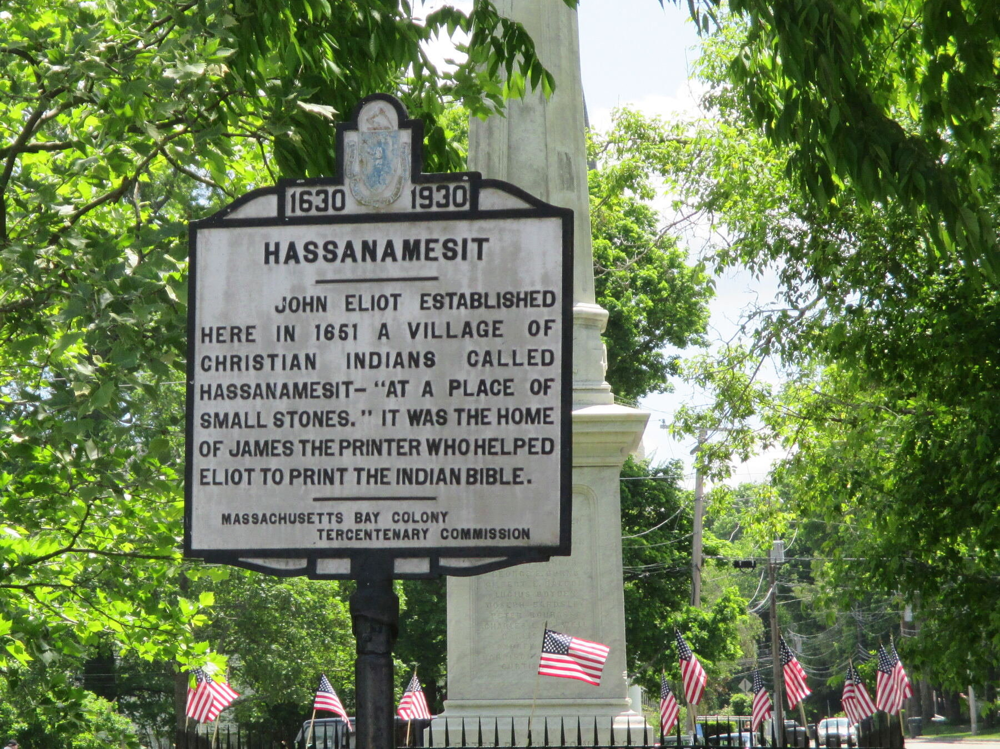
<figcaption markdown="span">
A Massachusetts Bay Colony Tercentenary marker, Grafton, 1930
<em>The happy version: Eliot's 1651 mission village and James the Printer. Of the state's 234 markers, 11% were on King Philip's War (Loewen, p. 21); this one never mentions it. (Elizabeth Thomsen, 2014. Wikimedia Commons, CC BY-SA 4.0.)</em>
</figcaption>
</figure>
</section>

<!-- ========== IMAGE: THE INDIAN BIBLE ========== -->
<section class="image-slide" data-background="#0d1412" markdown="1">
<figure class="portrait">
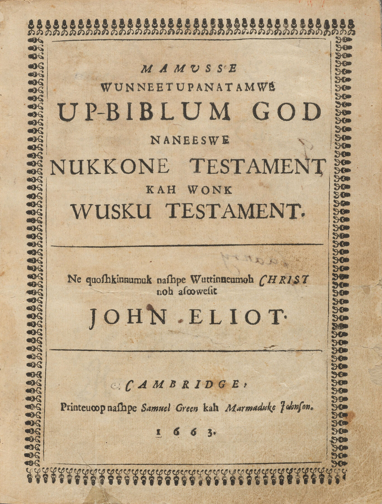
<figcaption markdown="span">
<i>Mamusse Wunneetupanatamwe Up-Biblum God</i> ("The Whole Holy His-Bible God"), Cambridge, 1663
<em>John Eliot's Bible in Massachusett, the book the marker is proud of, printed for Christian Indians like those at Hassanamesit. Daniel Gookin, the colony's superintendent of Christian Indians, recorded what happened to them in 1675. (Houghton Library, Harvard University. Wikimedia Commons, public domain.)</em>
</figcaption>
</figure>
</section>

<!-- ========== HASSANAMESIT · NOVEMBER 1675 ========== -->
<section markdown="1">
Hassanamesit · November 1675
{: .eyebrow}

## The marker leaves out the war that emptied Hassanamesit in 1675
{: .main-point}

---

"they will either force you all to some Island as the Natick Indians are, where you will be in danger to be starved with cold and hunger, and most probably in the end be all sent out of the country for slaves."

Nipmuc fighters on the English, as reported by Daniel Gookin, 1677, p. 476

###### Deer Island
{: .label}

About two hundred went with the fighters. By December the colony held five hundred other Christian Indians on Deer Island, "bleak and cold" (pp. 476, 485).

###### Still in Grafton
{: .label}

Hassanamisco Nipmuc families still hold a small reservation in Grafton.

</section>

<!-- ========== NOT WRITTEN BY GODS ========== -->
<section markdown="1">
Loewen · how to read a marker
{: .eyebrow}

## People, not gods, write markers, so ask how each might be wrong
{: .main-point}

---

"Markers and monuments are often written in stone, but they are not written by gods. People put them up."

Loewen, <i>Lies Across America</i>, p. 20

###### His questions
{: .label}

Ask, "How might this be wrong?" Distrust "According to tradition . . ." Ask why the sponsors went to the trouble of putting it up (pp. 20–21).

</section>

<!-- ================================================================ -->
<!-- ====== HAYDEN, CHAPTER 2, PP. 14–43 ============================== -->
<!-- ================================================================ -->

<!-- ========== HAYDEN ========== -->
<section markdown="1">
Hayden · *The Power of Place*, 1995
{: .eyebrow}

## An architect and urban historian reads the whole city as social history
{: .main-point}

<figure>
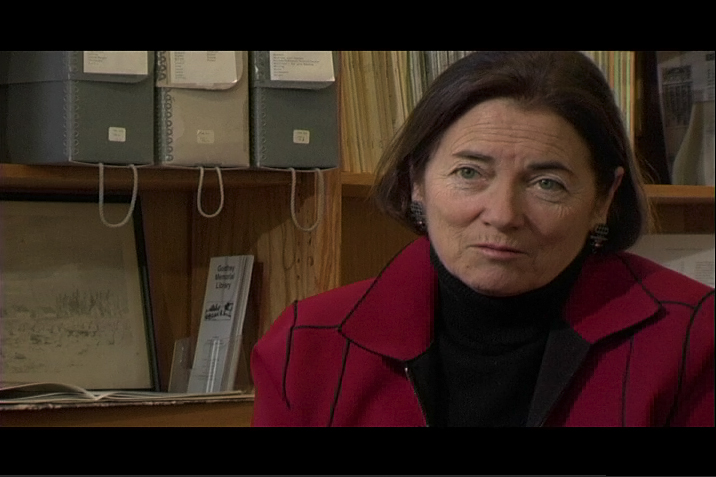
<figcaption>Dolores Hayden · photograph by Dean Terry · Flickr, CC BY-NC-ND 2.0</figcaption>
</figure>

"This chapter sketches a way to frame the social history of urban space, a scholarly terrain where many fields overlap." Hayden, <i>The Power of Place</i>, p. 15
{: .quote.compact}

Loewen stops at markers and monuments. Hayden, an architect who taught at UCLA and Yale, ran The Power of Place in Los Angeles, marking sites of working people's lives.
{: .detail}

</section>

<!-- ========== LEFEBVRE ========== -->
<section markdown="1">
Hayden · Lefebvre, 1974
{: .eyebrow}

## Chapter 2's starting point: space is produced
{: .main-point}

<figure>

<figcaption>Henri Lefebvre (1901–1991), 1971 · Bert Verhoeff, Nationaal Archief · CC BY-SA 3.0 NL</figcaption>
</figure>

"Authentic knowledge of space must address the question of its production." Henri Lefebvre, <i>The Production of Space</i> (1974), Hayden's epigraph, p. 14
{: .quote.compact}

Hayden builds the chapter on the French sociologist Henri Lefebvre. Her question is how any place gets made, and for whom.
{: .detail}

</section>

<!-- ========== EVERYONE BUILDS ========== -->
<section markdown="1">
Hayden · the production of space
{: .eyebrow}

## Hayden counts ditchdiggers and housewives among a city's makers
{: .main-point}

---

"Indigenous residents as well as colonizers, ditchdiggers as well as architects, migrant workers as well as mayors, housewives as well as housing inspectors, are all active shaping the urban landscape."

Hayden, <i>The Power of Place</i>, p. 15

###### Lefebvre's term
{: .label}

The production of space: how places are "planned, designed, built, inhabited, appropriated, celebrated, despoiled, and discarded" (p. 15).

</section>

<!-- ========== IMAGE: CHAMISAL ========== -->
<section class="image-slide" data-background="#0d1412" markdown="1">
<figure class="landscape">
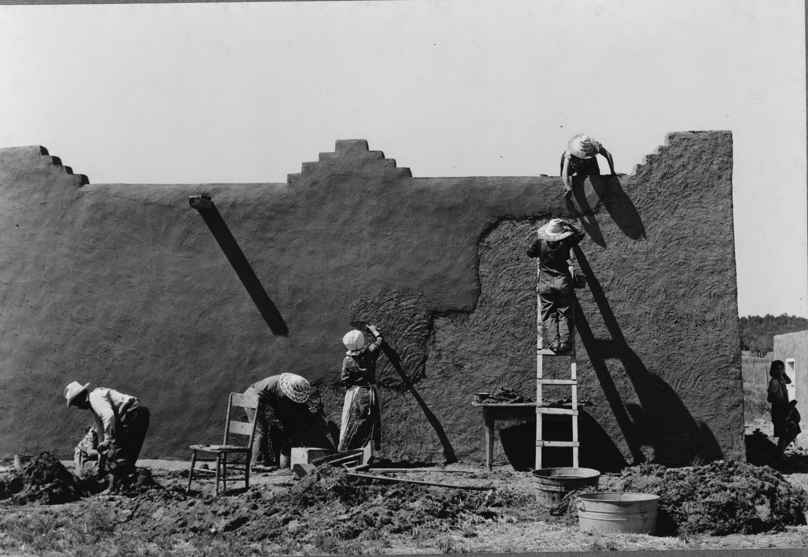
<figcaption markdown="span">
Replastering an adobe house, Chamisal, New Mexico, 1940
<em>Hayden prints it: a rural building, easier to read than urban real estate, which "may still convey some surprises—such as women doing the construction" (p. 31). (Russell Lee, Farm Security Administration. Library of Congress. Public domain.)</em>
</figcaption>
</figure>
</section>

<!-- ========== PLACE ========== -->
<section markdown="1">
Hayden · "place"
{: .eyebrow}

## Hayden joins the sense of place to the politics of space
{: .main-point}

---

"'Place' is one of the trickiest words in the English language, a suitcase so overfilled one can never shut the lid. It carries the resonance of homestead, location, and open space in the city as well as a position in a social hierarchy."

Hayden, <i>The Power of Place</i>, p. 15

###### The sense of place
{: .label}

Place reaches all five senses, which makes it "powerful as a source of memory" (p. 18).

###### The politics of space
{: .label}

Phrases like "knowing one's place" are spatial and political at once (p. 16). Cultural geography, she says, kept to rural landscapes, "avoiding issues of political contestation" (p. 17).

</section>

<!-- ========== PRODUCTION AND REPRODUCTION ========== -->
<section markdown="1">
Lefebvre, through Hayden · pp. 18–19
{: .eyebrow}

## Every society, Lefebvre argues, builds space for production and for social reproduction
{: .main-point}

---

#### Production

Spaces "shaped for mining, manufacturing, commerce, or real estate speculation."

#### The body

Biological reproduction, in the space in and around the body.

#### Housing

Reproduction of the labor force, in the space of housing.

#### The city

Reproduction of social relations, in the public space of the city.

</section>

<!-- ========== THREE HISTORIES ========== -->
<section markdown="1">
Hayden · three histories to write
{: .eyebrow}

## Hayden turns Lefebvre into three kinds of history a historian can write
{: .main-point}

---

#### Working landscapes

Who built and kept up the farms, mines, railroads and streetcars, a history that has "barely been studied" (pp. 20–22).

#### Territorial histories

Ghettos and barrios, reservations and camps; for women, the body, the home and the street: territories with enforced boundaries (pp. 22–29).

#### Building types

The political life of ordinary buildings: who built, owned, regulated and rented them (pp. 30–34).

</section>

<!-- ========== IMAGE: WRIGHTS TUNNEL ========== -->
<section class="image-slide" data-background="#0d1412" markdown="1">
<figure class="landscape">
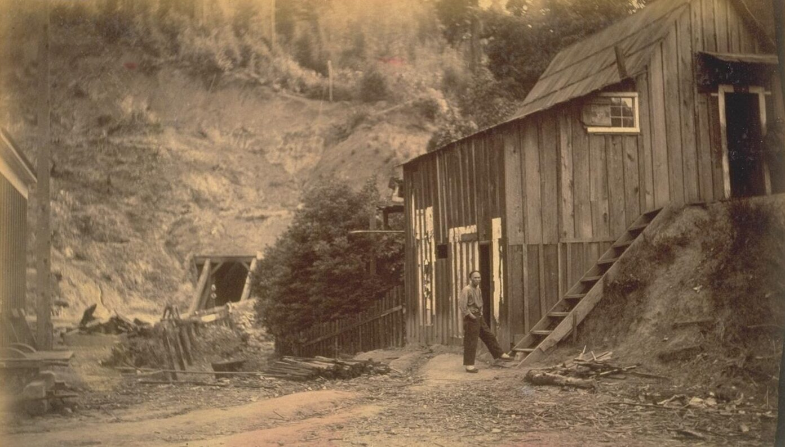
<figcaption markdown="span">
Workers' barracks by Wrights Tunnel, Santa Cruz Mountains, about 1880
<em>A working landscape: a Chinese worker outside the barracks. Building this tunnel killed twenty-nine Chinese workers in 1879 and injured dozens more (Hayden, p. 21). (Photographer unknown. Bancroft Library, via Wikimedia Commons, public domain.)</em>
</figcaption>
</figure>
</section>

<!-- ========== IMAGE: BELZONI ========== -->
<section class="image-slide" data-background="#0d1412" markdown="1">
<figure class="landscape">
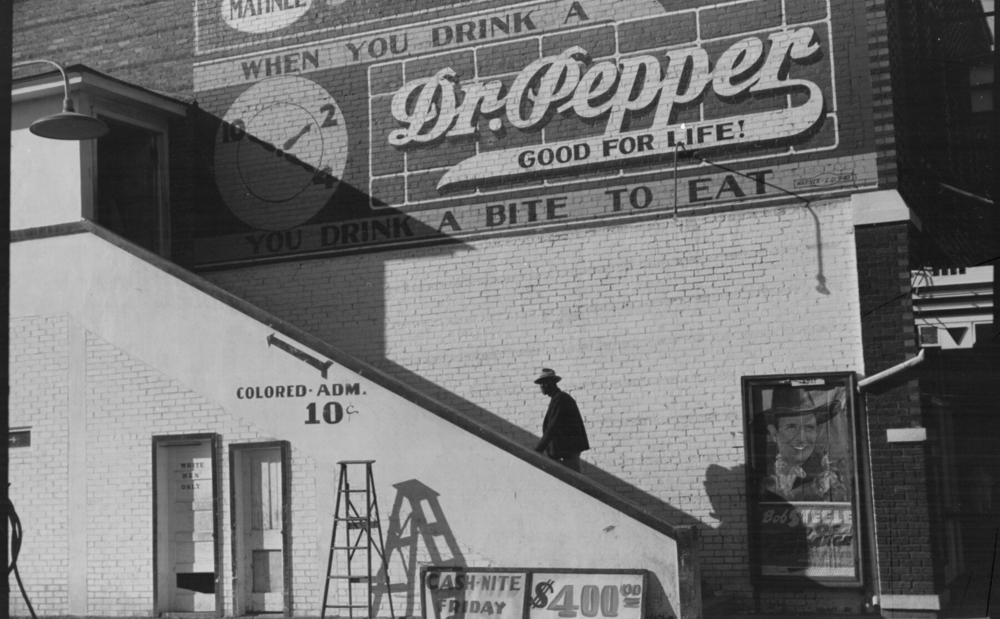
<figcaption markdown="span">
A movie house in Belzoni, Mississippi, October 1939
<em>A territorial history: Black moviegoers took the outside stair. Photographs of segregated entrances like this one, Hayden writes, "convey territorial history" (p. 24). (Marion Post Wolcott, Farm Security Administration. Library of Congress. Public domain.)</em>
</figcaption>
</figure>
</section>

<!-- ========== IMAGE: TENEMENT MUSEUM ========== -->
<section class="image-slide" data-background="#0d1412" markdown="1">
<figure class="landscape">
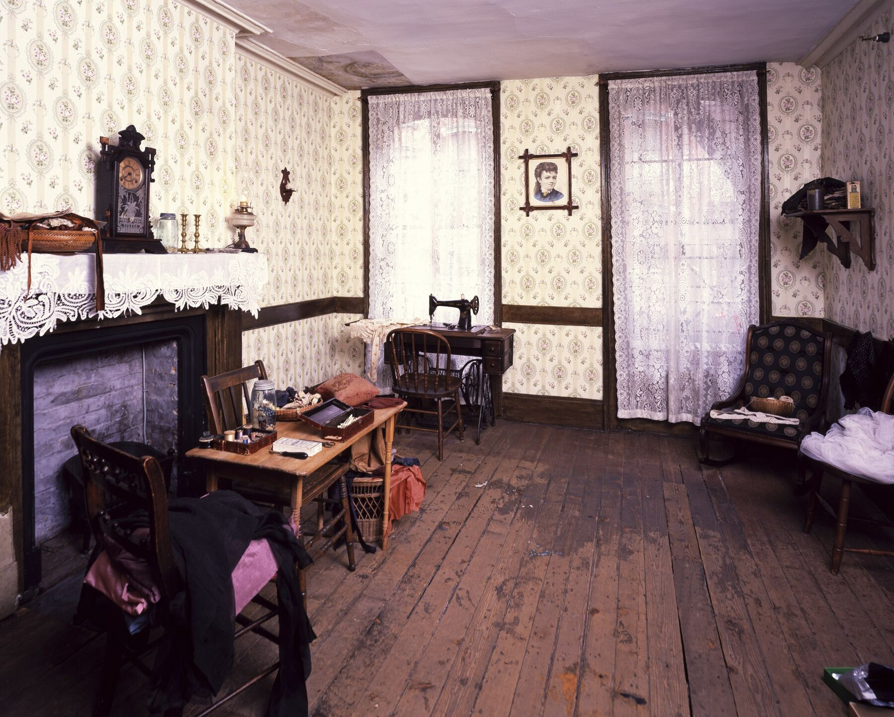
<figcaption markdown="span">
A restored apartment at 97 Orchard Street, the Tenement Museum, New York
<em>A building type: a tenement of 1863, a museum since 1988. Standing in such a flat, Hayden writes, "leaves a visitor gasping for air and looking for light" (p. 33). (Carol M. Highsmith. Library of Congress. Public domain.)</em>
</figcaption>
</figure>
</section>

<!-- ========== TERRITORIAL ========== -->
<section markdown="1">
Hayden · territorial histories
{: .eyebrow}

## Keeping people out of space, Hayden argues, is a way of limiting their rights
{: .main-point}

---

"One of the consistent ways to limit the economic and political rights of groups has been to constrain social reproduction by limiting access to space."

Hayden, <i>The Power of Place</i>, p. 22

###### Los Angeles · the 1940s
{: .label}

An African American lawyer who grew up there remembered, "As teen-agers, we knew not to drive into Compton, to Inglewood, not to drive into Glendale" (quoted in Hayden, p. 23).

</section>

<!-- ========== ORDINARY BUILDINGS ========== -->
<section markdown="1">
Hayden · ordinary buildings
{: .eyebrow}

## Hayden reads an ordinary building as a record of power
{: .main-point}

---

"most buildings can be understood in terms of power or authority—as efforts to assume, extend, resist, or accommodate it."

Camille Wells, quoted in Hayden, <i>The Power of Place</i>, p. 30

###### The tenement
{: .label}

A New York tenement around 1900 could return its landlord 25 percent a year. "One building tells the story of thousands of developers and millions of tenants" (pp. 33–34).

</section>

<!-- ========== IMAGE: HODGIN HALL, 1904 ========== -->
<section class="image-slide" data-background="#0d1412" markdown="1">
<figure class="landscape">
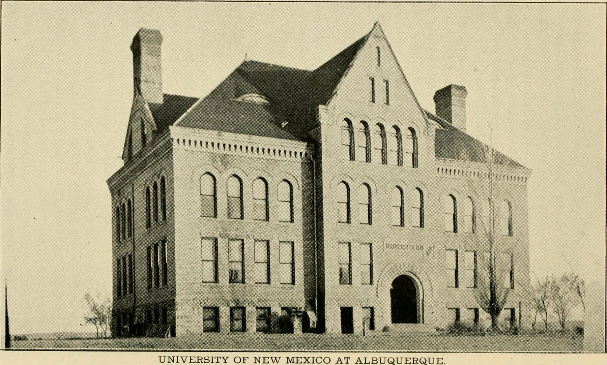
<figcaption markdown="span">
Hodgin Hall, University of New Mexico, 1904
<em>UNM's first building, put up in brick in 1892, as New Mexico showed it at the St. Louis fair. (<i>The Land of Sunshine</i>, New Mexico's handbook for the 1904 fair, via Internet Archive; no known restrictions.)</em>
</figcaption>
</figure>
</section>

<!-- ========== IMAGE: HODGIN HALL, 2024 ========== -->
<section class="image-slide" data-background="#0d1412" markdown="1">
<figure class="landscape">

<figcaption markdown="span">
The same building, now UNM's alumni center, 2024
<em>In 1908 the university's president, William G. Tight, had it remodeled to look like a pueblo. What history does the new look claim for the university, and who was asked? (Kenneth C. Zirkel, via Wikimedia Commons, CC BY 4.0.)</em>
</figcaption>
</figure>
</section>

<!-- ========== CONCLUSION ========== -->
<section markdown="1">
Hayden · the chapter's end
{: .eyebrow}

## For Hayden, how a place feels and who controls it are bound together
{: .main-point}

---

"Places make memories cohere in complex ways. People's experiences of the urban landscape intertwine the sense of place and the politics of space."

Hayden, <i>The Power of Place</i>, p. 43

###### Counter-space
{: .label}

In East Harlem, Puerto Rican organizers built casitas, island houses, among abandoned tenements. They "produced their own public space," Hayden's example of Lefebvre's "counter-space" (pp. 35–36).

</section>

<!-- ========== IMAGE: CASITA RINCÓN CRIOLLO ========== -->
<section class="image-slide" data-background="#0d1412" markdown="1">
<figure class="landscape">
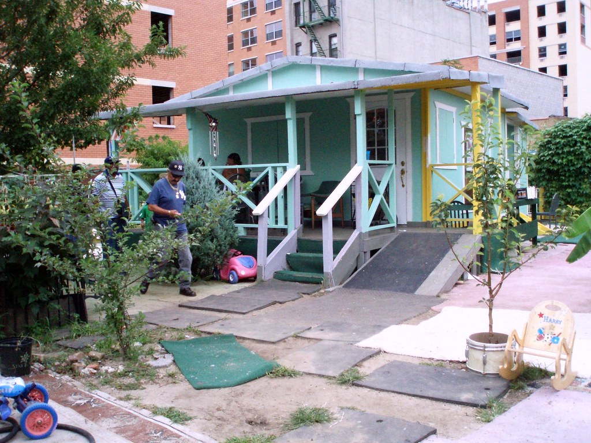
<figcaption markdown="span">
Casita Rincón Criollo ("Downhome Corner"), South Bronx, New York
<em>Counter-space: a rural Puerto Rican house among apartment blocks. Begun on a vacant lot in the late 1970s, it moved a block in 2007 when the city took the lot for housing. (Miss April NYC, via Flickr, CC BY 2.0.)</em>
</figcaption>
</figure>
</section>

<!-- ========== IMAGE: ESTRADA COURTS ========== -->
<section class="image-slide" data-background="#0d1412" markdown="1">
<figure class="landscape">
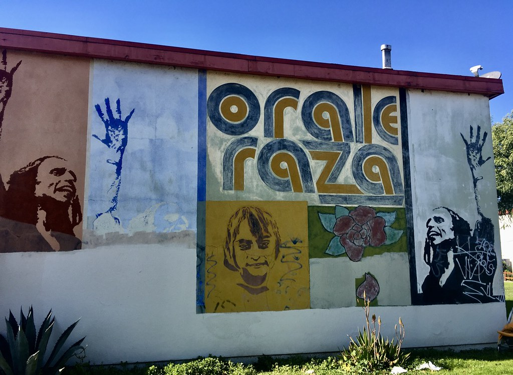
<figcaption markdown="span">
"Órale raza" ("Right on, people"), Estrada Courts, Boyle Heights, Los Angeles
<em>Counter-space: Chicano artists painted about eighty murals on this public housing project in the 1970s. Hayden photographed two in 1980; such murals set up "a political dialogue with the surrounding city" (pp. 36–38). (waltarrrrr, via Flickr, CC BY-NC-ND 2.0.)</em>
</figcaption>
</figure>
</section>

<!-- ========== IMAGE: MAPPING INEQUALITY ========== -->
<section class="image-slide" data-background="#0d1412" markdown="1">
<figure class="landscape">
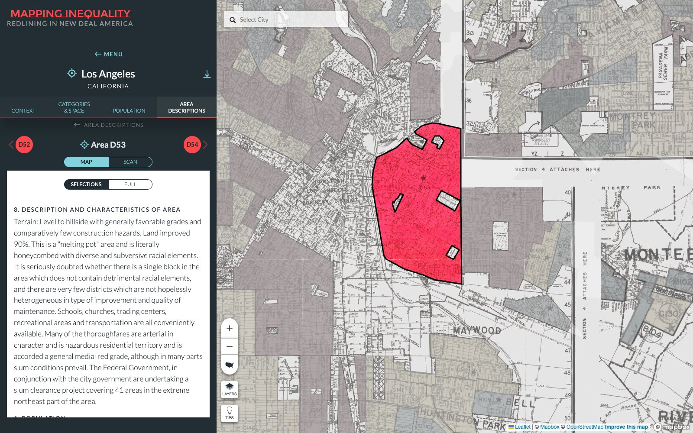
<figcaption markdown="span">
<i>Mapping Inequality</i>: Boyle Heights (area D53), Los Angeles, graded in 1939
<em>Territory, mapped: University of Richmond historians put the 1930s redlining maps and appraisers' notes online. Estrada Courts sits in D53, graded "Hazardous," "literally honeycombed with diverse and subversive racial elements." (Screenshot, dsl.richmond.edu/panorama/redlining.)</em>
</figcaption>
</figure>
</section>

<!-- ========== IMAGE: MAPPING PREJUDICE ========== -->
<section class="image-slide" data-background="#0d1412" markdown="1">
<figure class="portrait">
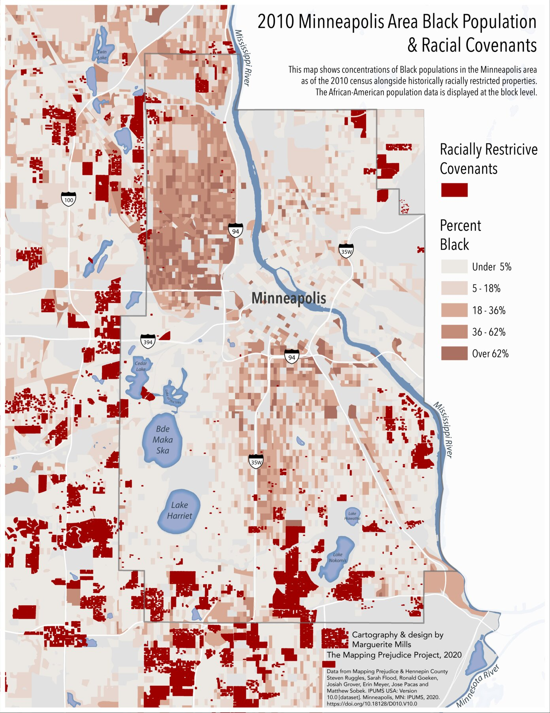
<figcaption markdown="span">
<i>Mapping Prejudice</i>: racial covenants (dark red) and the share of Black residents in 2010, Minneapolis
<em>Since 2016, volunteers have read old deeds for clauses barring anyone not White, Hayden's "deed restrictions" (p. 25). Against the 2010 census, most covenanted blocks still have few Black residents. (Marguerite Mills, Mapping Prejudice, 2020. CC BY-NC 4.0.)</em>
</figcaption>
</figure>
</section>

<!-- ================================================================ -->
<!-- ====== CLOSING =================================================== -->
<!-- ================================================================ -->

<!-- ========== COMPARISON ========== -->
<section markdown="1">
Loewen and Hayden
{: .eyebrow}

## Loewen reads what was put up; Hayden reads everything that was built
{: .main-point}

---

##### Loewen · *Lies Across America*, 1999

Markers and monuments are documents with sponsors. Ask who got them approved, who paid, and how they might be wrong (pp. 18–21).

##### Hayden · *The Power of Place*, 1995

Every street and building was produced by someone, for work and for daily life, and its boundaries often keep people out (pp. 19–22, 30).

</section>

<!-- ========== THE ARC ========== -->
<section markdown="1">
The lecture · looking back
{: .eyebrow}

## From what monuments do to how all space gets made
{: .main-point}

---

###### Loewen, pp. 13–24
{: .num}

#### What monuments do

Flatter, sell and unify more than they teach, and usually mark only the happy history.

###### Oñate · Hassanamesit
{: .num}

#### The happy version

A founder without Acoma, a mission village without the war that emptied it.

###### Hayden, ch. 2
{: .num}

#### How space gets made

Work, territory and ordinary buildings, read as the production of space, down to a remodeled Hodgin Hall.

</section>

<!-- ========== THE TAKE HOME ========== -->
<section data-transition="fade" markdown="1">
The take home
{: .eyebrow}

## A monument is a source about the people who put it up
{: .main-point}

---

###### What it records
{: .label}

When it went up, who paid, and what they were proud of. The Grafton marker tells more about 1930 than about 1651.

###### What Hayden adds
{: .label}

The rest of the landscape is a source too. Tunnels, movie houses and tenements record who built them and who was kept out (pp. 20–34).

The catch: a corrected marker is still a marker. It speaks with the same authority Loewen distrusts.

</section>

<!-- ========== WHAT COMES NEXT ========== -->
<section data-transition="fade" markdown="1">
Next · Thursday, 11.2
{: .eyebrow}

## Next: AI and the future of history, and the archive behind your campus history
{: .main-point}

Hodgin Hall stands on the campus you are researching. Its records may show who argued over the 1908 remodel, and why.
{: .detail}
</section>
