<!-- ========== TITLE ========== -->
<section data-transition="fade" markdown="1">
Making History • HIST 1105 • Week 14.1
{: .eyebrow}

# The History of Medicine
{: .main-point}

---

- Background: Sarah Maza, *Thinking About History* (2017), ch. 3: "The History of What?", 83–108
- Charles E. Rosenberg, "Framing Disease: Illness, Society, and History," in Rosenberg and Janet Golden, eds., *Framing Disease* (1992), xiii–xxvi
{: .source-list}

Rosenberg's introduction is numbered in roman numerals. Shapin is quoted from <i>The Scientific Revolution</i> (1996), from Week 13.1.
{: .citation-note}
</section>

<!-- ========== PHYSICIANS' HISTORY ========== -->
<section markdown="1">
Doctors' histories · to 1930
{: .eyebrow}

## The history of disease was long written by doctors and moral writers
{: .main-point}

---

"Although it has been a traditional concern of physicians, antiquarians, and moralists, the study of disease is still comparatively novel for social scientists."

Rosenberg, "Framing Disease," p. xxiii

###### The physicians' version
{: .label}

Antiquarians were collectors of old things and texts. Doctors wrote most early histories of medicine: great men from Hippocrates to Pasteur beating back ignorance.

</section>

<!-- ========== IMAGE: JENNER ========== -->
<section class="image-slide" data-background="#0d1412" markdown="1">
<figure class="landscape">
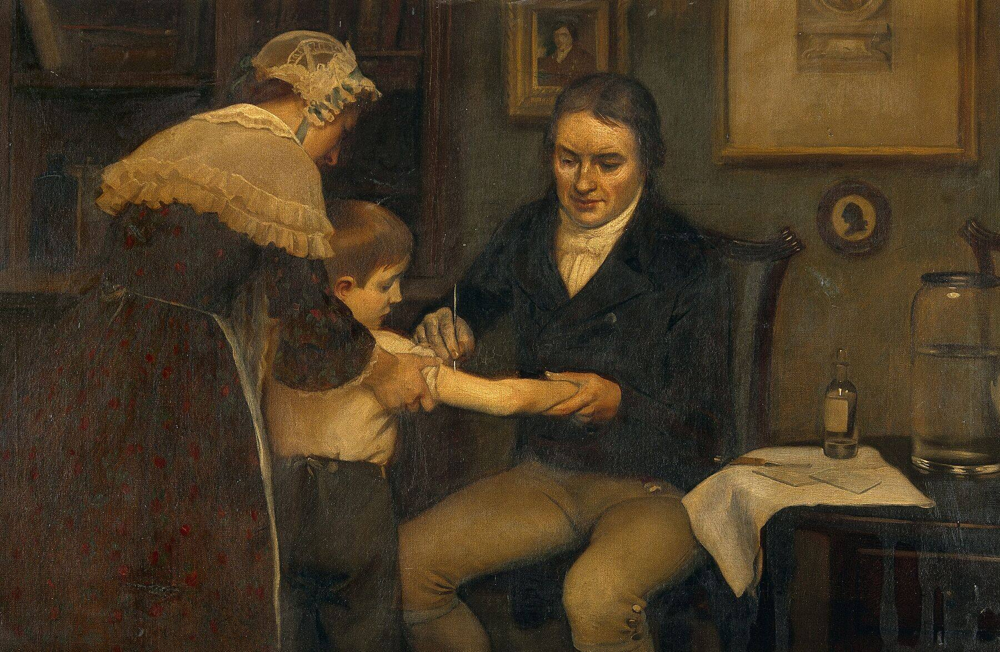
<figcaption markdown="span">
Ernest Board, <i>Dr Jenner Performing His First Vaccination, on James Phipps, a Boy of 8, May 14, 1796</i>, about 1910
<em>Painted more than a century after the event, it makes the first vaccination gentle and willing: a calm doctor, a trusting boy, a woman steadying his arm. Nothing shows the risk of infecting a healthy child with cowpox. (Wellcome Collection. CC BY 4.0; frame cropped.)</em>
</figcaption>
</figure>
</section>

<!-- ========== IMAGE: PASTEUR ========== -->
<section class="image-slide" data-background="#0d1412" markdown="1">
<figure class="portrait">
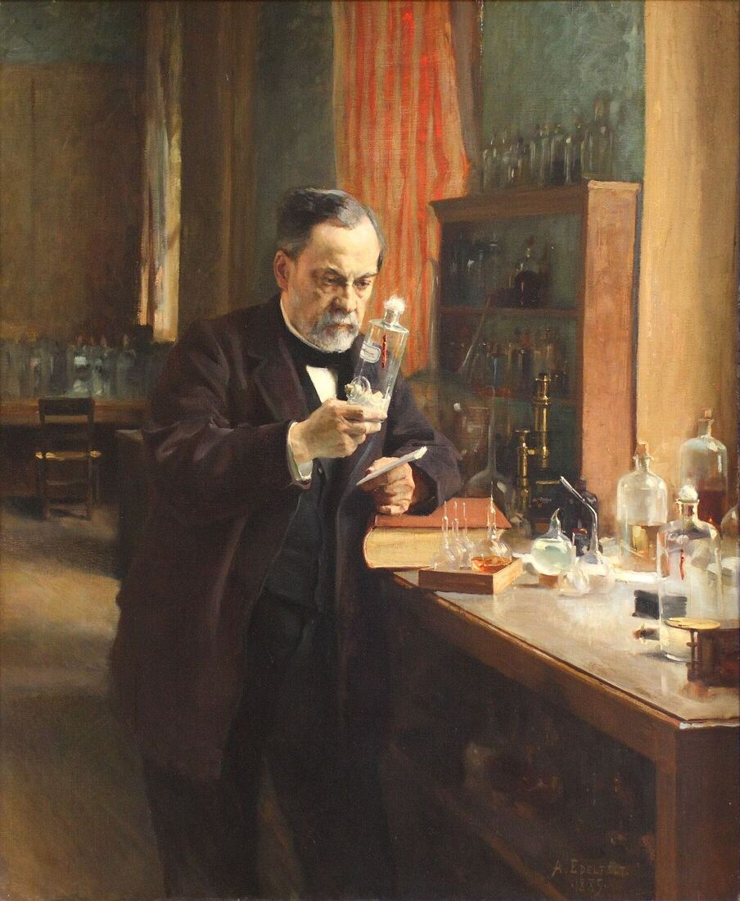
<figcaption markdown="span">
Albert Edelfelt, <i>Louis Pasteur</i>, 1885
<em>Pasteur alone at his laboratory window, studying a glass jar. Germ theory made it seem only a matter of time before the microbe behind every disease was found (Rosenberg, p. xvii), and Paul de Kruif's <i>Microbe Hunters</i> (1926) made the germ hunters adventure heroes. (Musée d'Orsay, via Wikimedia Commons. Public domain.)</em>
</figcaption>
</figure>
</section>

<!-- ========== IMAGE: THE GROSS CLINIC ========== -->
<section class="image-slide" data-background="#0d1412" markdown="1">
<figure class="portrait">
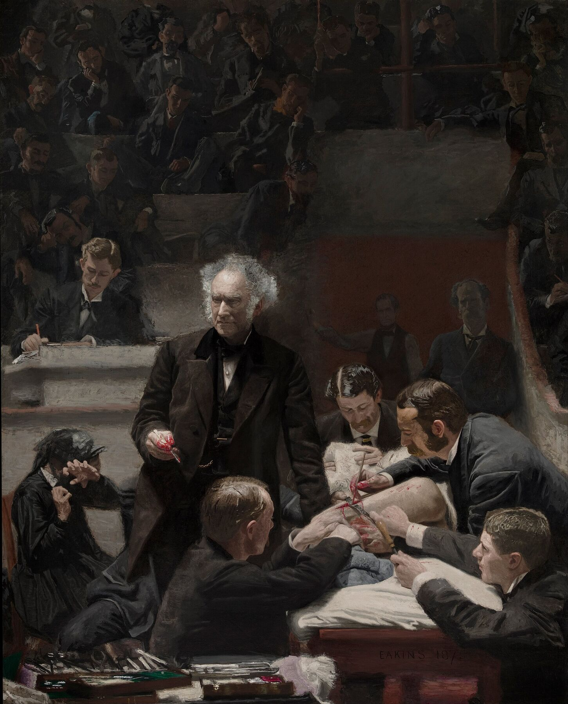
<figcaption markdown="span">
Thomas Eakins, <i>The Gross Clinic</i>, 1875
<em>A surgeon lectures mid-operation in Philadelphia. The surgeon is lit like a hero, the patient is a pair of legs, and the woman at left, probably a relative, cannot watch. (Philadelphia Museum of Art and Pennsylvania Academy of the Fine Arts. Public domain.)</em>
</figcaption>
</figure>
</section>

<!-- ========== SIGERIST ========== -->
<section markdown="1">
1930s–40s · society
{: .eyebrow}

## Medicine's history began to be written as part of society's history
{: .main-point}

---

"Every aspect of medicine's history is necessarily 'social,' whether acted out in laboratory, library, or at the bedside."

Rosenberg, "Framing Disease," p. xiv

Henry Sigerist, a doctor turned historian, wrote <i>Civilization and Disease</i> (1943) about disease, work and poverty, not only doctors.
{: .detail}
</section>

<!-- ========== FOUCAULT ========== -->
<section markdown="1">
1961 · madness
{: .eyebrow}

## The freeing of the mad came to be seen as a new kind of control
{: .main-point}

<figure>
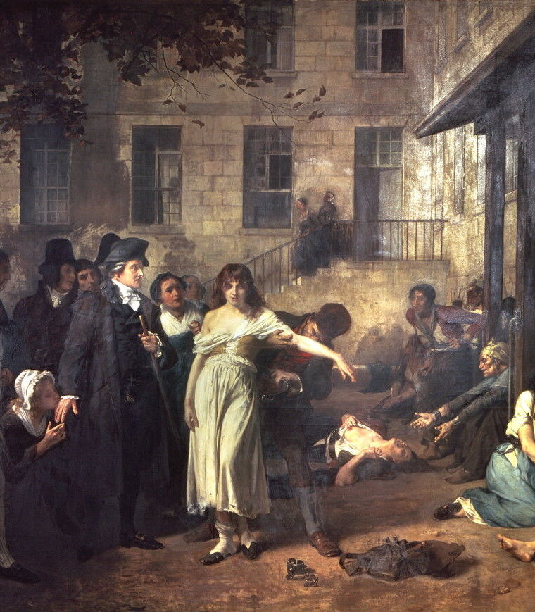
<figcaption>The hero version: Pinel unchaining patients, Paris, 1795, painted 1876 · public domain</figcaption>
</figure>

Critics came to see diagnoses "as tools of social control, as labels for deviance" Rosenberg, "Framing Disease," p. xvi
{: .quote.compact}

Michel Foucault's <i>Madness and Civilization</i> (1961) argued that the asylum replaced chains with constant watching. Deviance means behavior a society treats as abnormal.
{: .detail}

###### Discuss
{: .label}

**Was unchaining the mad an act of kindness or a quieter kind of control?**

</section>

<!-- ========== THE CHOLERA YEARS ========== -->
<section markdown="1">
Rosenberg · 1962 · cholera
{: .eyebrow}

## Reactions to disease could show what a society believed
{: .main-point}

<figure>
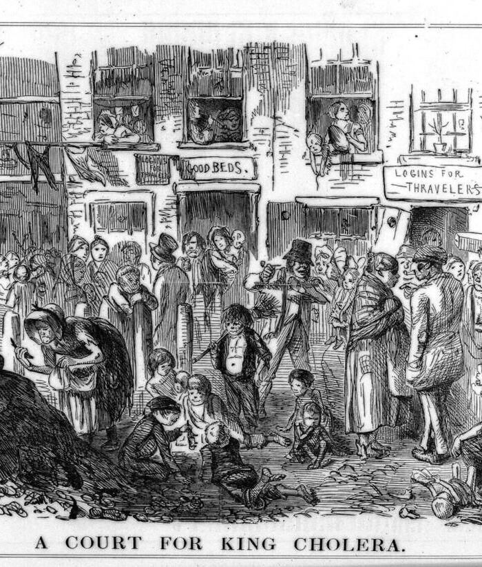
<figcaption><i>Punch</i> blames a London slum, 'A Court for King Cholera,' 1852 · Wellcome · CC BY 4.0</figcaption>
</figure>

Once cholera was known to spread "through the water supply, policy choices were reframed not only in practical engineering terms but in political and moral ones." Rosenberg, "Framing Disease," p. xx
{: .quote.compact}

Rosenberg's own <i>The Cholera Years</i> (1962) followed the epidemics of 1832, 1849 and 1866. Americans first read cholera as punishment for sin, later as a problem of filth and water.
{: .detail}

</section>

<!-- ========== CROSBY AND MCNEILL ========== -->
<section markdown="1">
1970s · ecology
{: .eyebrow}

## Historians began to treat disease as part of the environment
{: .main-point}

<figure>
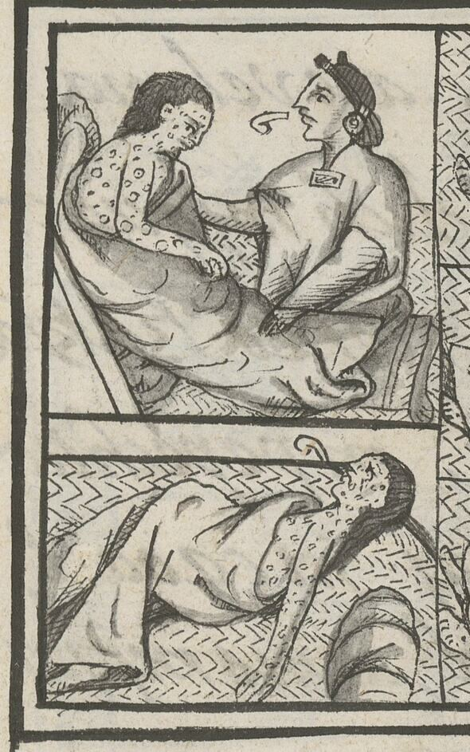
<figcaption>A Nahua healer tends smallpox sufferers, 1520, in the Florentine Codex, 1577 · public domain</figcaption>
</figure>

Historians took up "an ecological vision of history in which disease plays a key role, for example, in the Spanish conquest of Central and South America." Rosenberg, "Framing Disease," p. xv
{: .quote.compact}

Alfred Crosby's <i>The Columbian Exchange</i> (1972) traced the plants, animals and germs that crossed the Atlantic after 1492. William McNeill's <i>Plagues and Peoples</i> (1976) went worldwide.
{: .detail}

</section>

<!-- ========== MCKEOWN ========== -->
<section markdown="1">
1976 · did medicine work?
{: .eyebrow}

## Historians asked whether doctors deserved credit for longer lives
{: .main-point}

<figure>
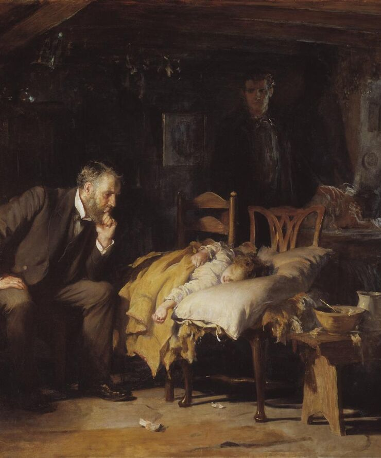
<figcaption>Luke Fildes, <i>The Doctor</i>, 1891: the physician can only watch · public domain</figcaption>
</figure>

"How much credit should go to specific medical interventions … and how much to changed economic and social circumstances?" Rosenberg, "Framing Disease," p. xv
{: .quote.compact}

Thomas McKeown's <i>The Modern Rise of Population</i> (1976) argued that better food, more than medicine, cut tuberculosis deaths. The claim drew controversy (n. 7). The policy question follows: spend on cures, or on prevention (p. xv)?
{: .detail}

</section>

<!-- ========== SOCIAL CONSTRUCTION ========== -->
<section markdown="1">
1970s–80s · construction
{: .eyebrow}

## Historians argued that societies help decide what counts as a disease
{: .main-point}

---

Social construction "has forcefully reminded us that medical thought and practice are rarely free of cultural constraint, even in matters seemingly technical."

Rosenberg, "Framing Disease," p. xiv

###### Discuss
{: .label}

**When a society frames a disease differently, does the disease itself change, or only what it means to have it?**

</section>

<!-- ========== DISEASE AS SOCIAL DIAGNOSIS ========== -->
<section markdown="1">
1970s–80s · blame
{: .eyebrow}

## Ideas about disease have carried a society's views of race, gender and class
{: .main-point}

---

"It is difficult indeed to think of any significant area of social debate and tension—ideas of race, gender, class, and industrialization—in which hypothetical disease etiologies have not served to project and rationalize widely held values and attitudes."

Rosenberg, "Framing Disease," p. xxii

###### Theories of cause
{: .label}

An etiology is a theory of what causes a disease. Such theories often carried, and justified, blame. The debate "has hardly ceased," he wrote, citing AIDS (p. xxii).

</section>

<!-- ========== IMAGE: TUSKEGEE ========== -->
<section class="image-slide" data-background="#0d1412" markdown="1">
<figure class="landscape">
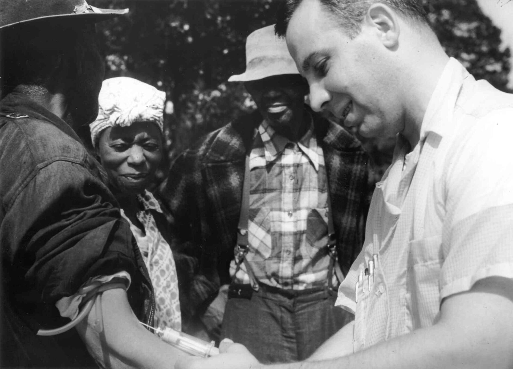
<figcaption markdown="span">
A doctor draws blood for the Tuskegee study of untreated syphilis, Alabama (undated)
<em>From 1932 to 1972 the U.S. Public Health Service left about four hundred Black men with syphilis untreated, even after penicillin. James Jones's <i>Bad Blood</i> (1981) told it as a history of racism in medicine. (National Archives. Public domain.)</em>
</figcaption>
</figure>
</section>

<!-- ========== IMAGE: SALPÊTRIÈRE ========== -->
<section class="image-slide" data-background="#0d1412" markdown="1">
<figure class="landscape">
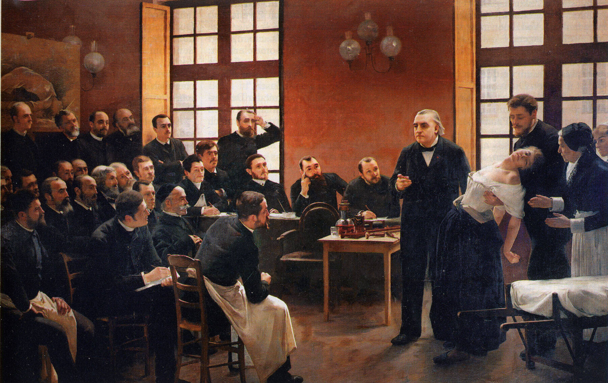
<figcaption markdown="span">
André Brouillet, <i>Une leçon clinique à la Salpêtrière</i> ("A Clinical Lesson at the Salpêtrière"), 1887
<em>A neurologist demonstrates hysteria on a patient before an audience of men. Elaine Showalter's <i>The Female Malady</i> (1985) asked why madness was so often seen as a woman's illness. (Université Paris Cité. Public domain.)</em>
</figcaption>
</figure>
</section>

<!-- ========== PORTER ========== -->
<section markdown="1">
1985 · patients
{: .eyebrow}

## Historians called for medical history from the patient's side
{: .main-point}

<figure>
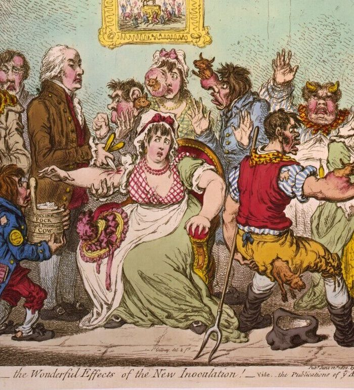
<figcaption>James Gillray, <i>The Cow-Pock</i>, 1802: vaccination as some patients feared it · public domain</figcaption>
</figure>

Rosenberg names, as one trend, "the emphasis among professional historians on social history and the experience of ordinary men and women." Rosenberg, "Framing Disease," p. xv
{: .quote.compact}

Roy Porter's essay "The Patient's View" (1985) asked for medical history from below, as workers' history had been written from below.
{: .detail}

</section>

<!-- ========== ULRICH: A MIDWIFE'S TALE ========== -->
<section markdown="1">
1990 · childbirth
{: .eyebrow}

## A midwife's diary let a historian rebuild her medical practice
{: .main-point}

<figure>
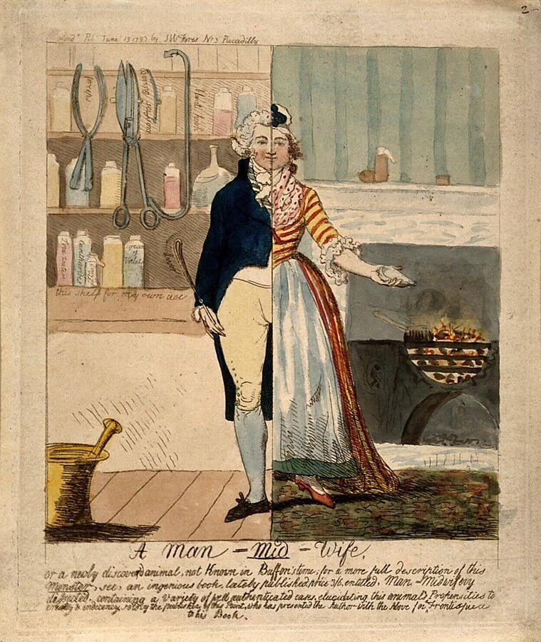
<figcaption>Cruikshank's <i>Man-Mid-Wife</i>, 1793, mocks men taking over childbirth · Wellcome · CC BY 4.0</figcaption>
</figure>

"Pregnancy and childbirth, for example, like epidemic disease have in recent years become an accepted part of the standard historical canon." Rosenberg, "Framing Disease," p. xv
{: .quote.compact}

Laurel Thatcher Ulrich's <i>A Midwife's Tale</i> (1990) used a Maine midwife's diary of more than eight hundred births, 1785–1812. Women's healing, missing from doctors' histories, became evidence.
{: .detail}

</section>

<!-- ========== ROSENBERG: THE FIELD ========== -->
<section markdown="1">
Rosenberg · 1992 · the field
{: .eyebrow}

## Rosenberg mapped why historians turned to disease
{: .main-point}

---

#### Ordinary people

Social history: patients, childbirth, epidemics.

#### Public health

Did medicine or living conditions lengthen lives? Demographers counted.

#### Ecology

Disease as part of the environment, moving with people, animals and trade.

#### Social control

Diagnoses as labels for deviance; the most influential.

###### What all of them missed
{: .label}

How a disease gets defined, and what the definition does to lives, policy and care (Rosenberg, pp. xv–xvi).

</section>

<!-- ========== ROSENBERG: DISEASE AS MANY THINGS ========== -->
<section markdown="1">
Rosenberg · 1992 · reframing disease
{: .eyebrow}

## Rosenberg treated disease as six things at once
{: .main-point}

---

#### A biological event

It happens in bodies, and in animals, whatever anyone calls it.

#### A vocabulary

A generation's "verbal constructs," shaped by medicine's ideas and institutions.

#### A reason for policy

An occasion for public policy, and a potential justification of it.

#### A part of who you are

An aspect of a person's social role and identity.

#### A sanction for values

A way a culture backs up what it values.

#### A relationship

A structuring element in how doctors and patients deal with each other.

Rosenberg, "Framing Disease," p. xiii
{: .cite}
</section>

<!-- ========== ROSENBERG: NAMING AND FRAMING ========== -->
<section markdown="1">
Rosenberg · 1992 · frame
{: .eyebrow}

## Rosenberg: a disease exists socially once it is named
{: .main-point}

---

"In some ways disease does not exist until we have agreed that it does, by perceiving, naming, and responding to it."

Rosenberg, "Framing Disease," p. xiii

###### Discuss
{: .label}

**Cholera killed before anyone agreed what it was. In what sense did the disease "not exist"?**

</section>

<!-- ========== ARNOLD ========== -->
<section markdown="1">
1993 · empire
{: .eyebrow}

## Historians showed colonial medicine entering Indian homes
{: .main-point}

<figure>
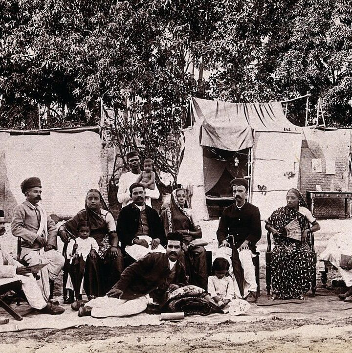
<figcaption>A well-off Bombay family forced into a plague camp, 1896–97 · Wellcome · CC BY 4.0</figcaption>
</figure>

Rosenberg noted "a recent growth of interest in 'imperial' medicine" Rosenberg, "Framing Disease," p. xxv n. 9
{: .quote.compact}

David Arnold's <i>Colonizing the Body</i> (1993) showed that against plague in 1896–97, officials searched homes and moved families into camps. It argues that Indian resistance made officials back down.
{: .detail}

</section>

<!-- ========== COMPARISON ========== -->
<section markdown="1">
Two fields · one course
{: .eyebrow}

## Both fields moved from triumph to the people, interests and politics behind knowledge
{: .main-point}

---

##### Science

Great men and the birth of the modern world. Then inside and outside causes and Kuhn's paradigms; then laboratory facts, political order and trust; then women, print that earned credit, objectivity's history and circulation.

##### Medicine

Doctors' histories of great men and germ hunters. Then society, the asylum and cholera; then disease and environment, doubts about medicine's credit, patients, race, gender and empire, and disease as a frame.

###### Compare · the semester
{: .label}

The path of history itself: Ranke's nations, then history from below, gender and the linguistic turn.

</section>

<!-- ========== THE TAKE HOME ========== -->
<section data-transition="fade" markdown="1">
The take home
{: .eyebrow}

## The history of knowledge shows its makers, and we are among them
{: .main-point}

---

"What we select inevitably represents our interests, even if we aim all the while to 'tell it like it really was.' That is to say, there is inevitably something of 'us' in the stories we tell about the past."

Shapin, <i>The Scientific Revolution</i>, p. 10

Science and medicine have histories because people made them, trusted them and named things with them. What we take as settled now will have a history too.

</section>

<!-- ========== CLOSING ========== -->
<section markdown="1">
Next · 14.2 · environmental history
{: .eyebrow}

## Next time, nature itself helps make history
{: .main-point}

---

A century from now, what will historians say we got wrong about science or medicine, and how will they know?
{: .question .fragment data-fragment-index="1"}
</section>
