<!-- ========== TITLE ========== -->
<section data-transition="fade" markdown="1">
Making History • HIST 1105 • Week 13.1
{: .eyebrow}

# The History of Science
{: .main-point}

---

- Background: Sarah Maza, *Thinking About History* (2017), ch. 3: "The History of What?", 83–108
- Steven Shapin, *The Scientific Revolution* (1996), Introduction, 1–14
- Optional: Thomas Kuhn, *The Structure of Scientific Revolutions* (1962), 1–22
{: .source-list}

Kuhn is cited by the pages of the second edition (1970). Johns is quoted from <i>The Nature of the Book</i> (1998), ch. 1.
{: .citation-note}
</section>

<!-- ========== GARRISON AND LOVEJOY: THE OLD STORY ========== -->
<section markdown="1">
1913–36 · the old story
{: .eyebrow}

## Early histories credited a few chosen spirits and the occasional genius
{: .main-point}

---

##### Garrison, *An Introduction to the History of Medicine* (1913)

"It is no exaggeration to say that science owes most to the shining individualism of a few chosen spirits." (p. 36)

##### Lovejoy, *The Great Chain of Being* (1936), in Maza's words

"Ideas, in this sort of approach, are like a set of building blocks with which thinkers play and from which the occasional genius constructs something dazzling" (Maza, pp. 86–87)

###### Discuss
{: .label}

**Who disappears from a history that credits "a few chosen spirits"?**

</section>

<!-- ========== IMAGE: COPERNICUS ========== -->
<section class="image-slide" data-background="#0d1412" markdown="1">
<figure class="landscape">
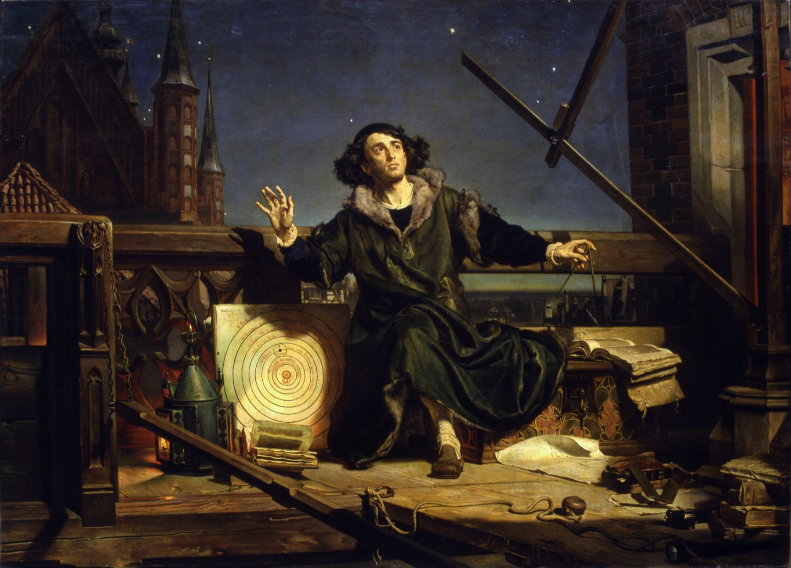
<figcaption markdown="span">
Jan Matejko, <i>Astronomer Copernicus, or Conversations with God</i>, 1872
<em>Painted more than three centuries after Copernicus died, it shows him alone at night beside his sun-centered diagram, hands raised as if in conversation with God. (Wikimedia Commons. Public domain.)</em>
</figcaption>
</figure>
</section>

<!-- ========== IMAGE: GALILEO FACING THE INQUISITION ========== -->
<section class="image-slide" data-background="#0d1412" markdown="1">
<figure class="landscape">
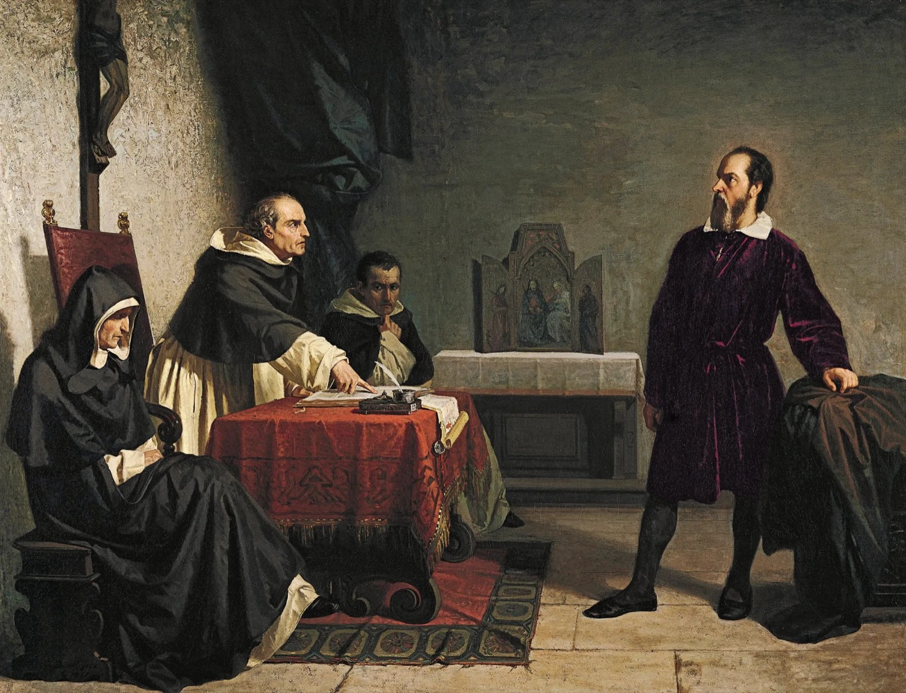
<figcaption markdown="span">
Cristiano Banti, <i>Galileo Facing the Roman Inquisition</i>, 1857
<em>Painted more than two centuries after the 1633 trial, it makes Galileo a lone martyr for truth, standing before three churchmen. (Wikimedia Commons. Public domain.)</em>
</figcaption>
</figure>
</section>

<!-- ========== IMAGE: FRANKLIN AND THE KITE ========== -->
<section class="image-slide" data-background="#0d1412" markdown="1">
<figure class="portrait">
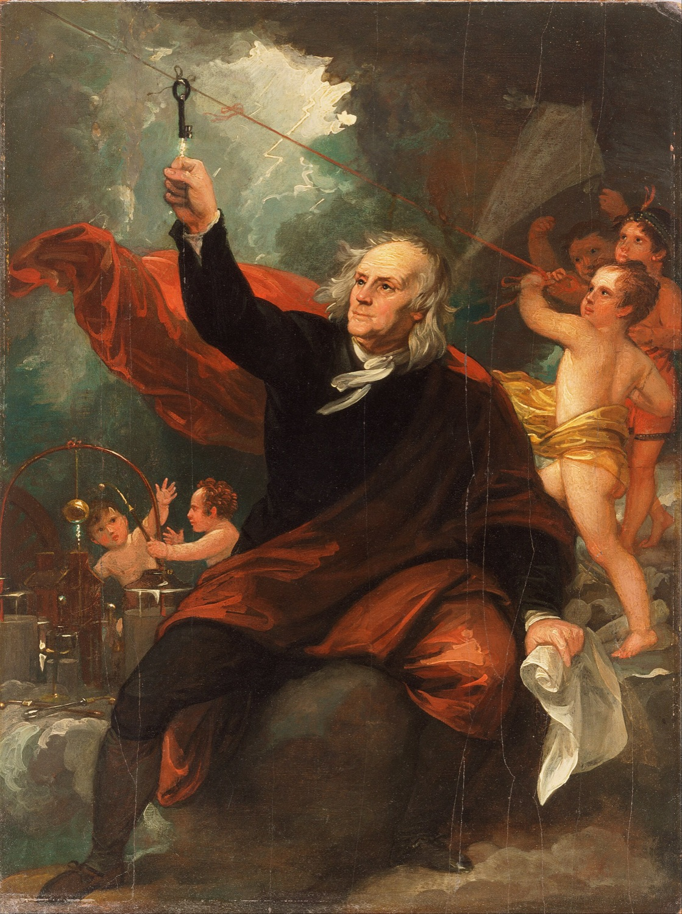
<figcaption markdown="span">
Benjamin West, <i>Benjamin Franklin Drawing Electricity from the Sky</i>, c. 1816
<em>Painted more than sixty years after the 1752 kite experiment, it gives Franklin a billowing cloak, a key at the end of the string, and cherubs to tend his apparatus. (Philadelphia Museum of Art, via Google Art Project and Wikimedia Commons. Public domain.)</em>
</figcaption>
</figure>
</section>

<!-- ========== IMAGE: MEN OF SCIENCE ========== -->
<section class="image-slide" data-background="#0d1412" markdown="1">
<figure class="landscape">
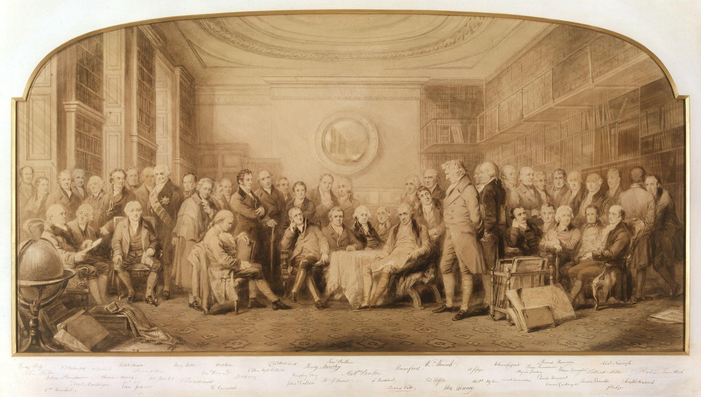
<figcaption markdown="span">
Sir John Gilbert, <i>Men of Science Living in 1807–8</i>
<em>A Victorian artist imagines nearly fifty British scientists and inventors in one library. Every one of them is a man. (National Portrait Gallery, London, via Wikimedia Commons. Public domain.)</em>
</figcaption>
</figure>
</section>

<!-- ========== BUTTERFIELD ========== -->
<section markdown="1">
1931–49 · the old story
{: .eyebrow}

## Science was told as the making of the modern world
{: .main-point}

<figure>
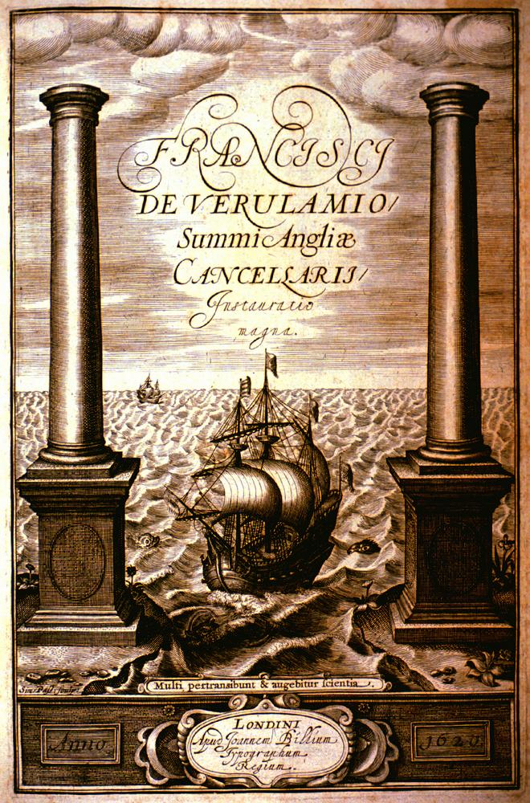
<figcaption>Bacon's <i>Great Instauration</i>, 1620 · public domain</figcaption>
</figure>

The Scientific Revolution "outshines everything since the rise of Christianity and reduces the Renaissance and Reformation to the rank of mere episodes" Herbert Butterfield, <i>The Origins of Modern Science</i> (1949), quoted in Shapin, p. 1
{: .quote.compact}

Herbert Butterfield named the "Whig interpretation of history" in a 1931 book of that title: judging the past as the road to the present. Historians told science that way "through the Cold War" (Maza, p. 92).
{: .detail}

</section>

<!-- ========== INSIDE OR OUTSIDE ========== -->
<section markdown="1">
Internal and external · 1930s
{: .eyebrow}

## Historians split on whether science changed by its own ideas or by its society
{: .main-point}

---

##### Inside: ideas and methods

Alexandre Koyré, <i>Galilean Studies</i> (1939), read Galileo's science as a change in thought: mathematics, more than experiment, remade physics.

##### Outside: economics, religion, politics

Boris Hessen (1931) tied Newton's <i>Principia</i> to the needs of shipping, mining and war; Robert Merton (1938) tied English science to Puritan values.

###### Internalist and externalist
{: .label}

Later historians named the sides. Internalists explain scientific change from inside science, by ideas, methods and evidence; externalists by the economics, religion and politics outside it. The old story of great geniuses was largely internalist.

</section>

<!-- ========== KUHN: THE TURN ========== -->
<section markdown="1">
Kuhn · 1962 · the turn
{: .eyebrow}

## Kuhn: historians now judged old science by its own time
{: .main-point}

---

"Rather than seeking the permanent contributions of an older science to our present vantage, they attempt to display the historical integrity of that science in its own time."

Kuhn, <i>The Structure of Scientific Revolutions</i>, p. 3

###### Paradigms, not accumulation
{: .label}

Kuhn called a shared model of "problems and solutions" a paradigm. When misfit results pile up, a crisis brings a new paradigm, "incommensurable" with the old: the two can't be judged by the same standards (Maza, p. 93, on Copernicus).

###### Discuss
{: .label}

**If paradigms can't be judged by the same standards, in what sense is later science better science?**

</section>

<!-- ========== NEWTON'S ALCHEMY ========== -->
<section markdown="1">
1970s · science and the occult
{: .eyebrow}

## Newton's gravitation was rooted in alchemy
{: .main-point}

<figure>
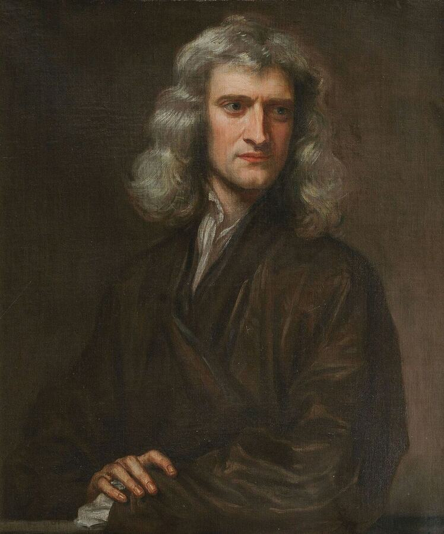
<figcaption>Kneller, 1689 · public domain</figcaption>
</figure>

His work toward gravitation was "rooted in the great scientist's avid and extensive research into the 'dark arts' of alchemy." Maza, <i>Thinking About History</i>, p. 99
{: .quote.compact}

Betty Jo Teeter Dobbs, <i>The Foundations of Newton's Alchemy</i> (1975), made the case. The line between science and "occult" pursuits hardened only in the eighteenth century (p. 99).
{: .detail}

</section>

<!-- ========== LATOUR AND WOOLGAR: THE LABORATORY ========== -->
<section markdown="1">
1979 · the laboratory
{: .eyebrow}

## Social scientists followed a laboratory as it made facts
{: .main-point}

<figure>

<figcaption>Salk Institute · Highsmith · public domain</figcaption>
</figure>

"There is as much society inside the scientist's laboratory, and internal to the development of scientific knowledge, as there is outside." Shapin, <i>The Scientific Revolution</i>, p. 10
{: .quote.compact}

Bruno Latour and Steve Woolgar's <i>Laboratory Life</i> (1979) studied a Salk Institute laboratory as an anthropologist would a village, and saw facts made by arguing and writing.
{: .detail}

</section>

<!-- ========== EISENSTEIN ========== -->
<section markdown="1">
1979 · print
{: .eyebrow}

## One argument held that print made the Scientific Revolution possible
{: .main-point}

<figure>
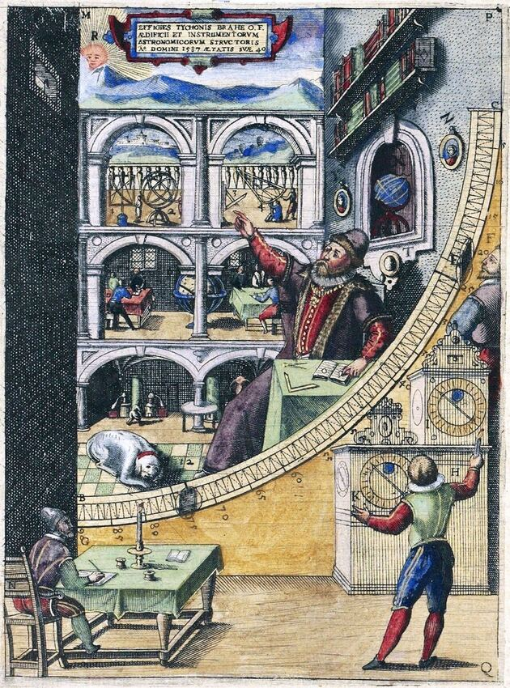
<figcaption>Tycho Brahe at his great quadrant, 1598 · public domain</figcaption>
</figure>

"The 'Scientific Revolution' was thus inconceivable without a preceding printing revolution." Adrian Johns, <i>The Nature of the Book</i> (1998), p. 11, summarizing the argument
{: .quote.compact}

Elizabeth Eisenstein, <i>The Printing Press as an Agent of Change</i> (1979): print gave texts "fixity," the same words, repeatable anywhere (Johns, p. 10). Its hero was Tycho Brahe, comparing printed rival models of the universe (pp. 10–11).
{: .detail}

</section>

<!-- ========== CONSTRUCTIVISM ========== -->
<section markdown="1">
After Kuhn · 1970s–80s · constructivism
{: .eyebrow}

## Constructivists treated scientific knowledge as something people make
{: .main-point}

---

"the belief that scientific knowledge is a human creation, made with available material and cultural resources, rather than simply the revelation of a natural order that is pre-given and independent of human action."

A definition of constructivism, quoted in Maza, p. 95

###### Compare · Week 10.1
{: .label}

The linguistic turn read sources as "texts," not transparent windows onto the past. Constructivists treated scientific knowledge the same way: as made, not simply found.

###### Discuss
{: .label}

**If a belief has a social cause, has anyone yet said whether it is true?**

</section>

<!-- ========== IMAGE: BOYLE'S AIR PUMP ========== -->
<section class="image-slide" data-background="#0d1412" markdown="1">
<figure class="portrait">
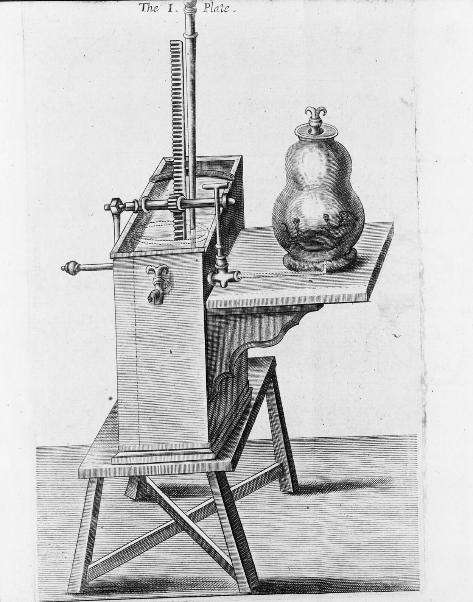
<figcaption markdown="span">
Robert Boyle's air pump, plate 1 of <i>New Experiments Physico-Mechanical</i>, 1660
<em>"The cyclotron of its age," in one scholar's phrase (quoted in Maza, p. 96): the costliest, most advanced machine of its day. Few machines existed, so most people learned the results from Boyle's book or from the chosen witnesses who saw them. (Library of Congress. Public domain.)</em>
</figcaption>
</figure>
</section>

<!-- ========== LEVIATHAN AND THE AIR-PUMP ========== -->
<section markdown="1">
1985 · politics
{: .eyebrow}

## The air-pump dispute was also a dispute about political order
{: .main-point}

---

"solutions to the problem of knowledge are solutions to the problem of social order."

Steven Shapin and Simon Schaffer, <i>Leviathan and the Air-Pump</i> (1985), quoted in Maza, p. 97

###### England, 1660
{: .label}

After two decades of civil war, Boyle's experimenters stood for freedom used responsibly. Hobbes, author of <i>Leviathan</i>, a defense of absolute rule, trusted only mathematical proof in science and a single authority in the state (pp. 96–97).

</section>

<!-- ========== TRUST ========== -->
<section markdown="1">
Shapin · 1994 · trust
{: .eyebrow}

## Shapin argued that experimental science flourished in England because gentlemen did it
{: .main-point}

---

"Experimental science flourished in seventeenth-century England, Shapin argues, because it was conducted by a group of elite practitioners—'gentlemen,' members of the landed upper class—who both trusted one another and had moral authority in the society at large."

Maza, <i>Thinking About History</i>, p. 98, on Shapin, <i>A Social History of Truth</i> (1994)

###### Discuss
{: .label}

**Whom do you trust on science today, and what makes them trustworthy: credentials, numbers or someone like you?**

</section>

<!-- ========== IMAGE: SPRAT FRONTISPIECE ========== -->
<section class="image-slide" data-background="#0d1412" markdown="1">
<figure class="portrait">
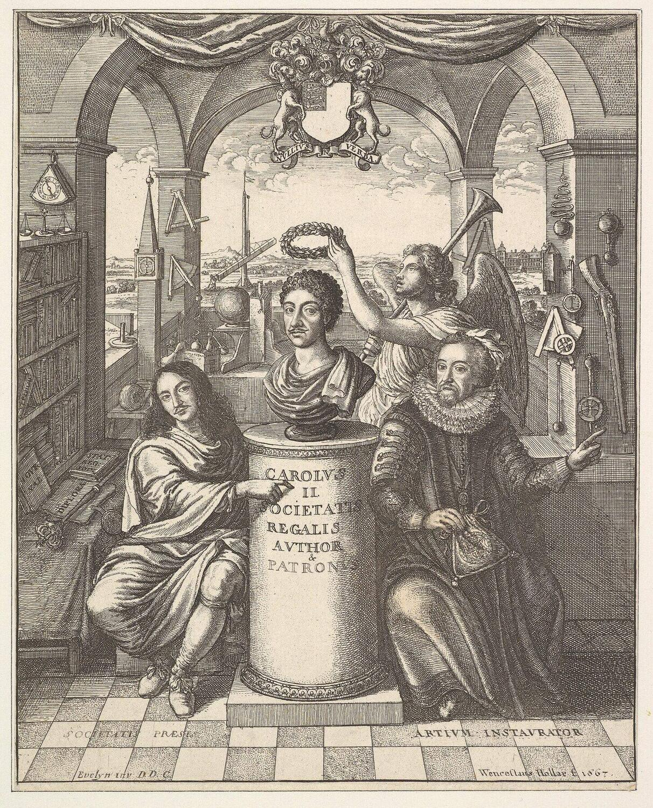
<figcaption markdown="span">
Frontispiece to Thomas Sprat, <i>The History of the Royal Society</i>, 1667
<em>Bacon, right, and the Society's first president, left, flank its patron, the king. Gentlemen and a king vouched for the new science; Sprat's triumphant history, written seven years on, defended it. (Wenceslaus Hollar after John Evelyn. Metropolitan Museum of Art. CC0.)</em>
</figcaption>
</figure>
</section>

<!-- ========== IMAGE: HARVARD COMPUTERS ========== -->
<section class="image-slide" data-background="#0d1412" markdown="1">
<figure class="landscape">
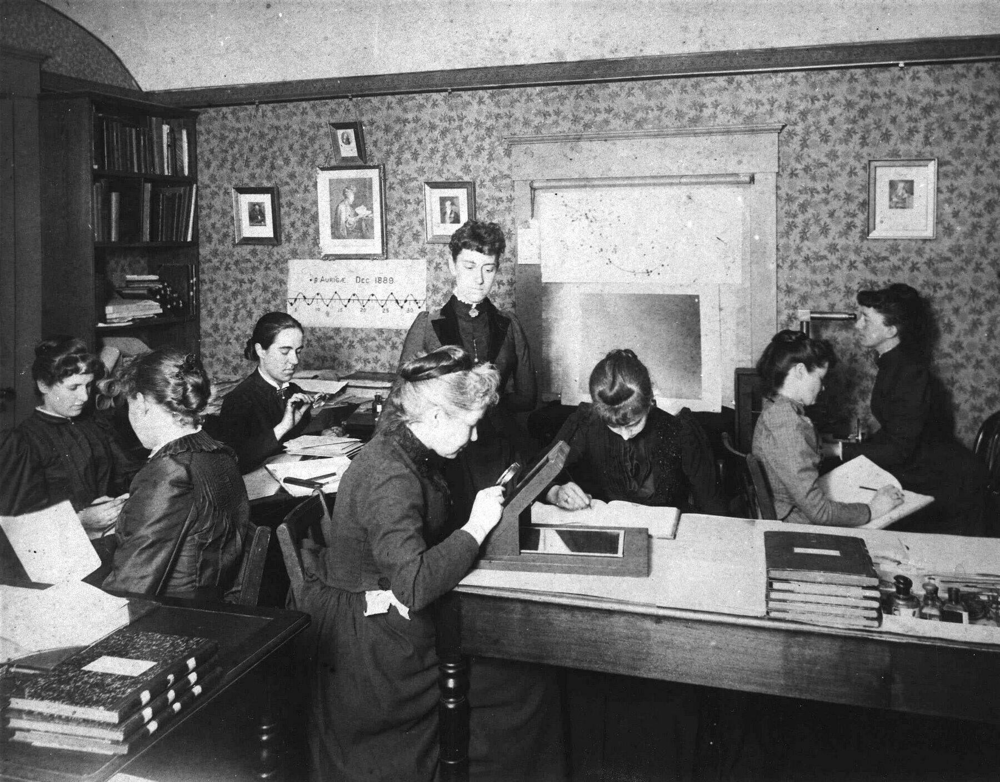
<figcaption markdown="span">
The women "computers" of the Harvard College Observatory, about 1891
<em>By the nineteenth century, Theodore Porter shows in <i>Trust in Numbers</i> (1995), trust came from "expertise backed by numbers rather than genteel status" (Maza, p. 98). These women produced the numbers, for far less pay than men. (Harvard College Observatory. Public domain.)</em>
</figcaption>
</figure>
</section>

<!-- ========== SHAPIN: NO SUCH THING ========== -->
<section markdown="1">
Shapin · 1996
{: .eyebrow}

## Shapin opens by denying that the Scientific Revolution happened
{: .main-point}

---

"There was no such thing as the Scientific Revolution, and this is a book about it. Some time ago, when the academic world offered more certainty and more comforts, historians announced the real existence of a coherent, cataclysmic, and climactic event that fundamentally and irrevocably changed what people knew about the natural world … It was the moment at which the world was made modern, it was a Good Thing"

Shapin, <i>The Scientific Revolution</i>, p. 1

</section>

<!-- ========== SHAPIN: WHAT IS ARGUED ========== -->
<section markdown="1">
Shapin · 1996 · what is argued
{: .eyebrow}

## Historians still argue about what the Scientific Revolution was
{: .main-point}

---

#### One event, or many practices?

Many historians doubt any "singular and discrete event," and any single "science" or "scientific method" to revolutionize (pp. 3–4).

#### A break, or continuity?

The continuity of seventeenth-century natural philosophy with its medieval past "is now routinely asserted" (p. 4).

#### Ideas, or practices?

Older accounts treated ideas as if they "floated freely in conceptual space." Newer ones ask what people did to make an observation or run an experiment (p. 4).

#### Inside, or outside?

Whether science's causes were intellectual or social was long argued. Shapin calls the split "a rather silly demarcation" (p. 9).

Shapin, <i>The Scientific Revolution</i>, pp. 3–4, 9
{: .cite}
</section>

<!-- ========== SHAPIN: THE WHO ========== -->
<section markdown="1">
Shapin · 1996 · who took part
{: .eyebrow}

## Shapin asks who was left out of the Scientific Revolution
{: .main-point}

---

"The half of the European population that was female was in a position to participate in scientific culture scarcely at all, as was that overwhelming majority—of men and women—who were illiterate or otherwise disqualified from entering the venues of formal learning."

Shapin, <i>The Scientific Revolution</i>, p. 8

###### Revolution for whom?
{: .label}

If only a few took part, "in what sense, if at all," was it the moment "modernity was made, for 'us'"? (pp. 4–5).

</section>

<!-- ========== SHAPIN: WHY KEEP TELLING IT ========== -->
<section markdown="1">
Shapin · 1996 · ancestors
{: .eyebrow}

## Shapin still tells the story, as one about our ancestors
{: .main-point}

---

"Yet there is absolutely no reason we should not want to know how we got from there to here, who the ancestors were, and what the lineage is that connects us to the past."

Shapin, <i>The Scientific Revolution</i>, p. 7

Such stories, he warns, are "not likely to be sensitive accounts of how it was in the past": Galileo, Descartes and Boyle were hardly typical of their countrymen (p. 7).
{: .detail}

###### Discuss
{: .label}

**Is it wrong to judge the past as the road to the present if the road really did lead here?**

</section>

<!-- ========== JOHNS ========== -->
<section markdown="1">
1998 · print and trust
{: .eyebrow}

## Printed books had to earn trust, a later historian argued
{: .main-point}

<figure>
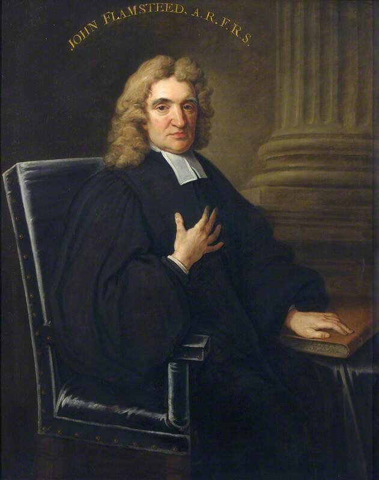
<figcaption>The astronomer John Flamsteed, 1712 · public domain</figcaption>
</figure>

"In such a world, questions of credit took the place of assumptions of fixity." Adrian Johns, <i>The Nature of the Book</i> (1998), p. 31
{: .quote.compact}

Early print was full of piracy and error, so readers had to decide which books to believe (p. 31). In 1712 Newton and Halley printed an astronomer's star catalogue against his "vehement opposition" (p. 55).
{: .detail}

</section>

<!-- ========== EISENSTEIN AND JOHNS ========== -->
<section markdown="1">
Print and trust
{: .eyebrow}

## One view put authority in the printed page; another put it in readers
{: .main-point}

---

##### Print fixes texts (1979)

Print fixed texts, so scholars could compare, correct and build on them. The Renaissance and Reformation were "rendered permanent" by permanent texts (as Johns summarizes it, p. 11).

##### Readers make print trustworthy (1998)

Fixity "exists only inasmuch as it is recognized and acted upon by people" (p. 19). Printed texts were trusted "only as a result of hard work" (p. 36).

###### From gentlemen to books
{: .label}

The later view builds on Shapin's trust: not only whom to believe, but which printed books (p. 31). The two authors argued it out in the <i>American Historical Review</i> in 2002.

</section>

<!-- ========== IMAGE: MERIAN ========== -->
<section class="image-slide" data-background="#0d1412" markdown="1">
<figure class="portrait">
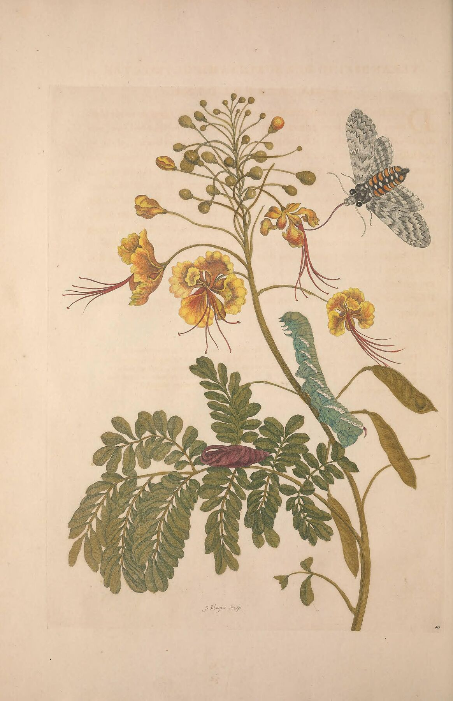
<figcaption markdown="span">
Maria Sibylla Merian, the peacock flower, from <i>Metamorphosis insectorum Surinamensium</i> ("The Transformation of Surinam's Insects"), 1705
<em>Merian drew Surinam's insects from life, and recorded enslaved and Indigenous women using these seeds to end pregnancies. Pamela Smith, <i>The Body of the Artisan</i> (2004), found science "in the workshops of artisans and artists" (Maza, p. 101). (Biodiversity Heritage Library. Public domain.)</em>
</figcaption>
</figure>
</section>

<!-- ========== DASTON AND GALISON: OBJECTIVITY ========== -->
<section markdown="1">
2007 · objectivity
{: .eyebrow}

## Scientific objectivity itself has a history
{: .main-point}

<figure>

<figcaption>A plate from Albinus's anatomy atlas, 1747, drawn under his direction · KU Leuven · CC0</figcaption>
</figure>

"The objectivity of the experimental matter of fact … was an artifact of certain forms of discourse and certain modes of social solidarity." Steven Shapin and Simon Schaffer, <i>Leviathan and the Air-Pump</i> (1985), quoted in Maza, p. 97
{: .quote.compact}

Lorraine Daston and Peter Galison's <i>Objectivity</i> (2007) traced scientific atlases and found self-restraint as an ideal of science taking shape only in the nineteenth century. Earlier atlases trusted the expert's eye to show the typical body.
{: .detail}

</section>

<!-- ========== RAJ: CIRCULATION ========== -->
<section markdown="1">
2007 · circulation
{: .eyebrow}

## Science was made by circulation, not spread from Europe
{: .main-point}

<figure>

<figcaption>Jantar Mantar, Jaipur, 1720s–30s: an illustration only · Eichmann · CC BY 4.0</figcaption>
</figure>

"the reframing of historians' 'where' … from the single location to transnational and global expanses, all of which have entailed challenges to Eurocentrism." Maza, <i>Thinking About History</i>, p. 116
{: .quote.compact}

Older accounts had Western science radiating from Europe. Kapil Raj's <i>Relocating Modern Science</i> (2007) argued that South Asia and Europe made it together.
{: .detail}

</section>

<!-- ========== WHO DID SCIENCE ========== -->
<section markdown="1">
Maza · 2017 · who did science
{: .eyebrow}

## Science was practiced by many more people than the old story allowed
{: .main-point}

---

"Science, in short, was not just produced by savants in learned societies but practiced by all sorts of people with very concrete needs and agendas—performing at court, impressing wealthy friends, firing an intricate piece of pottery, or, in the case of wives and family members, providing unacknowledged assistance of every sort."

Maza, <i>Thinking About History</i>, p. 101

###### Discuss
{: .label}

**Shapin says women and the illiterate took part in scientific culture "scarcely at all"; Maza says "all sorts of people" practiced science. Who is right, and what is each counting as science?**

</section>

<!-- ========== CLOSING ========== -->
<section markdown="1">
Next · 14.1 · the history of medicine
{: .eyebrow}

## Next, the history of medicine
{: .main-point}
</section>
