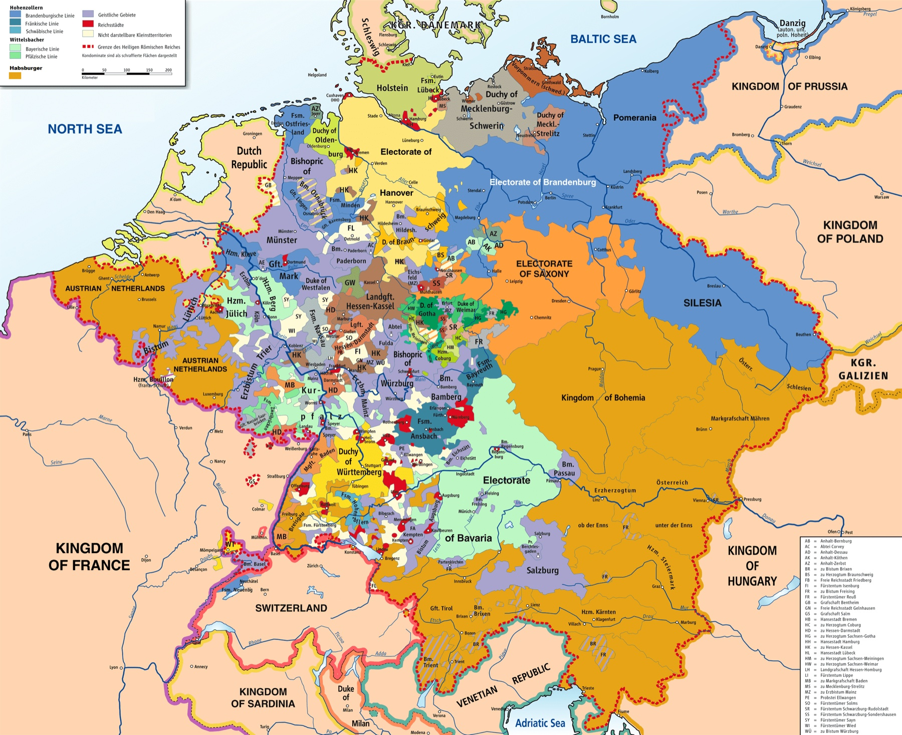
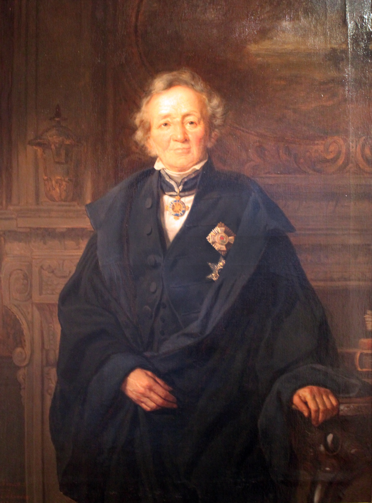
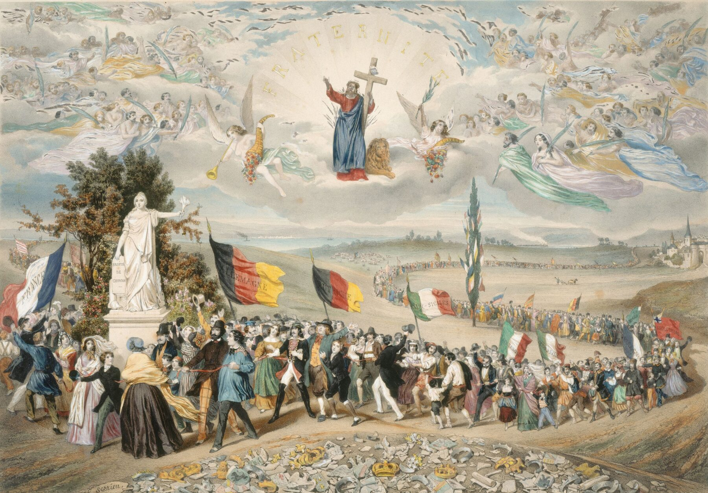
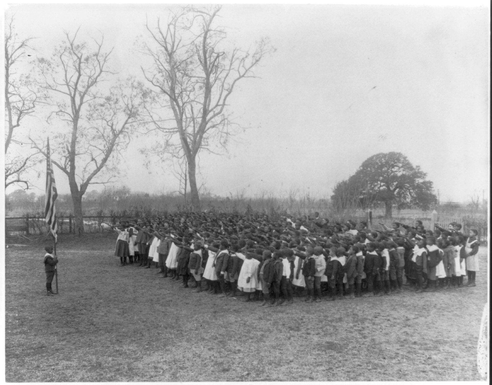
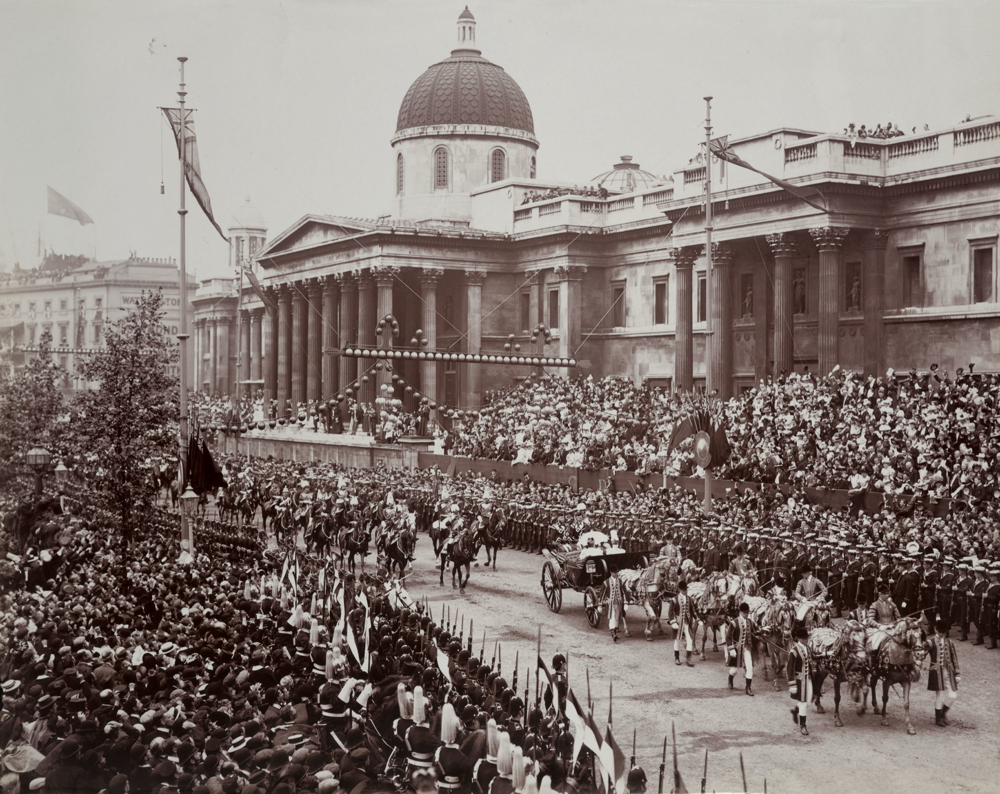
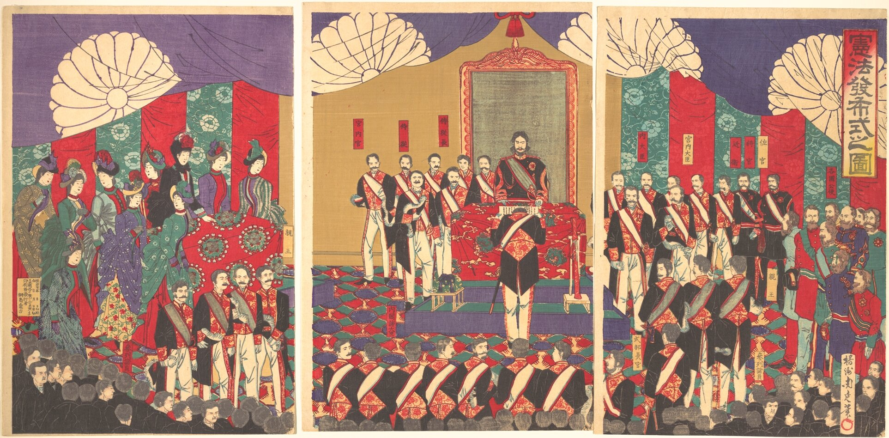
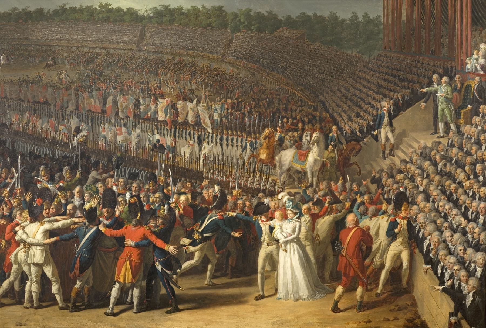
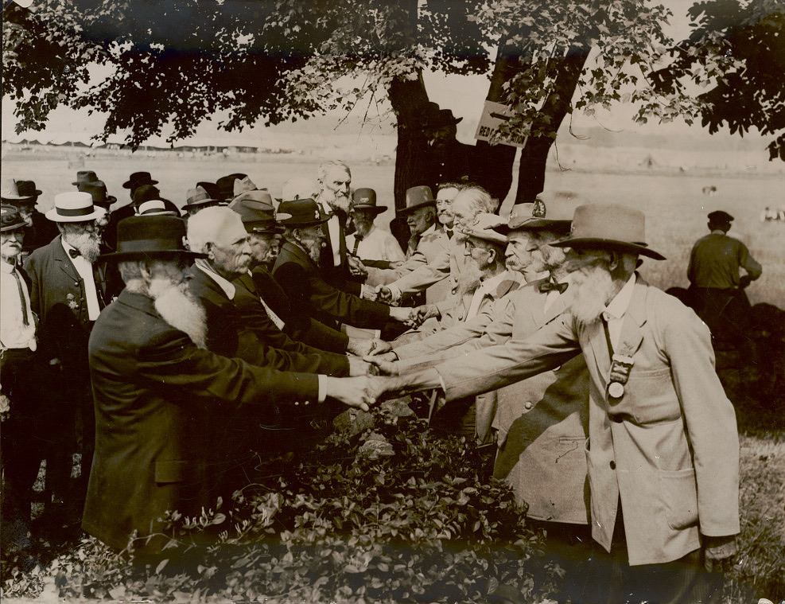
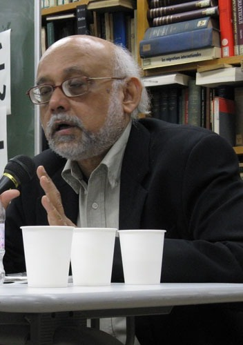

<!-- ========== TITLE ========== -->
<section data-transition="fade" markdown="1">
Making History • HIST 1105 • Week 9.1
{: .eyebrow}

# Inventing Nations
{: .main-point}

---

- Background: Sarah Maza, *Thinking About History* (2017), ch. 2: "The History of Where?", 45–82
- Benedict Anderson, *Imagined Communities* (1983), Introduction, 1–7
- Partha Chatterjee, "Whose Imagined Community?" (1993), 214–225
{: .source-list}

Anderson is cited by the page of the Verso edition. Chatterjee's essay first appeared as ch. 1 of *The Nation and Its Fragments* (1993); pages are those of the course PDF, its reprint in Gopal Balakrishnan, ed., *Mapping the Nation* (1996).
{: .citation-note}
</section>

<!-- ========== THROUGHLINE ========== -->
<section markdown="1">
Today in context
{: .eyebrow}

## What makes history happen?
{: .main-point}

---

###### Week 6.2 · Scott, 1986
{: .num}

Gender, as the system that makes arrangements of power look natural.

###### Week 7.1 · Ginzburg, 1976
{: .num}

One miller's cosmos, and what a single case can be made to carry.

###### Week 9.1 · Maza, with Anderson and Chatterjee
{: .num}

Nations, which turn out to be recent, imagined, and partly the work of historians.

###### Week 9.2 · Trouillot and Said
{: .num}

Power, at every stage from making a source to telling the story.

</section>

<!-- ================================================================ -->
<!-- ====== PART ONE: THE NATION AS HISTORY'S FRAME, MAZA PP. 45–49 === -->
<!-- ================================================================ -->

<!-- ========== BEFORE 1800: THE QUESTION ========== -->
<section markdown="1">
Part one · the national frame
{: .eyebrow}

## Until about 1800, Western history was not usually written nation by nation
{: .main-point}

---

"Before the nineteenth century, 'the nation' was not usually the context or object of Western historical writing."

Maza, <i>Thinking About History</i>, pp. 46–47

So how did the nation come to seem natural, and worth dying for?
{: .question .fragment data-fragment-index="1"}
</section>

<!-- ========== EMPIRE ========== -->
<section markdown="1">
Today's map
{: .eyebrow}

## Most countries are younger than a century, with borders drawn by Western empires
{: .main-point}

---

"Most of the countries on today's world maps did not exist a hundred years ago: they secured independence within boundaries initially drawn by Western imperialists whose own nations resulted from eighteenth- and nineteenth-century revolutionary movements."

Maza, <i>Thinking About History</i>, p. 46

###### Compare · 9.2
{: .label}

Said: describing and teaching "the Orient" was one of the ways the West ruled it.

</section>

<!-- ========== IMAGE: HOLY ROMAN EMPIRE, 1789 ========== -->
<section class="image-slide" data-background="#0d1412" markdown="1">
<figure class="landscape">

<figcaption markdown="span">
The Holy Roman Empire in 1789
<em>Some three hundred territories, among them bishoprics (purple) and free cities (red). Maza warns against reading it as a jigsaw waiting for Bismarck (p. 46). (Robert Alfers, after Putzger, 2008. Wikimedia Commons, CC BY-SA 3.0.)</em>
</figcaption>
</figure>
</section>

<!-- ========== BEFORE 1800: STATES BELONGED TO RULERS ========== -->
<section markdown="1">
Before 1800
{: .eyebrow}

## Before 1800, most states belonged to rulers, not to the people in them
{: .main-point}

---

###### France · 1700s
{: .num}

#### The king's kingdom

Subjects owed loyalty to the Bourbon king; in 1789 perhaps half of them spoke no French.

###### Habsburg lands · 1740
{: .num}

#### One family's inheritance

Austria, Bohemia, Hungary and Milan, tied together by a dynasty rather than a language.

###### Venice · until 1797
{: .num}

#### A city that was a state

Merchant families governed it, and it held ports down the Adriatic until Napoleon ended it.

###### Ottoman Empire · 1700s
{: .num}

#### Subjects sorted by faith

From Algiers to Baghdad, the sultan's subjects were grouped largely by religion, not by language.

</section>

<!-- ========== OLDER NATIONAL FEELING ========== -->
<section markdown="1">
Before 1800 · national feeling
{: .eyebrow}

## National feeling is much older, but it was mostly defined against neighbors
{: .main-point}

---

"you knew you were Dutch in the sixteenth century because you loathed the Spaniards, British in the eighteenth century because you despised the French."

Maza, <i>Thinking About History</i>, p. 47

###### Compare · Week 3
{: .label}

Bede wrote of "the English people," the *gens Anglorum*, in 731, when there were only rival kingdoms.

</section>

<!-- ========== THE AGE OF REVOLUTIONS ========== -->
<section markdown="1">
The age of revolutions · 1776–1820s
{: .eyebrow}

## What was new after 1776 was the nation as the source of power
{: .main-point}

---

"that state power should represent the collective will of a particular population or 'citizenry' that lived within the borders of a large, well-defined territory."

Lloyd Kramer, quoted in Maza, p. 47

</section>

<!-- ========== NATIONAL HISTORIES ========== -->
<section markdown="1">
The nineteenth century · national histories
{: .eyebrow}

## Then historians wrote each nation an admirable past
{: .main-point}

---

"leading historians in various parts of the West published classic works of national history built around the premise that their country's past illustrated the advent of admirable values and ideals embodied in its people."

Maza, <i>Thinking About History</i>, p. 47

</section>

<!-- ========== THE PROFESSION ========== -->
<section markdown="1">
The nineteenth century · the profession
{: .eyebrow}

## The first professional historians mostly celebrated their own nations
{: .main-point}

---

"It was natural, if not inevitable, for the first generations of 'professional' historians to focus on, and usually celebrate, the history of their respective nations."

Maza, <i>Thinking About History</i>, pp. 48–49

</section>

<!-- ========== IMAGE: RANKE ========== -->
<section class="image-slide" data-background="#0d1412" markdown="1">
<figure class="portrait">

<figcaption markdown="span">
Leopold von Ranke · 1795–1886
<em>He taught at Berlin from 1825 into the 1870s, training historians in archives and seminars. In 1841 the king named him historiographer of the Prussian state; he wrote a German history of the Reformation and nine books of Prussian history.<strong>Why he matters:</strong> he did not write only national history, but most of his German students did, and backed German unification (Popkin, <i>From Herodotus to H-Net</i>, p. 88).(Adolf Jebens, 1875. Public domain.)</em>
</figcaption>
</figure>
</section>

<!-- ========== RANKE'S NATIONS ========== -->
<section markdown="1">
Ranke · 1824
{: .eyebrow}

## Ranke's scientific history, too, began with the nations he counted as kin
{: .main-point}

---

"the author will remain close to the racially kindred nations of either purely Germanic or Latin-Germanic origin whose history forms the heart of all modern history."

Ranke, introduction to <i>The History of the Latin and Teutonic Nations</i> (1824), trans. Roger Wines. "Racially kindred" renders <i>stammverwandt</i>, "of kindred stock"

###### Compare · Week 4
{: .label}

Treitschke, trained under Ranke, made Bismarck's unification of Germany look inevitable.

</section>

<!-- ========== IMAGE: SORRIEU, 1848 ========== -->
<section class="image-slide" data-background="#0d1412" markdown="1">
<figure class="landscape">

<figcaption markdown="span">
Frédéric Sorrieu, <i>La République universelle démocratique et sociale: le pacte</i> ("The Universal Democratic and Social Republic: The Pact"), 1848
<em>The "springtime of nations." National historians took part: Michelet backed the revolution in Paris, and several sat in the Frankfurt parliament. Ranke, a conservative, did not. By 1849 nearly every revolution had been crushed. (Musée Carnavalet, Paris. CC0.)</em>
</figcaption>
</figure>
</section>

<!-- ================================================================ -->
<!-- ====== PART TWO: HOW HISTORIANS EXPLAINED IT, MAZA PP. 50–56 ===== -->
<!-- ================================================================ -->

<!-- ========== 1914 ========== -->
<section markdown="1">
Part two · 1914
{: .eyebrow}

## In 1914 nationalism was at its height
{: .main-point}

---

"soldiers marched off in a haze of patriotic fervor, and almost nobody questioned the need to slaughter fellow Europeans or the glory of a battlefield death."

Maza, <i>Thinking About History</i>, p. 50

</section>

<!-- ========== AFTER 1914: DENATURALIZING ========== -->
<section markdown="1">
1914 to the 1980s · denaturalizing
{: .eyebrow}

## The century after 1914 led historians to ask how nations were made
{: .main-point}

---

"These developments in the public world have been mirrored in the academic world by scholarly trends toward 'denaturalizing' nationhood, that is, exposing its artificiality by looking at how and why this particular way of conceiving of human communities came about."

Maza, <i>Thinking About History</i>, p. 51

</section>

<!-- ========== IMAGE: ANDERSON ========== -->
<section class="image-slide" data-background="#0d1412" markdown="1">
<figure class="portrait">

<figcaption markdown="span">
Benedict Anderson · 1936–2015
<em>Born in Kunming to an Irish father and an English mother, he taught politics at Cornell and worked on Indonesia, which barred him from 1972 until 1998. Maza traces the book to "many years of studying Indonesian history" (p. 81).<strong>Why he matters:</strong> he answered his own question by arguing that nations are imagined, which lets a historian ask when and how.(Cornell University, Department of Government. Used for teaching.)</em>
</figcaption>
</figure>
</section>

<!-- ========== ANDERSON'S QUESTION ========== -->
<section markdown="1">
Anderson · 1983
{: .eyebrow}

## Anderson asked why such recent communities demand such sacrifice
{: .main-point}

---

"what makes the shrunken imaginings of recent history (scarcely more than two centuries) generate such colossal sacrifices?"

Anderson, <i>Imagined Communities</i>, p. 7

</section>

<!-- ========== ANDERSON'S DEFINITION ========== -->
<section markdown="1">
Anderson · 1983
{: .eyebrow}

## His starting point: nations are imagined, since members never meet most of the others
{: .main-point}

---

"it is an imagined political community – and imagined as both inherently limited and sovereign."

Anderson, <i>Imagined Communities</i>, p. 6

</section>

<!-- ========== ANDERSON'S ANSWER, IN MAZA'S ACCOUNT ========== -->
<section markdown="1">
Anderson · 1983
{: .eyebrow}

## His answer: nations took over religion's work of linking the dead and the unborn
{: .main-point}

---

"with the decline of religion as a way of explaining broader public and historical forces, membership in a 'nation,' with a particular, redemptive destiny, became a way of linking random individual fates to a larger purpose, of 'creating links between the dead and the yet unborn.'"

Maza, <i>Thinking About History</i>, pp. 51–52, summarizing Anderson; the inner quotation is Anderson, pp. 10–11

</section>

<!-- ========== THE SYMBOLS ========== -->
<section markdown="1">
The 1880s and 1890s · symbols
{: .eyebrow}

## Meanwhile, historians found that many "timeless" symbols dated from the 1880s and 1890s
{: .main-point}

---

"In Europe and America most of the major symbols of national belonging—flags, national capitals, anthems, monuments, and commemorative holidays—date from the last quarter of the nineteenth century"

Maza, <i>Thinking About History</i>, p. 52

</section>

<!-- ========== COLUMBUS DAY, 1892 ========== -->
<section markdown="1">
United States · 1892
{: .eyebrow}

## The first national Columbus Day, in 1892, was built around schools and the flag
{: .main-point}

---

"Let the national flag float over every schoolhouse in the country and the exercises be such as shall impress upon our youth the patriotic duties of American citizenship."

Presidential proclamation for the four-hundredth anniversary of Columbus's landing, 21 July 1892 (Proclamation 335, American Presidency Project)

</section>

<!-- ========== IMAGE: THE PLEDGE, 1899 ========== -->
<section class="image-slide" data-background="#0d1412" markdown="1">
<figure class="landscape">

<figcaption markdown="span">
Saluting the flag at the Whittier Primary School, Hampton Institute, Virginia, 1899 or 1900
<em>The Pledge was written for schoolchildren to recite on Columbus Day, 1892; federal endorsement came only in 1942 (Maza, p. 52), when a hand on the heart replaced the outstretched arm. (Frances Benjamin Johnston. Library of Congress. No known restrictions.)</em>
</figcaption>
</figure>
</section>

<!-- ========== IMAGE: DIAMOND JUBILEE, 1897 ========== -->
<section class="image-slide" data-background="#0d1412" markdown="1">
<figure class="landscape">

<figcaption markdown="span">
Queen Victoria's Diamond Jubilee procession passes the National Gallery, London, 22 June 1897
<em>Jubilees, carriages and regalia "would have been unrecognizable to the British two centuries ago" (Maza, p. 52). Colonial troops marched too: the jubilee celebrated an empire as well as a nation. (Royal Collection Trust, RCIN 2109693. Public domain.)</em>
</figcaption>
</figure>
</section>

<!-- ========== IMAGE: MEIJI CONSTITUTION, 1889 ========== -->
<section class="image-slide" data-background="#0d1412" markdown="1">
<figure class="landscape">

<figcaption markdown="span">
Toyohara Chikanobu, <i>Kenpō happu shiki no zu</i> ("Illustration of the Ceremony Issuing the Constitution"), 1889
<em>In Western uniform, the emperor hands the constitution to his prime minister in the new palace: for Maza, part of a "centuries-old" cult built late in the century (pp. 52–53). (Metropolitan Museum of Art. CC0.)</em>
</figcaption>
</figure>
</section>

<!-- ========== NATIONS AND EMPIRE ========== -->
<section markdown="1">
Nations and empire
{: .eyebrow}

## Nationalism grew against empires: first in the Americas, last in Africa and Southeast Asia
{: .main-point}

---

"the earliest forms of modern nationalism were forged in North and South America in opposition to British and Spanish metropolitan power, and the latest, in twentieth-century Africa and Southeast Asia as part of a complicated dynamic of imitation and repudiation of foreign colonizers."

Maza, <i>Thinking About History</i>, p. 53

</section>

<!-- ========== RENAN ========== -->
<section markdown="1">
Memory · 1882
{: .eyebrow}

## Nations chose what to remember, and what to forget
{: .main-point}

---

"The essence of a nation is that all individuals have many things in common, but also that they have forgotten many things."

Ernest Renan, "What Is a Nation?" (1882), quoted in Maza, p. 53. Anderson quotes the French, p. 6

</section>

<!-- ========== IMAGE: FESTIVAL OF FEDERATION 1790 ========== -->
<section class="image-slide" data-background="#0d1412" markdown="1">
<figure class="landscape">

<figcaption markdown="span">
Charles Thévenin, <i>La Fête de la Fédération</i> ("The Festival of the Federation"), 1792
<em>July 1790: "hundreds of thousands gathered from across the nation" for "the first of many such celebrations of the new order" (Maza, p. 54), and swore to the nation, the law and the king, in that order. (Musée Carnavalet. CC0.)</em>
</figcaption>
</figure>
</section>

<!-- ========== IMAGE: GETTYSBURG 1913 ========== -->
<section class="image-slide" data-background="#0d1412" markdown="1">
<figure class="landscape">

<figcaption markdown="span">
Veterans shake hands across the wall at the Angle, Gettysburg, July 1913
<em>The fiftieth-anniversary reunion. Maza: "not a word was said about slavery and emancipation, and black veterans were specifically excluded from the ceremony" (p. 55). (International News Service, 1913. Library of Congress. No known restrictions.)</em>
</figcaption>
</figure>
</section>

<!-- ================================================================ -->
<!-- ====== PART THREE: FROM THE COLONIES, MAZA PP. 77–81 ============= -->
<!-- ================================================================ -->

<!-- ========== PART THREE: EUROPE AS THE YARDSTICK ========== -->
<section markdown="1">
Part three · from the colonies
{: .eyebrow}

## History became a profession under empire, so Europe's past became everyone's model
{: .main-point}

---

"Since professional historical scholarship came of age in the heyday of European imperialism, that continent's history from the start served as a yardstick and model not only for Euro-American historians but their counterparts in Africa, Asia, and Latin America."

Maza, <i>Thinking About History</i>, p. 78

</section>

<!-- ========== IMAGE: CHATTERJEE ========== -->
<section class="image-slide" data-background="#0d1412" markdown="1">
<figure class="portrait">

<figcaption markdown="span">
Partha Chatterjee · b. 1947
<em>A political theorist and historian of colonial India, at the Centre for Studies in Social Sciences, Calcutta, and at Columbia; one of the Subaltern Studies group. He takes his examples from Bengal, "with whose history I am most familiar" (p. 218).<strong>Why he matters:</strong> he finds anti-colonial nationalism at work in culture well before it fought for the state.(At a seminar in Japan; Fukuoka Prize, laureate page, 2009; cropped. Used for teaching.)</em>
</figcaption>
</figure>
</section>

<!-- ========== CHATTERJEE'S OBJECTION ========== -->
<section markdown="1">
Chatterjee · 1993
{: .eyebrow}

## Chatterjee answered Anderson: the colonized did not simply copy Europe's model
{: .main-point}

---

"If nationalisms in the rest of the world have to choose their imagined community from certain 'modular' forms already made available to them by Europe and the Americas, what do they have left to imagine?"

Chatterjee, "Whose Imagined Community?", p. 216

</section>

<!-- ========== BENGAL: TWO DOMAINS ========== -->
<section markdown="1">
Bengal · 1850s–1900s
{: .eyebrow}

## In Bengal, nationalists copied the West's state and remade their own culture
{: .main-point}

---

"The greater one's success in imitating Western skills in the material domain, therefore, the greater the need to preserve the distinctness of one's spiritual culture."

Chatterjee, "Whose Imagined Community?", p. 217

</section>

<!-- ================================================================ -->
<!-- ====== CONCLUSION: MAZA PULLS IT TOGETHER, PP. 81–82 ============= -->
<!-- ================================================================ -->

<!-- ========== THE ARC ========== -->
<section markdown="1">
Maza, 2017 · looking back
{: .eyebrow}

## The nation made, explained, and seen from the colonies
{: .main-point}

---

###### 01 · 1700s–1900s
{: .num}

#### Made, and given a past

Nations replaced dynasties as the source of power, and historians, Ranke's students among them, wrote each one a past.

###### 02 · Anderson, 1983, and after
{: .num}

#### Imagined and remembered

The nation took over religion's work of linking the dead and the unborn; new symbols and selective forgetting made it look ancient.

###### 03 · Chatterjee, 1993
{: .num}

#### Imagined from the inside

Colonized nationalists copied Europe's state and remade their culture as modern but not Western.

###### 04 · Maza, 2017
{: .num}

#### No longer natural

Historians still work nation by nation, but have "long since lost our innocence about what nations are and how they came about" (pp. 81–82).

</section>

<!-- ========== THE TAKE HOME ========== -->
<section data-transition="fade" markdown="1">
The take home
{: .eyebrow}

## History is hard to write without the nations historians helped make
{: .main-point}

---

"There is a significant price to pay, however, for thinking outside of 'the nation' and 'modernity': it entails letting go of familiar stories (the 'rise,' 'development,' or 'triumph' of . . .), and possibly of any all-encompassing stories about the past whatsoever."

Maza, <i>Thinking About History</i>, p. 82

</section>
