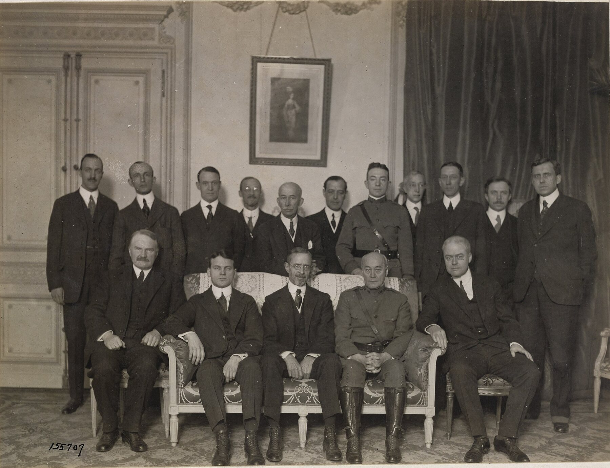
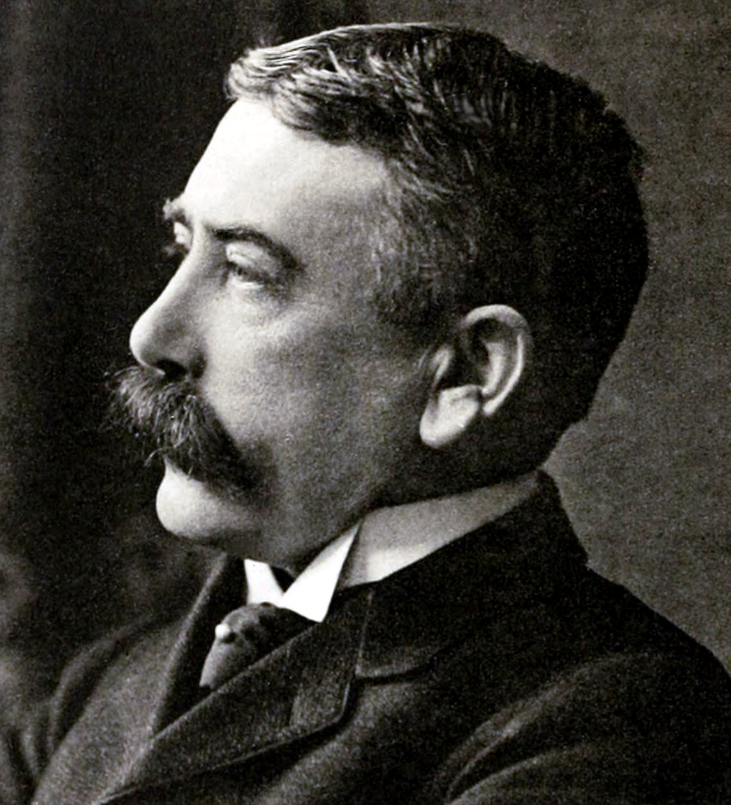
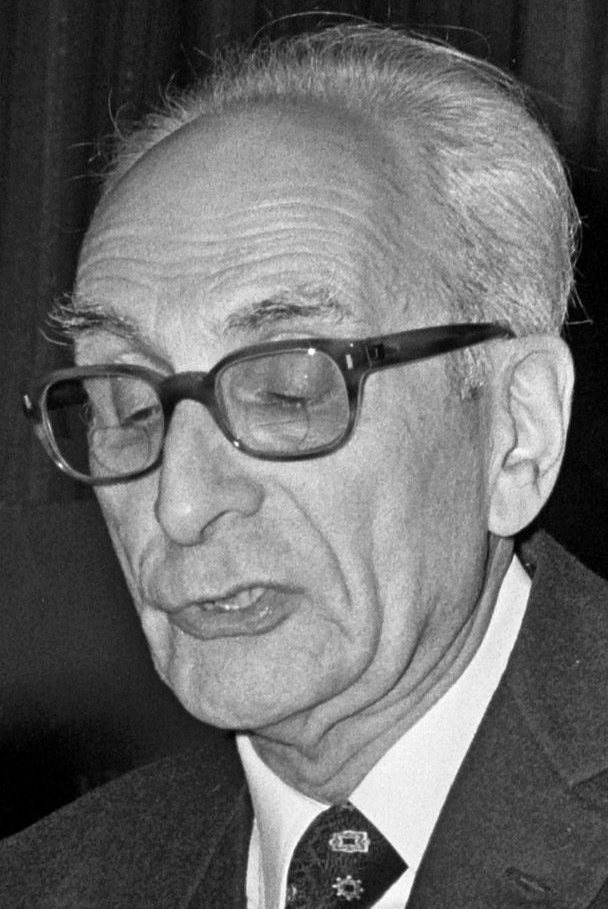
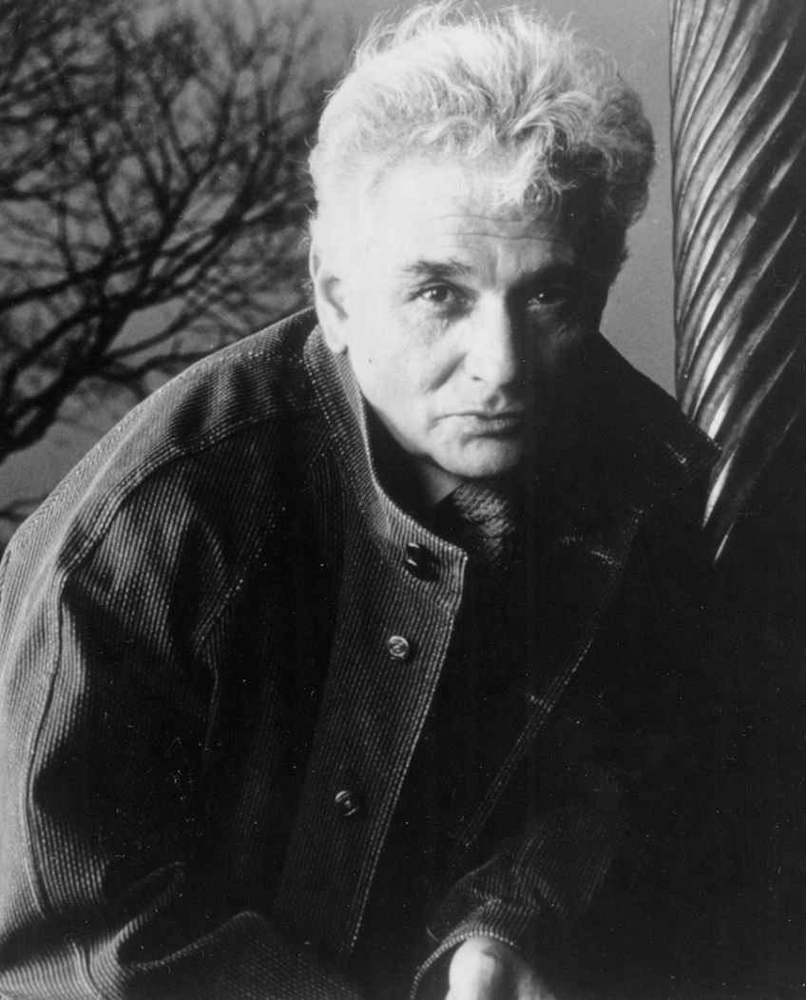
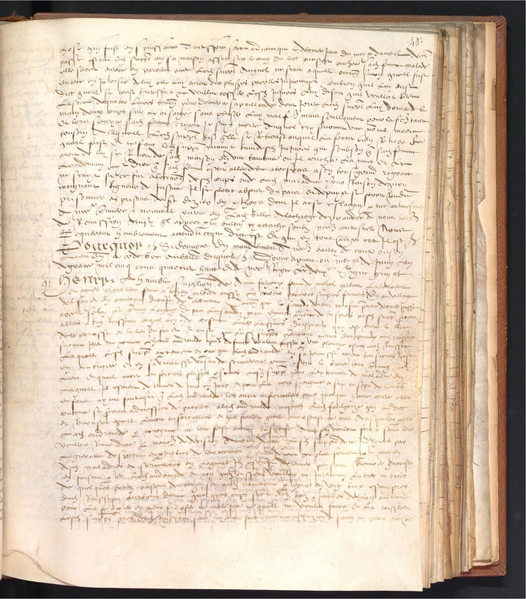
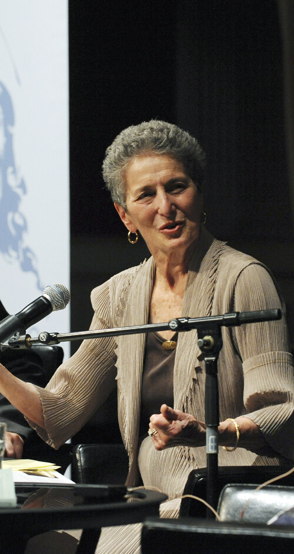
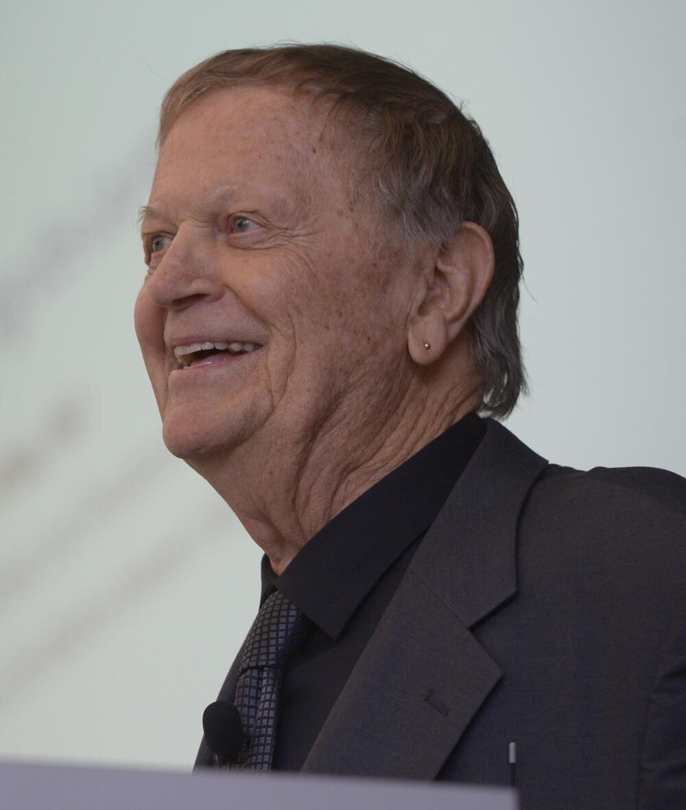
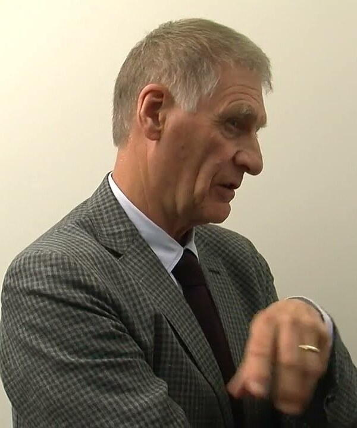

<!-- ========== TITLE ========== -->
<section data-transition="fade" markdown="1">
Making History • HIST 1105 • Week 10.1
{: .eyebrow}

# The Linguistic Turn
{: .main-point}

---

- Background: Sarah Maza, *Thinking About History* (2017), ch. 6: "Facts or Fictions?", 199–230
- Keith Jenkins, *Re-thinking History* (1991), ch. 3: "Doing History in the Post-Modern World", 70–84
{: .source-list}

Maza is cited by the page of the Chicago edition; the Davis–Finlay exchange runs two pages past the assigned range, to p. 232. Jenkins is cited by the page of the Routledge Classics edition (2003), which the course PDF reproduces.
{: .citation-note}
</section>

<!-- ========== THROUGHLINE ========== -->
<section markdown="1">
Today in context
{: .eyebrow}

## What makes history happen?
{: .main-point}

---

###### Week 9.1 · Maza, with Anderson and Chatterjee
{: .num}

Nations, which turn out to be recent, imagined, and partly the work of historians.

###### Week 9.2 · Trouillot and Said
{: .num}

Power, at every stage from making a source to telling the story.

###### Week 10.1 · Maza, with Jenkins
{: .num}

Language. Sources read as texts, and histories as made things.

###### Week 10.2 · Campus history with AI
{: .num}

A machine that puts words together the way readers expect. Whether it can write history.

</section>

<!-- ================================================================ -->
<!-- ====== PART ONE: THE FALL OF OBJECTIVITY, MAZA PP. 199–208 ====== -->
<!-- ================================================================ -->

<!-- ========== THE ONE RULE, AND THE QUESTION ========== -->
<section markdown="1">
Part one · fact or fiction
{: .eyebrow}

## History may not make things up, yet every account is a set of choices
{: .main-point}

---

"On the face of it, the question of whether history is fact or fiction should be easy to answer just by drawing a bright line: history cannot be fiction since the most basic ground rule for the discipline—in its modern form, at least—is that you are not allowed to make things up. But if modern professional norms tell us that history must be grounded in verifiable facts, postmodern sensibilities make us inescapably aware that all historical accounts are the products of choices"

Maza, <i>Thinking About History</i>, p. 199

</section>

<!-- ========== THE IDEAL ========== -->
<section markdown="1">
The 1880s · the ideal
{: .eyebrow}

## From the 1880s the profession's ideal was objectivity, defined against fiction
{: .main-point}

---

"a commitment to the reality of the past, and to truth as correspondence to that reality; a sharp separation between knower and known, between fact and value, and, above all, between history and fiction."

Peter Novick, <i>That Noble Dream</i> (1988), quoted in Maza, p. 201

</section>

<!-- ========== THE ROOM ========== -->
<section markdown="1">
The 1880s to the 1950s · the room
{: .eyebrow}

## It was easy to agree on objectivity in a room where everyone was alike
{: .main-point}

---

"It was easy to subscribe to that ideal at a time when nobody was around to challenge it plausibly. For decades, the near consensus about historical objectivity was linked to the fact that history departments were extremely homogeneous workplaces peopled by white male Protestant scholars from upper-class backgrounds."

Maza, <i>Thinking About History</i>, p. 201

###### Compare · Week 4.2
{: .label}

The room that certified historians did not admit most people.

</section>

<!-- ========== IMAGE: THE INQUIRY, PARIS 1919 ========== -->
<section class="image-slide" data-background="#0d1412" markdown="1">
<figure class="landscape">

<figcaption markdown="span">
American experts at the Paris Peace Conference, Hotel Crillon, 5 April 1919
<em>Historians, geographers and lawyers advising on Europe's new borders. The historians came from what Maza calls "extremely homogeneous workplaces" (p. 201). (Chas. Stern, U.S. Army Signal Corps, 111-SC-155707. National Archives. Public domain.)</em>
</figcaption>
</figure>
</section>

<!-- ========== THE 1970s: IDENTITY ========== -->
<section markdown="1">
The 1970s · who writes
{: .eyebrow}

## Women and Black scholars made the historian's identity part of the scholarship
{: .main-point}

---

"Far more disruptive to the epistemology of the discipline was the arrival in history departments, starting in the 1970s, of small but vocal minorities of women and African-American scholars. These groups introduced new approaches to the past that for the first time demanded that the historian's identity be an openly acknowledged component of scholarship."

Maza, <i>Thinking About History</i>, p. 204

###### Compare · Week 6.2
{: .label}

Green and Troup: historians began by finding the women and writing them back in.

</section>

<!-- ========== OLYMPIAN DETACHMENT ========== -->
<section markdown="1">
By the 1980s
{: .eyebrow}

## Each new perspective made Olympian detachment harder to believe in
{: .main-point}

---

"Only the most radical argued for embracing 'subjectivity,' but the more different perspectives on history accumulated, the harder it became to believe that any historian, however honest and well-intentioned, could tell the story of the past from a position of Olympian detachment, untainted by class, gender, racial, national, and other biases."

Maza, <i>Thinking About History</i>, p. 205

</section>

<!-- ========== SEEN GLOBALLY ========== -->
<section markdown="1">
Seen globally
{: .eyebrow}

## Seen from outside the West, objectivity looks like one more Western convention
{: .main-point}

---

"Viewed in global context, the objectivity long prized by Euro-American scholars amounts to the cherry on the cake of a centuries-long process of Western erasure of competing historical traditions, an ideal linked to underlying convictions about the value of written ('objective') documents as sources and of history as a unitary, linear process."

Maza, <i>Thinking About History</i>, p. 208

###### Compare · Week 9.2
{: .label}

Said: describing and teaching "the Orient" was one of the ways the West ruled it.

</section>

<!-- ================================================================ -->
<!-- ====== PART TWO: THE LINGUISTIC TURN, MAZA PP. 209–215 ========== -->
<!-- ================================================================ -->

<!-- ========== THE "POST" ========== -->
<section markdown="1">
Part two · the "post"
{: .eyebrow}

## The "post" comes after three modern certainties: science, progress, objectivity
{: .main-point}

---

"the collapse of 'absolutist' beliefs in the infallibility of science, the inevitability of progress, and the goal of perfect objectivity"

Maza, <i>Thinking About History</i>, p. 224, on how Appleby, Hunt and Jacob, <i>Telling the Truth about History</i> (1994), explained the early-1990s crisis

###### Compare · Week 4
{: .label}

Kant gave history a direction toward reason and freedom; Ranke's scientific history promised the past "as it actually was."

</section>

<!-- ========== THE WAVE ========== -->
<section markdown="1">
The 1980s · postmodernism
{: .eyebrow}

## In the 1980s a wave from linguistics and philosophy reached the history departments
{: .main-point}

---

"'Postmodernism' is a catchall term frequently used to describe the intellectual tsunami that hit the humanistic end of the academy with full force in the 1980s, originating in the fields of linguistics, philosophy, and literary studies . . . For our purposes, the most important aspect of postmodernism, as it came to affect historical work and nourish controversy, is its emphasis on language and 'text.'"

Maza, <i>Thinking About History</i>, p. 209

</section>

<!-- ========== MAZA'S GENEALOGY ========== -->
<section markdown="1">
Maza's genealogy · 1916 to the 1980s
{: .eyebrow}

## Her genealogy runs from a theory of words to a way of reading sources
{: .main-point}

---

###### 01 · Saussure, 1916
{: .num}

#### Words mean by difference

"Cat" means something because it differs from "cap" and "bat," not because of the animal.

###### 02 · Lévi-Strauss, 1950s–60s
{: .num}

#### Cultures as codes

Kinship, myth and totem read as grids of opposites: raw and cooked, male and female.

###### 03 · Derrida, 1970s
{: .num}

#### Meaning deferred

A term pushes away an unlimited number of opposites, so its meaning is never fixed.

###### 04 · Historians, 1980s
{: .num}

#### Sources as texts

Documents read as patterns of words and stories, not as windows onto the past.

Maza, pp. 209–211.
{: .cite}
</section>

<!-- ========== SAUSSURE ========== -->
<section markdown="1">
Saussure · 1857–1913
{: .eyebrow}

## Saussure: a word means by differing from other words
{: .main-point}

<figure>

<figcaption>Photograph by F. Jullien, Geneva, before 1913 · Wikimedia Commons · public domain</figcaption>
</figure>

"words derive meaning not from their connection with the things they designate (signifieds), but in relation to other words, or signifiers." Maza, <i>Thinking About History</i>, p. 209
{: .quote.compact}

A Genevan linguist. His *Course in General Linguistics* (1916) was compiled from students' notes after his death.
{: .detail}

So language cannot simply mirror the world. Postmodernists drew the conclusion that we reach the past only through words.
{: .detail}

</section>

<!-- ========== LÉVI-STRAUSS ========== -->
<section markdown="1">
Lévi-Strauss · 1908–2009
{: .eyebrow}

## Lévi-Strauss read cultures as Saussure read language
{: .main-point}

<figure>

<figcaption>Erasmus Prize, 1973 · Bert Verhoeff, Nationaal Archief · CC0</figcaption>
</figure>

"Any item within a culture, Lévi-Strauss argued, is intelligible only in relation to its opposite: the idea of 'raw' food has meaning only in relation to its 'cooked' opposite" Maza, <i>Thinking About History</i>, p. 209
{: .quote.compact}

A French anthropologist who carried Saussure's method to kinship, myth and totem.
{: .detail}

A culture became something to read like a text. Maza says the habit reached historians through thinkers like Foucault (p. 211).
{: .detail}

</section>

<!-- ========== STRUCTURES, NOT PEOPLE ========== -->
<section markdown="1">
Structuralism · the cost
{: .eyebrow}

## If structures make meaning, people stop being the authors of their history
{: .main-point}

---

"Structures, not people, generate meaning, and humans are therefore not the causes but the effects of linguistic and cultural structures: we can think, speak—in short, exist—only through preexisting grids of collective meaning. Structuralism is therefore 'antihumanist,' in the technical sense that it discounts individual human behavior and experience, which it views as subordinate to systems of signs."

Maza, <i>Thinking About History</i>, p. 210

###### Compare · Week 6.1
{: .label}

Thompson: the working class "was present at its own making."

</section>

<!-- ========== DERRIDA ========== -->
<section markdown="1">
Derrida · 1930–2004
{: .eyebrow}

## Derrida: meaning is never fixed, only deferred
{: .main-point}

<figure>

<figcaption>Author photograph, University of Chicago Press · used for teaching</figcaption>
</figure>

"Meaning, then, is endlessly 'deferred,' since a term is 'always already' engaged in the process of pushing away this infinity of potential opposites." Maza, <i>Thinking About History</i>, p. 211
{: .quote.compact}

A philosopher born in Algeria who taught in Paris, and the founder of deconstruction.
{: .detail}

Saussure and Lévi-Strauss thought a system could be decoded. Derrida denied any text a final meaning, sources included.
{: .detail}

</section>

<!-- ========== FEW READ THE THEORY ========== -->
<section markdown="1">
The 1980s · the climate
{: .eyebrow}

## Few historians read the theorists, but the climate reached them anyway
{: .main-point}

---

"This sort of high theory sounds remote from the preoccupations of most historians, and indeed only a tiny number of them engaged firsthand with the writings of theorists like Derrida. Within academia, however, structuralism and poststructuralism helped create, by the 1980s, a broad intellectual climate known as postmodernism whose implications translated into controversial propositions regarding historians' approaches to the past."

Maza, <i>Thinking About History</i>, p. 211

</section>

<!-- ========== THE LINGUISTIC TURN ========== -->
<section markdown="1">
The 1980s · the linguistic turn
{: .eyebrow}

## Sources read as texts, not windows
{: .main-point}

---

"the 1980s saw the advent in Western historical studies of approaches to the past in which sources were viewed not as transparent windows onto a past reality but as 'texts.' The emphasis on 'texts,' which came to be known as the 'linguistic turn,' was a change in perspective whereby historians sympathetic to movements like postmodernism and the new cultural history started reading sources as patterns of words and stories, as forms of 'fiction' in the broadest sense, rather than as documentary evidence."

Maza, <i>Thinking About History</i>, p. 211

</section>

<!-- ========== FICTION MEANS MADE ========== -->
<section markdown="1">
Fiction · the word
{: .eyebrow}

## In this sense fiction means made, not false
{: .main-point}

---

"In its original sense, 'fiction' does not mean 'something untrue' but 'something created and shaped,' an important distinction."

Maza, <i>Thinking About History</i>, p. 211

</section>

<!-- ========== HISTORIANS: THE COURTROOM ========== -->
<section markdown="1">
Historians · the 1980s
{: .eyebrow}

## Historians read court records for the stories in them
{: .main-point}

<figure>

<figcaption>Chancery register, June 1548 · Archives nationales, JJ 258-2, fol. 45 · public domain</figcaption>
</figure>

"cultural historians approached the courtroom not in search of evidence of crime and punishment but as an institutional setting that generates words, and especially narratives." Maza, <i>Thinking About History</i>, pp. 211–212
{: .quote.compact}

Two women who killed a supposed witch won this 1548 pardon with a story the king could forgive. Read as texts, such records show what a society found believable.
{: .detail}

</section>

<!-- ========== IMAGE: NATALIE ZEMON DAVIS ========== -->
<section class="image-slide" data-background="#0d1412" markdown="1">
<figure class="portrait">

<figcaption markdown="span">
Natalie Zemon Davis · 1928–2023
<em>A historian of sixteenth-century France who taught at Toronto, Berkeley and Princeton. <i>The Return of Martin Guerre</i> (1983) and <i>Fiction in the Archives</i> (1987) read pardon letters and a judge's account of a trial for the stories people told in them.<strong>Why she matters:</strong> she turned the linguistic turn into a method, reading the fictions in the archive instead of peeling them away.(Holberg Prize, Bergen, 2010, cropped. Photograph: Marit Hommedal/Scanpix. CC BY 2.0.)</em>
</figcaption>
</figure>
</section>

<!-- ========== DAVIS: THE PARDON TALES ========== -->
<section markdown="1">
Davis · 1987
{: .eyebrow}

## Davis read pardon tales for the stories petitioners told the king
{: .main-point}

---

"we were ordinarily taught as scientific historians to peel away the fictive elements in our documents so as to get at the real facts."

Natalie Zemon Davis, <i>Fiction in the Archives</i> (1987), p. 3, quoted in Maza, p. 212, who adds that Davis proposed "to do just the opposite"

</section>

<!-- ========== IMAGE: HAYDEN WHITE ========== -->
<section class="image-slide" data-background="#0d1412" markdown="1">
<figure class="portrait">

<figcaption markdown="span">
Hayden White · 1928–2018
<em>Trained as a medieval historian at Michigan, he joined the History of Consciousness program at Santa Cruz in 1978. <i>Metahistory</i> (1973) read the great nineteenth-century historians as writers whose stories fall into plots.<strong>Why he matters:</strong> he turned the reading of sources as texts onto the historians' own books.(Photograph: Bernd Wannenmacher, Freie Universität Berlin. Used for teaching.)</em>
</figcaption>
</figure>
</section>

<!-- ========== WHITE: THE PLOT ========== -->
<section markdown="1">
White · 1973
{: .eyebrow}

## White: historians do not invent the facts, but they supply the plot
{: .main-point}

---

"All historical writing, White argues, is a form of fiction-making. He does not thereby suggest that historians invent documents or sources, but that at least in the modern Western mode, historical writing invariably adheres to one of several types of narrative plots drawn from, in the broadest sense, literary culture."

Maza, <i>Thinking About History</i>, p. 214, summarizing White, <i>Metahistory</i> (1973)

</section>

<!-- ========== WHITE: THE FOUR PLOTS ========== -->
<section markdown="1">
White · the plots
{: .eyebrow}

## The same Industrial Revolution can be written as a tragedy or a comedy
{: .main-point}

---

###### Tragedy
{: .num}

#### Thompson's artisans

"Doomed to exploitation and poverty."

###### Comedy
{: .num}

#### The same decades, retold

"The standard of living rises for everyone!"

###### Romance
{: .num}

#### Marxists and nationalists

Heroes "prevailing in the face of adversity."

###### Satire
{: .num}

#### The fourth mode

Nobody wins, nothing resolves, and the historian stands back.

Maza, p. 215, after White, <i>Metahistory</i>, pp. 7–30. The satire card is White's alone.
{: .cite}
</section>

<!-- ================================================================ -->
<!-- ====== PART THREE: THE CRITICS AND THE LINE, MAZA PP. 221–232 === -->
<!-- ================================================================ -->

<!-- ========== THE REAL CHALLENGE ========== -->
<section markdown="1">
Part three · the challenge
{: .eyebrow}

## Postmodernism posed a real challenge: we cannot be sure the past happened
{: .main-point}

---

"A rigorously postmodern position does indeed present a serious philosophical challenge to the way most people think of history in that it suggests we can never be assured that the past really happened. All we historians have, a postmodernist would argue, are words and 'texts' (including oral testimony, images, and physical artifacts), whose relationship to a 'real past' can never be known."

Maza, <i>Thinking About History</i>, p. 221

</section>

<!-- ========== THE MORAL OBJECTION ========== -->
<section markdown="1">
The 1990s · the moral objection
{: .eyebrow}

## Many historians' deepest objection was moral
{: .main-point}

---

"Auschwitz was not a discourse. It trivializes mass murder to see it as a text. The gas chambers were not a piece of rhetoric. Auschwitz was indeed inherently a tragedy and cannot be seen as either a comedy or a farce."

Richard J. Evans, <i>In Defense of History</i> (1999), p. 107, quoted in Maza, p. 222

</section>

<!-- ========== NO POSTMODERN HISTORIES ========== -->
<section markdown="1">
The 1990s · the historians
{: .eyebrow}

## Historians borrowed from postmodernism, but no major scholar wrote a postmodern history
{: .main-point}

---

"no major scholars actually wrote postmodern works of history; they merely borrowed insights from the trend, while experimental and theoretical work remained confined to the margins of the discipline."

Maza, <i>Thinking About History</i>, p. 223

</section>

<!-- ========== QUALIFIED OBJECTIVITY ========== -->
<section markdown="1">
Appleby, Hunt and Jacob · 1994
{: .eyebrow}

## The settlement most historians can live with is a qualified objectivity
{: .main-point}

---

"'Qualified objectivity,' then, amounts to an interactive relationship between an inevitably subjective historian and the materials that limit and shape her inquiry."

Maza, <i>Thinking About History</i>, p. 224, on Joyce Appleby, Lynn Hunt and Margaret Jacob, <i>Telling the Truth about History</i> (1994)

</section>

<!-- ========== THE LINE ========== -->
<section markdown="1">
Drawing the line
{: .eyebrow}

## Historians agree in principle on an embargo on invention, and argue about imagination
{: .main-point}

---

"Agreement reigns in principle that historians are bound by the facts and obey a strict embargo on invention. But the historian's task also consists in assembling scattered sources and connecting the dots between them, and superior historical work involves the ability to imagine the past and recreate it in vivid prose. Disagreement often arises, often contentiously, as to which forms of dot-connecting and imagination are licit and which are not."

Maza, <i>Thinking About History</i>, p. 225

</section>

<!-- ========== DAVIS AND FINLAY ========== -->
<section markdown="1">
Davis and Finlay · *Martin Guerre*, 1988
{: .eyebrow}

## Davis and her critic disagreed about how far a historian may imagine
{: .main-point}

---

##### Robert Finlay · *American Historical Review*, 1988

"In historical writing . . . where does reconstruction stop and invention begin?" Speculation "is supposed to give way before the sovereignty of the sources, the tribunal of the documents." quoted in Maza, p. 232

##### Natalie Zemon Davis · her reply, same issue

Of her "in part my invention": "I opened the gap between what I hope to accomplish and what the sources could yield with absolute certainty; by my last page, the reader has had ample encouragement to think about other ways of making sense of the evidence." quoted in Maza, p. 232

</section>

<!-- ================================================================ -->
<!-- ====== PART FOUR: JENKINS, PP. 70–84 ============================ -->
<!-- ================================================================ -->

<!-- ========== IMAGE: KEITH JENKINS ========== -->
<section class="image-slide" data-background="#0d1412" markdown="1">
<figure class="portrait">

<figcaption markdown="span">
Keith Jenkins · b. 1943
<em>A British theorist of history, professor of historical theory at Chichester until 2008. <i>Re-thinking History</i> (1991) is a short, polemical introduction. Maza counts him among the theorists Evans's attack mostly targeted (p. 223, n. 54).<strong>Why he matters:</strong> he treats post-modernism as the condition history is now written in, and asks what history should become.(Still from a St Mary's University interview, December 2013. Used for teaching.)</em>
</figcaption>
</figure>
</section>

<!-- ========== JENKINS'S QUESTIONS ========== -->
<section markdown="1">
Part four · Jenkins, 1991
{: .eyebrow}

## Jenkins builds his chapter around four questions
{: .main-point}

---

###### 01 · p. 71
{: .num}

#### What is post-modernism?

"What do these things mean and how can they be explained?"

###### 02 · p. 72
{: .num}

#### Why now?

"Why have such endings occurred? Why this now 'common sense' (of) incredulity?"

###### 03 · pp. 77–81
{: .num}

#### What has it done to history?

His second section, on "that whole mass of history genres."

###### 04 · pp. 81–82
{: .num}

#### How should history be done now?

"How might this desirable approach to history then . . . be realised?"

</section>

<!-- ========== Q1: WHAT POST-MODERNISM IS ========== -->
<section markdown="1">
Jenkins · question 1 · what it is
{: .eyebrow}

## Post-modernism: the old centers lost their authority, and the great stories their hold
{: .main-point}

---

"Lyotard's definition at its most basic is rather minimal, characterising post-modernism as witnessing the 'death of centres' and of displaying 'incredulity towards metanarratives'."

Jenkins, <i>Re-thinking History</i>, p. 71, summarizing Lyotard, <i>The Postmodern Condition: A Report on Knowledge</i> (1979; English 1984)

###### Compare · Weeks 4 and 5
{: .label}

Voltaire and Kant argued for progress; Marx gave history a motor.

</section>

<!-- ========== Q2: NO FOUNDATIONS ========== -->
<section markdown="1">
Jenkins · question 2 · no foundations
{: .eyebrow}

## Why now: the old stories lost their force, and nobody found new foundations
{: .main-point}

---

"As they have searched ever harder for some foundations for their own positions, what they have all realised is that no such foundations exist either for themselves or for anybody else – and nor have they ever done so: every idol has had feet made of clay."

Jenkins, <i>Re-thinking History</i>, p. 76. The searchers run "from Nietzsche to Freud to Saussure to Wittgenstein to Althusser to Foucault to Derrida"

</section>

<!-- ========== IMAGE: BERLIN 1989 ========== -->
<section class="image-slide" data-background="#0d1412" markdown="1">
<figure class="landscape">

<figcaption markdown="span">
The Brandenburg Gate from the West, with crowds on the Wall, late 1989
<em>Jenkins wrote a year later. He dates Marxism's troubles from 1917: "actually existing socialism" turned "the workers' supremely optimistic metanarrative" pessimistic (p. 74). (Photograph: Raphaël Thiémard. Wikimedia Commons, CC BY-SA 2.0.)</em>
</figcaption>
</figure>
</section>

<!-- ========== Q3: HISTORY REDEFINED ========== -->
<section markdown="1">
Jenkins · question 3 · history redefined
{: .eyebrow}

## History, redefined: not knowledge of the past but a practice for present needs
{: .main-point}

---

"viewed not in its traditional guise as a subject discipline aiming at a real knowledge of the past, but seen rather as what it is, a discursive practice that enables present-minded people(s) to go to the past, there to delve around and reorganise it appropriately to their needs"

Jenkins, <i>Re-thinking History</i>, pp. 80–81

</section>

<!-- ========== Q4: NO UNPOSITIONED HISTORY ========== -->
<section markdown="1">
Jenkins · question 4 · how to do it
{: .eyebrow}

## With no unpositioned history, the only choice is between aware and unaware
{: .main-point}

---

"There is no such thing as an 'unpositioned centre' (actually a contradiction in terms); no possibility of an unpositioned site. The only choice is between a history that is aware of what it is doing and a history that is not."

Jenkins, <i>Re-thinking History</i>, p. 82

###### Compare · Week 1
{: .label}

Carr: "Study the historian before you begin to study the facts."

</section>

<!-- ================================================================ -->
<!-- ====== ARC, TAKE HOME, NEXT ===================================== -->
<!-- ================================================================ -->

<!-- ========== THE ARC ========== -->
<section markdown="1">
The lecture · looking back
{: .eyebrow}

## Objectivity questioned, sources read as texts, imagination, and positioned history 
{: .main-point}

---

###### 01 · Maza, pp. 199–208
{: .num}

#### Objectivity questioned

Questioned from within, then broken when historians made their identity part of the work.

###### 02 · Maza, pp. 209–215
{: .num}

#### Sources read as texts

Fiction as made, not false: Davis's pardon tales and White's plots.

###### 03 · Maza, pp. 221–232
{: .num}

#### The role of imagination

Historians borrowed from postmodernism without writing postmodern history. Most settled on a qualified objectivity, and kept arguing over imagination.

###### 04 · Jenkins, 1991
{: .num}

#### Every history positioned

History redefined as a practice for present needs, and the only choice between aware and unaware.

</section>

<!-- ========== THE TAKE HOME ========== -->
<section data-transition="fade" markdown="1">
The take home
{: .eyebrow}

## Every history is made by someone, from evidence nobody may invent
{: .main-point}

---

###### The rule that stays
{: .label}

In principle, historians "obey a strict embargo on invention" (Maza, p. 225). Even White, in her account, never says they invent "documents or sources" (p. 214).

###### What changed
{: .label}

The plot and the position belong to the historian and cannot be taken out. Fiction in the old sense, "something created and shaped," names that work (p. 211).

The cost: someone must say what makes one history better. Most historians answer "qualified objectivity" (Maza, pp. 224–25); Jenkins, a history "aware of what it is doing" (p. 82).

</section>

<!-- ========== WHAT COMES NEXT ========== -->
<section markdown="1">
Thursday · 10.2
{: .eyebrow}

## Next: a machine that puts words together the way readers expect
{: .main-point}

</section>
