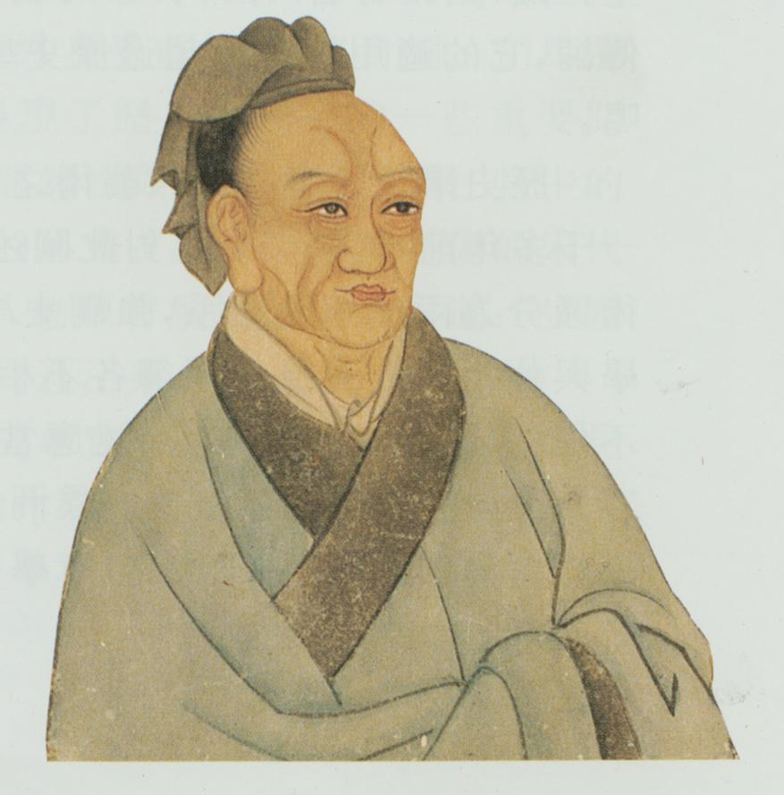
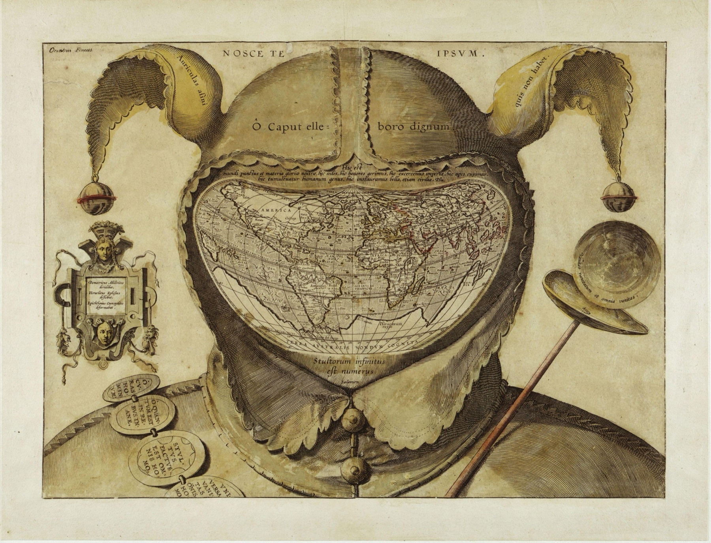
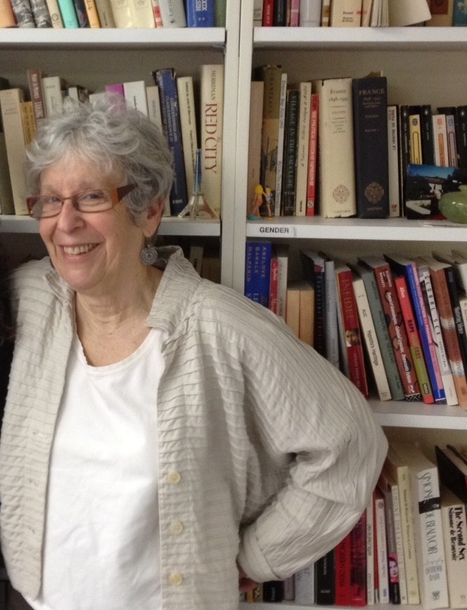
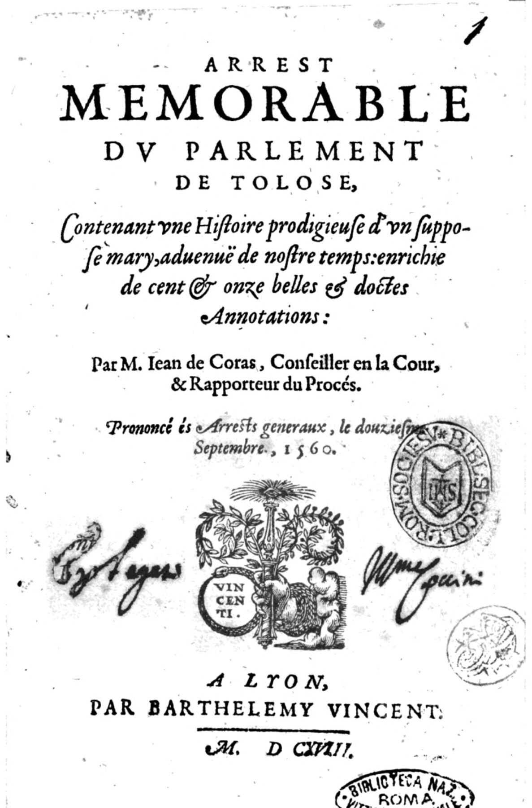
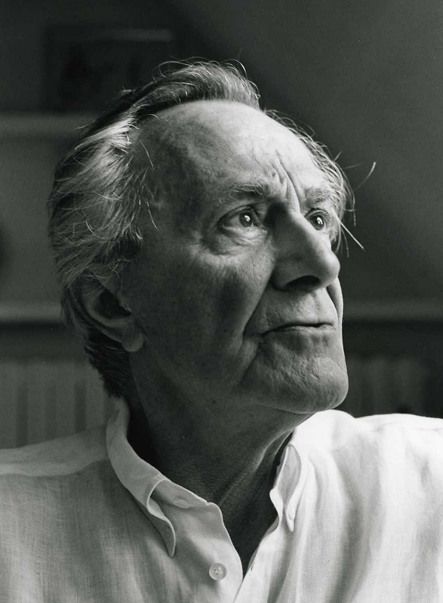
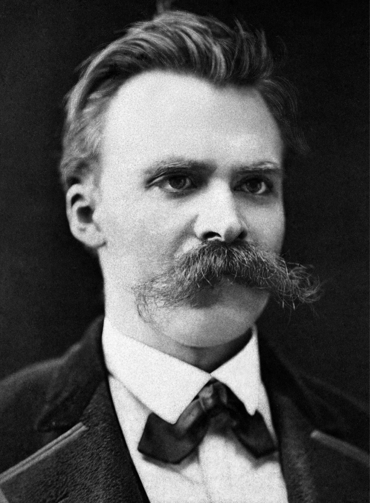

<!-- ========== TITLE ========== -->
<section data-transition="fade" markdown="1">
Making History • HIST 1105 • Week 10.1
{: .eyebrow}

# The Linguistic Turn
{: .main-point}

---

- Background: Sarah Maza, *Thinking About History* (2017), ch. 6: "Facts or Fictions?", 199–230
- Keith Jenkins, *Re-thinking History* (1991), ch. 3: "Doing History in the Post-Modern World", 70–84
{: .source-list}

Maza is cited by the page of the Chicago edition; the Davis–Finlay exchange runs two pages past the assigned range, to p. 232. Jenkins is cited by the page of the Routledge Classics edition (2003), which the course PDF reproduces.
{: .citation-note}
</section>

<!-- ========== THROUGHLINE ========== -->
<section markdown="1">
Today in context
{: .eyebrow}

## What makes history happen?
{: .main-point}

---

###### Week 9.1 · Maza, with Anderson and Chatterjee
{: .num}

Nations, which turn out to be recent, imagined, and partly the work of historians.

###### Week 9.2 · Trouillot and Said
{: .num}

Power, at every stage from making a source to telling the story.

###### Week 10.1 · Maza, with Jenkins
{: .num}

Language. Sources read as texts, and histories as made things.

###### Week 10.2 · Campus history with AI
{: .num}

A machine that puts words together the way readers expect. Whether it can write history.

</section>

<!-- ================================================================ -->
<!-- ====== PART ONE: THE FALL OF OBJECTIVITY, MAZA PP. 199–208 ====== -->
<!-- ================================================================ -->

<!-- ========== THE ONE RULE, AND THE QUESTION ========== -->
<section markdown="1">
Part one · fact or fiction
{: .eyebrow}

## History may not make things up, yet every account is a set of choices
{: .main-point}

---

"On the face of it, the question of whether history is fact or fiction should be easy to answer just by drawing a bright line: history cannot be fiction since the most basic ground rule for the discipline—in its modern form, at least—is that you are not allowed to make things up. But if modern professional norms tell us that history must be grounded in verifiable facts, postmodern sensibilities make us inescapably aware that all historical accounts are the products of choices"

Maza, <i>Thinking About History</i>, p. 199

If a history is built with the techniques of fiction, is it fiction?
{: .question .fragment data-fragment-index="1"}
</section>

<!-- ========== THE IDEAL ========== -->
<section markdown="1">
The 1880s · the ideal
{: .eyebrow}

## From the 1880s the profession's ideal was objectivity, defined above all against fiction
{: .main-point}

---

"a commitment to the reality of the past, and to truth as correspondence to that reality; a sharp separation between knower and known, between fact and value, and, above all, between history and fiction."

Peter Novick, <i>That Noble Dream</i> (1988), quoted in Maza, p. 201

</section>

<!-- ========== THE ROOM ========== -->
<section markdown="1">
The 1880s to the 1950s · the room
{: .eyebrow}

## It was easy to agree on objectivity in a room where everyone was alike
{: .main-point}

---

"It was easy to subscribe to that ideal at a time when nobody was around to challenge it plausibly. For decades, the near consensus about historical objectivity was linked to the fact that history departments were extremely homogeneous workplaces peopled by white male Protestant scholars from upper-class backgrounds."

Maza, <i>Thinking About History</i>, p. 201

###### Compare · Week 4.2
{: .label}

The room that certified historians did not admit most people.

</section>

<!-- ========== IMAGE: THE INQUIRY, PARIS 1919 ========== -->
<section class="image-slide" data-background="#0d1412" markdown="1">
<figure class="landscape">

<figcaption markdown="span">
American experts at the Paris Peace Conference, Hotel Crillon, 5 April 1919
<em>Historians, geographers and lawyers advising on Europe's new borders. The historians came from what Maza calls "extremely homogeneous workplaces" (p. 201). (Chas. Stern, U.S. Army Signal Corps, 111-SC-155707. National Archives. Public domain.)</em>
</figcaption>
</figure>
</section>

<!-- ========== THE 1970s: IDENTITY ========== -->
<section markdown="1">
The 1970s · who writes
{: .eyebrow}

## Women and Black scholars made the historian's identity part of the scholarship
{: .main-point}

---

"Far more disruptive to the epistemology of the discipline was the arrival in history departments, starting in the 1970s, of small but vocal minorities of women and African-American scholars. These groups introduced new approaches to the past that for the first time demanded that the historian's identity be an openly acknowledged component of scholarship."

Maza, <i>Thinking About History</i>, p. 204

###### Compare · Week 6.2
{: .label}

Green and Troup: historians began by finding the women and writing them back in.

</section>

<!-- ========== OLYMPIAN DETACHMENT ========== -->
<section markdown="1">
By the 1980s
{: .eyebrow}

## Each new perspective made Olympian detachment harder to believe in
{: .main-point}

---

"Only the most radical argued for embracing 'subjectivity,' but the more different perspectives on history accumulated, the harder it became to believe that any historian, however honest and well-intentioned, could tell the story of the past from a position of Olympian detachment, untainted by class, gender, racial, national, and other biases."

Maza, <i>Thinking About History</i>, p. 205

</section>

<!-- ========== IMAGE: SIMA QIAN ========== -->
<section class="image-slide" data-background="#0d1412" markdown="1">
<figure class="portrait">

<figcaption markdown="span">
Sima Qian, Week 2's Grand Historian, in a later portrait
<em>He finished the <i>Shiji</i> about 90 BC. No civilization, Maza quotes Daniel Woolf, "has consistently and continuously placed as high a priority on the recording and understanding of its past as the Chinese" (p. 206). (Wikimedia Commons. Public domain.)</em>
</figcaption>
</figure>
</section>

<!-- ========== SEEN GLOBALLY ========== -->
<section markdown="1">
Seen globally
{: .eyebrow}

## Seen from outside the West, objectivity looks like one more Western convention
{: .main-point}

---

"Viewed in global context, the objectivity long prized by Euro-American scholars amounts to the cherry on the cake of a centuries-long process of Western erasure of competing historical traditions, an ideal linked to underlying convictions about the value of written ('objective') documents as sources and of history as a unitary, linear process."

Maza, <i>Thinking About History</i>, p. 208

###### Compare · Week 9.2
{: .label}

Said: describing and teaching "the Orient" was one of the ways the West ruled it.

</section>

<!-- ========== DISCUSSION: PART ONE ========== -->
<section markdown="1">
Part one · discussion
{: .eyebrow}

## Objectivity and who was in the room
{: .main-point}

---

Maza says the newcomers of the 1950s–60s did not question objectivity; the women and Black scholars of the 1970s, who made identity part of the work, did (pp. 203–204). Why was that the blow?
{: .question .fragment data-fragment-index="1"}

It challenged who could know, not only what to study. Dissenters came to call objectivity "the particular perspective of the white upper-class men at the helm" (p. 208).

</section>

<!-- ================================================================ -->
<!-- ====== PART TWO: THE LINGUISTIC TURN, MAZA PP. 209–216 ========== -->
<!-- ================================================================ -->

<!-- ========== THE WAVE ========== -->
<section markdown="1">
Part two · postmodernism
{: .eyebrow}

## In the 1980s a wave from linguistics and philosophy reached the history departments
{: .main-point}

---

"'Postmodernism' is a catchall term frequently used to describe the intellectual tsunami that hit the humanistic end of the academy with full force in the 1980s, originating in the fields of linguistics, philosophy, and literary studies . . . For our purposes, the most important aspect of postmodernism, as it came to affect historical work and nourish controversy, is its emphasis on language and 'text.'"

Maza, <i>Thinking About History</i>, p. 209

</section>

<!-- ========== MAZA'S GENEALOGY ========== -->
<section markdown="1">
Maza's genealogy · 1916 to the 1980s
{: .eyebrow}

## Her genealogy runs from a theory of words to a way of reading sources
{: .main-point}

---

###### 01 · Saussure, 1916
{: .num}

#### Words mean by difference

"Cat" means something because it differs from "cap" and "bat," not because of the animal.

###### 02 · Lévi-Strauss, 1950s–60s
{: .num}

#### Cultures as codes

Kinship, myth and totem read as grids of opposites: raw and cooked, male and female.

###### 03 · Derrida, 1970s
{: .num}

#### Meaning deferred

A term pushes away an unlimited number of opposites, so its meaning is never fixed.

###### 04 · Historians, 1980s
{: .num}

#### Sources as texts

Documents read as patterns of words and stories, not as windows onto the past.

Maza, pp. 209–211.
{: .cite}
</section>

<!-- ========== STRUCTURES, NOT PEOPLE ========== -->
<section markdown="1">
Structuralism · the cost
{: .eyebrow}

## If structures make meaning, people stop being the authors of their history
{: .main-point}

---

"Structures, not people, generate meaning, and humans are therefore not the causes but the effects of linguistic and cultural structures: we can think, speak—in short, exist—only through preexisting grids of collective meaning. Structuralism is therefore 'antihumanist,' in the technical sense that it discounts individual human behavior and experience, which it views as subordinate to systems of signs."

Maza, <i>Thinking About History</i>, p. 210

###### Compare · Week 6.1
{: .label}

Thompson: the working class "was present at its own making."

</section>

<!-- ========== FEW READ THE THEORY ========== -->
<section markdown="1">
The 1980s · the climate
{: .eyebrow}

## Few historians read the theorists, but the climate reached them anyway
{: .main-point}

---

"This sort of high theory sounds remote from the preoccupations of most historians, and indeed only a tiny number of them engaged firsthand with the writings of theorists like Derrida. Within academia, however, structuralism and poststructuralism helped create, by the 1980s, a broad intellectual climate known as postmodernism whose implications translated into controversial propositions regarding historians' approaches to the past."

Maza, <i>Thinking About History</i>, p. 211

</section>

<!-- ========== THE LINGUISTIC TURN ========== -->
<section markdown="1">
The 1980s · the linguistic turn
{: .eyebrow}

## For historians the result was the linguistic turn: sources read as texts, not windows
{: .main-point}

---

"the 1980s saw the advent in Western historical studies of approaches to the past in which sources were viewed not as transparent windows onto a past reality but as 'texts.' The emphasis on 'texts,' which came to be known as the 'linguistic turn,' was a change in perspective whereby historians sympathetic to movements like postmodernism and the new cultural history started reading sources as patterns of words and stories, as forms of 'fiction' in the broadest sense, rather than as documentary evidence."

Maza, <i>Thinking About History</i>, p. 211

</section>

<!-- ========== FICTION MEANS MADE ========== -->
<section markdown="1">
Fiction · the word
{: .eyebrow}

## In this sense fiction means made, not false
{: .main-point}

---

"In its original sense, 'fiction' does not mean 'something untrue' but 'something created and shaped,' an important distinction."

Maza, <i>Thinking About History</i>, p. 211

</section>

<!-- ========== IMAGE: NATALIE ZEMON DAVIS ========== -->
<section class="image-slide" data-background="#0d1412" markdown="1">
<figure class="portrait">

<figcaption markdown="span">
Natalie Zemon Davis · 1928–2023
<em>A historian of sixteenth-century France who taught at Toronto, Berkeley and Princeton. <i>The Return of Martin Guerre</i> (1983) and <i>Fiction in the Archives</i> (1987) read pardon letters and a judge's account of a trial for the stories people told in them.<strong>Why she matters:</strong> she turned the linguistic turn into a method, reading the fictions in the archive instead of peeling them away.(Holberg Prize, Bergen, 2010, cropped. Photograph: Marit Hommedal/Scanpix. CC BY 2.0.)</em>
</figcaption>
</figure>
</section>

<!-- ========== DAVIS: THE PARDON TALES ========== -->
<section markdown="1">
Davis · 1987
{: .eyebrow}

## Davis read pardon tales for the stories petitioners told the king
{: .main-point}

---

"we were ordinarily taught as scientific historians to peel away the fictive elements in our documents so as to get at the real facts."

Natalie Zemon Davis, <i>Fiction in the Archives</i> (1987), p. 3, quoted in Maza, p. 212, who adds that Davis proposed "to do just the opposite"

</section>

<!-- ========== IMAGE: FOOL'S CAP MAP ========== -->
<section class="image-slide" data-background="#0d1412" markdown="1">
<figure class="landscape">

<figcaption markdown="span">
<i>Fool's Cap Map of the World</i>, engraved about 1590, maker unknown
<em>A world map inside a jester's hood, under "Know thyself." Read the linguistic turn's way, Maza says, such a map tells you "about the mental universe of the cartographers" (p. 214). (Wikimedia Commons. Public domain.)</em>
</figcaption>
</figure>
</section>

<!-- ========== IMAGE: HAYDEN WHITE ========== -->
<section class="image-slide" data-background="#0d1412" markdown="1">
<figure class="portrait">

<figcaption markdown="span">
Hayden White · 1928–2018
<em>Trained as a medieval historian at Michigan, he joined the History of Consciousness program at Santa Cruz in 1978. <i>Metahistory</i> (1973) read the great nineteenth-century historians as writers whose stories fall into plots.<strong>Why he matters:</strong> he turned the reading of sources as texts onto the historians' own books.(Photograph: Bernd Wannenmacher, Freie Universität Berlin. Used for teaching.)</em>
</figcaption>
</figure>
</section>

<!-- ========== WHITE: THE PLOT ========== -->
<section markdown="1">
White · 1973
{: .eyebrow}

## White: historians do not invent the facts, but they supply the plot
{: .main-point}

---

"All historical writing, White argues, is a form of fiction-making. He does not thereby suggest that historians invent documents or sources, but that at least in the modern Western mode, historical writing invariably adheres to one of several types of narrative plots drawn from, in the broadest sense, literary culture."

Maza, <i>Thinking About History</i>, p. 214, summarizing White, <i>Metahistory</i> (1973)

</section>

<!-- ========== WHITE: THE FOUR PLOTS ========== -->
<section markdown="1">
White · the plots
{: .eyebrow}

## The same Industrial Revolution can be written as a tragedy or a comedy
{: .main-point}

---

###### Tragedy
{: .num}

#### Thompson's artisans

"Doomed to exploitation and poverty."

###### Comedy
{: .num}

#### The same decades, retold

"The standard of living rises for everyone!"

###### Romance
{: .num}

#### Marxists and nationalists

Heroes "prevailing in the face of adversity."

###### Satire
{: .num}

#### The fourth mode

Nobody wins, nothing resolves, and the historian stands back.

Maza, p. 215, after White, <i>Metahistory</i>, pp. 7–30. The satire card is White's alone.
{: .cite}
</section>

<!-- ========== IMAGE: JOAN SCOTT ========== -->
<section class="image-slide" data-background="#0d1412" markdown="1">
<figure class="portrait">

<figcaption markdown="span">
Joan Wallach Scott · b. 1941
<em>The author of "Gender: A Useful Category of Historical Analysis" (1986), read in Week 6.2. Maza: historians like Scott "drew upon structuralist and poststructuralist methods" to recast women's history as gender history (p. 216).<strong>Why she matters:</strong> she turned the method on a category rather than a source, so that "gender" itself became a word with a history.(Photograph by B. Sutherton, 2013, cropped. CC BY-SA 3.0.)</em>
</figcaption>
</figure>
</section>

<!-- ========== SCOTT: WORDS HAVE A HISTORY ========== -->
<section markdown="1">
Scott · 1986
{: .eyebrow}

## Scott took the turn to gender: the category itself has a history
{: .main-point}

---

"words, like the ideas and things they are meant to signify, have a history."

Joan Wallach Scott, "Gender: A Useful Category of Historical Analysis" (1986), quoted in Maza, p. 216

</section>

<!-- ========== DISCUSSION: PART TWO ========== -->
<section markdown="1">
Part two · discussion
{: .eyebrow}

## A history without a story
{: .main-point}

---

White says historians impose narrative on evidence (Maza, p. 214). What would a history without narrative look like, and is it possible?
{: .question .fragment data-fragment-index="1"}

Two candidates: the chronicle, which Maza, following White, calls "devoid of meaning" today (p. 214), and Week 5's Annales structures. Whether the second escapes plot is the argument.

</section>

<!-- ================================================================ -->
<!-- ====== PART THREE: THE CRITICS AND THE LINE, MAZA PP. 220–232 === -->
<!-- ================================================================ -->

<!-- ========== THE CRITICS ========== -->
<section markdown="1">
Part three · the critics
{: .eyebrow}

## British critics answered with alarm, and some with Francophobia
{: .main-point}

---

"The absurd always sounds better in French."

G. R. Elton, <i>Return to Essentials</i> (1991), quoted in Maza, p. 220, among "British historians seizing the chance to vent traditional Francophobia"

</section>

<!-- ========== THE REAL CHALLENGE ========== -->
<section markdown="1">
The 1990s · the challenge
{: .eyebrow}

## Underneath the alarm was a real challenge: we cannot be sure the past happened
{: .main-point}

---

"A rigorously postmodern position does indeed present a serious philosophical challenge to the way most people think of history in that it suggests we can never be assured that the past really happened. All we historians have, a postmodernist would argue, are words and 'texts' (including oral testimony, images, and physical artifacts), whose relationship to a 'real past' can never be known."

Maza, <i>Thinking About History</i>, p. 221

</section>

<!-- ========== THE MORAL OBJECTION ========== -->
<section markdown="1">
The 1990s · the moral objection
{: .eyebrow}

## Many historians' deepest objection was moral: some pasts must be affirmed as real
{: .main-point}

---

"Auschwitz was not a discourse. It trivializes mass murder to see it as a text. The gas chambers were not a piece of rhetoric. Auschwitz was indeed inherently a tragedy and cannot be seen as either a comedy or a farce."

Richard J. Evans, <i>In Defense of History</i> (1999), p. 107, quoted in Maza, p. 222

</section>

<!-- ========== THE HISTORIANS KEPT THE PAST ========== -->
<section markdown="1">
The 1990s · the historians
{: .eyebrow}

## Historians took the linguistic turn, but almost none stopped believing in the past
{: .main-point}

---

"Many creative historians took the 'linguistic turn' in the 1980s and 1990s, looking to stories or representations, but almost none of them professed disbelief in the reality of the past."

Maza, <i>Thinking About History</i>, p. 223

</section>

<!-- ========== QUALIFIED OBJECTIVITY ========== -->
<section markdown="1">
Appleby, Hunt and Jacob · 1994
{: .eyebrow}

## The settlement most historians can live with is a qualified objectivity
{: .main-point}

---

"'Qualified objectivity,' then, amounts to an interactive relationship between an inevitably subjective historian and the materials that limit and shape her inquiry."

Maza, <i>Thinking About History</i>, p. 224, on Joyce Appleby, Lynn Hunt and Margaret Jacob, <i>Telling the Truth about History</i> (1994)

</section>

<!-- ========== THE LINE ========== -->
<section markdown="1">
Drawing the line
{: .eyebrow}

## Historians agree in principle on an embargo on invention, and argue about imagination
{: .main-point}

---

"Agreement reigns in principle that historians are bound by the facts and obey a strict embargo on invention. But the historian's task also consists in assembling scattered sources and connecting the dots between them, and superior historical work involves the ability to imagine the past and recreate it in vivid prose. Disagreement often arises, often contentiously, as to which forms of dot-connecting and imagination are licit and which are not."

Maza, <i>Thinking About History</i>, p. 225

</section>

<!-- ========== THREE CASES ========== -->
<section markdown="1">
Drawing the line · Maza's cases
{: .eyebrow}

## Maza's cases run from fabrication through carelessness to imagination
{: .main-point}

---

###### Bellesiles · 2000–2002
{: .num}

#### Fabrication

A prize-winning book on guns in early America. An outside committee found "outright falsification"; the prize was rescinded.

###### Abraham · 1980s
{: .num}

#### Carelessness

He presented "as direct quotes from the sources what were actually his paraphrases," and denied deliberately inventing documents.

###### Davis · 1983
{: .num}

#### Imagination

*The Return of Martin Guerre* reconstructs what a peasant wife "must have" known. A critic called it invention.

Maza, pp. 225–232.
{: .cite}
</section>

<!-- ========== IMAGE: CORAS ========== -->
<section class="image-slide" data-background="#0d1412" markdown="1">
<figure class="portrait">

<figcaption markdown="span">
Jean de Coras, <i>Arrest memorable du Parlement de Tolose</i> ("Memorable Judgment of the Parlement of Toulouse"), Lyon, 1618
<em>The judge's account of the Martin Guerre trial, first printed in 1561; the trial records are lost (Maza, p. 230). Davis and Finlay were arguing over this source. (Biblioteca Nazionale Centrale, Rome, digitized by Google. Internet Archive. Public domain.)</em>
</figcaption>
</figure>
</section>

<!-- ========== DAVIS AND FINLAY ========== -->
<section markdown="1">
Davis and Finlay · 1988
{: .eyebrow}

## Davis and her critic disagreed about how far a historian may imagine
{: .main-point}

---

##### Robert Finlay · *American Historical Review*, 1988

"In historical writing . . . where does reconstruction stop and invention begin?" Speculation "is supposed to give way before the sovereignty of the sources, the tribunal of the documents." quoted in Maza, p. 232

##### Natalie Zemon Davis · her reply, same issue

Of her "in part my invention": "I opened the gap between what I hope to accomplish and what the sources could yield with absolute certainty; by my last page, the reader has had ample encouragement to think about other ways of making sense of the evidence." quoted in Maza, p. 232

</section>

<!-- ========== DISCUSSION: PART THREE ========== -->
<section markdown="1">
Part three · discussion
{: .eyebrow}

## A story and a lie
{: .main-point}

---

Bellesiles falsified figures, Abraham passed off paraphrases as quotations, and Davis imagined what Bertrande knew. Which of them told a lie, and how would you know?
{: .question .fragment data-fragment-index="1"}

Fraud is clear. Short of it, Maza asks rather than answers: "how can any historian know where and how to draw the line between interpretation and distortion?" (p. 229).

</section>

<!-- ================================================================ -->
<!-- ====== PART FOUR: JENKINS, PP. 70–84 ============================ -->
<!-- ================================================================ -->

<!-- ========== IMAGE: KEITH JENKINS ========== -->
<section class="image-slide" data-background="#0d1412" markdown="1">
<figure class="portrait">

<figcaption markdown="span">
Keith Jenkins · b. 1943
<em>A British theorist of history, professor of historical theory at Chichester until 2008. <i>Re-thinking History</i> (1991) is a short, polemical introduction. Maza counts him among the theorists Evans's attack mostly targeted (p. 223, n. 54).<strong>Why he matters:</strong> he treats post-modernism as the condition history is now written in, and asks what history should become.(Still from a St Mary's University interview, December 2013. Used for teaching.)</em>
</figcaption>
</figure>
</section>

<!-- ========== JENKINS'S QUESTIONS ========== -->
<section markdown="1">
Part four · Jenkins, 1991
{: .eyebrow}

## Jenkins, one of the critics' targets, builds his chapter around his own questions
{: .main-point}

---

###### 01 · p. 71
{: .num}

#### What is post-modernism?

"What do these things mean and how can they be explained?"

###### 02 · p. 72
{: .num}

#### Why now?

"Why have such endings occurred? Why this now 'common sense' (of) incredulity?"

###### 03 · pp. 77–81
{: .num}

#### What has it done to history?

His second section, on "that whole mass of history genres."

###### 04 · pp. 81–82
{: .num}

#### How should history be done now?

"How might this desirable approach to history then . . . be realised?"

</section>

<!-- ========== IMAGE: LYOTARD ========== -->
<section class="image-slide" data-background="#0d1412" markdown="1">
<figure class="portrait">

<figcaption markdown="span">
Jean-François Lyotard · 1924–1998
<em>A French philosopher. <i>La Condition postmoderne</i> (1979) began as a report on knowledge for the universities council of Quebec; the English translation appeared in 1984.<strong>Why he matters:</strong> Jenkins takes his definition of post-modernism from that book.(Photograph: Bracha L. Ettinger, retouched. Wikimedia Commons, CC BY-SA 2.0.)</em>
</figcaption>
</figure>
</section>

<!-- ========== Q1: LYOTARD'S DEFINITION ========== -->
<section markdown="1">
Jenkins · question 1 · what it means
{: .eyebrow}

## He takes his definition from Lyotard: the "death of centres" and "incredulity towards metanarratives"
{: .main-point}

---

"Lyotard's definition at its most basic is rather minimal, characterising post-modernism as witnessing the 'death of centres' and of displaying 'incredulity towards metanarratives'."

Jenkins, <i>Re-thinking History</i>, p. 71, summarizing Lyotard, <i>The Postmodern Condition: A Report on Knowledge</i> (1979; English 1984)

</section>

<!-- ========== Q1: THE DEATH OF CENTRES ========== -->
<section markdown="1">
Jenkins · question 1 · the centers
{: .eyebrow}

## Frameworks that looked natural turn out to serve particular interests
{: .main-point}

---

"all those old organising frameworks that presupposed the privileging of various centres (things that are, for example, Anglo-centric, Euro-centric, ethno-centric, gender-centric, logo-centric) are no longer regarded as legitimate and natural frameworks (legitimate because natural), but as temporary fictions which were useful for the articulation not of universal but of actually very particular interests"

Jenkins, <i>Re-thinking History</i>, p. 71

</section>

<!-- ========== Q1: METANARRATIVES ========== -->
<section markdown="1">
Jenkins · question 1 · the metanarratives
{: .eyebrow}

## The great stories lost their hold: God's first, then progress
{: .main-point}

---

"those great structuring (metaphysical) stories which have given meaning(s) to western developments have been drained of vitality. After the nineteenth-century announcements of the death of God (the theological metanarrative), the death of secular surrogates has occurred . . . that whole Enlightenment project; those various programmes of human progress, reform and emancipation that manifested themselves in, say, humanism, liberalism, Marxism, and so on."

Jenkins, <i>Re-thinking History</i>, p. 72

###### Compare · Weeks 4 and 5
{: .label}

Voltaire and Kant argued for progress; Marx gave history a motor.

</section>

<!-- ========== Q2: HIS EXPLANATORY STORY ========== -->
<section markdown="1">
Jenkins · question 2 · why now
{: .eyebrow}

## His answer: value moved from birth to effort to life to the market
{: .main-point}

---

###### 01 · Pre-modern
{: .num}

#### Born to rule

"Divinity, race, blood, lineage": worth was what a man was by birth.

###### 02 · The bourgeoisie
{: .num}

#### Earned, not given

Value "by effort," located in the property that embodied the work.

###### 03 · The workers
{: .num}

#### Alive, therefore valuable

With no property, men "had value just by being alive." Marx built them the story.

###### 04 · After 1950
{: .num}

#### Exchange value

Worth is what a thing fetches, and "people too take on the garb of objects."

Jenkins, <i>Re-thinking History</i>, pp. 72–74.
{: .cite}
</section>

<!-- ========== IMAGE: BERLIN 1989 ========== -->
<section class="image-slide" data-background="#0d1412" markdown="1">
<figure class="landscape">

<figcaption markdown="span">
The Brandenburg Gate from the West, with crowds on the Wall, late 1989
<em>Jenkins wrote a year later. He dates Marxism's troubles from 1917: "actually existing socialism" turned "the workers' supremely optimistic metanarrative" pessimistic (p. 74). (Photograph: Raphaël Thiémard. Wikimedia Commons, CC BY-SA 2.0.)</em>
</figcaption>
</figure>
</section>

<!-- ========== IMAGE: NIETZSCHE ========== -->
<section class="image-slide" data-background="#0d1412" markdown="1">
<figure class="portrait">

<figcaption markdown="span">
Friedrich Nietzsche · 1844–1900
<em>A German classical philologist turned philosopher, photographed about 1875 while he taught at Basel. Jenkins puts him first among the thinkers who looked for foundations and found none (p. 76).<strong>Why he matters:</strong> Jenkins borrows his words for what historians do with the past: they make it theirs and say, "So I willed it" (p. 78).(Photograph: F. Hartmann, about 1875. Public domain.)</em>
</figcaption>
</figure>
</section>

<!-- ========== Q2: NO FOUNDATIONS ========== -->
<section markdown="1">
Jenkins · question 2 · no foundations
{: .eyebrow}

## Jenkins: from Nietzsche to Derrida, every search for foundations found none
{: .main-point}

---

"As they have searched ever harder for some foundations for their own positions, what they have all realised is that no such foundations exist either for themselves or for anybody else – and nor have they ever done so: every idol has had feet made of clay."

Jenkins, <i>Re-thinking History</i>, p. 76. The searchers run "from Nietzsche to Freud to Saussure to Wittgenstein to Althusser to Foucault to Derrida"

</section>

<!-- ========== Q3: REDESCRIPTION ========== -->
<section markdown="1">
Jenkins · question 3 · what it does to history
{: .eyebrow}

## After Rorty: a past that can be redescribed without end
{: .main-point}

---

"this is a past that can be infinitely redescribed. It can and has supported countless plausible and, vis-à-vis their own methodological lights, equally legitimate histories; it has unfailingly given whatever historians (and their impersonators) have wanted and want: various births, origins, legitimating antecedents, explanations and lines of descent (Tory, Whig, Marxist etc.) useful for them as they try to be in control, so that they can make the past their past and so say, along with Nietzsche, 'So I willed it.'"

Jenkins, <i>Re-thinking History</i>, pp. 77–78, after Richard Rorty's "re-descriptive turn"

</section>

<!-- ========== Q3: THE MASS OF GENRES ========== -->
<section markdown="1">
Jenkins · question 3 · the genres
{: .eyebrow}

## The result is a mass of histories, each somebody's
{: .main-point}

---

"Here we can identify, say, historians' histories (professional histories attempting to exercise hegemony over the field, a version expressed in the thesis, the monograph and the text), teachers' histories (necessarily popularisations of professional histories), and then a whole range of other distinctive forms that can only be listed: children's histories, popular-memory histories, proscribed histories, black histories, white histories, women's histories, feminist histories, men's histories, heritage histories, reactionary histories, revolutionary histories, bottom-dog histories, top-dog histories, etc."

Jenkins, <i>Re-thinking History</i>, p. 78

</section>

<!-- ========== Q3: POWER/KNOWLEDGE ========== -->
<section markdown="1">
Jenkins · question 3 · power/knowledge
{: .eyebrow}

## Which history sits at the center is settled by power, not by method
{: .main-point}

---

"interpretations at (say) the 'centre' of our culture are not there because they are true or methodologically correct (brilliant histories can be marginalised if their subject matter is unpalatable) but because they are aligned to the dominant discursive practices: again power/knowledge."

Jenkins, <i>Re-thinking History</i>, p. 79

###### Compare · Week 9.2
{: .label}

Trouillot: power enters at every stage, from making a source to telling the story.

</section>

<!-- ========== Q3: TWO READINGS OF THE FLUX ========== -->
<section markdown="1">
Jenkins · question 3 · freedom or loss
{: .eyebrow}

## The same flux could free the marginal or leave them no past
{: .main-point}

---

##### Viewed positively · Jenkins

"This interpretive flux, when viewed positively, is potentially empowering to even the most marginal in that they can at least make their own histories even if they do not have the power to make them other peoples'." p. 79

##### The danger · Peter Widdowson's scenario, quoted by Jenkins

"In this scenario, post modernism is the last great gambit of capitalism to [try and] defeat opposition, contestation and change" — a pastlessness "held to be more damaging for those whose constructions are at an early stage." p. 80

</section>

<!-- ========== Q3: HIS OWN POSITION ========== -->
<section markdown="1">
Jenkins · question 3 · his position
{: .eyebrow}

## Jenkins places himself between "authorised history" and no past at all
{: .main-point}

---

"Between the Scylla and Charybdis of, on the one hand, authorised history and, on the other, post-modern pastlessness, a space exists for the desirable outcome of as many people(s) as possible to make their own histories such that they can have real effects (a real say) in the world."

Jenkins, <i>Re-thinking History</i>, p. 80

</section>

<!-- ========== Q3: HISTORY REDEFINED ========== -->
<section markdown="1">
Jenkins · question 3 · history redefined
{: .eyebrow}

## History, redefined: not knowledge of the past but a practice for present needs
{: .main-point}

---

"viewed not in its traditional guise as a subject discipline aiming at a real knowledge of the past, but seen rather as what it is, a discursive practice that enables present-minded people(s) to go to the past, there to delve around and reorganise it appropriately to their needs"

Jenkins, <i>Re-thinking History</i>, pp. 80–81

</section>

<!-- ========== Q4: NO UNPOSITIONED HISTORY ========== -->
<section markdown="1">
Jenkins · question 4 · how to do it
{: .eyebrow}

## With no unpositioned history, the only choice is between aware and unaware
{: .main-point}

---

"There is no such thing as an 'unpositioned centre' (actually a contradiction in terms); no possibility of an unpositioned site. The only choice is between a history that is aware of what it is doing and a history that is not."

Jenkins, <i>Re-thinking History</i>, p. 82

###### Compare · Week 1
{: .label}

Carr: "Study the historian before you begin to study the facts."

</section>

<!-- ========== Q4: TWO PROPOSALS ========== -->
<section markdown="1">
Jenkins · question 4 · two proposals
{: .eyebrow}

## His two proposals: a reflexive method, and histories of the present
{: .main-point}

---

###### 01 · Method · p. 82
{: .num}

#### A reflexive methodology

Students would be "given an explicit analysis of why the history you are getting is the one you are getting and why you are getting it in the way you are and not in any other."

###### 02 · Content · pp. 83–84
{: .num}

#### Histories of the present

In Foucault's phrase, "a series of 'histories of the present'": studies of "the makings of the histories of post-modernity itself."

</section>

<!-- ========== DISCUSSION: PART FOUR ========== -->
<section markdown="1">
Part four · discussion
{: .eyebrow}

## Jenkins and the line
{: .main-point}

---

Jenkins says the past "can be infinitely redescribed" (p. 77). Can his position still tell Bellesiles from Davis?
{: .question .fragment data-fragment-index="1"}

Partly. A falsified table fails even "their own methodological lights" (p. 77). To rank two honest histories, he prefers the one "aware of what it is doing" (p. 82).

</section>

<!-- ================================================================ -->
<!-- ====== ARC, TAKE HOME, NEXT ===================================== -->
<!-- ================================================================ -->

<!-- ========== THE ARC ========== -->
<section markdown="1">
The lecture · looking back
{: .eyebrow}

## Objectivity questioned, sources read as texts, a line argued over, and every history positioned
{: .main-point}

---

###### 01 · Maza, pp. 199–208
{: .num}

#### Objectivity questioned

Questioned from within, then broken when historians made their identity part of the work.

###### 02 · Maza, pp. 209–216
{: .num}

#### Sources read as texts

Fiction as made, not false: Davis's pardon tales, White's plots, Scott's gender.

###### 03 · Maza, pp. 220–232
{: .num}

#### Arguing over the line

Almost no historian doubted the past. Most settled on a qualified objectivity, and kept arguing over imagination.

###### 04 · Jenkins, 1991
{: .num}

#### Every history positioned

The past endlessly redescribed, and the only choice between aware and unaware.

</section>

<!-- ========== THE TAKE HOME ========== -->
<section data-transition="fade" markdown="1">
The take home
{: .eyebrow}

## Every history is made by someone, from evidence nobody may invent
{: .main-point}

---

###### The rule that stays
{: .label}

In principle, historians "obey a strict embargo on invention" (Maza, p. 225). Even White, in her account, never says they invent "documents or sources" (p. 214).

###### What changed
{: .label}

The plot and the position belong to the historian and cannot be taken out. Fiction in the old sense, "something created and shaped," names that work (p. 211).

The cost: someone must say what makes one history better. Most historians answer "qualified objectivity" (Maza, pp. 224–25); Jenkins, a history "aware of what it is doing" (p. 82).

</section>

<!-- ========== WHAT COMES NEXT ========== -->
<section markdown="1">
Thursday · 10.2
{: .eyebrow}

## Next: a machine that puts words together the way readers expect
{: .main-point}

---

Jenkins says no history is written from nowhere. Where is a language model writing from?
{: .question .fragment data-fragment-index="1"}
</section>
