<!-- ========== TITLE ========== -->
<section data-transition="fade" markdown="1">
Making History • HIST 1105 • Week 13.1
{: .eyebrow}

# Science and Medicine
{: .main-point}

---

- Background: Sarah Maza, *Thinking About History* (2017), ch. 3: "The History of What?", 83–108
- Steven Shapin, *The Scientific Revolution* (1996), Introduction, 1–14
- Charles E. Rosenberg, "Framing Disease: Illness, Society, and History," in Rosenberg and Janet Golden, eds., *Framing Disease* (1992), xiii–xxvi
- Optional: Thomas Kuhn, *The Structure of Scientific Revolutions* (1962), 1–22
{: .source-list}

Kuhn is cited by the pages of the second edition (1970). Rosenberg's introduction is numbered in roman numerals. Johns is quoted from <i>The Nature of the Book</i> (1998), ch. 1.
{: .citation-note}
</section>

<!-- ========== SECTION ONE: SCIENCE ========== -->
<section markdown="1">
Section one · science
{: .eyebrow}

## From great men to knowledge made by many people
{: .main-point}
</section>

<!-- ========== GARRISON AND LOVEJOY: THE OLD STORY ========== -->
<section markdown="1">
1913–36 · the old story
{: .eyebrow}

## Early histories credited a few chosen spirits and the occasional genius
{: .main-point}

---

##### Garrison, *An Introduction to the History of Medicine* (1913)

"It is no exaggeration to say that science owes most to the shining individualism of a few chosen spirits." (p. 36)

##### Lovejoy, *The Great Chain of Being* (1936), in Maza's words

"Ideas, in this sort of approach, are like a set of building blocks with which thinkers play and from which the occasional genius constructs something dazzling" (Maza, pp. 86–87)

###### Discuss
{: .label}

**Who disappears from a history that credits "a few chosen spirits"?**

</section>

<!-- ========== IMAGE: COPERNICUS ========== -->
<section class="image-slide" data-background="#0d1412" markdown="1">
<figure class="landscape">
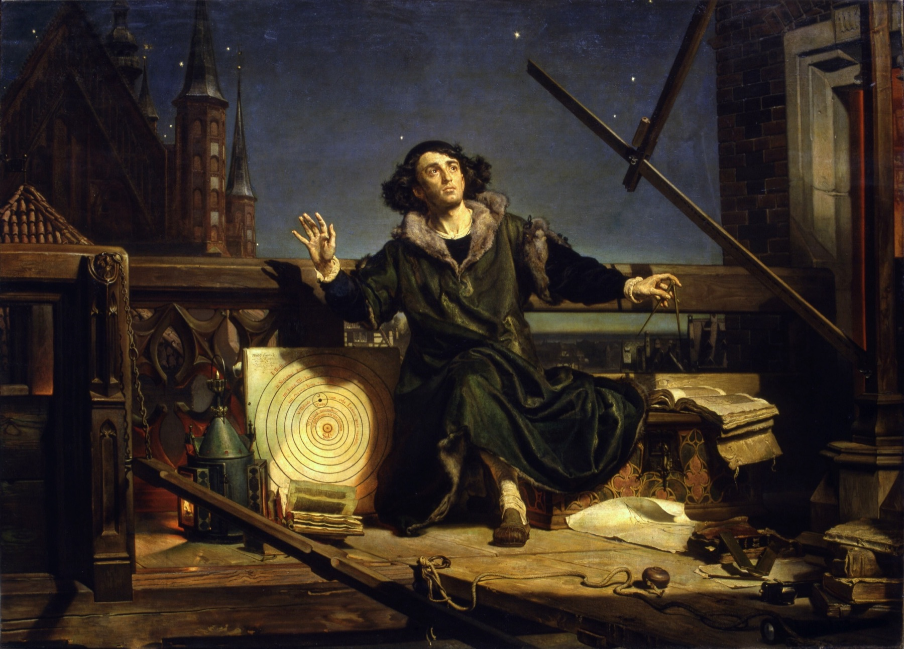
<figcaption markdown="span">
Jan Matejko, <i>Astronomer Copernicus, or Conversations with God</i>, 1872
<em>Painted more than three centuries after Copernicus died, it shows him alone at night beside his sun-centered diagram, hands raised as if in conversation with God. (Wikimedia Commons. Public domain.)</em>
</figcaption>
</figure>
</section>

<!-- ========== IMAGE: GALILEO FACING THE INQUISITION ========== -->
<section class="image-slide" data-background="#0d1412" markdown="1">
<figure class="landscape">
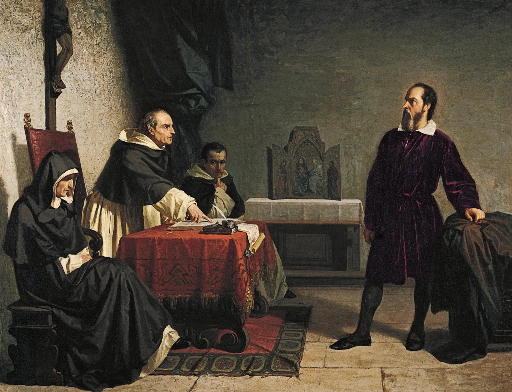
<figcaption markdown="span">
Cristiano Banti, <i>Galileo Facing the Roman Inquisition</i>, 1857
<em>Painted more than two centuries after the 1633 trial, it makes Galileo a lone martyr for truth, standing before three churchmen. (Wikimedia Commons. Public domain.)</em>
</figcaption>
</figure>
</section>

<!-- ========== IMAGE: FRANKLIN AND THE KITE ========== -->
<section class="image-slide" data-background="#0d1412" markdown="1">
<figure class="portrait">
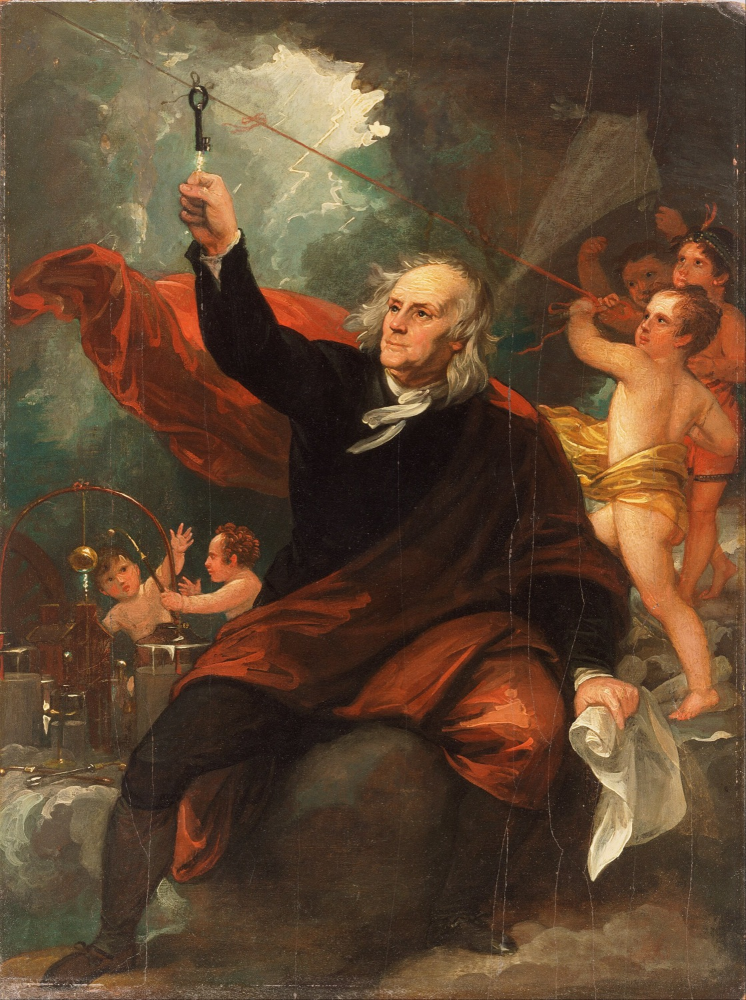
<figcaption markdown="span">
Benjamin West, <i>Benjamin Franklin Drawing Electricity from the Sky</i>, c. 1816
<em>Painted more than sixty years after the 1752 kite experiment, it gives Franklin a billowing cloak, a key at the end of the string, and cherubs to tend his apparatus. (Philadelphia Museum of Art, via Google Art Project and Wikimedia Commons. Public domain.)</em>
</figcaption>
</figure>
</section>

<!-- ========== IMAGE: MEN OF SCIENCE ========== -->
<section class="image-slide" data-background="#0d1412" markdown="1">
<figure class="landscape">
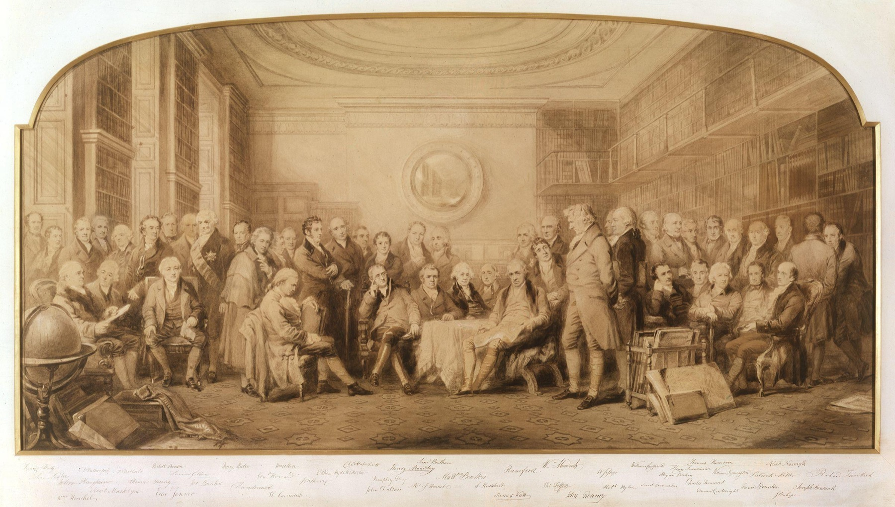
<figcaption markdown="span">
Sir John Gilbert, <i>Men of Science Living in 1807–8</i>
<em>A Victorian artist imagines nearly fifty British scientists and inventors in one library. Every one of them is a man. (National Portrait Gallery, London, via Wikimedia Commons. Public domain.)</em>
</figcaption>
</figure>
</section>

<!-- ========== BUTTERFIELD ========== -->
<section markdown="1">
1931–49 · the old story
{: .eyebrow}

## Science was told as the making of the modern world
{: .main-point}

<figure>
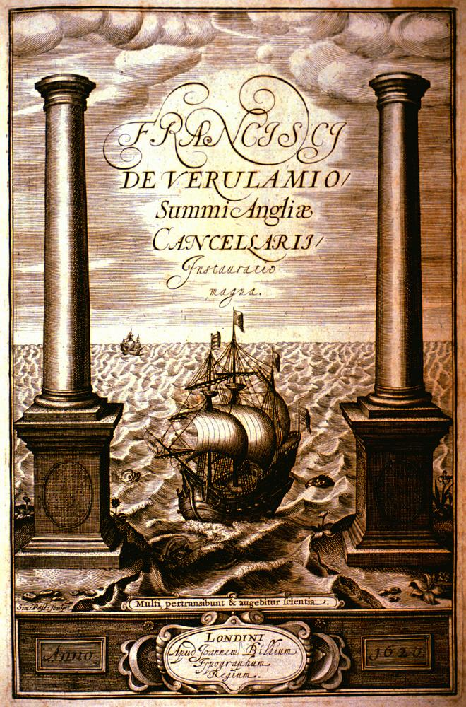
<figcaption>Bacon's <i>Great Instauration</i>, 1620 · public domain</figcaption>
</figure>

The Scientific Revolution "outshines everything since the rise of Christianity and reduces the Renaissance and Reformation to the rank of mere episodes" Herbert Butterfield, <i>The Origins of Modern Science</i> (1949), quoted in Shapin, p. 1
{: .quote.compact}

The "Whig interpretation of history," named in 1931, judges the past as the road to the present.
{: .detail}

Historians told science that way "through the Cold War" (Maza, p. 92).
{: .detail}

</section>

<!-- ========== INSIDE OR OUTSIDE ========== -->
<section markdown="1">
Internal and external · 1930s
{: .eyebrow}

## Historians split on whether science changed by its own ideas or by its society
{: .main-point}

---

##### Inside: ideas and methods

One school read Galileo's science as a change in thought: mathematics, more than experiment, remade physics.

##### Outside: economics, religion, politics

Another tied Newton's <i>Principia</i> to the needs of shipping, mining and war, and English science to Puritan values.

###### Internalist and externalist
{: .label}

Later historians named the sides. Internalists explain scientific change from inside science, by ideas, methods and evidence; externalists by the economics, religion and politics outside it. The old story of great geniuses was largely internalist.

</section>

<!-- ========== KUHN: THE TURN ========== -->
<section markdown="1">
Kuhn · 1962 · the turn
{: .eyebrow}

## Kuhn: historians now judged old science by its own time
{: .main-point}

---

"Rather than seeking the permanent contributions of an older science to our present vantage, they attempt to display the historical integrity of that science in its own time."

Kuhn, <i>The Structure of Scientific Revolutions</i>, p. 3

###### Paradigms, not accumulation
{: .label}

Kuhn called a shared model of "problems and solutions" a paradigm. When misfit results pile up, a crisis brings a new paradigm, "incommensurable" with the old: the two can't be judged by the same standards (Maza, p. 93, on Copernicus).

###### Discuss
{: .label}

**If paradigms can't be judged by the same standards, in what sense is later science better science?**

</section>

<!-- ========== NEWTON'S ALCHEMY ========== -->
<section markdown="1">
1970s · science and the occult
{: .eyebrow}

## Newton's gravitation was rooted in alchemy
{: .main-point}

<figure>
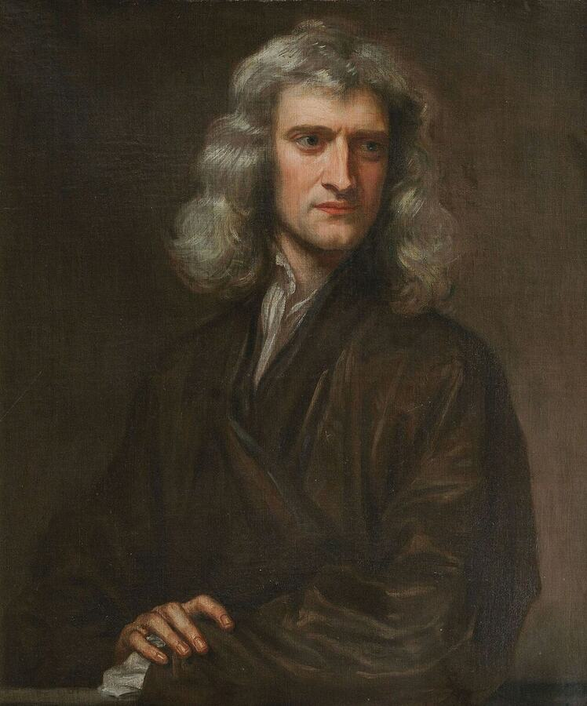
<figcaption>Kneller, 1689 · public domain</figcaption>
</figure>

His work toward gravitation was "rooted in the great scientist's avid and extensive research into the 'dark arts' of alchemy." Maza, <i>Thinking About History</i>, p. 99
{: .quote.compact}

The line between science and "occult" pursuits hardened only in the eighteenth century (p. 99).
{: .detail}

</section>

<!-- ========== LATOUR AND WOOLGAR: THE LABORATORY ========== -->
<section markdown="1">
1979 · the laboratory
{: .eyebrow}

## Social scientists followed a laboratory as it made facts
{: .main-point}

<figure>

<figcaption>Salk Institute · Highsmith · public domain</figcaption>
</figure>

"There is as much society inside the scientist's laboratory, and internal to the development of scientific knowledge, as there is outside." Shapin, <i>The Scientific Revolution</i>, p. 10
{: .quote.compact}

<i>Laboratory Life</i> (1979) followed scientists at a Salk Institute laboratory in California, as an anthropologist would follow a village.
{: .detail}

They saw facts take shape through arguing, writing and persuading. The first subtitle was <i>The Social Construction of Scientific Facts</i>.
{: .detail}

</section>

<!-- ========== EISENSTEIN ========== -->
<section markdown="1">
1979 · print
{: .eyebrow}

## One argument held that print made the Scientific Revolution possible
{: .main-point}

<figure>
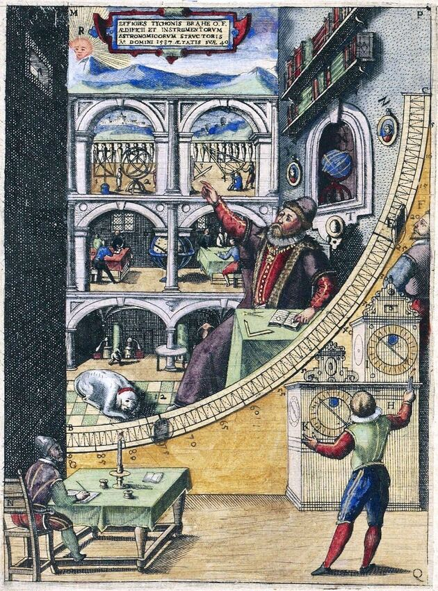
<figcaption>Tycho Brahe at his great quadrant, 1598 · public domain</figcaption>
</figure>

"The 'Scientific Revolution' was thus inconceivable without a preceding printing revolution." Adrian Johns, <i>The Nature of the Book</i> (1998), p. 11, summarizing the argument
{: .quote.compact}

Print gave texts "fixity": the same words, repeatable anywhere (Johns, p. 10).
{: .detail}

Its hero was Tycho Brahe, who set printed rival models of the universe side by side and saw where they disagreed (pp. 10–11).
{: .detail}

</section>

<!-- ========== CONSTRUCTIVISM ========== -->
<section markdown="1">
After Kuhn · 1970s–80s · constructivism
{: .eyebrow}

## Constructivists treated scientific knowledge as something people make
{: .main-point}

---

"the belief that scientific knowledge is a human creation, made with available material and cultural resources, rather than simply the revelation of a natural order that is pre-given and independent of human action."

A definition of constructivism, quoted in Maza, p. 95

###### Compare · Week 10.1
{: .label}

The linguistic turn read sources as "texts," not transparent windows onto the past. Constructivists treated scientific knowledge the same way: as made, not simply found.

###### Discuss
{: .label}

**If a belief has a social cause, has anyone yet said whether it is true?**

</section>

<!-- ========== IMAGE: BOYLE'S AIR PUMP ========== -->
<section class="image-slide" data-background="#0d1412" markdown="1">
<figure class="portrait">
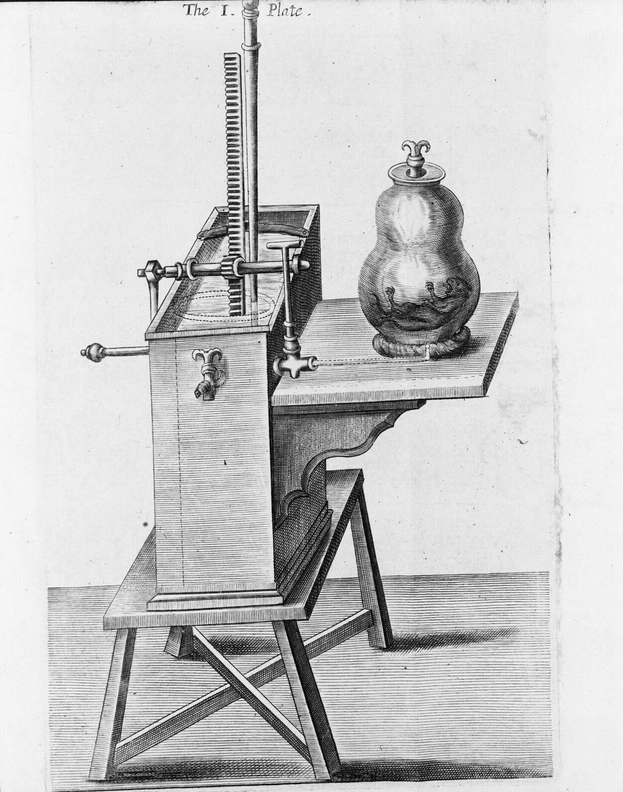
<figcaption markdown="span">
Robert Boyle's air pump, plate 1 of <i>New Experiments Physico-Mechanical</i>, 1660
<em>"The cyclotron of its age," in one scholar's phrase (quoted in Maza, p. 96): the costliest, most advanced machine of its day. Few machines existed, so most people learned the results from Boyle's book or from the chosen witnesses who saw them. (Library of Congress. Public domain.)</em>
</figcaption>
</figure>
</section>

<!-- ========== LEVIATHAN AND THE AIR-PUMP ========== -->
<section markdown="1">
1985 · politics
{: .eyebrow}

## The air-pump dispute was also a dispute about political order
{: .main-point}

---

"solutions to the problem of knowledge are solutions to the problem of social order."

Steven Shapin and Simon Schaffer, <i>Leviathan and the Air-Pump</i> (1985), quoted in Maza, p. 97

###### England, 1660
{: .label}

After two decades of civil war, Boyle's experimenters stood for freedom used responsibly. Hobbes, author of <i>Leviathan</i>, a defense of absolute rule, trusted only mathematical proof in science and a single authority in the state (pp. 96–97).

</section>

<!-- ========== TRUST ========== -->
<section markdown="1">
Shapin · 1994 · trust
{: .eyebrow}

## Shapin argued that experimental science flourished in England because gentlemen did it
{: .main-point}

---

"Experimental science flourished in seventeenth-century England, Shapin argues, because it was conducted by a group of elite practitioners—'gentlemen,' members of the landed upper class—who both trusted one another and had moral authority in the society at large."

Maza, <i>Thinking About History</i>, p. 98, on Shapin, <i>A Social History of Truth</i> (1994)

###### Discuss
{: .label}

**Whom do you trust on science today, and what makes them trustworthy: credentials, numbers or someone like you?**

</section>

<!-- ========== IMAGE: SPRAT FRONTISPIECE ========== -->
<section class="image-slide" data-background="#0d1412" markdown="1">
<figure class="portrait">
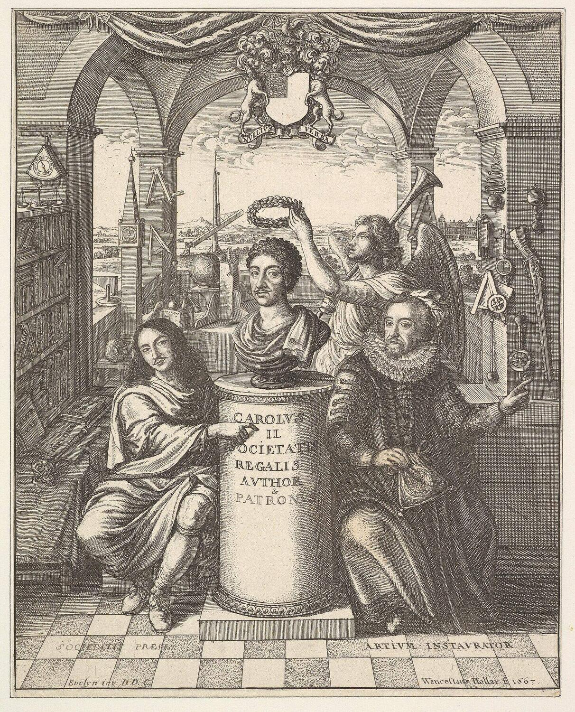
<figcaption markdown="span">
Frontispiece to Thomas Sprat, <i>The History of the Royal Society</i>, 1667
<em>Bacon, right, and the Society's first president, left, flank its patron, the king. Gentlemen and a king vouched for the new science; Sprat's triumphant history, written seven years on, defended it. (Wenceslaus Hollar after John Evelyn. Metropolitan Museum of Art. CC0.)</em>
</figcaption>
</figure>
</section>

<!-- ========== IMAGE: HARVARD COMPUTERS ========== -->
<section class="image-slide" data-background="#0d1412" markdown="1">
<figure class="landscape">
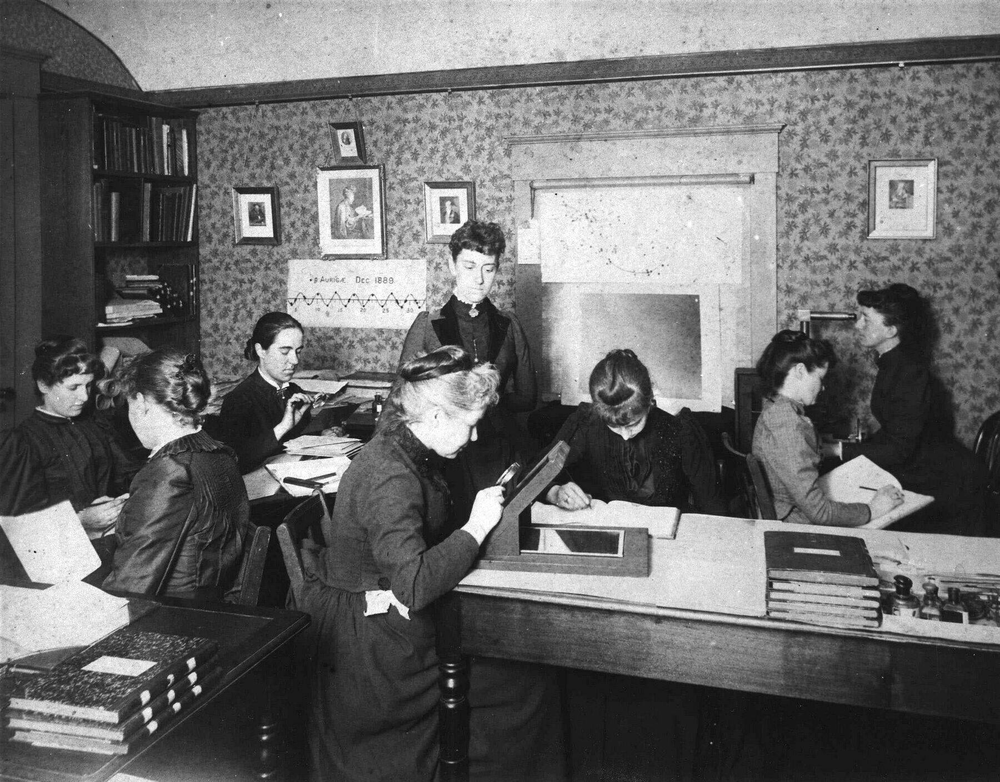
<figcaption markdown="span">
The women "computers" of the Harvard College Observatory, about 1891
<em>By the nineteenth century, one historian shows, trust came from "expertise backed by numbers rather than genteel status" (Maza, p. 98). These women produced the numbers, for far less pay than men. (Harvard College Observatory. Public domain.)</em>
</figcaption>
</figure>
</section>

<!-- ========== SHAPIN: NO SUCH THING ========== -->
<section markdown="1">
Shapin · 1996
{: .eyebrow}

## Shapin opens by denying that the Scientific Revolution happened
{: .main-point}

---

"There was no such thing as the Scientific Revolution, and this is a book about it. Some time ago, when the academic world offered more certainty and more comforts, historians announced the real existence of a coherent, cataclysmic, and climactic event that fundamentally and irrevocably changed what people knew about the natural world … It was the moment at which the world was made modern, it was a Good Thing"

Shapin, <i>The Scientific Revolution</i>, p. 1

</section>

<!-- ========== SHAPIN: WHAT IS ARGUED ========== -->
<section markdown="1">
Shapin · 1996 · what is argued
{: .eyebrow}

## Historians still argue about what the Scientific Revolution was
{: .main-point}

---

#### One event, or many practices?

Many historians doubt any "singular and discrete event," and any single "science" or "scientific method" to revolutionize (pp. 3–4).

#### A break, or continuity?

The continuity of seventeenth-century natural philosophy with its medieval past "is now routinely asserted" (p. 4).

#### Ideas, or practices?

Older accounts treated ideas as if they "floated freely in conceptual space." Newer ones ask what people did to make an observation or run an experiment (p. 4).

#### Inside, or outside?

Whether science's causes were intellectual or social was long argued. Shapin calls the split "a rather silly demarcation" (p. 9).

Shapin, <i>The Scientific Revolution</i>, pp. 3–4, 9
{: .cite}
</section>

<!-- ========== SHAPIN: THE WHO ========== -->
<section markdown="1">
Shapin · 1996 · who took part
{: .eyebrow}

## Shapin asks who was left out of the Scientific Revolution
{: .main-point}

---

"The half of the European population that was female was in a position to participate in scientific culture scarcely at all, as was that overwhelming majority—of men and women—who were illiterate or otherwise disqualified from entering the venues of formal learning."

Shapin, <i>The Scientific Revolution</i>, p. 8

###### Revolution for whom?
{: .label}

If only a few took part, "in what sense, if at all," was it the moment "modernity was made, for 'us'"? (pp. 4–5).

</section>

<!-- ========== SHAPIN: WHY KEEP TELLING IT ========== -->
<section markdown="1">
Shapin · 1996 · ancestors
{: .eyebrow}

## Shapin still tells the story, as one about our ancestors
{: .main-point}

---

"Yet there is absolutely no reason we should not want to know how we got from there to here, who the ancestors were, and what the lineage is that connects us to the past."

Shapin, <i>The Scientific Revolution</i>, p. 7

Such stories, he warns, are "not likely to be sensitive accounts of how it was in the past": Galileo, Descartes and Boyle were hardly typical of their countrymen (p. 7).
{: .detail}

###### Discuss
{: .label}

**Is it wrong to judge the past as the road to the present if the road really did lead here?**

</section>

<!-- ========== JOHNS ========== -->
<section markdown="1">
1998 · print and trust
{: .eyebrow}

## Printed books had to earn trust, a later historian argued
{: .main-point}

<figure>

<figcaption>The astronomer John Flamsteed, 1712 · public domain</figcaption>
</figure>

"In such a world, questions of credit took the place of assumptions of fixity." Adrian Johns, <i>The Nature of the Book</i> (1998), p. 31
{: .quote.compact}

Early print was full of piracy and error, so readers had to decide which books to believe (p. 31). Even Tycho could not get his star catalogue printed (p. 18).
{: .detail}

In 1712 Newton and Halley printed an astronomer's star catalogue against his "vehement opposition" (p. 55).
{: .detail}

</section>

<!-- ========== EISENSTEIN AND JOHNS ========== -->
<section markdown="1">
Print and trust
{: .eyebrow}

## One view put authority in the printed page; another put it in readers
{: .main-point}

---

##### Print fixes texts (1979)

Print fixed texts, so scholars could compare, correct and build on them. The Renaissance and Reformation were "rendered permanent" by permanent texts (as Johns summarizes it, p. 11).

##### Readers make print trustworthy (1998)

Fixity "exists only inasmuch as it is recognized and acted upon by people" (p. 19). Printed texts were trusted "only as a result of hard work" (p. 36).

###### From gentlemen to books
{: .label}

The later view builds on Shapin's trust: not only whom to believe, but which printed books (p. 31). The two authors argued it out in the <i>American Historical Review</i> in 2002.

</section>

<!-- ========== IMAGE: MERIAN ========== -->
<section class="image-slide" data-background="#0d1412" markdown="1">
<figure class="portrait">

<figcaption markdown="span">
Maria Sibylla Merian, the peacock flower, from <i>Metamorphosis insectorum Surinamensium</i> ("The Transformation of Surinam's Insects"), 1705
<em>Merian drew Surinam's insects from life, and recorded enslaved and Indigenous women using these seeds to end pregnancies. A later historian found science "in the workshops of artisans and artists" (Maza, p. 101). (Biodiversity Heritage Library. Public domain.)</em>
</figcaption>
</figure>
</section>

<!-- ========== DASTON AND GALISON: OBJECTIVITY ========== -->
<section markdown="1">
2007 · objectivity
{: .eyebrow}

## Scientific objectivity itself has a history
{: .main-point}

<figure>
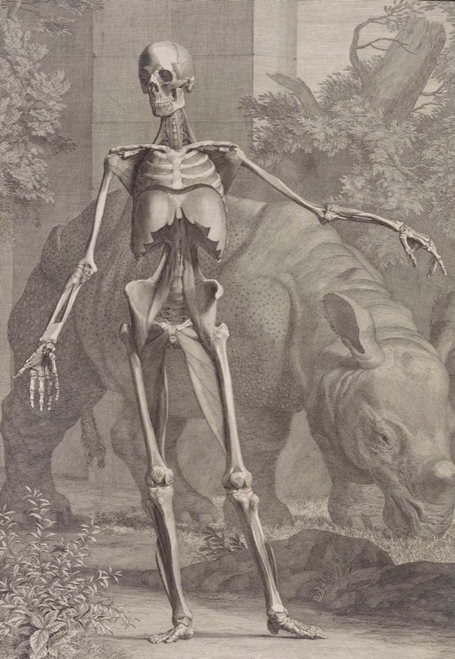
<figcaption>A plate from Albinus's anatomy atlas, 1747, drawn under his direction · KU Leuven · CC0</figcaption>
</figure>

"The objectivity of the experimental matter of fact … was an artifact of certain forms of discourse and certain modes of social solidarity." Steven Shapin and Simon Schaffer, <i>Leviathan and the Air-Pump</i> (1985), quoted in Maza, p. 97
{: .quote.compact}

<i>Objectivity</i> (2007) traced scientific atlases and found self-restraint as an ideal of science taking shape only in the nineteenth century.
{: .detail}

Earlier atlases trusted the expert's eye to show the typical body.
{: .detail}

</section>

<!-- ========== RAJ: CIRCULATION ========== -->
<section markdown="1">
2007 · circulation
{: .eyebrow}

## Science was made through circulation between places, not spread from Europe
{: .main-point}

<figure>

<figcaption>Jantar Mantar, Jaipur, built by Jai Singh II in the 1720s and 1730s: an illustration only · Eichmann · CC BY 4.0</figcaption>
</figure>

"the reframing of historians' 'where' … from the single location to transnational and global expanses, all of which have entailed challenges to Eurocentrism." Maza, <i>Thinking About History</i>, p. 116
{: .quote.compact}

Older accounts had Western science radiating from Europe. <i>Relocating Modern Science</i> (2007) argued that South Asia and Europe made it together.
{: .detail}

</section>

<!-- ========== WHO DID SCIENCE ========== -->
<section markdown="1">
Maza · 2017 · who did science
{: .eyebrow}

## Science was practiced by many more people than the old story allowed
{: .main-point}

---

"Science, in short, was not just produced by savants in learned societies but practiced by all sorts of people with very concrete needs and agendas—performing at court, impressing wealthy friends, firing an intricate piece of pottery, or, in the case of wives and family members, providing unacknowledged assistance of every sort."

Maza, <i>Thinking About History</i>, p. 101

###### Discuss
{: .label}

**Shapin says women and the illiterate took part in scientific culture "scarcely at all"; Maza says "all sorts of people" practiced science. Who is right, and what is each counting as science?**

</section>

<!-- ========== SECTION TWO: MEDICINE ========== -->
<section markdown="1">
Section two · medicine
{: .eyebrow}

## From heroic doctors to the frames around disease
{: .main-point}
</section>

<!-- ========== PHYSICIANS' HISTORY ========== -->
<section markdown="1">
Doctors' histories · to 1930
{: .eyebrow}

## The history of disease was long written by doctors and moral writers
{: .main-point}

---

"Although it has been a traditional concern of physicians, antiquarians, and moralists, the study of disease is still comparatively novel for social scientists."

Rosenberg, "Framing Disease," p. xxiii

###### The physicians' version
{: .label}

Antiquarians were collectors of old things and texts. Doctors wrote most early histories of medicine: great men from Hippocrates to Pasteur beating back ignorance.

</section>

<!-- ========== IMAGE: JENNER ========== -->
<section class="image-slide" data-background="#0d1412" markdown="1">
<figure class="landscape">
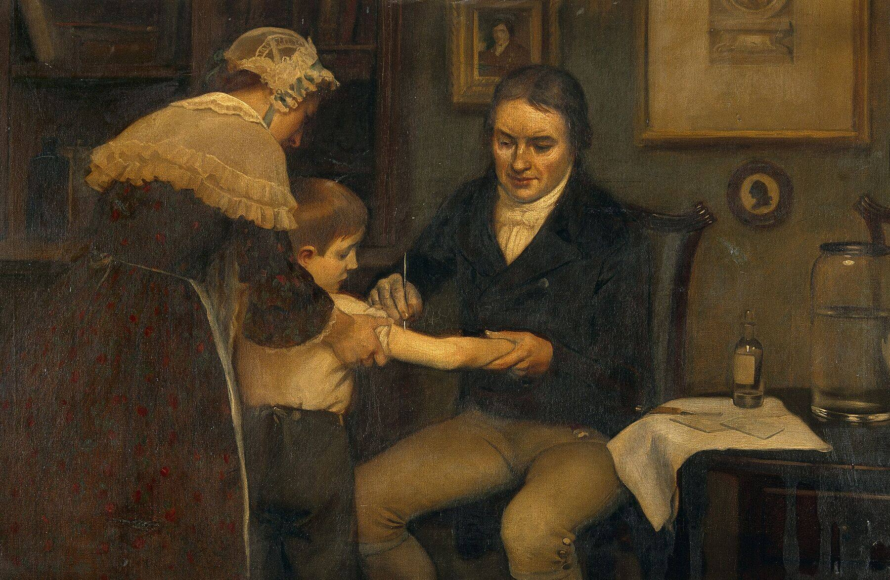
<figcaption markdown="span">
Ernest Board, <i>Dr Jenner Performing His First Vaccination, on James Phipps, a Boy of 8, May 14, 1796</i>, about 1910
<em>The physicians' version as a painting, made more than a century after the event: a calm doctor, a trusting boy, a woman holding him steady. (Wellcome Collection. CC BY 4.0; frame cropped.)</em>
</figcaption>
</figure>
</section>

<!-- ========== IMAGE: PASTEUR ========== -->
<section class="image-slide" data-background="#0d1412" markdown="1">
<figure class="portrait">
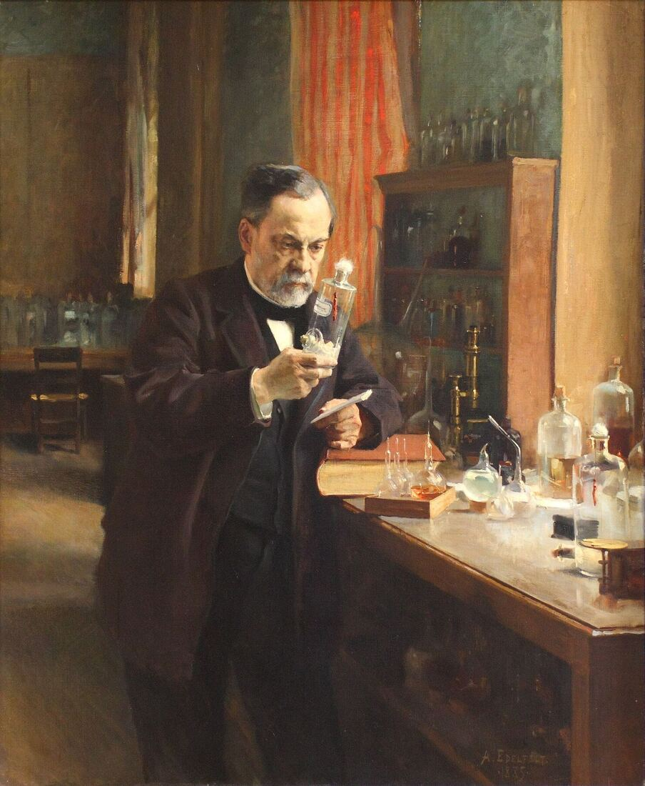
<figcaption markdown="span">
Albert Edelfelt, <i>Louis Pasteur</i>, 1885
<em>Pasteur studies a glass jar at his laboratory window, a lone man of science at work. Germ theory made it seem only a matter of time before the microbe behind every disease was found (Rosenberg, p. xvii), and popular books made the germ hunters adventure heroes. (Musée d'Orsay, via Wikimedia Commons. Public domain.)</em>
</figcaption>
</figure>
</section>

<!-- ========== IMAGE: THE GROSS CLINIC ========== -->
<section class="image-slide" data-background="#0d1412" markdown="1">
<figure class="portrait">
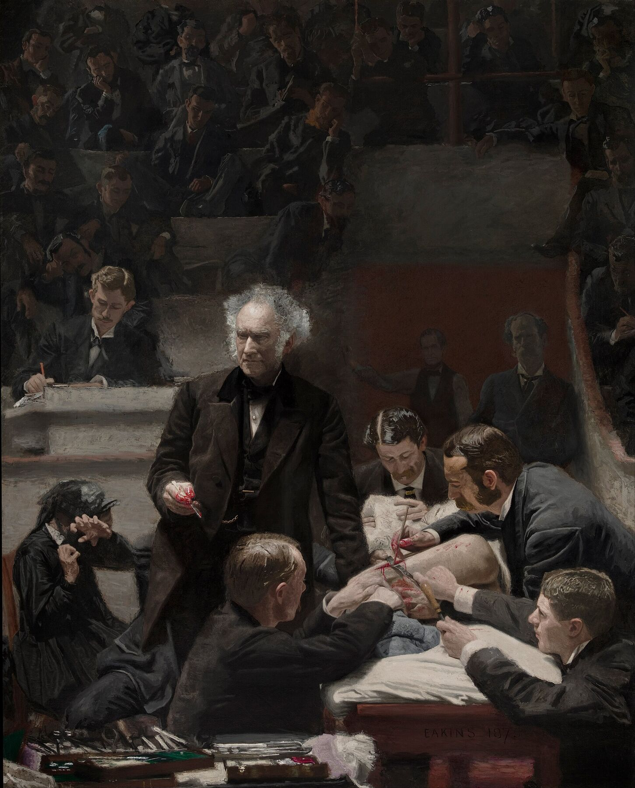
<figcaption markdown="span">
Thomas Eakins, <i>The Gross Clinic</i>, 1875
<em>A surgeon lectures mid-operation in Philadelphia. The surgeon is lit like a hero, the patient is a pair of legs, and the woman at left, probably a relative, cannot watch. (Philadelphia Museum of Art and Pennsylvania Academy of the Fine Arts. Public domain.)</em>
</figcaption>
</figure>
</section>

<!-- ========== SIGERIST ========== -->
<section markdown="1">
1930s–40s · society
{: .eyebrow}

## Medicine's history began to be written as part of society's history
{: .main-point}

---

"Every aspect of medicine's history is necessarily 'social,' whether acted out in laboratory, library, or at the bedside."

Rosenberg, "Framing Disease," p. xiv

One doctor-historian wrote about disease, health insurance and workers' illness, not only doctors.
{: .detail}
</section>

<!-- ========== FOUCAULT ========== -->
<section markdown="1">
1961 · madness
{: .eyebrow}

## The freeing of the mad came to be seen as a new kind of control
{: .main-point}

<figure>
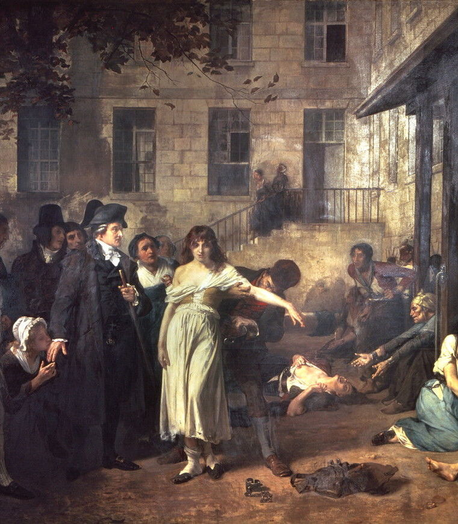
<figcaption>The hero version: Pinel unchaining patients, Paris, 1795, painted 1876 · public domain</figcaption>
</figure>

Critics came to see diagnoses "as tools of social control, as labels for deviance" Rosenberg, "Framing Disease," p. xvi
{: .quote.compact}

<i>Madness and Civilization</i> (1961) argued that the asylum replaced chains with constant watching.
{: .detail}

Deviance: behavior a society treats as abnormal.
{: .detail}

###### Discuss
{: .label}

**Was unchaining the mad an act of kindness or a quieter kind of control?**

</section>

<!-- ========== THE CHOLERA YEARS ========== -->
<section markdown="1">
Rosenberg · 1962 · cholera
{: .eyebrow}

## Rosenberg used cholera to understand American society
{: .main-point}

<figure>
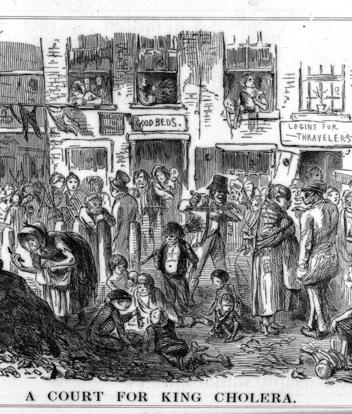
<figcaption><i>Punch</i> blames a London slum, 'A Court for King Cholera,' 1852 · Wellcome · CC BY 4.0</figcaption>
</figure>

Once cholera was known to spread "through the water supply, policy choices were reframed not only in practical engineering terms but in political and moral ones." Rosenberg, "Framing Disease," p. xx
{: .quote.compact}

<i>The Cholera Years</i> (1962) followed the epidemics of 1832, 1849 and 1866. Americans first read cholera as punishment for sin, later as a problem of filth and water.
{: .detail}

A disease showed what a society believed.
{: .detail}

</section>

<!-- ========== CROSBY AND MCNEILL ========== -->
<section markdown="1">
1970s · ecology
{: .eyebrow}

## Historians made smallpox part of the conquest of the Americas
{: .main-point}

<figure>
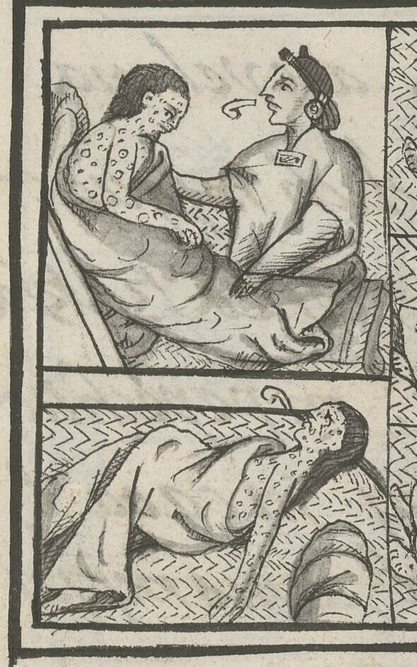
<figcaption>A Nahua healer tends smallpox sufferers, 1520, in the Florentine Codex, 1577 · public domain</figcaption>
</figure>

Historians took up "an ecological vision of history in which disease plays a key role, for example, in the Spanish conquest of Central and South America." Rosenberg, "Framing Disease," p. xv
{: .quote.compact}

<i>The Columbian Exchange</i> (1972) traced the plants, animals and germs that crossed the Atlantic after 1492. <i>Plagues and Peoples</i> (1976) went worldwide.
{: .detail}

</section>

<!-- ========== MCKEOWN ========== -->
<section markdown="1">
1976 · did medicine work?
{: .eyebrow}

## Historians asked whether doctors deserved credit for longer lives
{: .main-point}

<figure>
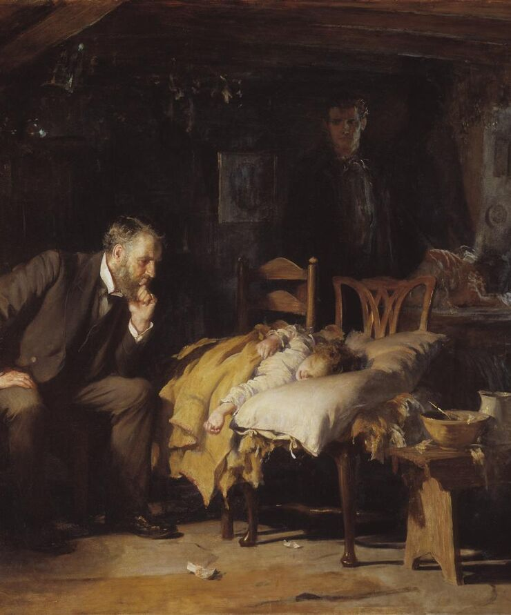
<figcaption>Luke Fildes, <i>The Doctor</i>, 1891: the physician can only watch · public domain</figcaption>
</figure>

"How much credit should go to specific medical interventions … and how much to changed economic and social circumstances?" Rosenberg, "Framing Disease," p. xv
{: .quote.compact}

<i>The Modern Rise of Population</i> (1976) argued that better food, more than medicine, cut tuberculosis deaths. The claim drew controversy (n. 7).
{: .detail}

The policy question follows: spend on cures, or on prevention (p. xv)?
{: .detail}

</section>

<!-- ========== SOCIAL CONSTRUCTION ========== -->
<section markdown="1">
1970s–80s · construction
{: .eyebrow}

## Historians argued that societies help decide what counts as a disease
{: .main-point}

---

Social construction "has forcefully reminded us that medical thought and practice are rarely free of cultural constraint, even in matters seemingly technical."

Rosenberg, "Framing Disease," p. xiv

###### Discuss
{: .label}

**Does saying a disease is framed by society make it any less real to the person who has it?**

</section>

<!-- ========== DISEASE AS SOCIAL DIAGNOSIS ========== -->
<section markdown="1">
1970s–80s · blame
{: .eyebrow}

## Ideas about disease have carried a society's views of race, gender and class
{: .main-point}

---

"It is difficult indeed to think of any significant area of social debate and tension—ideas of race, gender, class, and industrialization—in which hypothetical disease etiologies have not served to project and rationalize widely held values and attitudes."

Rosenberg, "Framing Disease," p. xxii

###### Theories of cause
{: .label}

An etiology is a theory of what causes a disease. Such theories often carried, and justified, blame. The debate "has hardly ceased," he wrote, citing AIDS (p. xxii).

</section>

<!-- ========== IMAGE: TUSKEGEE ========== -->
<section class="image-slide" data-background="#0d1412" markdown="1">
<figure class="landscape">
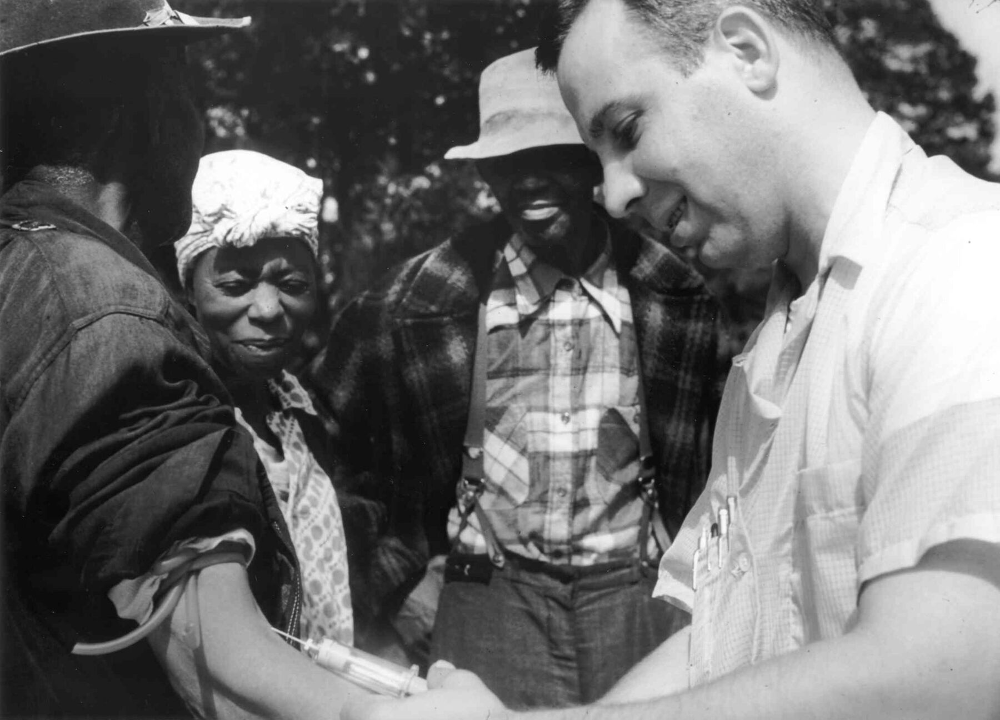
<figcaption markdown="span">
A doctor draws blood for the Tuskegee study of untreated syphilis, Alabama (undated)
<em>From 1932 to 1972 the U.S. Public Health Service left about four hundred Black men with syphilis untreated, even after penicillin. A 1981 book, <i>Bad Blood</i>, told it as a history of racism in medicine. (National Archives. Public domain.)</em>
</figcaption>
</figure>
</section>

<!-- ========== IMAGE: SALPÊTRIÈRE ========== -->
<section class="image-slide" data-background="#0d1412" markdown="1">
<figure class="landscape">
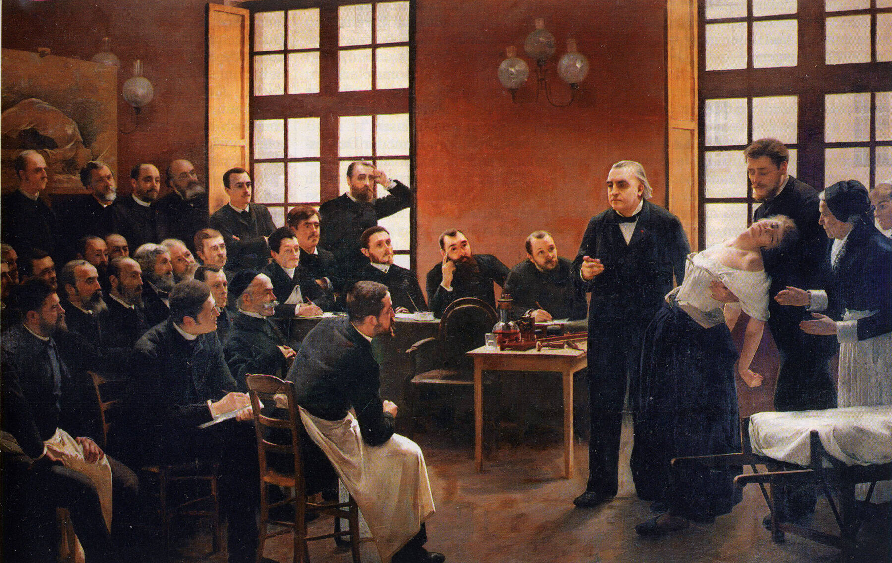
<figcaption markdown="span">
André Brouillet, <i>Une leçon clinique à la Salpêtrière</i> ("A Clinical Lesson at the Salpêtrière"), 1887
<em>A neurologist demonstrates hysteria on a patient before an audience of men. <i>The Female Malady</i> (1985) asked why madness was so often seen as a woman's illness. (Université Paris Cité. Public domain.)</em>
</figcaption>
</figure>
</section>

<!-- ========== PORTER ========== -->
<section markdown="1">
1985 · patients
{: .eyebrow}

## Historians called for medical history from the patient's side
{: .main-point}

<figure>
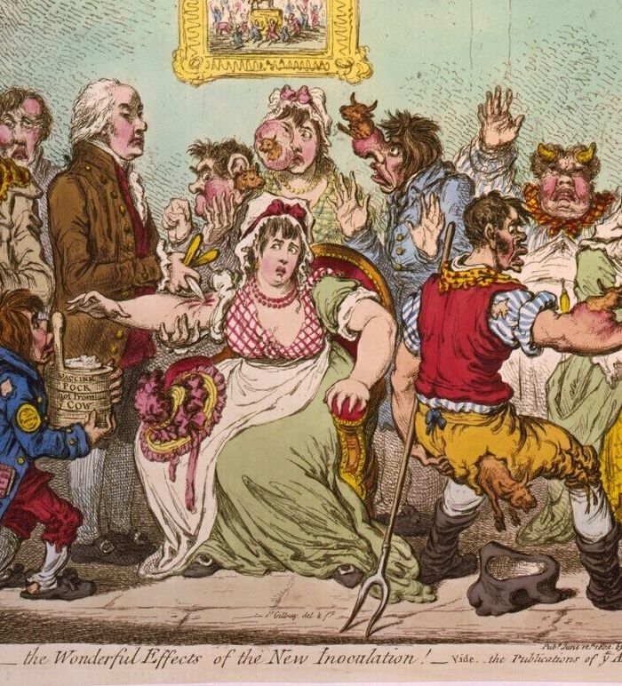
<figcaption>James Gillray, <i>The Cow-Pock</i>, 1802: vaccination as some patients feared it · public domain</figcaption>
</figure>

Rosenberg names, as one trend, "the emphasis among professional historians on social history and the experience of ordinary men and women." Rosenberg, "Framing Disease," p. xv
{: .quote.compact}

A 1985 essay asked for medical history from below, from the patient's view, as workers' history had been written from below.
{: .detail}

</section>

<!-- ========== ULRICH: A MIDWIFE'S TALE ========== -->
<section markdown="1">
1990 · childbirth
{: .eyebrow}

## A midwife's diary let a historian rebuild her medical practice
{: .main-point}

<figure>
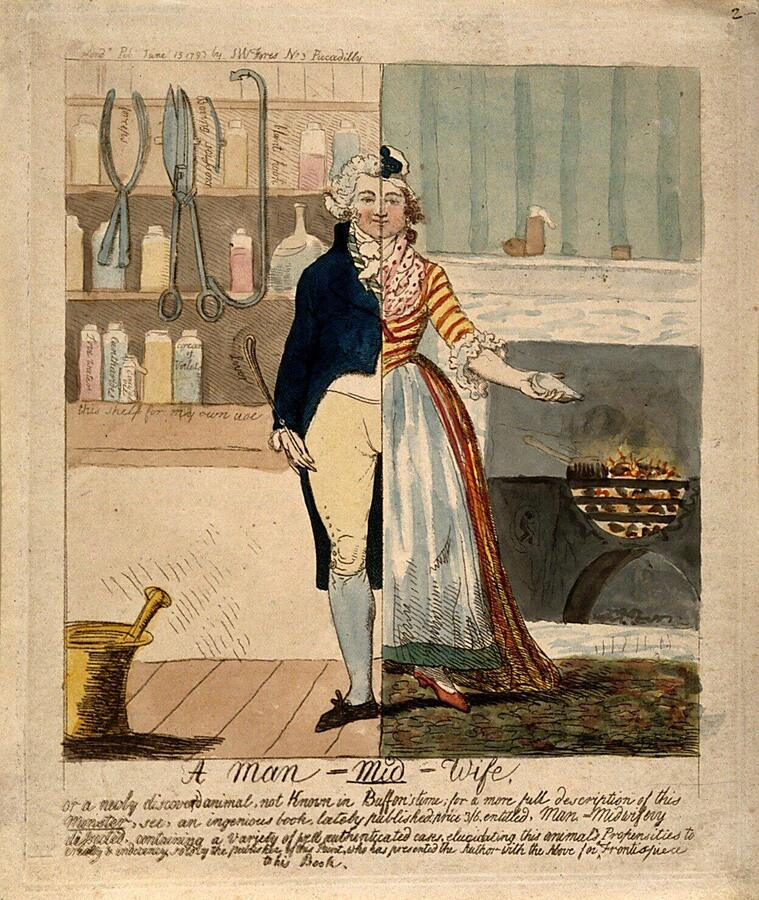
<figcaption>Cruikshank's <i>Man-Mid-Wife</i>, 1793, mocks men taking over childbirth · Wellcome · CC BY 4.0</figcaption>
</figure>

"Pregnancy and childbirth, for example, like epidemic disease have in recent years become an accepted part of the standard historical canon." Rosenberg, "Framing Disease," p. xv
{: .quote.compact}

<i>A Midwife's Tale</i> (1990) used a Maine midwife's diary of more than eight hundred births, 1785–1812.
{: .detail}

Women's healing, missing from doctors' histories, became evidence.
{: .detail}

</section>

<!-- ========== ROSENBERG: THE FIELD ========== -->
<section markdown="1">
Rosenberg · 1992 · the field
{: .eyebrow}

## Rosenberg mapped why historians turned to disease
{: .main-point}

---

#### Ordinary people

Social history: patients, childbirth, epidemics.

#### Public health

Did medicine or living conditions lengthen lives? Demographers counted.

#### Ecology

Disease in the conquest of the Americas.

#### Social control

Diagnoses as labels for deviance; the most influential.

###### What all of them missed
{: .label}

How a disease gets defined, and what the definition does to lives, policy and care (Rosenberg, pp. xv–xvi).

</section>

<!-- ========== ROSENBERG: DISEASE AS MANY THINGS ========== -->
<section markdown="1">
Rosenberg · 1992 · reframing disease
{: .eyebrow}

## Rosenberg treated disease as six things at once
{: .main-point}

---

#### A biological event

It happens in bodies, and in animals, whatever anyone calls it.

#### A vocabulary

A generation's "verbal constructs," shaped by medicine's ideas and institutions.

#### A reason for policy

An occasion for public policy, and a potential justification of it.

#### A part of who you are

An aspect of a person's social role and identity.

#### A sanction for values

A way a culture backs up what it values.

#### A relationship

A structuring element in how doctors and patients deal with each other.

Rosenberg, "Framing Disease," p. xiii
{: .cite}
</section>

<!-- ========== ROSENBERG: NAMING AND FRAMING ========== -->
<section markdown="1">
Rosenberg · 1992 · frame
{: .eyebrow}

## Rosenberg: a disease exists socially once it is named
{: .main-point}

---

"In some ways disease does not exist until we have agreed that it does, by perceiving, naming, and responding to it."

Rosenberg, "Framing Disease," p. xiii

###### Discuss
{: .label}

**Cholera killed before anyone agreed what it was. In what sense did the disease "not exist"?**

</section>

<!-- ========== ARNOLD ========== -->
<section markdown="1">
1993 · empire
{: .eyebrow}

## Historians showed colonial medicine entering Indian homes
{: .main-point}

<figure>
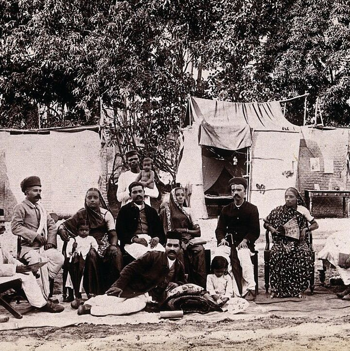
<figcaption>A well-off Bombay family forced into a plague camp, 1896–97 · Wellcome · CC BY 4.0</figcaption>
</figure>

Rosenberg noted "a recent growth of interest in 'imperial' medicine" Rosenberg, "Framing Disease," p. xxv n. 9
{: .quote.compact}

<i>Colonizing the Body</i> (1993) showed that against plague in 1896–97, officials searched homes and moved families into camps.
{: .detail}

It argues that Indian resistance made officials back down.
{: .detail}

</section>

<!-- ========== COMPARISON ========== -->
<section markdown="1">
Two fields · one course
{: .eyebrow}

## Both fields moved from triumph to the people, interests and politics behind knowledge
{: .main-point}

---

##### Science

Great men and the birth of the modern world. Then inside and outside causes and Kuhn's paradigms; then laboratory facts, political order and trust; then women, print that earned credit, objectivity's history and circulation.

##### Medicine

Doctors' histories of great men and germ hunters. Then society, the asylum and cholera; then disease in conquest, doubts about medicine's credit, patients, race, gender and empire, and disease as a frame.

###### Compare · the semester
{: .label}

The path of history itself: Ranke's nations, then history from below, gender and the linguistic turn.

</section>

<!-- ========== THE TAKE HOME ========== -->
<section data-transition="fade" markdown="1">
The take home
{: .eyebrow}

## The history of knowledge shows its makers, and we are among them
{: .main-point}

---

"What we select inevitably represents our interests, even if we aim all the while to 'tell it like it really was.' That is to say, there is inevitably something of 'us' in the stories we tell about the past."

Shapin, <i>The Scientific Revolution</i>, p. 10

Science and medicine have histories because people made them, trusted them and named things with them. What we take as settled now will have a history too.

</section>

<!-- ========== CLOSING ========== -->
<section markdown="1">
Next · 13.2 · environmental history
{: .eyebrow}

## Next time, nature itself helps make history
{: .main-point}

---

A century from now, what will historians say we got wrong about science or medicine, and how will they know?
{: .question .fragment data-fragment-index="1"}
</section>
